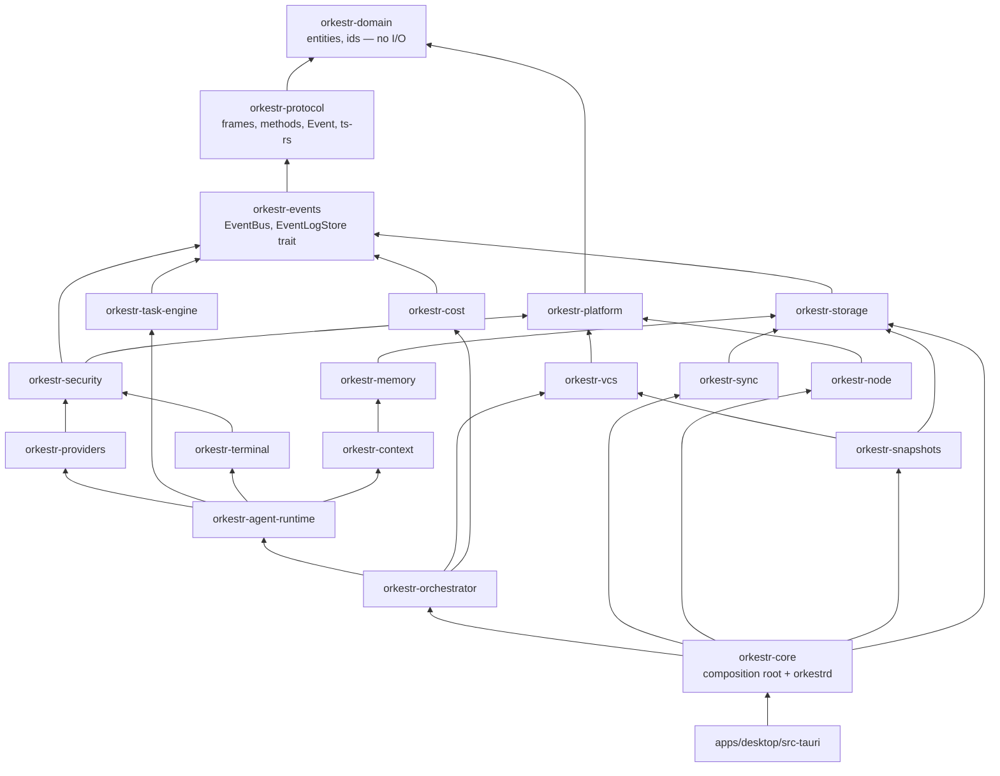

# ADR-0001: Monorepo layout with cargo + npm workspaces

- **Status:** Accepted
- **Date:** 2026-10-02
- **Phase:** 0 (applies to every phase)
- **Spec:** §3, §47, §59, §60, §65 deliverable #4, §67
- **Related:** ADR-0002, ADR-0005, ADR-0006

## Context

Orkestr ships a Rust core (§3: orchestrator, runtimes, engines), a Tauri desktop app (§2), a Web client (Phase 4) and React Native mobile apps (Phase 5). These share one wire protocol (§65 #19) and aim for 90–95% shared code (§47). Many contributors and agents work in parallel (contract §9), so crate boundaries must stop "god services" (§60.3, §64) and keep OS-specific code (§60.6) and provider-specific code (§60.5) in their own crates.

## Decision drivers

1. One atomic change can touch Rust types and their generated TS types (ADR-0006).
2. Boundaries are enforced by the compiler: crate dependencies make cycles impossible.
3. Web and mobile reuse the TS client and protocol packages without copying code.
4. Parallel builds: each crate can be tested on its own with `cargo test -p`.
5. Windows-first tooling: the layout must work without symlink tricks.

## Considered options

| Option | Verdict |
|---|---|
| **A. Single repo: cargo workspace (`crates/*`, `apps/desktop/src-tauri`) + npm workspaces (`apps/*`, `packages/*`)** | **Chosen** |
| B. Separate repos for core, desktop and protocol | Rejected. Cross-repo protocol changes would need version dances, and generated TS types would drift. |
| C. Nx / Turborepo / Bazel orchestration | Rejected for now. Extra tooling on Windows, and the cargo + npm scripts are enough at this size. Can be revisited in Phase 4 if CI time exceeds 15 min. |
| D. One big `orkestr-core` crate with modules | Rejected. Nothing stops cross-module coupling, compiles are slow, and it is the "giant orchestrator service" §64 forbids. |

## Decision

Use the layout fixed in contract §2. The dependency direction is checked in CI:



Rules (CI-enforced through `cargo metadata` checks in `scripts/check-deps`, Phase 1 M1.1):

1. No crate except `apps/desktop/src-tauri` depends on `orkestr-core`.
2. Engines (`task-engine`, `agent-runtime`, `orchestrator`, `memory`, `cost`, …) depend on **traits** (`MetadataStore`, `EventLogStore`, `GitProvider`, `SecretStore`, `PlatformAdapter`), never on concrete backends. `core` injects the implementations.
3. `#[cfg(target_os = …)]` appears only in `orkestr-platform` (and in `src-tauri` for window plumbing).
4. Provider names (`anthropic`, `claude_code`, …) appear only inside `orkestr-providers`. Everything else uses `ProviderId`.
5. TS packages: `@orkestr/protocol` (generated types plus `Methods` map) ← `@orkestr/client` ← `@orkestr/ui` ← `apps/*`. `@orkestr/client` has no React dependency, so mobile and web can reuse it.

Workspace manifests:

```toml
# /Cargo.toml
[workspace]
resolver = "2"
members = ["crates/*", "apps/desktop/src-tauri"]
[workspace.package]
edition = "2021"
rust-version = "1.80"
license = "UNLICENSED"
[workspace.dependencies]   # all shared versions pinned here
tokio = { version = "1", features = ["full"] }
serde = { version = "1", features = ["derive"] }
# …
```

```json
// /package.json
{ "private": true, "workspaces": ["apps/desktop", "packages/*"] }
```

## Consequences

- **Positive:** atomic cross-stack changes; compiler-enforced boundaries; `cargo test -p <crate>` lets agents work in parallel; Web and Mobile get `@orkestr/client` for free.
- **Negative:** about 20 crates means more `Cargo.toml` upkeep, and the first workspace build is slow. This is mitigated by `[workspace.dependencies]` and per-agent `CARGO_TARGET_DIR` (contract §9.3).
- **Negative:** `apps/desktop/src-tauri` is both a cargo member and inside an npm workspace. Tauri CLI commands must run from `apps/desktop`.
- **Follow-ups:** the `scripts/check-deps` boundary checker (M1.1). `apps/web` and `apps/mobile` are added to `workspaces` in Phases 4 and 5.

## Implementation notes (Phase 0 foundation, 2026-10-02)

Status and errata only; the decision above is unchanged.

- **Dependency direction (erratum needed):** the code has `orkestr-events → orkestr-storage` (the persisted log `SqliteEventLog` lives in `events` and uses `storage::Db`/`Migration`), and `orkestr-storage` depends only on `orkestr-domain`. The diagram above draws `storage → events`. Both satisfy rule 2 and avoid cycles, but they cannot both hold. Either the integrator accepts the as-built direction as an erratum to this ADR (recommended; `components.md` §1 and `monorepo.md` §3.1 already describe it) or a superseding ADR moves `SqliteEventLog` into `storage`.
- As built, the skeleton crates (`security`, `providers`, `task-engine`, `agent-runtime`, `orchestrator`, `context`, `memory`, `vcs`, `terminal`, `snapshots`, `cost`, `sync`) depend only on `orkestr-domain` (`security` and `node` also on `orkestr-platform`); `orkestr-core` depends on `domain`, `protocol`, `events`, `storage`, `platform`.
- Workspace manifests: `/package.json` uses `"workspaces": ["apps/*", "packages/*"]`; `/Cargo.toml` adds `default-members = ["crates/*"]` and `license = "MIT OR Apache-2.0"` (the sketch above says `UNLICENSED`).
- Rule 3: `#[cfg(unix)]` currently appears in `crates/core/src/bin/orkestrd.rs` (SIGTERM handling) — a violation to fix (see `monorepo.md` §3.1). No `#[cfg]` exists in `src-tauri`.
- Rule 5: `@orkestr/ui` depends on `@orkestr/protocol` only (not on `@orkestr/client`).
- `scripts/check-deps` does not exist yet (Phase 1 M1.1).
