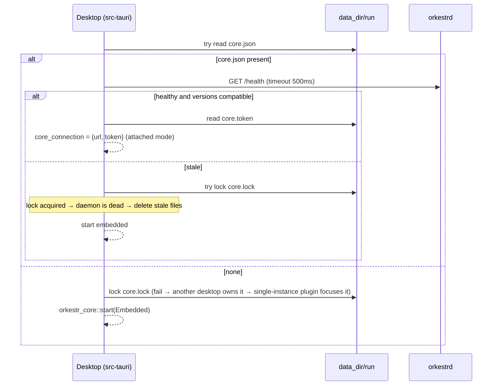

# ADR-0004: Embedded core by default + headless `orkestrd` daemon

- **Status:** Accepted
- **Date:** 2026-10-02
- **Phase:** 1 (embedded core plus a manual daemon), 2 (handoff to daemon), 3 (autostart and tray), 4 (headless node behind the gateway)
- **Spec:** §3, §12, §35, §38, §52, §61 (local service spike), §67
- **Review:** RR-C2, RR-A10, RR-G17
- **Spike:** SP-13 · **Risk:** R-13

## Context

§12 requires agents to keep working when the GUI is minimised or closed, when the user switches project, or when the user works from Web or Mobile. It also requires the core to run as a background/headless service with optional autostart. §61 Phase 1, however, is a desktop MVP, and running two processes (UI plus service) from day one adds install, IPC, update and crash coordination costs. Contract §3 already chooses: embedded by default, plus an `orkestrd` binary.

## Decision drivers

1. Phase 1 should be one process to install, debug and update.
2. There must be **no second code path**: the UI talks to the core over the same WebSocket RPC whether the core is embedded or in the daemon (ADR-0005), so the daemon is a deployment choice, not a fork.
3. Agents survive the GUI closing (§12) without losing work (§70 #2).
4. The core never listens on a non-loopback interface (§35, contract §6).
5. Exactly one core owns a data dir at a time (SQLite and worktree consistency).

## Considered options

| Option | Verdict |
|---|---|
| **A. Library core, embedded in Tauri; the same library runs as the `orkestrd` bin; discovery through `core.json`** | **Chosen** |
| B. Always a separate daemon (Docker-desktop style) | Rejected for Phase 1. Two installers/services, Windows Service ACL complexity, harder debugging. It remains reachable via A |
| C. Embedded only; GUI close = stop | Rejected. Violates §12 |
| D. Windows Service (SCM) for the daemon | Deferred. A per-user login item is enough for §12. An SCM service runs as SYSTEM and cannot reach the user's keyring, CLI logins or Git credentials. Revisit in Phase 6 for unattended nodes |

## Decision

### API (`orkestr-core`)

```rust
pub struct CoreConfig {
    pub data_dir: Option<PathBuf>,        // None → platform::paths::data_dir() (honours ORKESTR_HOME)
    pub bind: SocketAddr,                 // must be loopback; default 127.0.0.1:0 (ephemeral)
    pub mode: CoreMode,                   // Embedded | Daemon
    pub log: LogConfig,                   // { json: bool, level: String }
    pub node_name: Option<String>,
}
pub enum CoreMode { Embedded, Daemon }

pub struct CoreConnection { pub url: String, pub token: String } // token = 256-bit random, base64url

pub async fn start(cfg: CoreConfig) -> Result<CoreHandle, CoreError>;

impl CoreHandle {
    pub fn connection(&self) -> CoreConnection;
    pub fn node_id(&self) -> NodeId;
    /// Graceful: stop accepting, cancel agents (tasks → Interrupted), flush WAL, remove run files.
    pub async fn shutdown(self, reason: ShutdownReason) -> Result<(), CoreError>;
}
```

`start` refuses a non-loopback `bind` with `CoreError::Config`. Phase 4 binds the gateway connector, not the RPC socket (§35).

### Run files (directly in `<data_dir>/`, as contract §3 specifies)

| File | Content | Permissions |
|---|---|---|
| `core.lock` | Exclusive OS file lock (`fd-lock`), held for the whole lifetime of the owning process | — |
| `core.json` | `{"url":"ws://127.0.0.1:53211/rpc","token_file_hint":"core.token","pid":1234,"version":"0.1.0","mode":"daemon","started_at":"2026-10-02T10:00:00Z"}` | user-only |
| `core.token` | The bearer token | user-only (0600 / owner-only DACL through `platform::fs::restrict_to_user`) |

In embedded mode, `core.json` and `core.token` are written **only** when the user turns on "Allow other local clients" (Phase 2). Otherwise the token stays in memory and reaches the webview only through `core_connection`.

### Desktop startup sequence



### Lifecycle by phase

- **Phase 1:**
  - Window close while any task is `Running`/`Waiting` shows a dialog: **Keep running in tray** (default), **Stop all agents**, or **Cancel**.
  - Tray mode keeps the embedded core alive. Quitting from the tray calls `shutdown(UserQuit)`, which moves tasks to `Interrupted` (ADR-0022).
  - `orkestrd` can be run by hand (`orkestrd --data-dir … --log-json`). The desktop attaches to it if it is found.
- **Phase 2:** "Hand off to background service":
  1. The desktop spawns `orkestrd` detached through `PlatformAdapter::process().spawn_detached`.
  2. It waits for `core.json` to appear.
  3. It shuts down the embedded core gracefully, so tasks become `Interrupted`.
  4. The daemon starts with recovery and the tasks become `Recovering`, then `Running` (§57 handoff).
  5. The desktop reconnects to the daemon.
  The handoff gap is under 5 s.
- **Phase 3:** `PlatformAdapter::autostart().set_enabled(true)` registers `orkestrd --background` (HKCU Run key / LaunchAgent plist / XDG autostart `.desktop`). Opt-in only (§12 "при разрешении").
- **Phase 4:** `orkestrd` runs as a headless AI Node with an outbound gateway connection (§35). The RPC socket stays loopback.

### Concurrency invariant

Exactly one process holds `core.lock` per data dir. Tests use `ORKESTR_HOME=<tempdir>` (contract §1).

## Consequences

- **Positive:** Phase 1 has one process. The daemon is the same code, so §12 can be delivered step by step without forking the code path. Web and Mobile (Phase 4/5) talk to the same RPC.
- **Negative:** in embedded mode, a desktop crash kills the running agents. Mitigated by ADR-0022 (they recover as `Interrupted`) and by snapshots taken before risky actions (ADR-0021).
- **Negative:** handing off to the daemon in Phase 2 interrupts in-flight provider calls. They resume with a handoff, not mid-stream. This is acceptable and documented in the UI.
- **Security:** the token file is the only credential for the local RPC. Any process running as the same OS user can read it. This is the same trust boundary as the user's git and CLI credentials and is documented in the threat model.

## Implementation notes (Phase 0 foundation, 2026-10-02)

Status and errata only; the decision above is unchanged. Verified by `../spikes/foundation-tauri-websocket.md` (embedded start, discovery of a running `orkestrd`, stale-file handling).

- **API as built:** `CoreConfig { data_dir, bind_addr, token: Option<String>, write_discovery: bool, event_capacity }` (no `mode`, `log`, `node_name`); `start(CoreConfig) -> Result<CoreHandle, CoreError>`; `CoreHandle { url, http_url, token, addr, data_dir, services, .. }` with `shutdown_token()` and `async fn shutdown(self)` (no `ShutdownReason`, no `connection()`/`node_id()` methods — the fields are public). The token is 64 hex chars (not base64url).
- **Run files as built:** `core.json` = `{url, token_file_hint, pid, version, started_at}` with `token_file_hint` the **absolute** path of `core.token` (clients only accept the canonical token file of their data dir); no `mode` field. `core.token` and `core.json` are written with `platform::fs::write_private_file` (Unix `0600`, Windows inherits the profile ACL). There is **no `core.lock`** OS lock: a second core on the same data dir is refused by discovery (`CoreError::AlreadyRunning`) and by the `session.lock` crash marker (ADR-0022 notes).
- **Embedded mode writes `core.json`/`core.token` too** (`write_discovery` defaults to `true`), so another client can attach; the "only when the user allows other local clients" rule is not implemented.
- **Desktop startup as built:** `find_running` (pid alive + token file readable + `GET /health` 200 within 1.5 s) → attach (`mode: "external"`), else `orkestr_core::start(CoreConfig::default())` (`mode: "embedded"`). No single-instance plugin; on `RunEvent::Exit` the embedded core is shut down. The window-close dialog, tray mode and Phase 2/3 steps are not implemented.
- `orkestrd [--data-dir <path>] [--port <port>] [--log-json]` exists; `--background`, `migrate` and `unlock` subcommands do not.

## Implementation notes (Phase 1 platform-shell)

- Tray mode, close-to-tray and opt-in autostart are implemented (see ADR-0003 notes); autostart moved forward from Phase 3. `CoreConfig.autostart: AutostartConfig { id, program, args, backend }` decides what is registered: the desktop registers itself (`dev.orkestr.desktop`, `--autostart`), `orkestrd` registers `orkestrd --background [--data-dir …]` (`dev.orkestr.orkestrd`).
- `orkestrd` handles Ctrl-C, SIGTERM/SIGHUP (Unix) and console close / logoff / system shutdown (Windows) via `orkestr_platform::signals::shutdown_signal()`; the binary no longer contains `#[cfg]` code. New flag `--background` (no console banner).
- Clean shutdown also records the event `seq` high-water mark (`event-model.md` §4.3).
