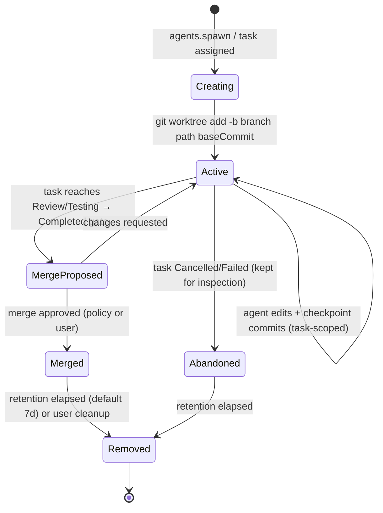

# ADR-0009: A branch + worktree per parallel agent

- **Status:** Accepted
- **Date:** 2026-10-02
- **Phase:** 1 (manual and basic spawn), 2 (parallel execution plus Merge Manager)
- **Spec:** §1.7, §1.12, §11 ("Git conflicts" as a scheduling resource), §16, §23 (sandbox: worktree), §40, §62.5, §63A, §63J, §65 #13
- **Review:** RR-C5, RR-C6, RR-G15
- **Spike:** SP-10 · **Risks:** R-05, R-15

## Context

§16 says that by default every parallel agent gets its own branch and worktree, and that a Merge Manager integrates the results. Agents must not trample each other's files or the user's working copy. The user may keep editing their own checkout at the same time.

## Decision drivers

1. Isolation: agents never write into the user's checkout or each other's (§23 sandbox).
2. Cheap creation: worktrees share the object database.
3. Merges can be reviewed and rolled back (§16, §25).
4. Windows path length and Defender interference (RR-G15).
5. Concurrency safety on the shared `.git` (R-05).

## Considered options

| Option | Verdict |
|---|---|
| **`git worktree` per agent instance, outside the repo dir, on an `agent/*` branch** | **Chosen** |
| Full clone per agent | Rejected. Disk and time cost, and remotes/credentials would be duplicated |
| All agents in the user's checkout | Rejected. Agents collide, and parallel work cannot be reviewed |
| Copy-on-write overlays / containers | Deferred. Not portable on Windows. Containers stay optional (§23 "where practical", Phase 2+ for Docker-capable tasks) |
| Worktrees inside `<repo>/.orkestr/wt` | Rejected. File watchers, IDE indexers and build tools (cargo, tsc) of the parent repo would pick them up, and paths get longer |

## Decision

### Policy (`AgentTemplate.worktreePolicy`)

```rust
#[derive(Serialize, Deserialize, TS)] #[serde(rename_all = "camelCase")]
pub enum WorktreePolicy {
    /// default for code-writing agents in parallel
    Dedicated,
    /// read-only agents (Reviewer, Researcher, Architect analysis): read the task's worktree, cannot write
    ReadOnlyShared,
    /// explicit user choice for single-agent work: operate on the user's checkout (still path-confined, snapshot first)
    UserCheckout,
}
```

### Naming and location

- **Branch:** `{prefix}{roleSlug}-{agentShort}` (prefix default `agent/`, configurable per project). Example: `agent/backend-3f9a1c2e`. Integration, merge and recovery branches use the `orkestr/` namespace, as listed in `../architecture/git-worktree-strategy.md` §2.
  - The short id is the **last 8 hex digits** of the UUID v7. These are the random bits; the leading digits are the timestamp and collide. On a collision, append `-2`, `-3` and so on.
  - Branch names are validated with `git check-ref-format --branch`.
  - A D/F conflict is detected with `for-each-ref refs/heads/agent` (RR-C6).
- **Path:** `<data_dir>/worktrees/<projectShort>/<agentShort>`, which keeps paths short on Windows. The full layout, including integration and trial-merge worktrees, is in `../architecture/git-worktree-strategy.md` §3. Each worktree gets `git config --worktree core.longpaths true` (Windows only, through `platform`). `extensions.worktreeConfig` is enabled once per repo, with the user's consent at project import.
- **Base:** `Task.baseRef`, default the project's current branch HEAD at spawn time, recorded as `Worktree.baseCommit`.

### Lifecycle



- Persistent table `worktrees(id, project_id, agent_id, task_id, branch, path, base_commit, state, created_at, removed_at)`.
- **Startup reconciliation:**
  1. `git worktree list --porcelain -z` is compared with the table.
  2. Unknown directories under `worktrees/` are reported, never auto-deleted (§60.8, "no silent destructive actions").
  3. Missing directories are marked removed, then `worktree prune` runs.
- Removing a worktree with uncommitted changes needs a snapshot first (ADR-0021) and, if forced, approval.

### Concurrency (R-05)

- **Shared-git mutations** (worktree add/remove/prune, branch create/delete, merges into the base, fetch) are serialised per repo by `RepoLock` (ADR-0008).
- **Writes into the user's checkout:** the Merge Manager merges into the user's branch only when the user's worktree is clean for the affected paths. Otherwise the merge is staged on a `orkestr/merge/<taskShort>` branch and the user is asked.
- **Scheduler input (§11):**
  - Before running tasks in parallel, the orchestrator estimates `filesLikelyTouched` (from the plan or context optimizer).
  - Overlapping sets lead to sequencing, or to a shared integration branch for a team (Phase 2).
  - After each checkpoint, `merge_preview` against the base and against sibling agent branches detects conflicts early and emits a `MergeProposed`/conflict warning (CA-6 kinds).

### Merge Manager outline (Phase 2)

Merge proposal = `{taskId, branch, baseCommit, preview: MergePreview, diffStat, gates: {build, lint, tests, review, securityFindings}, acceptanceCriteria: [{text, met, evidence}], strategy: "squash" | "merge" | "rebase"}`. An automatic merge happens only if `project.mergePolicy.auto == true` **and** every gate is green **and** there are no conflicts. Otherwise it waits in `approvals`.

## Consequences

- **Positive:** real isolation, cheap, reviewable, consistent with the snapshot model; the conflict prediction from `merge-tree` is a scheduling signal.
- **Negative:** each worktree needs its own dependency install (`node_modules`, `target/`). Mitigation (Phase 2): per-project shared caches (`CARGO_TARGET_DIR` per agent under `<data_dir>/cache`, npm cache shared). Disk usage is shown in the Agents panel.
- **Negative:** Defender real-time scanning slows checkout on Windows (SP-10 measures it). The optional exclusion is documented and never applied automatically.
- **Negative:** submodules need `git submodule update --init` per worktree. Supported but slower, and flagged in the project settings.

## Implementation notes (Phase 0 foundation, 2026-10-02)

Not implemented yet. The domain enum is `WorktreePolicy { DedicatedWorktree (default), SharedWorktree, ReadOnlyMain, None }` and `WorkspaceKind { Main, Worktree{branch, agentId} }`; `orkestr-vcs` has only the skeleton `Git::add_worktree`/`remove_worktree`. SP-10 has not run.
