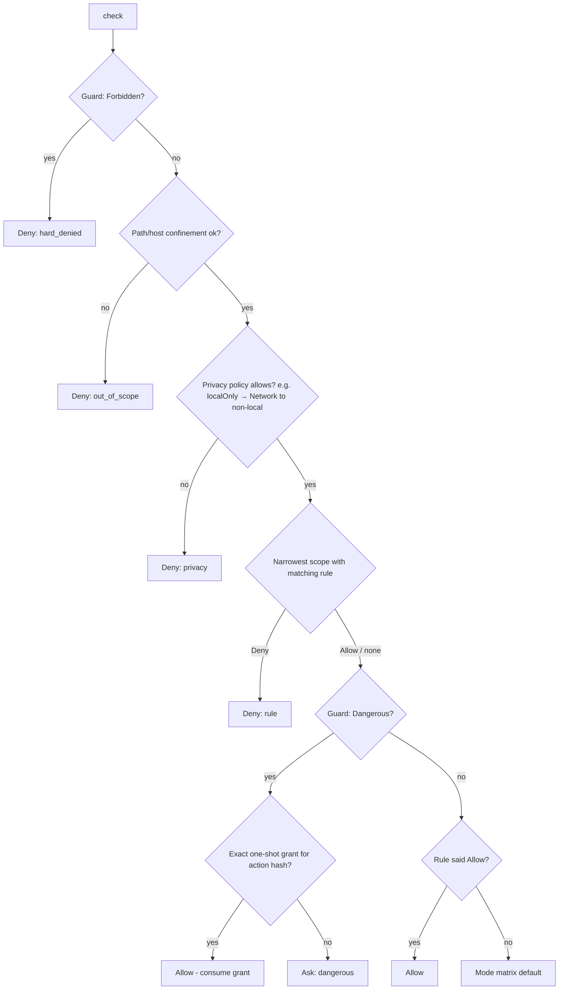
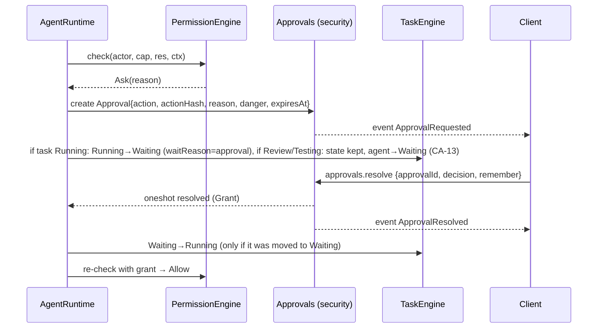

# ADR-0010: Capability-based Permission Engine + Dangerous Action Guard

- **Status:** Accepted
- **Date:** 2026-10-02
- **Phase:** 1 (complete for local tools), 2 (MCP/Browser/Docker/DB resources), 4 (remote session scopes)
- **Spec:** §18, §23, §52, §56, §60.8, §64, §67 ("agent cannot see another project's secrets"), §70
- **Review:** RR-C3, RR-A1, RR-A2, RR-G3, CA-4
- **Spike:** SP-17 · **Risk:** R-11

## Context

An agent is an untrusted autonomous actor (§23). The contract (§6) requires every agent tool call to go through `PermissionEngine::check(actor, capability, resource, context) -> Decision{Allow|Ask|Deny}`. Dangerous actions must always ask, even in FullAuto, and a hard-deny list always denies. §70 puts data safety first.

## Decision drivers

1. One choke point for every tool call (file, terminal, git, network, secrets …) that is easy to audit.
2. The engine is deterministic and pure: no I/O inside `check`, so it is exhaustively unit-testable (§60.9).
3. Scoped rules (Global ⊃ Project ⊃ Agent ⊃ Task) with predictable precedence (RR-A2).
4. Guard classification across bash, PowerShell and cmd, resistant to trivial obfuscation.
5. The Ask flow suspends the task without blocking threads (RR-G3).

## Considered options

| Option | Verdict |
|---|---|
| **Rust rule engine with typed resources plus a heuristic guard (tokenizer per shell)** | **Chosen** |
| OPA / Rego or Cedar policies | Rejected for the MVP. An extra runtime or language, and users cannot edit Rego. Cedar could be a later backend behind the same trait |
| OS sandbox only (AppContainer, seccomp, sandbox-exec) | Not sufficient alone. It is not portable and does not understand semantics such as "prod deploy". It is an additional layer per platform where practical (Phase 2+) |
| Allowlist-only commands | Rejected. Too restrictive for real development work. Used only for SemiAuto's "safe command" set |

## Decision

### Types (`orkestr-security`)

```rust
#[derive(Clone, Copy, Debug, PartialEq, Eq, Hash, Serialize, Deserialize, TS)]
pub enum Capability { Read, Write, Delete, Terminal, Git, Network, Browser, DbRead, DbWrite, Docker, Ssh, Deploy, ComputerControl, Secrets }

#[derive(Clone, Copy, Debug, Serialize, Deserialize, TS)]
pub enum ApprovalMode { Ask, SemiAuto, FullAuto }

pub enum Actor {
    User { device_id: DeviceId },              // local user: trusted, not checked for local UI ops; remote device sessions are scoped (Phase 4)
    Manager { agent_id: AgentId },
    Agent { agent_id: AgentId, template_id: AgentTemplateId },
    Plugin { plugin_id: PluginId },            // Phase 7
    System,                                    // internal maintenance (GC, recovery) — never from RPC
}

pub enum Resource {
    Path { path: PathBuf, op: FsOp },                          // FsOp: Read | Write | Delete | List
    Command { shell: ShellKind, line: String, cwd: PathBuf },  // ShellKind: Bash | Zsh | Fish | Sh | PowerShell | Pwsh | Cmd | GitBash | Wsl
    Git { op: GitOp, repo: PathBuf, args: Vec<String> },       // GitOp: Status | Diff | Commit | Branch | Merge | Push { force: bool } | Reset { hard: bool } | Clean | Fetch | Checkout
    Url { url: url::Url, method: String },
    Secret { reference: SecretReferenceId },
    Database { environment: EnvironmentId, statement: Option<String> },
    Deploy { environment: EnvironmentId, target: String },
    Container { op: String },
    Host { host: String },                                     // Ssh
    Screen,                                                    // ComputerControl
    Tool { server: String, tool: String },                     // MCP (CA-4)
}

pub struct CheckContext<'a> {
    pub project_id: Option<ProjectId>,
    pub agent_id: Option<AgentId>,
    pub task_id: Option<TaskId>,
    pub mode: ApprovalMode,                 // effective: task > agent > project > global setting
    pub confinement_root: Option<&'a Path>, // agent worktree or project root (canonicalized)
    pub environment_kind: Option<EnvironmentKind>, // Local | Dev | Test | Staging | Production | Custom
    pub privacy: Option<&'a PrivacyPolicy>,
    pub grants: &'a [Grant],                // one-shot / remembered approvals matching this action hash
}

pub enum Decision { Allow, Ask(Reason), Deny(Reason) }
pub struct Reason { pub code: ReasonCode, pub message: String, pub danger: Option<Vec<DangerTag>> }

pub trait PermissionEngine: Send + Sync + 'static {
    /// Pure, synchronous, no I/O except reading the in-memory rule snapshot.
    fn check(&self, actor: &Actor, cap: Capability, res: &Resource, ctx: &CheckContext<'_>) -> Decision;
    fn rules_version(&self) -> u64;
}
```

Path canonicalization and symlink resolution happen **before** `check` in `security::fs::confine(root, requested) -> Result<ConfinedPath, PathViolation>`. That function does I/O and is unit-tested with temp dirs. It rejects:
- `..` escapes;
- absolute paths outside the root;
- UNC paths (`\\server\share`) and `\\?\` / `\\.\` device paths;
- alternate data streams (`file.txt:stream`);
- reserved device names (`CON`, `NUL`, `COM1` …);
- symlinks or junctions whose target is outside the root.

### Evaluation order



- **Rule precedence (RR-A2):** rules at Task, then Agent, then Project, then Global scope. The first scope that has any matching rule decides. Inside a scope, Deny beats Ask, and Ask beats Allow. A rule can never turn Dangerous into Allow. Only a one-shot grant can, and a one-shot grant comes only from a user approval of that exact action hash (`blake3(actor, cap, canonical resource)`).
- **Rule JSON** (stored in `permission_rules` and versioned for rollback, RR-A4):
  ```json
  {"id":"…","scope":{"kind":"project","projectId":"…"},"capability":"Network","effect":"allow",
   "match":{"hosts":["registry.npmjs.org","crates.io"]},"createdBy":"user","expiresAt":null}
  ```
  The `match` keys depend on the capability: `paths` (glob, relative to the confinement root), `commands` (program names or glob patterns on the normalized first token), `hosts`, `gitOps`, `environments`, `tools`.

### Mode matrix (defaults when no rule matches; RR-A1)

| Capability | Ask | SemiAuto | FullAuto |
|---|---|---|---|
| Read (in root) | Allow | Allow | Allow |
| Write (in worktree) | Ask | Allow | Allow |
| Write (user checkout, `UserCheckout` policy) | Ask | Ask | Allow |
| Delete | Ask | Ask | Allow |
| Terminal: Safe class | Ask | Allow | Allow |
| Terminal: Unknown class | Ask | Ask | Allow |
| Git (local: status/diff/commit on agent branch/branch create) | Ask | Allow | Allow |
| Git (push, fetch, merge to user branch) | Ask | Ask | Ask (merge only via Merge Manager policy) |
| Network | Ask | Ask | Allow |
| Browser | Ask | Ask | Allow |
| DbRead (non-prod) | Ask | Allow | Allow |
| DbWrite (non-prod) | Ask | Ask | Allow |
| Docker | Ask | Ask | Allow |
| Ssh | Ask | Ask | Ask |
| Deploy (non-prod) | Ask | Ask | Ask |
| Secrets | Ask | Ask | Ask |
| ComputerControl | Deny | Deny | Deny (explicit rule needed, §18) |
| Anything in Production environment | Ask (dangerous) | Ask (dangerous) | Ask (dangerous) |

*Disable Full Auto* (§52) is a global switch that clamps the effective mode to SemiAuto.

### Dangerous Action Guard

```rust
pub enum Danger { Safe, Unknown, Dangerous(Vec<DangerTag>), Forbidden(DangerTag) }
pub enum DangerTag { RecursiveDelete, MassDelete, DbDestructive, ProdWrite, ProdDeploy, SecretChange, GitForcePush,
                     GitHardReset, GitClean, GitHistoryRewrite, PrivilegeEscalation, NetworkConfig, FirewallChange,
                     DiskFormat, BootConfig, RegistryEdit, ServiceControl, UserAccountChange, ShadowCopyDelete,
                     RemoteScriptExec, ObfuscatedCommand, ProcessKillBroad, PermissionsBroad, PackagePublish }

pub fn classify_command(shell: ShellKind, line: &str, env: &GuardEnv) -> Danger;
pub fn classify_git(op: &GitOp, args: &[String]) -> Danger;
pub fn classify_sql(stmt: &str) -> Danger;   // DROP/TRUNCATE/DELETE without WHERE/ALTER … DROP → Dangerous; in prod → Dangerous+ProdWrite
```

- **Tokenization:**
  - Per-shell lexer (POSIX quoting, PowerShell quoting/backtick escapes, cmd `^` escapes).
  - The line is split on `;`, `&&`, `||`, `|`, `&` and newlines. Every segment is classified, and the result is the **max** severity.
  - Command substitution (`$(…)`, backticks, PowerShell `$(…)`, `Invoke-Expression`/`iex`, `cmd /c` with a nested string, `bash -c`, `sh -c`, `pwsh -Command`) is classified **recursively** where the content is literal. Dynamic content gives `Dangerous(ObfuscatedCommand)`.
  - `-EncodedCommand`/`-enc`, base64 pipes to a shell, and `curl … | sh`/`iwr … | iex` give `Dangerous(RemoteScriptExec | ObfuscatedCommand)`.
  - Aliases are normalized: `rm`/`del`/`erase`/`rd`/`rmdir`/`Remove-Item`/`ri`/`rni`, plus case-insensitivity on Windows.
- **Forbidden (Deny always), examples:** `format <drive>:`, `diskpart`, `mkfs.*`, `dd … of=/dev/(sd|nvme|disk)…`, `rm -rf /` or `~` or `$HOME` or `/*`, `Remove-Item -Recurse` on a drive root or user profile root, `del /s /q <drive>:\`, `rd /s /q <drive>:\`, `bcdedit`, `vssadmin delete shadows`, `wmic shadowcopy delete`, `cipher /w`, the fork bomb `:(){ :|:& };:`, `reg delete HKLM…`, `chmod -R 777 /`, `chown -R … /`, `sudo rm -rf …` (any root-level target).
- **Dangerous (Ask always), examples:**
  - recursive delete anywhere (`rm -r`, `rm -rf node_modules` included: it is cheap to approve and can be remembered per task **only** for exact paths inside the worktree, see below);
  - `git push --force`/`-f`/`--force-with-lease`, `git reset --hard`, `git clean -f[dx]`, `git filter-branch`/`filter-repo`, `git rebase` on shared branches;
  - SQL destructive statements; `npm publish`/`cargo publish`;
  - `sudo`/`runas`/`Start-Process -Verb RunAs`;
  - `netsh`, `New-NetFirewallRule`, `iptables`, `ufw`;
  - `reg add`/`Set-ItemProperty HKLM:`;
  - `sc config|delete`, `systemctl disable|mask`;
  - `kill -9 -1`, `taskkill /f /im *`;
  - `setx` on PATH;
  - any command referencing a Production environment's URL or host.
- **Narrow relaxation:** recursive delete of a path that is confined inside the agent's worktree **and** matches the project's `disposablePaths` globs (default `node_modules`, `target`, `dist`, `build`, `.next`, `__pycache__`) is classified `Safe`. This is the only relaxation, and §70 accepts it because worktrees are snapshot-backed.
- **Tests:** at least 150 table-driven cases (bash, PowerShell, cmd, git, SQL), including quoting tricks (`r''m -rf /`, `"rm" -rf /`, `\rm`), env expansion (`rm -rf $HOME`), aliases (`ri -r -fo C:\`), chained segments (`echo ok && git push -f`) and false positives that must stay Safe (`echo "rm -rf /"`, `grep -r drop`).

### Approval flow (RR-G3)



- `remember`: `once` (default) | `task` | `agent` | `project`. A non-`once` choice creates a rule at that scope (only for non-dangerous actions; for dangerous actions the value is ignored and treated as `once`).
- Expiry (default 24 h) emits `ApprovalExpired` (CA-6) and is treated as Deny. The task goes back to `Running` with a tool error result, so the agent can adapt.
- Every decision of `Ask` or `Deny`, every resolution and every consumed grant writes an `audit_events` row: `{actor, capability, resourceSummary (redacted), decision, reason, approvalId?, correlationId}`.

## Consequences

- **Positive:** a single auditable choke point; pure and testable; predictable precedence; dangerous actions can never run silently.
- **Negative:** heuristic shell parsing cannot be complete. This is acknowledged. Defence in depth: worktree confinement, snapshot before autonomous runs (ADR-0021), `Unknown` class asks in SemiAuto, and an optional OS-level sandbox (Phase 2+: Windows Job Objects with restricted tokens, macOS `sandbox-exec` profiles, Linux bubblewrap where available, all through `PlatformAdapter`).
- **Negative:** Ask fatigue in Ask mode. Mitigated by "remember for task/agent/project" for non-dangerous actions and by batching approvals in the Approvals panel.
- **Constraint:** CLI coding agents gate through their own hooks (ADR-0012). Where that is impossible, the engine is consulted at launch time.

## Implementation notes (Phase 0 foundation, 2026-10-02)

Not implemented yet; `orkestr-security` is a skeleton. Its as-built surface differs from the signatures above and must converge in Phase 1: `PermissionEngine::check(&self, actor: &Actor, capability: Capability, resource: &str, ctx: &ActionContext) -> Decision` (resource is a string, context is `ActionContext { project_id, agent_id, task_id, approval_mode, protected_environment }`), `Decision { Allow, Ask(String), Deny(String) }`, `DangerClass { Safe, Dangerous(String), Forbidden(String) }`, `ShellDialect { PowerShell, Cmd, Posix }`, traits `DangerousActionGuard`, `PathGuard`, `SecretStore`, `Redactor`. The built `orkestr_domain::Actor` is `User(UserId) | Agent(AgentId) | Manager | System`; `PermissionScope` is `#[serde(tag = "scope")] Global | Project{projectId} | Agent{agentId} | Task{taskId}` with `specificity()`; `PermissionRule { capability, effect, resource: Option<String>, scope }`. SP-17 has not run.
