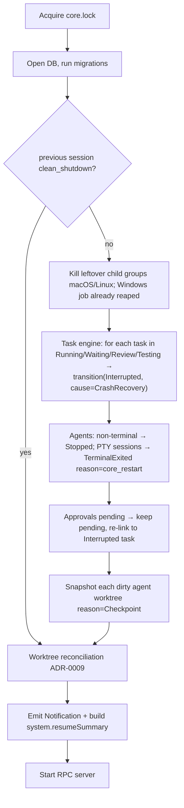

# ADR-0022: Crash recovery, interruption semantics and child-process containment

- **Status:** Accepted
- **Date:** 2026-10-02
- **Phase:** 1 (detection, `Interrupted` marking, process containment, resume summary), 2 (automatic `Recovering` from a handoff)
- **Spec:** §10 (Interrupted, Recovering), §12, §52 (emergency controls), §57 (session resume, handoff), §62.13, §67 ("workspace restored after crash"), §70 #2
- **Review:** RR-C7, RR-G9, CA-2, CA-10
- **Spike:** SP-13 · **Risk:** R-13

## Context

The core can die at any moment: an app crash, a killed process, a power loss, or a desktop-to-daemon handoff (ADR-0004). When that happens, tasks may be mid-flight, child processes (CLI agents, build and test commands, PTYs) may be orphaned and still writing to worktrees, and provider streams are lost. The contract (§5) moves in-flight tasks to `Interrupted` on restart, but the transition table does not allow that from `Waiting`, `Review` or `Testing` (RR-C7).

## Decision drivers

1. No orphan process keeps modifying a worktree after the core is gone (§70 #1, #4).
2. Recovery is deterministic and explicit to the user (§57).
3. The state machine stays the single authority (contract §5).
4. Resuming never replays the chain-of-thought history. It uses a structured handoff (§57).

## Decision

### Process containment (`orkestr-platform::process`)

```rust
pub trait ProcessSupervisor: Send + Sync {
    /// Spawn into a containment group that dies with the core process.
    fn spawn_contained(&self, cmd: CommandSpec, group: &ContainmentGroup) -> Result<ChildHandle, PlatformError>;
    fn new_group(&self, label: &str) -> Result<ContainmentGroup, PlatformError>;
    async fn kill_tree(&self, child: &ChildHandle, grace: Duration) -> Result<(), PlatformError>;
}
```

- **Windows:** a Job Object with `JOB_OBJECT_LIMIT_KILL_ON_JOB_CLOSE`. The core holds the job handle, and when the core dies the OS kills every process in the job. ConPTY children are assigned too. This needs Win32 FFI (the `windows` crate), which contract §9.4 allows **only in `orkestr-platform`**, with documentation.
- **Linux:** `prctl(PR_SET_PDEATHSIG, SIGKILL)` in `pre_exec`, plus a dedicated process group, so `kill_tree` sends the signal to `-pgid`.
- **macOS:** no PDEATHSIG. Each spawn records `(pid, start_time, pgid)` in `<data_dir>/children.json`. At startup, recovery kills any recorded group whose leader start-time still matches (protection against pid reuse). A watchdog pipe also lets children that understand stdin EOF exit.
- **Process detach for the daemon handoff** (ADR-0004) uses `spawn_detached`, outside any job.

### Session record

`sessions(id, core_pid, mode, started_at, ended_at, clean_shutdown BOOLEAN)`. Graceful `shutdown()` sets `clean_shutdown = 1` after it moves running tasks to `Interrupted` with `TransitionCause::Shutdown`.

### Startup recovery routine (`orkestr-core::recovery`, runs before the RPC server accepts connections)



- **`TransitionCause`** (in `orkestr-task-engine`):
  ```rust
  pub enum TransitionCause { User, Agent, Manager, Scheduler, Dependency, Policy, Shutdown, CrashRecovery, EmergencyStop }
  ```
  The edges `{Waiting, Review, Testing} → Interrupted` are allowed **only** with `Shutdown | CrashRecovery` (CA-2). The normal table stays as in contract §5.
- **Resume summary** (`system.resumeSummary`, §57): `{lastSessionEndedAt, clean, tasks: {completed: n, interrupted: [{taskId, title, lastState, lastSnapshotId}], failed: n}, pendingApprovals: n, lastSnapshot, providersDown: []}`. It is rendered in the Manager panel.

### Resuming an interrupted task

- **Phase 1 (manual):** the user clicks *Resume*, which runs `Interrupted → Recovering`. The runtime rebuilds the context from the task's **handoff record**:
  - `{task, acceptance criteria, decisions, files touched, last tool results summary, test state, unresolved issues}`, updated at every agent checkpoint (§57);
  - plus `git diff` of the worktree.
  Then `Recovering → Running` with a new agent instance (or the same `AgentId` if it was `Stopped`). Alternatively *Restart clean*: roll back to the `BeforeTask` snapshot, then `Recovering → Ready`.
- **Phase 2 (automatic):** tasks with `autoResume = true` (default in SemiAuto and FullAuto) resume automatically within the scheduler limits after recovery.
- **CLI agents:** Claude Code may resume with `--resume <session_ref>` if the session ref was recorded and SP-06 confirms the mechanism works headless. Otherwise the handoff path is used.

### Emergency stop vs interruption (CA-10)

| Action | Agents | Tasks | Child processes | Snapshot |
|---|---|---|---|---|
| `agents.stop {agentId}` | → `Stopped` | its `Running` task → `Interrupted` (resumable) | `kill_tree` (2 s grace) | if worktree dirty |
| `emergency.stopProject {projectId}` | all in project → `Stopped` | non-terminal → `Cancelled` (`EmergencyStop` cause) | kill all project groups (no grace) | `EmergencyStop` snapshot of dirty worktrees **after** the kill |
| `emergency.stopAll` | all → `Stopped` | all non-terminal → `Cancelled` | kill all groups | as above |

- Emergency stop never waits on providers or the network (RR-P9), and it emits `EmergencyStop`.
- Cancelled tasks can be cloned into new tasks ("Retry as new task"), because `Cancelled` is terminal.

## Consequences

- **Positive:** no orphans on Windows and Linux; deterministic recovery; the state machine stays authoritative with explicit causes; the user sees a resume summary.
- **Negative:** macOS orphan cleanup only happens at the next start. Orphans can run until then. Mitigation: children get stdin EOF on core death, and CLI agents stop on a closed stdin (validated in SP-06 and SP-07).
- **Negative:** in-flight provider calls are lost and must be re-run. Cost is re-incurred, bounded by checkpoints.
- **Contract change required:** CA-2 (privileged edges) must be folded into contract §5.

## Implementation notes (Phase 0 foundation, 2026-10-02)

Status and errata only; the decision above is unchanged.

- **Session record as built:** a file, `<data_dir>/session.lock` = `{pid, startedAt}`, written at start (`recovery::begin_session`) and removed on clean shutdown (`end_session`). A marker of a **dead** pid ⇒ the previous session crashed; a marker of a **live** foreign pid ⇒ `CoreError::AlreadyRunning`. There is no `sessions` table and no `core.lock`.
- **Recovery routine as built:** `recovery::run` executes the registered `RecoveryHook`s (`name()`, `recover(&Services)`) before the RPC server binds and publishes one `Log` event (`target: orkestr_core::recovery`) with the per-hook results; `system.info.recoveredFromCrash` reports it. `default_hooks()` is **empty**: no task/agent/terminal recovery, no child-process containment (no Job Objects, no `children.json`), no snapshots, no `system.resumeSummary` yet.
- `TransitionCause` does not exist yet; the as-built transition table (`orkestr_task_engine::state_machine`) rejects `{Waiting, Review, Testing} → Interrupted`, so the Phase 1 recovery hook must use the privileged path (CA-2).
- The pid liveness check (`sysinfo`) has no start-time guard, so a reused pid of an unrelated process can make the next start fail with `AlreadyRunning` until that process exits.
- Verified: crash detection after `taskkill /F` of `orkestrd` and refusal of a second core on the same data dir (`../spikes/foundation-tauri-websocket.md`, `crates/core/tests/rpc_integration.rs`).
