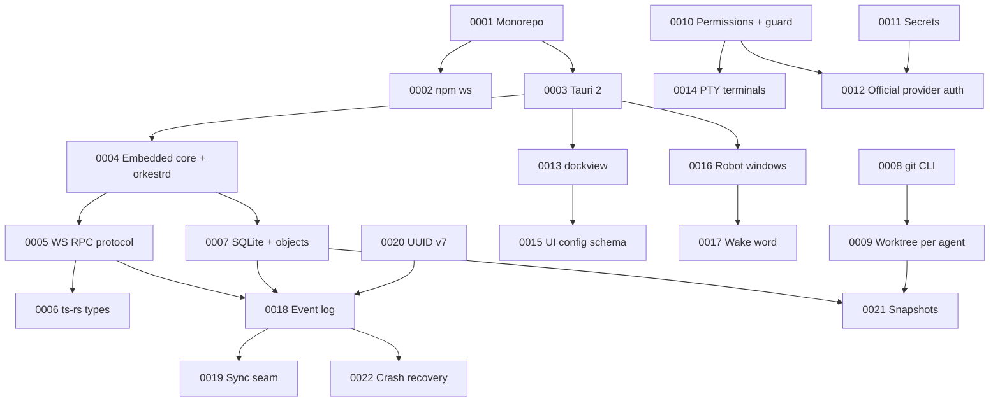

# Architecture Decision Records (§65 deliverable #20)

This folder records Orkestr's architecture decisions in the MADR format: Context, Decision drivers, Considered options, Decision, Consequences, Status. The engineering contract (`../ENGINEERING_CONTRACT.md`) is the summary these ADRs justify. The rules:

- To deviate from the contract, write a new ADR that **supersedes** the relevant one. Never edit an accepted ADR's decision. Only its status, links and errata may change.
- File name: `NNNN-kebab-title.md`. Numbers are never reused.
- Statuses: `Proposed`, `Accepted`, `Deprecated`, `Superseded by ADR-XXXX`.
- Every ADR names the spike(s) (`../spikes/README.md`) that validate it and the risks (`../risks.md`) it mitigates. If a spike fails, the ADR is reopened by a new superseding ADR. It is not edited.

## Index

Every ADR ends with **Implementation notes (Phase 0 foundation, 2026-10-02)**:
errata and status only, recording where the built code follows, partly
follows, or does not yet implement the decision. The **Impl.** column
summarises them: **Built** = implemented as decided (with listed deviations),
**Partial** = foundation exists with documented deviations or gaps,
**Not started** = only skeleton traits or nothing.

| # | Title | Status | Phase | Spike | Risk | Impl. (2026-10-02) |
|---|---|---|---|---|---|---|
| [0001](0001-monorepo-layout.md) | Monorepo layout: cargo + npm workspaces | Accepted | 0 | — | — | Built — erratum needed: as-built `events → storage` edge |
| [0002](0002-npm-workspaces-not-pnpm.md) | npm workspaces instead of pnpm | Accepted | 0 | — | — | Built |
| [0003](0003-tauri-2-desktop-shell.md) | Tauri 2 as the desktop shell | Accepted | 0–1 | SP-01, SP-04 | R-01 | Partial (shell, frameless window, `core_connection`; no plugins) |
| [0004](0004-embedded-core-and-orkestrd-daemon.md) | Embedded core + headless `orkestrd` daemon | Accepted | 1–4 | SP-13 | R-13 | Partial (embedded + daemon + discovery; no `core.lock`, discovery files always written) |
| [0005](0005-websocket-rpc-protocol.md) | WebSocket JSON RPC-like protocol shared by all clients | Accepted | 1 | SP-14 | R-02, R-09 | Partial (v1 frames; `hello`/`sinceSeq`/`lagged`/`ping`/idempotency planned) |
| [0006](0006-ts-rs-generated-types.md) | TS types generated from Rust with ts-rs | Accepted | 1 | SP-14 | R-17 | Built (generated `Methods` map; money is `f64`) |
| [0007](0007-sqlite-and-object-store.md) | SQLite (rusqlite) metadata + content-addressed object store | Accepted | 1 | SP-12 | R-16 | Partial (single connection; id-based migrations; bare-hex `ObjectId`) |
| [0008](0008-git-cli-over-libgit2.md) | Git through the `git` CLI, not libgit2 | Accepted | 1 | SP-10 | R-05 | Not started (skeleton trait) |
| [0009](0009-worktree-per-agent.md) | Branch + worktree per agent | Accepted | 1–2 | SP-10 | R-05, R-15 | Not started |
| [0010](0010-permission-engine-and-dangerous-action-guard.md) | Permission engine + Dangerous Action Guard | Accepted | 1 | SP-17 | R-11 | Not started (skeleton traits) |
| [0011](0011-secrets-keyring-and-encrypted-vault.md) | Secrets via OS keyring + encrypted fallback vault | Accepted | 1 | SP-18 | R-19 | Not started (platform `CredentialStore` only) |
| [0012](0012-official-only-provider-auth.md) | Official-only provider auth; CLI coding agents | Accepted | 1 | SP-06, SP-07, SP-08 | R-06, R-07, R-18 | Not started (skeleton trait) |
| [0013](0013-dockview-docking-layout.md) | dockview for docking layout | Accepted | 1–3 | SP-01 | — | Built for the shell (`dockview-react`) |
| [0014](0014-portable-pty-terminals.md) | Terminals on portable-pty (ConPTY on Windows) | Accepted | 1 | SP-03, SP-17 | R-02, R-11 | Not started (skeleton trait) |
| [0015](0015-ui-config-validated-schema.md) | UI config as a validated schema (AI-editable UI) | Accepted | 1–3 | — | R-20 | Partial (v1 schema validated in Rust + TS) |
| [0016](0016-floating-robots-transparent-windows.md) | Floating robots as separate transparent Tauri windows | Accepted (pending SP-04) | 3 | SP-04 | R-01 | Not started |
| [0017](0017-local-wake-word.md) | Local wake-word strategy | Accepted (pending SP-15) | 3 | SP-15 | R-08 | Not started |
| [0018](0018-event-sourcing-light.md) | Event sourcing light: event log + replay | Accepted | 1 | SP-14 | R-16 | Partial (persisted log + replay; no outbox, no retention) |
| [0019](0019-sync-deferred-behind-syncbackend.md) | Sync deferred to Phase 4 behind `SyncBackend` | Accepted | 1 (seam), 4 | SP-20 (Phase 4) | R-03, R-04, R-14 | Partial (minimal trait + `LocalOnlyBackend`) |
| [0020](0020-uuid-v7-ids.md) | UUID v7 identifiers | Accepted | 1 | — | — | Partial (v7 ids; `ProviderId` slug and `b3:` prefix not implemented) |
| [0021](0021-snapshots-content-manifests.md) | Snapshots as content manifests in the object store (not git commits) | Accepted | 1 | SP-16 | R-14, R-21 | Not started (object store ready) |
| [0022](0022-crash-recovery-and-interruption.md) | Crash recovery, interruption and child-process containment | Accepted | 1–2 | SP-13 | R-13 | Partial (crash detection via `session.lock`, hook runner; no hooks) |

## Planned ADRs (to be written when their phase starts)

| Planned | Topic | Phase |
|---|---|---|
| ADR-0023 | Provider router scoring & fallback handoff format (§7, §57) | 2 |
| ADR-0024 | Context optimizer: symbol extraction with tree-sitter (§20) | 2 |
| ADR-0025 | LSP bridge over RPC (RR-A6) | 2 |
| ADR-0026 | MCP client & capability mapping (CA-4) | 2 |
| ADR-0027 | Consensus / adversarial review protocol (§8) | 2 |
| ADR-0028 | Robot rendering: Rive vs Lottie vs Three.js budget (§30, §31) | 3 |
| ADR-0029 | STT/TTS provider abstraction and consent (§33) | 3 |
| ADR-0030 | Secure gateway / relay + device auth (WebAuthn) (§35–36) | 4 |
| ADR-0031 | Sync protocol: journal, chunks, conflict model (§41–44) | 4 |
| ADR-0032 | Mobile stack (React Native) & push (§2, §37) | 5 |
| ADR-0033 | Node protocol & task migration (§38–39) | 6 |
| ADR-0034 | Plugin/Widget sandbox (§48) | 7 |
| ADR-0035 | Computer Control adapters (§18) | 7 |

## Decision map

