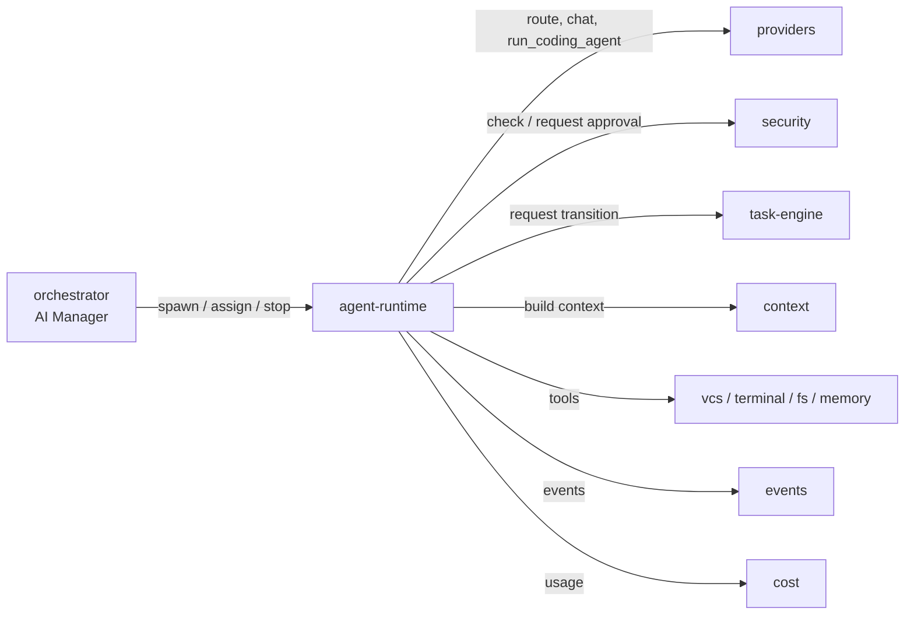
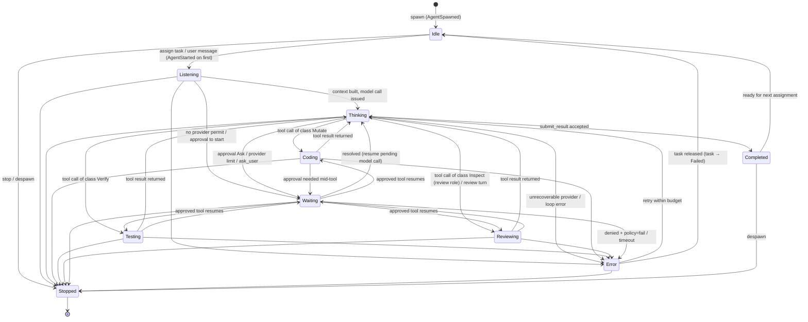

# Agent Runtime Specification

Status: Phase 0 deliverable #8 (§65). Crate: `orkestr-agent-runtime`.
Binding companions: `docs/ENGINEERING_CONTRACT.md` (§3, §5, §6, §7),
`docs/providers/provider-adapter-spec.md`, `docs/architecture/task-state-machine.md`,
`docs/security/permission-model.md`, `docs/architecture/git-worktree-strategy.md`.
Spec references: §1, §5, §6, §7, §16, §17, §20, §21, §22, §23, §30, §52, §57, §60, §64.

> §64 forbids "fake agents (different prompts without task/runtime isolation)".
> An Orkestr agent is therefore: **an instance with its own identity, task
> binding, worktree, permission grants, budget, cancellation token and audit
> trail** — not a system prompt.

---

## 0. Implementation status (2026-10-02, Phase 1)

**Built** in `orkestr-agent-runtime` (+ `crates/core/src/rpc/{agents,templates}.rs`, desktop `panels/Agents`):

- Templates (§2.1): all §6 fields, persisted (`agent_templates`), 11 built-in official
  templates (`crates/agent-runtime/templates/*.json`, Architect … Researcher) seeded on
  start and read-only; CRUD + import/export (`orkestr.agent-template` envelope v1;
  imported permission requests are dropped unless `acceptPermissions: true`).
  Template permissions become `Agent`-scope rules at spawn and are removed when the run ends.
- Instances + the state machine of §3 (`state.rs`, full matrix tested); persisted
  (`agent_instances`, `agent_executions`, `agent_messages`, `agent_tool_calls`,
  `agent_handoffs`); events `AgentSpawned/Started/StateChanged/Updated/Stopped`,
  `AgentMessage` (text deltas only), `ToolCallStarted/Finished`. `AgentUpdated` is a new,
  ephemeral event kind (usage/turns/model/activity snapshots).
- Isolation: one tokio task per agent, its own `CancellationToken` from
  `EmergencyController::register_agent`, own worktree (`agent/<role>-<shortid>` via
  `orkestr-vcs` for `DedicatedWorktree`; `SharedWorktree`, `ReadOnlyMain`, `None`), own
  conversation, turn / budget / wall-clock limits.
- Tool loop (§4) over the provider router with fallback + structured handoff hook; context
  bundle from `orkestr-context` (rules, memory, files, previous handoff); automatic
  checkpoint snapshot before the first mutating tool; usage → `CostEngine::ingest`;
  pre-flight budget check (agent budget + `CostEngine::check`); one "call submit_result"
  nudge, then an implicit `partial` result.
- Tools (assignment names, which supersede the `fs_*` names of §5.2): `read_file`,
  `write_file`, `edit_file`, `list_dir`, `search_files`, `run_command`, `git_status`,
  `git_diff`, `git_commit`, `create_snapshot`, `ask_user`, `record_memory`,
  `record_decision`, `submit_result`. Deviation: `git_status`/`git_diff`/`create_snapshot`
  are checked as `Read` on the worktree root (they are read-only), `git_commit` as `Git`.
  `run_command` is checked by the terminal's security gate (same engine, actor = agent);
  `Ask` ⇒ agent + task `Waiting` until the approval is resolved (approve ⇒ the gate lets the
  same command through once; reject ⇒ tool `Denied`, returned to the model).
- CLI coding agents (§4.1, `cli.rs`): Claude Code / Codex via `run_coding_agent` in the
  worktree with a static tool policy; file changes outside the worktree cancel the run.
  **Limits:** no per-command approval bridge yet (Bash only allowed in Full Auto; Codex needs
  a one-time approval per run unless Full Auto), CLI cost is checked only after the run,
  no fallback chain for CLI agents, pause is not supported.
- Not built yet: rolling transcript summaries / context-overflow compaction, doom-loop
  detection, parallel tool calls, `fs_delete`/`fs_move`/`run_checks`/`memory_search`/
  `ask_manager`, teams/hierarchy (Phase 2), idle timeout watchdog, Job Object per agent
  (commands use the terminal's process-tree kill).

---

## 1. Responsibilities and boundaries

`orkestr-agent-runtime` owns:

- `AgentTemplate` / `AgentInstance` model operations and the **agent instance
  state machine** (§3).
- The **tool loop** for chat-style providers and **supervision** of CLI
  coding-agent providers.
- The **tool registry** and tool execution dispatch (tools themselves are thin
  wrappers over `orkestr-vcs`, `orkestr-terminal`, file APIs, `orkestr-memory`).
- Budgets, turn limits, timeouts, cancellation.
- Building and consuming **handoffs** (§57).

It does **not** own: task status (only requests transitions from
`orkestr-task-engine`), planning/decomposition/spawn decisions
(`orkestr-orchestrator`), routing (`orkestr-providers::ProviderRegistry::route`),
permission decisions (`orkestr-security::PermissionEngine`), context selection
(`orkestr-context`), git mechanics (`orkestr-vcs`).



---

## 2. Template vs instance

### 2.1 AgentTemplate (§6) — immutable once published; edits create a new version

```rust
// As built: orkestr_domain::AgentTemplate (wire type, camelCase JSON)
pub struct AgentTemplate {
    pub id: AgentTemplateId,
    pub name: String,                      // "Backend Engineer"
    pub role: AgentRole,                   // Manager | Architect | Backend | Frontend | Database | Qa | Security
                                           // | DevOps | UiUx | ProductManager | Reviewer | Researcher | Custom(String)
    pub description: String,
    pub system_prompt: String,             // template text; variables {{project.name}}, {{task.title}} ...
    pub preferred_model: Option<ModelRef>,
    pub fallback_models: Vec<ModelRef>,
    pub tools: Vec<String>,                // allow-list from the registry (§5)
    pub permissions: Vec<PermissionRule>,  // requested grants; become Agent-scope rules on spawn (permission-model §3)
    pub memory_access: MemoryAccess,       // None | ProjectOnly | ProjectAndGlobal | Full
    pub budget: Option<Budget>,            // wire budget {maxCostUsd, maxTokens, maxDurationSecs, period, warnAt}; §7
    pub max_turns: u32,
    pub worktree_policy: WorktreePolicy,   // DedicatedWorktree (default) | SharedWorktree | ReadOnlyMain | None (pure-chat roles)
    pub quality_gates: Vec<QualityGate>,   // §58: Build | Lint | Typecheck | Tests | Security | Review | AcceptanceCriteria
    pub voice: Option<VoiceProfile>,       // §33 (Phase 3)
    pub avatar: Option<AvatarConfig>,      // §30 robot skin (Phase 3)
    pub visual_state: AgentState,
    pub source: TemplateSource,            // Builtin | Official | Community | Private | Custom
    pub version: String,                   // template version, e.g. "1.2.0"
    pub created_at: Timestamp, pub updated_at: Timestamp,
}
// Planned additive fields (runtime needs, §4 and §7): execution_style (Chat | CodingAgentCli | Auto);
// the full AgentBudget of §7 next to the wire `budget`; an import origin for marketplace templates (§68.1, Phase 7).
```

Builtin templates ship as JSON resources in `crates/agent-runtime/templates/`
(one per role in §6) and are validated against a JSON Schema on load. Imported
templates **never** carry grants silently: requested permissions are displayed and
must be accepted by the user on import (§48 "manifest + explicit permissions").

### 2.2 AgentInstance — a running actor

```rust
// As built: orkestr_domain::AgentInstance (wire type)
pub struct AgentInstance {
    pub id: AgentId,                       // UUID v7
    pub template_id: Option<AgentTemplateId>,
    pub project_id: ProjectId,
    pub task_id: Option<TaskId>,           // current task, at most one at a time
    pub team_id: Option<AgentTeamId>,
    pub parent_agent_id: Option<AgentId>,  // hierarchy (§6), Phase 2
    pub name: String,
    pub role: AgentRole,
    pub state: AgentState,                 // §3
    pub model: Option<ModelRef>,           // resolved at spawn, may change on fallback
    pub worktree: Option<WorktreeRef>,     // { branch, path }
    pub usage: UsageSummary,               // { inputTokens, outputTokens, costUsd }
    pub turns_used: u32,
    pub last_error: Option<String>,
    pub created_at: Timestamp, pub started_at: Option<Timestamp>,
    pub stopped_at: Option<Timestamp>, pub last_activity_at: Option<Timestamp>,
}
// Planned additive fields: template_version (pinned), cli_session (coding-agent resume id),
// created_by: Actor, stop_reason, worktree base commit; the branch short id is derived from
// the id's last 8 hex chars. Crash detection uses the core session marker
// (task-state-machine §0/§8), not a per-agent field.
```

Invariants:
- An instance belongs to exactly one project (cross-project agents §68.27 are a
  Phase 7 feature implemented as *one instance per project* sharing a template).
- One active task per instance. An instance may execute several tasks
  sequentially (Completed → Idle → next assignment) in the same worktree when the
  orchestrator decides the work is continuous; otherwise a new instance is spawned.
- `model` (optional on the wire) is never `None` once `Listening` is entered.

---

## 3. Agent instance state machine

States are fixed by the contract §5: `Idle, Listening, Thinking, Coding, Testing,
Reviewing, Waiting, Error, Completed, Stopped`. Robot visual states (§30) map 1:1
(`Stopped` renders as robot removed/greyed).



Rules:

- Every transition emits `AgentStateChanged {from, to, reason}`; entering
  `Listening` for the first time also emits `AgentStarted`; entering `Stopped`
  emits `AgentStopped {reason: Completed|UserStop|EmergencyStop|BudgetExceeded|Error|Crash}`.
- Tool **class** (registry §5) drives Coding/Testing/Reviewing: `Mutate`
  (write/delete/terminal-mutating/git commit) → Coding; `Verify` (build, test,
  lint, typecheck tools) → Testing; `Inspect` (read/search/diff) → Reviewing only
  when the agent role is Reviewer/Security/QA or the task is in `Review`;
  otherwise Inspect tools keep the agent in Thinking (prevents flicker).
- Mapping agent ↔ task state (driven by runtime through task-engine API):

| Agent event | Task transition requested |
|---|---|
| Listening (task assigned, task Ready) | `Ready → Running` |
| Waiting (approval / user / provider) | `Running → Waiting` |
| Waiting resolved | `Waiting → Running` |
| `submit_result` with gates pending | `Running → Review` or `Running → Testing` (per quality gates) |
| `submit_result`, no gates | `Running → Completed` |
| Error after retries exhausted | `Running → Failed` |
| Stopped by the user (`agents.stop`) | `Running → Interrupted` (resumable; CA-10, ADR-0022), or `→ Cancelled` with `mode: "cancel"` — see §9 |
| Emergency stop (`emergency.stop*`) | non-terminal tasks `→ Cancelled` (cause `EmergencyStop`; CA-10, ADR-0022) — see §9 |

- `Error` is a *recoverable* state; `Stopped` is terminal. A stopped instance's
  worktree is retained per cleanup policy (git-worktree-strategy §8).

---

## 4. Tool loop (chat-style providers)

```text
loop_turn(instance, task):
  assert state ∈ {Listening, Thinking}
  ctx  = context.build(task, handoff, memory_scope, token_budget(model))     # §20 optimizer
  req  = ChatRequest{ system, messages = ctx + transcript_window, tools = registry.specs(template.tools) }
  for attempt in route(task): 
      stream = provider.chat(req, cancel.child())
      consume stream:
        TextDelta  → emit AgentMessage{delta}; append to assistant buffer
        ToolCall   → push pending_calls
        Usage      → cost.record(...); budget.charge(...)  → may raise BudgetExceeded
        Done       → break
        Error(e)   → classify per provider spec §4 → retry / fallback(with handoff) / fail
  persist assistant message (text + tool_use parts; NO reasoning)
  if pending_calls is empty:
      if stop_reason == EndTurn and task requires submit_result: nudge once ("call submit_result"),
      else treat text as final answer → submit_result(implicit)
  for call in pending_calls (sequential by default; parallel only for tools marked parallel_safe):
      validate args against input_schema           → invalid ⇒ tool error result
      resource = tool.resource(args, worktree)     → path confinement, command parse
      decision = PermissionEngine::check(actor, tool.capability, resource, ctx)
         Allow       → execute
         Ask(reason) → state Waiting; ApprovalRequested; await ApprovalResolved | cancel | timeout
         Deny(reason)→ tool error result "denied: <reason>" (model may adapt)
      emit ToolCallStarted / ToolCallFinished {callId, tool, ok, durationMs, summary}
      append ToolResult (truncated to tool.max_result_tokens, full output stored as object)
  turns += 1; if turns ≥ max_turns ⇒ BudgetExceeded(MaxTurns)
  repeat
```

Details:

- **Transcript window**: the runtime keeps the full persisted transcript, but
  each request contains: system + context pack + the last *N* turns that fit 60 %
  of the model's window; older turns are replaced by a runtime-generated
  **rolling summary** (produced by a cheap route, purpose `Classification`, and
  stored as a normal artifact, not CoT).
- **Context overflow** (`BadRequest::ContextLengthExceeded`): compact once
  (summarise older turns, truncate tool outputs to 2 k tokens), retry; second
  overflow → fallback to a larger-window model with handoff.
- **Tool result size**: default cap 8 k tokens per result; overflow stored in
  `ObjectStore`, the model receives head/tail + an `object_ref` that `fs_read_object`
  can page through.
- **Parallel tool calls**: executed concurrently only if every call in the batch
  is `parallel_safe` (all `Inspect`); otherwise sequential in model order.
- **Doom-loop detection**: the same tool with identical arguments failing 3×
  in a row, or 6 consecutive turns without any `Mutate`/`Verify` tool or text
  progress, ⇒ inject a corrective system note once, then `Error(reason: Stalled)`.
- **Termination**: the canonical end is the `submit_result` tool (schema §5.3),
  which carries the structured result used by review/test gates and by handoff.

### 4.1 CLI coding-agent supervision

For `ExecutionStyle::CodingAgentCli` the runtime calls
`provider.run_coding_agent(req, cancel)` with: prompt = task + handoff +
acceptance criteria + instruction to finish with a JSON result block;
`max_turns` = remaining turns; `tool_policy` derived from the agent's grants; the
permission bridge (provider spec §6.3). Events are forwarded
(`ToolStarted/Finished` → `ToolCallStarted/Finished`, `FileChanged`,
`Chat(TextDelta)` → `AgentMessage`). Agent state follows tool classes inferred
from the CLI tool name (`Edit/Write/Bash(mutating)` → Coding, test commands →
Testing). On completion the runtime parses the final JSON block into a
`SubmitResult`; missing/invalid ⇒ one follow-up resume turn asking for it, then
`Error`. Budget enforcement: `--max-turns` + wall-clock kill + post-hoc cost check
(subscription usage is tracked but not $-limited).

---

## 5. Tool registry

### 5.1 Descriptor

```rust
pub struct ToolDescriptor {
    pub name: &'static str,            // ^[a-z][a-z0-9_]{0,63}$ — no dots (OpenAI/Gemini name rules)
    pub description: &'static str,
    pub input_schema: serde_json::Value,   // JSON Schema draft 2020-12, additionalProperties:false
    pub capability: Capability,        // contract §6 capability set
    pub class: ToolClass,              // Inspect | Mutate | Verify | Control
    pub parallel_safe: bool,
    pub timeout: Duration,
    pub max_result_tokens: u32,
    pub phase: Phase,                  // availability
}

#[async_trait]
pub trait Tool: Send + Sync {
    fn descriptor(&self) -> &ToolDescriptor;
    /// Pure: derive the permission resource from args (paths canonicalised & confined,
    /// commands parsed). Errors here are returned to the model as tool errors.
    fn resource(&self, args: &Value, env: &ToolEnv) -> Result<Resource, ToolError>;
    async fn execute(&self, args: Value, env: &ToolEnv, cancel: CancellationToken)
        -> Result<ToolOutput, ToolError>;
}
```

`ToolEnv` carries: `agent_id, task_id, project_id, worktree_root, terminal
session factory, object store, correlation_id`. Tools never receive the
`SecretStore`; secrets reach processes only through the `Secrets` capability path
(env injection by `orkestr-terminal` after an explicit grant).

### 5.2 Built-in tools

| Tool | Capability | Class | Phase | Notes |
|---|---|---|---|---|
| `fs_read` | Read | Inspect | 1 | `{path, offset?, limit?}`; confined to worktree root |
| `fs_list` | Read | Inspect | 1 | `{path, depth?≤5, glob?}` |
| `fs_search` | Read | Inspect | 1 | `{pattern, path?, glob?, max_results?≤200}` (ripgrep-like, in-process) |
| `fs_write` | Write | Mutate | 1 | `{path, content}` full write; creates parents |
| `fs_edit` | Write | Mutate | 1 | `{path, old, new, replace_all?}` exact replacement |
| `fs_delete` | Delete | Mutate | 1 | `{path, recursive?}`; recursive ⇒ DangerousActionGuard |
| `fs_move` | Write (+Delete on source) | Mutate | 1 | `{from, to}` |
| `fs_read_object` | Read | Inspect | 1 | page through large stored tool outputs |
| `terminal_run` | Terminal | Mutate/Verify | 1 | `{command, shell?, cwd?, timeout_s?≤1800}`; class Verify if command matches the project's detected build/test/lint commands; parsed by guard |
| `git_status` / `git_diff` / `git_log` | Git | Inspect | 1 | read-only, own worktree |
| `git_commit` | Git | Mutate | 1 | `{message, paths?}` on own agent branch only; never push |
| `run_checks` | Terminal | Verify | 1 | `{kinds: [build,lint,test,typecheck,smoke]}` uses detected project commands (§17) |
| `memory_search` | Read | Inspect | 1 | project/global memory FTS within `memory_scope` |
| `memory_propose` | Write | Control | 1 | proposes MemoryItem/Decision (manager or user accepts) |
| `ask_manager` | — (always allowed) | Control | 1 | question to orchestrator; agent → Waiting |
| `ask_user` | — (always allowed) | Control | 1 | routed through manager; agent → Waiting |
| `submit_result` | — (always allowed) | Control | 1 | ends the assignment (§5.3) |
| `web_fetch` | Network | Inspect | 2 | `{url}`; domain allow-list per project network policy |
| `browser_*` (open, click, type, screenshot, console) | Browser | Inspect/Mutate | 2 | §18 |
| `db_query` / `db_execute` | DbRead / DbWrite | Inspect / Mutate | 2 | per Environment; SQL parsed by guard |
| `docker_*` | Docker | Mutate | 2 | |
| `ssh_exec` | Ssh | Mutate | 3+ | |
| `deploy_*` | Deploy | Mutate | 3+ | always Ask for non-local environments |
| `computer_*` | ComputerControl | Mutate | 3+ | never granted by default (§18) |
| `mcp__<server>__<tool>` | per MCP server manifest (default Network+Ask) | per manifest | 2 | MCP Hub §19 |

### 5.3 `submit_result` schema

```json
{
  "type": "object", "additionalProperties": false,
  "required": ["status", "summary"],
  "properties": {
    "status": { "enum": ["done", "partial", "blocked", "failed"] },
    "summary": { "type": "string", "maxLength": 4000 },
    "acceptanceCriteria": { "type": "array", "items": {
        "type": "object", "required": ["criterion", "met"],
        "properties": { "criterion": {"type":"string"}, "met": {"type":"boolean"}, "evidence": {"type":"string"} } } },
    "filesTouched": { "type": "array", "items": { "type": "string" } },
    "testsRun": { "type": "array", "items": { "type": "object",
        "properties": { "command": {"type":"string"}, "passed": {"type":"boolean"}, "summary": {"type":"string"} } } },
    "openIssues": { "type": "array", "items": { "type": "string" } },
    "decisions": { "type": "array", "items": { "type": "object",
        "required": ["title", "choice"],
        "properties": { "title": {"type":"string"}, "choice": {"type":"string"},
                        "alternatives": {"type":"array","items":{"type":"string"}},
                        "rationaleSummary": {"type":"string"} } } }
  }
}
```

`decisions[].rationaleSummary` is an explicit, user-facing summary written by the
agent — it is **not** model chain-of-thought and is the only "reasoning" persisted
(§21 Decision Log).

---

## 6. Isolation

| Layer | Mechanism | Phase |
|---|---|---|
| Identity | Every call carries `Actor::Agent(AgentId)`; audit rows per tool call | 1 |
| Filesystem | All fs tools resolve paths against `worktree_root`; canonicalise, reject `..` escapes, absolute paths outside root, symlink/junction targets outside root, UNC, `\\?\`/`\\.\` prefixes, alternate data streams (`file:stream`), reserved device names (`CON`, `NUL`, `COM1`…). `.git` directory writes denied (git only via git tools). | 1 |
| Git | Dedicated branch `agent/<role>-<shortid>` + worktree (git-worktree-strategy) | 1 |
| Terminal | cwd forced inside worktree; env allow-list (provider-adapter-spec §6.1); each command parsed by DangerousActionGuard; agent terminals are separate PTY sessions tagged `owner=agent` | 1 |
| Secrets | none by default; `Secrets` grant per environment injects env vars into a single command's process, values redacted from output stream | 1 |
| Network | `Network` capability off by default for executors; `web_fetch` domain allow-list. OS-level egress blocking for terminal commands is **not** enforced in Phase 1 (honest limitation); Phase 2 adds container sandbox (§23 "container where practical") | 1 / 2 |
| Cross-project | Agents cannot reference other projects' paths, memory, secrets (§67) | 1 |
| Process | Windows Job Object / Unix process group per agent; killed on stop | 1 |

---

## 7. Budgets, limits, timeouts (§17, §22)

```rust
pub struct AgentBudget {
    pub max_turns: u32,                 // default 40 (executor), 80 (manager)
    pub max_tool_calls: u32,            // default 200
    pub max_cost_usd: Option<f64>,      // None = inherit task/project budget
    pub max_wall_clock: Duration,       // default 60 min
    pub max_output_tokens_per_turn: u32,// default 8192
    pub max_self_heal_attempts: u32,    // default 3 (build→test→fix cycles §17)
    pub idle_timeout: Duration,         // default 15 min without progress event
    pub approval_timeout: Option<Duration>, // None = wait indefinitely (task stays Waiting)
}
```

- Effective budget = min(template, task, project remaining, manager override).
- Enforcement points: before every model call (pre-flight estimate), after every
  `Usage`, before every tool call, and by a watchdog timer.
- At 80 %: `BudgetThreshold{scope: agent, pct: 80}` + note injected into the next
  request ("you have N turns / $X left; prioritise finishing").
- At 100 %: current call is cancelled; agent → `Error(BudgetExceeded)`; the task
  goes `Running → Failed` with `failure.reason = budget_exceeded`; the orchestrator
  may ask the user to extend (task `Failed → Ready` retry with new budget).
- `max_turns` is never unlimited (§64 "no uncontrolled autonomous loops"); FullAuto
  does not lift it.

---

## 8. Handoff (§57, §7)

Used for: agent→agent delegation, provider fallback (§7), session resume,
node migration (§39, Phase 6). Generated by the runtime from persisted data,
optionally polished by a cheap model; **never** includes the raw chat history.

```json
{
  "handoffId": "0192…",
  "schemaVersion": 1,
  "createdAt": "2026-10-02T12:00:00Z",
  "from": { "agentId": "…", "role": "Backend", "model": { "providerId": "…", "model": "…" } },
  "to":   { "agentId": "…|null", "role": "Backend|null" },
  "reason": "provider_fallback | delegation | resume | review_feedback | migration",
  "task": { "taskId": "…", "title": "…", "goal": "…", "acceptanceCriteria": ["…"] },
  "context": "≤ 1500 tokens concise state of work",
  "relevantFiles": [ { "path": "src/payroll/calc.rs", "why": "core calculation, partially implemented", "symbols": ["compute_net"] } ],
  "decisions": [ { "title": "…", "choice": "…", "rationaleSummary": "…" } ],
  "done": ["…"],
  "remaining": ["…"],
  "unresolvedIssues": ["…"],
  "testState": { "lastRun": "2026-10-02T11:58:00Z", "command": "cargo test -p payroll", "passed": 12, "failed": 1, "failing": ["calc::overtime_rounding"] },
  "artifacts": [ { "kind": "diff|log|report|snapshot", "objectRef": "<64-hex blake3 ObjectId>", "label": "…" } ],
  "workspace": { "branch": "agent/backend-3f9a1c2e", "worktree": "…relative to data dir…", "headCommit": "…", "snapshotId": "…|null", "dirty": true },
  "budgetRemaining": { "turns": 12, "costUsd": 1.35 }
}
```

Constraints: total ≤ 4 k tokens (excluding artifact bodies, which are refs);
validated against `crates/agent-runtime/schemas/handoff.v1.json`; stored as an
object + row (`handoffs` table) and referenced from `ProviderFallback`/task history.

---

## 9. Cancellation & stop

Token hierarchy (`tokio_util::sync::CancellationToken` children):

```text
core_root
 └─ project:<id>
     └─ agent:<id>
         └─ call:<model or tool call id>
```

| Command | Effect | Task outcome |
|---|---|---|
| `agents.stop {agentId}` (default, CA-10) | cancel agent token; kill processes (2 s grace); agent → Stopped; snapshot if the worktree is dirty | its `Running` task `→ Interrupted` (resumable via Recovering) |
| `agents.stop {agentId, mode: "cancel"}` (optional extension) | same | `→ Cancelled` |
| `emergency.stopProject` | cancel project token; kill all project process groups (no grace) | all non-terminal project tasks `→ Cancelled` (cause `EmergencyStop`); dirty worktrees snapshotted after the kill (ADR-0022) |
| `emergency.stopAll` | cancel root token; disable spawning until re-armed | as above for all projects; emits `EmergencyStop` |

Guarantees: model streams aborted ≤ 2 s; child process trees killed ≤ 5 s
(force-kill after grace); tools must check the token at every await point; a tool
that ignores cancellation is force-dropped and its process killed. Stop handling
is entirely local (contract §6) — no provider round-trip.

---

## 10. Persistence and the no-CoT rule (§1.14, §21)

Persisted per agent: `executions` (one per assignment), `agent_messages`
(user/assistant visible text, tool-use parts), `tool_calls` (args redacted,
result summary, object ref of full output, decision, duration), `usage_records`,
`handoffs`, state transitions (event log).

**Never persisted, never emitted, never logged**: provider reasoning/thinking
content, hidden chain-of-thought, provider opaque signed blocks (kept in memory
for the current loop only). Enforcement: `ChatEvent` has no reasoning variant;
`OpaqueBlock` is not `Serialize`; unit test asserts the persisted transcript of a
fixture containing thinking blocks contains none of their text.

Redaction: tool args/results pass through `orkestr-security::redact` (secret
values known to the vault, common key patterns) before persistence and events.

---

## 11. Dynamic spawn heuristics (§6, §11) — decided by the orchestrator, executed here

The orchestrator calls `AgentRuntime::spawn(template, project, task, overrides)`.
The decision rule (Phase 1 "basic dynamic spawn", Phase 2 full):

```text
ready_parallel = tasks Ready with no file-overlap conflict among them
want = min(
  ready_parallel,
  manager.max_parallel_agents,                    // §5 setting (default 3)
  floor(free_ram_gb / ram_per_agent_gb),          // 1.5 GB per CLI agent, 0.3 GB per chat agent; local-model agents use model size
  cpu_slots = max(1, logical_cores/2 - running_build_jobs),
  Σ provider concurrency permits available for the routed models,
  floor(remaining_budget_usd / est_cost_per_task)
)
spawn only if   est_parallel_speedup(want) - coordination_overhead(want) > 0
   where coordination_overhead grows with shared files & dependency edges among chosen tasks
reuse an Idle instance of the same role & project before spawning a new one
```

- Prefer reuse (same role, same project, worktree still clean relative to task
  base) to cut worktree churn.
- Never spawn when `EmergencyStop` armed, project budget exhausted, or disk free
  < 2 GB (worktree creation).
- Spawn emits `AgentSpawned {agentId, templateId, role, model, reason}`.

## 12. Teams & hierarchy (§6) — Phase 2

- `AgentTeam { id, name, preset: Erp|Web|Mobile|Security|RapidPrototype|Custom, members: [TemplateRef × count], lead: Option<TemplateRef> }`.
- Hierarchy Manager → Team Lead → Executors → Reviewers: a Team Lead is an agent
  with the `delegate_task` tool (Phase 2, capability: none, governed by the
  orchestrator's spawn limits) that can create subtasks and request spawns **only
  within its team's quota**. Leads cannot grant permissions they do not hold
  (no privilege escalation: child grants ⊆ parent grants).
- Reviewers are separate instances (different model preferred for adversarial
  review §8) and only get Inspect tools + `submit_result` with review verdict.
- Agents never message each other directly; all coordination goes through the
  orchestrator (handoffs, `ask_manager`), which keeps Replay (§21) linear.

## 13. Phasing summary

| Feature | Phase |
|---|---|
| Templates (builtin + user), instances, state machine, tool loop, Phase-1 tools, budgets, handoff, cancellation, CLI supervision, basic dynamic spawn | 1 |
| Teams/hierarchy, reviewers/adversarial, browser/db/docker/web tools, MCP tools, container sandbox, full spawn heuristics | 2 |
| Robot/voice presentation bindings | 3 |
| Migration of agents across nodes via handoff | 6 |
| Marketplace import/export | 7 |

## 14. Test obligations

State machine (every allowed/forbidden transition), tool loop with `mock` provider
(tool round trip, invalid JSON args, deny, ask→approve, ask→deny, budget exceeded,
max turns, cancellation mid-stream and mid-tool, doom-loop), path confinement
(property tests incl. Windows forms), handoff schema validation and size cap,
no-CoT persistence test, fallback with handoff.
