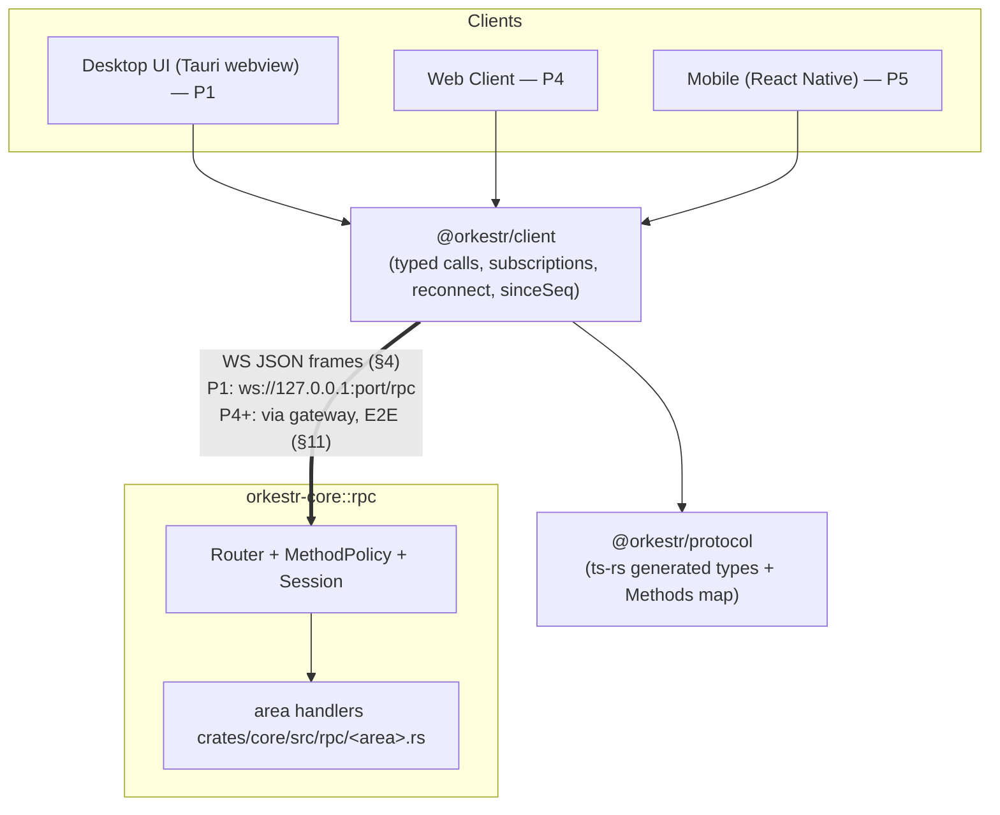
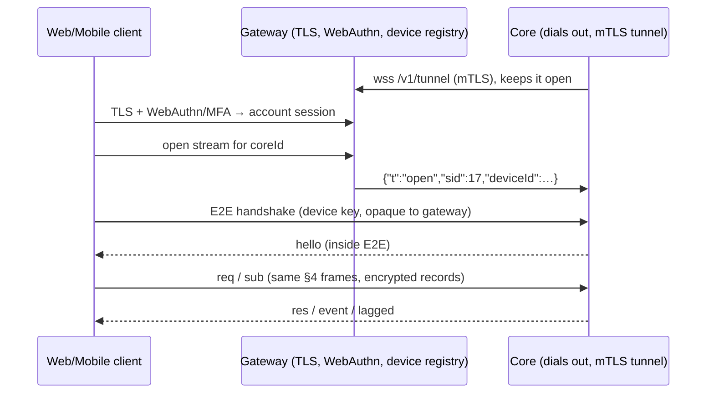

# Desktop / Web / Mobile Shared Protocol

> Deliverable §65 #19 (the contract §4 heading says "§19"; see CA-12). This is
> the single application protocol for every client: Desktop (P1), Web (P4) and
> Mobile (P5) (§2, §67: "Web/Mobile use the common protocol"). It is not RDP or
> screen sharing (§2).
>
> Binding: `docs/ENGINEERING_CONTRACT.md` §2–§6. Accepted decisions detailed
> here: ADR-0005 (frames and server semantics), ADR-0006 (ts-rs), ADR-0014
> (terminals), ADR-0018 (events), ADR-0020 (ids), ADR-0022 (crash recovery),
> `remote-access.md` (P4 transport, MethodPolicy). Companions:
> `../architecture/event-model.md` (event kinds, topics, replay) and
> `../architecture/data-model.md` (entities).
>
> **How to read this document.** §0 is the normative description of what the
> Phase 0 foundation code actually implements (`crates/protocol`,
> `crates/core/src/server`, `crates/core/src/rpc`, `packages/client`). Sections
> 2–12 describe the full Phase 1–4 design. Wherever the design goes beyond the
> code, the text says **(planned)**; where the design and the code disagreed,
> the text was corrected to the code or the difference is listed in §0.5. If you
> change the wire protocol, update §0 in the same change.

---

## 0. Protocol v1 as built (Phase 0 foundation, 2026-10-02)

### 0.1 Transport and limits

| Item | As built | Source |
|---|---|---|
| Endpoint | `ws://127.0.0.1:<ephemeral>/rpc` (`CoreConfig::bind_addr` must be loopback, otherwise `CoreError::Config`) | `crates/core/src/config.rs` |
| Health | `GET /health`, no auth → `{"status":"ok","version":"0.1.0"}` (no `protocolVersion`; use `system.info`) | `crates/core/src/server/mod.rs` |
| Host check | `/rpc` upgrade rejected with HTTP 403 unless the `Host` header names `127.0.0.1`, `localhost` or `::1` (DNS-rebinding guard) | same |
| `Origin` check | **not implemented** (SR-03 is open, see `../security/threat-model.md`) | — |
| Max inbound message | 4 MiB (`MAX_MESSAGE_BYTES`) | `server/mod.rs` |
| Binary messages | answered with `res{id:"", ok:false, error:bad_request}`; the connection stays open | `server/connection.rs` |
| Per-connection outbound queue | 512 frames (`OUTBOUND_BUFFER`) | same |
| In-flight requests | 64 per connection (`MAX_INFLIGHT_REQUESTS`); further `req` frames wait (back-pressure), they are not rejected | same |
| Request id | 1..=128 chars, otherwise `bad_request` (uniqueness among in-flight ids is **not** checked) | same |
| Topics per `sub`/`unsub` | ≤ 256, otherwise `bad_request` | same |
| Keepalive | WebSocket-level ping/pong handled by axum; there is no `ping` frame | — |

### 0.2 Frames (`orkestr_protocol::frames`)

```rust
#[serde(tag = "type", rename_all = "camelCase", rename_all_fields = "camelCase")]
pub enum ClientFrame {
    Auth  { token: String, #[serde(default = "auth")] id: String, client: Option<ClientInfo> }, // ClientInfo {kind, version}
    Req   { id: String, method: String, #[serde(default)] params: serde_json::Value },        // missing/null params ⇒ {}
    Sub   { id: String, topics: Vec<String> },
    Unsub { id: String, topics: Vec<String> },
}
#[serde(tag = "type", rename_all = "camelCase", rename_all_fields = "camelCase")]
pub enum ServerFrame {
    Res(ResFrame),                       // {type:"res", id, ok, result?, error?}
    Event { seq: u64, event: Box<Event> },
}
pub struct ResFrame { pub id: String, pub ok: bool, pub result: Option<Value>, pub error: Option<RpcError> }
pub struct AuthResult { pub session_id: SessionId, pub server_version: String, pub protocol_version: u32, pub last_seq: u64 }
pub struct SubResult  { pub topics: Vec<String> }   // all topics held after the change
pub const PROTOCOL_VERSION: u32 = 1;
```

Wire examples (exactly what the core sends):

```json
{"type":"auth","token":"<64 hex>"}
{"type":"res","id":"auth","ok":true,"result":{"sessionId":"…","serverVersion":"0.1.0","protocolVersion":1,"lastSeq":42}}
{"type":"req","id":"c-1","method":"projects.list","params":{}}
{"type":"res","id":"c-1","ok":true,"result":{"projects":[…]}}
{"type":"res","id":"c-2","ok":false,"error":{"code":"not_found","message":"project … not found","data":null}}
{"type":"sub","id":"s-1","topics":["global","project:0192…"]}
{"type":"res","id":"s-1","ok":true,"result":{"topics":["global","project:0192…"]}}
{"type":"event","seq":43,"event":{"seq":43,"id":"…","ts":"…","projectId":"…","taskId":null,"agentId":null,"nodeId":null,"correlationId":"…","kind":"ProjectCreated","payload":{"project":{…}}}}
```

### 0.3 Semantics

- **Auth.** Either `Authorization: Bearer <token>` on the upgrade request (a
  wrong header token ⇒ HTTP 401 before the upgrade; a correct one opens the
  session without any reply frame) or the first text frame `auth` within
  **10 s**. Success ⇒ `res` with the auth frame's `id` (default `"auth"`) and
  `AuthResult`. Failure, a non-`auth` first frame or the timeout ⇒ `res` with
  `unauthorized`, then close **4401**. An `auth` frame sent later on an open
  session is re-validated; a wrong token closes the connection (4401). The
  token is 32 random bytes rendered as **64 lowercase hex chars**, compared in
  constant time (`subtle`, `orkestr_core::auth`). Failed-auth rate limiting is
  **not implemented** (SR-05 partial).
- **Dispatch.** `RpcRouter::dispatch`: unknown method ⇒ `bad_request`
  ("unknown method `x`", `data: null`); params that fail serde ⇒ `bad_request`
  ("invalid params for <method>: <serde message>"). Requests run concurrently;
  responses come back in completion order. A panicking handler ⇒ `internal`.
  There is no server-side per-request timeout and no `system.cancel`.
- **Correlation.** Each `req` gets a fresh `CorrelationId`, installed as the
  ambient correlation (`orkestr_events::with_correlation`) so every event the
  handler publishes carries it. `params.correlationId` is **not** adopted yet.
- **Subscriptions.** Per connection, additive union of topics; topic grammar
  `* | global | project:<uuid> | task:<uuid> | agent:<uuid> | terminal:<uuid> |
  node:<uuid>`; an invalid topic fails the whole `sub` with `bad_request`. Each
  matching event is delivered once per connection. Routing rules: see
  `../architecture/event-model.md` §0.3.
- **Lagging.** When the connection's broadcast receiver lags, the server sends
  one synthetic event `{type:"event", seq:0, event:{seq:0, kind:"Log",
  payload:{level:"warn", target:"orkestr_core::rpc", fields:{dropped:n,
  local:true}, …}}}`. Clients recognise local notices by `seq === 0`
  (`isLocalNotice`) and re-sync with `events.replay`. There is no `lagged` frame.
- **Shutdown.** On core shutdown every connection is closed with **1001**
  ("core shutting down").
- **Unimplemented features.** `RpcError::unimplemented_feature(name)` =
  `bad_request` with `data: {"unimplementedFeature": name}`. No handler uses it
  yet because only implemented methods are registered (unknown names are
  `bad_request` "unknown method").
- **Error codes.** Exactly the ten contract codes (`RpcErrorCode`, snake_case on
  the wire). `unimplemented` / `invalid_transition` (CA-1) are **not** added.

### 0.4 Implemented methods

| Method | Params | Result | Emits |
|---|---|---|---|
| `system.health` | `{}` | `HealthResult {status:"ok", version, uptimeMs}` | — |
| `system.info` | `{}` | `SystemInfo {version, protocolVersion, nodeId, os, arch, hostname, pid, dataDir, startedAt, recoveredFromCrash, shells: string[]}` | — |
| `projects.list` | `ListProjectsParams {includeArchived?}` | `ListProjectsResult {projects: Project[]}` (most recently opened first, then name; no paging) | — |
| `projects.get` | `ProjectIdParams {projectId}` | `ProjectResult {project}` | — |
| `projects.create` | `CreateProjectParams {name, description?, rootPath?, color?, icon?, classification?, approvalMode?, privacy?, tags?}` | `ProjectResult` | `ProjectCreated` |
| `projects.update` | `UpdateProjectParams {projectId, patch: ProjectPatch}` (absent = unchanged; `""` clears `rootPath`/`color`/`icon`; `archived` toggles) | `ProjectResult` | `ProjectUpdated` |
| `projects.delete` | `ProjectIdParams` | `DeleteProjectResult {projectId}` — removes the metadata row only, never files | `ProjectDeleted` |
| `projects.open` | `ProjectIdParams` | `ProjectResult` (sets `lastOpenedAt`) | `ProjectUpdated` |
| `events.replay` | `ReplayParams {fromSeq? = 1, toSeq?, limit? ≤ 1000, topics?, newestFirst?}` | `ReplayResult {events (ascending seq), lastSeq, hasMore}` | — |

Validation (`orkestr_protocol::methods::projects`): name trimmed, 1..=120
chars, unique case-insensitively (duplicate ⇒ `conflict`); description ≤ 10 000
chars; color `#RRGGBB`; icon `[A-Za-z0-9-]{1,48}`; ≤ 32 tags of 1..=40 chars
(deduplicated case-insensitively); `rootPath` must be an existing absolute
directory. The registry test `router_covers_protocol_registry_exactly` keeps
`orkestr_protocol::methods::registry()` (which generates
`packages/protocol/src/generated/methods.ts`) and the core router identical.

Every other area exists only as a reserved name list
(`orkestr_protocol::methods::<area>::PLANNED`); see §8.27 for how those names
relate to the catalogue in §8.

### 0.5 Differences between the accepted design (ADR-0005, §2–§11) and v1

| Design element | v1 status |
|---|---|
| `hello` frame | Not implemented. Its data comes in the `auth` response (`AuthResult`); `nodeId`/`capabilities` via `system.info` (capabilities list: not implemented) |
| `sub.sinceSeq`, `resyncRequired`, `lastSeq` in the sub ack | Not implemented. Gap filling is `events.replay` (done automatically by `@orkestr/client` after a reconnect) |
| `lagged` frame | Replaced by the `seq:0` `Log` notice (§0.3) |
| `ping`/`pong` frames | Not implemented (WS-level pings only) |
| `req.idempotencyKey` | Not implemented |
| `system.cancel`, 60 s method timeout | Not implemented |
| `MethodPolicy` / `Session` principal | Not implemented; every authenticated connection has full authority (Phase 1 local model) |
| Close codes 4400/4409/4413/4429/4500/4403 | Not used; only 4401 and 1001 |
| 8 MiB inbound / 4096-frame queue / 256 in-flight | 4 MiB / 512 / 64 (§0.1) |
| 5 s auth deadline, base64url token | 10 s, 64 hex chars |
| `Page<T>`, `asOfSeq`, `expectedRev` | Not implemented (`projects.list` returns a plain array; entities have no `rev`) |
| Stub error `internal` + `reason:"unimplemented"` (§4.3) | `bad_request` + `data.unimplementedFeature` |

---

## 1. Layers



- **Business data never travels over Tauri IPC.** The only Tauri command for
  data access is `core_connection → {url, token, mode: "embedded"|"external", startupMs}`
  (contract §2–3, `apps/desktop/src-tauri/src/lib.rs`).
  Window, tray and hotkey commands are host services and carry no project data.
- The same frames are used on localhost and through the Phase 4 gateway; only
  the transport and the authentication step differ (§11).

---

## 2. Transport

Target values for Phase 1+. The values the code uses today are in §0.1; rows
marked **(planned)** are not implemented yet.

| Item | Value |
|---|---|
| Endpoint | `ws://127.0.0.1:<port>/rpc` (never `0.0.0.0`, contract §3) |
| Health | `GET /health`, no auth → `{"status":"ok","version":"0.1.0"}`. Adding `protocolVersion` (ADR-0005) is **(planned)**, additive |
| Encoding | UTF-8 JSON text frames, one protocol frame per WS message. Binary WS messages are answered with `bad_request` in v1; closing with 4400 is **(planned)** |
| Origin / Host check | The WS upgrade must carry a loopback `Host` (`127.0.0.1`, `localhost`, `[::1]`; implemented). `Origin`, if present, must be on the allowlist (`tauri://localhost`, `http://tauri.localhost`, `https://tauri.localhost`, and the dev server origin when the core runs with `dev=true`) — **(planned, SR-03)**. Together they protect against DNS rebinding and cross-site WebSocket hijacking from browser tabs on the same machine |
| Max inbound frame | 4 MiB today; ADR-0005 targets 8 MiB with close 4413 **(planned)** |
| Outbound | results above 4 MiB must be paged by the method (e.g. `files.read` ranges) |
| Keepalive | WS-level ping/pong (axum). The `ping` frame for browser/RN clients is **(planned)** |
| Per-connection queue | 512 outbound frames today (ADR-0005 targets 4096); a lagging subscription gets the `seq:0` `Log` notice (§4.7) |
| Concurrency | 64 in-flight requests per connection today, further requests wait (back-pressure); 256 + `rate_limited` is **(planned)** |

---

## 3. Authentication & session

### 3.1 Local (P1–3)

1. Desktop host obtains `{url, token}` via `core_connection` (embedded core) or
   from `core.json` + the token file `core.token` (an already running
   `orkestrd`, mode `external`, ADR-0004). Both files are written by every core,
   embedded or daemon (`CoreConfig::write_discovery`, default `true`).
2. Client opens the WS. It authenticates with **either**
   `Authorization: Bearer <token>` on the upgrade request **or** a first frame
   `{"type":"auth","token":"…"}` (browsers cannot set WS headers; contract §4).
   `@orkestr/client` always uses the frame, so every client follows one path.
3. The token is a random 256-bit value rendered as 64 lowercase hex chars. It is
   compared in constant time (`subtle`).
4. On success the server answers the `auth` frame with a `res` carrying
   `AuthResult {sessionId, serverVersion, protocolVersion, lastSeq}` (this
   replaces ADR-0005's `hello`, see §0.5). On failure, or when no auth arrives
   within **10 s**, the server sends an `unauthorized` `res` and closes with
   **4401**. Any frame other than `auth` as the first frame ⇒ the same. Rate
   limiting failed auths (ADR-0005: 5 per minute) is **(planned)**.
5. **(planned, P1/P4)** The session holds a principal used by every handler.
   Today `RpcContext` carries only `{services, session_id, correlation_id}`:

```rust
pub struct Session {
    pub id: SessionId,
    pub actor: Actor,                 // P1: Actor::User(owner)
    pub device_id: Option<DeviceId>,  // this device in P1
    pub role: Role,                   // LocalUser (P1); Viewer|Operator|Admin for remote (P4)
    pub project_allowlist: Option<Vec<ProjectId>>, // remote devices (P4)
    pub correlation_root: Option<CorrelationId>,
}
```

### 3.2 Remote (P4+)

There is **no `auth` frame** over the gateway. The principal comes from the
end-to-end device handshake (`remote-access.md` §6): `Actor::RemoteDevice`
(proposed additive variant), role and project allowlist from the device record.
See §11.

---

## 4. Frames

All frames are JSON objects tagged by `type` with camelCase fields (contract §4).
The `ClientFrame`/`ServerFrame` Rust enums live in `orkestr-protocol::frames`
(exact definitions in §0.2) and are exported via ts-rs.

### 4.1 Frame catalogue

| Direction | Frame | Shape | Source | v1 |
|---|---|---|---|---|
| C→S | `auth` | `{type:"auth", token, id?, client?: {kind, version}}` | contract | ✔ |
| S→C | `res` to `auth` | `{type:"res", id:"auth", ok:true, result: AuthResult}` | foundation (replaces `hello`) | ✔ |
| S→C | `hello` | `{type:"hello", protocolVersion:1, serverVersion, nodeId, sessionId, capabilities: string[]}` | ADR-0005 | planned |
| C→S | `req` | `{type:"req", id, method, params, idempotencyKey?}` | contract (+ `idempotencyKey`, ADR-0005) | ✔ without `idempotencyKey` |
| S→C | `res` | `{type:"res", id, ok:true, result}` / `{type:"res", id, ok:false, error:{code, message, data}}` | contract | ✔ |
| C→S | `sub` | `{type:"sub", id, topics: string[], sinceSeq?}` | contract (+ `sinceSeq`, ADR-0005) | ✔ without `sinceSeq` |
| C→S | `unsub` | `{type:"unsub", id, topics: string[]}` | ADR-0005 | ✔ |
| S→C | `event` | `{type:"event", seq, event: Event}` (`seq` == `event.seq`; `0` for local notices) | contract | ✔ |
| S→C | `lagged` | `{type:"lagged", topics: string[], lastSeq}` | ADR-0005 | planned (v1: `seq:0` `Log` notice) |
| C→S / S→C | `ping` / `pong` | `{type:"ping", id}` → `{type:"pong", id}` | ADR-0005 | planned |

**(planned)** `capabilities` in `hello` lists optional server features so one
client build works against differently configured cores: `"terminal"`,
`"voice"`, `"robots"`, `"teams"`, `"reviews"`, `"remote"`, `"sync"`, `"mcp"`,
`"computerControl"`, …

### 4.2 Request / response

- `id`: client-chosen string of 1..=128 chars (v1 limit). It should be unique
  among the connection's **in-flight** requests; rejecting duplicates
  (`bad_request`, reason `duplicate_id`) is **(planned)**. `@orkestr/client`
  uses a per-client counter.
- `params` should be an object (`{}` when there are none; an omitted or `null`
  `params` is treated as `{}`). Unknown fields are **ignored** for forward
  compatibility (§9). Missing required fields ⇒ `bad_request` whose message
  contains the serde error; a structured `data.issues` list is **(planned)**.
- Requests run concurrently. Responses may arrive in any order, matched by `id`.
- **(planned)** Server time limit per non-streaming method: 60 s ⇒ `internal`
  (`reason:"timeout"`). Long work returns a handle immediately (§5.5).
- **(planned)** Cancel an in-flight request: `system.cancel {requestId}` (best
  effort; the original request then completes with `internal` and
  `reason:"cancelled"`).

### 4.3 Errors

```ts
type RpcError = { code: ErrorCode; message: string /* human, redacted */; data: ErrorData | null };
type ErrorCode = "unauthorized" | "bad_request" | "not_found" | "conflict" | "forbidden"
  | "approval_required" | "rate_limited" | "budget_exceeded" | "provider_error" | "internal";
  // proposed append-only (CA-1): "unimplemented" | "invalid_transition"
```

| Code | When | `data` |
|---|---|---|
| `unauthorized` | bad/expired auth (connection is also closed 4401) | `null` |
| `bad_request` | validation, unknown method, malformed topic | `{reason: "unknown_method"\|"invalid_params"\|"duplicate_id"\|"invalid_topic"\|…, issues?: [{path, message}]}` |
| `not_found` | entity missing or invisible to principal | `{entity: "task", id}` |
| `conflict` | rev mismatch, invalid task transition (until CA-1), already exists, cycle, busy/locked | `{reason: "rev_mismatch"\|"invalid_transition"\|"already_exists"\|"cycle"\|"locked"\|"busy", currentRev?, from?, to?, allowed?: TaskStatus[]}` |
| `forbidden` | MethodPolicy / PermissionEngine deny, local-only method from remote, hard-denied action, step-up missing | `{reason, capability?, stepUpRequired?: true, challenge?}` (`remote-access.md` §6.3) |
| `approval_required` | a user-initiated action that policy routes through an approval (e.g. `vcs.push` with `--force`, `vcs.discard`, recursive `files.delete` in Ask mode) | `{approvalId, capability, risk}` → the client shows the approval; after resolution it retries with the same `idempotencyKey` |
| `rate_limited` | connection/request limits, provider limits surfaced synchronously | `{retryAfterMs}` |
| `budget_exceeded` | an action would exceed a `Block` budget | `{budgetId, scope, spentUsd, maxCostUsd}` |
| `provider_error` | synchronous provider failure (`providers.health`, `manager.send` pre-flight) | `{providerId, class: "RateLimited"\|"QuotaExceeded"\|"Auth"\|"Network"\|"BadRequest"\|"Server"\|"Cancelled"}` (contract §7) |
| `internal` | bug, timeout, cancelled | `{reason?, incidentId}` — never stack traces or secrets (v1: `data: null`) |

Stubs follow contract §9.6. As built, `RpcError::unimplemented_feature(feature)`
returns **`bad_request`** with `data: {"unimplementedFeature": "<feature>"}`
(`crates/protocol/src/error.rs`); it never fakes success. CA-1 proposes a
dedicated `unimplemented` code; until it is adopted, clients detect stubs by
`data.unimplementedFeature`. Methods that are not registered at all return
`bad_request` "unknown method". The `data` shapes in the table above are the
Phase 1 target; v1 handlers send `data: null` except for
`unimplementedFeature`.

### 4.4 Subscriptions

- `sub.topics` grammar: `* | global | project:<id> | task:<id> | agent:<id> |
  terminal:<id> | node:<id>` (event-model §0.3, `orkestr_protocol::topic`).
  `*` matches every event (Logs panel, diagnostics).
- The ack is a `res` with the same `id` carrying `SubResult {topics}` — all
  topics held after the change (v1). ADR-0005/CA-5 extend it additively
  **(planned)**:

```json
{"type":"res","id":"s-1","ok":true,"result":{"topics":["project:0192…"],"lastSeq":1234,
 "replayed":17,"resyncRequired":false}}
```

- Subscriptions are per connection and additive (union of topics). Each event
  is delivered **once** per connection even if several topics match.
  Subscribing to a topic already held is a no-op. Unsubscribing a topic not held
  is a no-op. A malformed topic fails the whole `sub` with `bad_request`.
- **(planned, P4)** Authorization: topics the principal cannot see ⇒ the whole
  `sub` fails with `forbidden` (no partial subscribe).
- Events arrive in strictly increasing `seq` order per connection; seqs are not
  dense (ephemeral kinds are not persisted, see event-model §0.2). The only
  exception is the local lag notice with `seq: 0` (§4.7).

### 4.5 Resume

**As built:** after a reconnect, `@orkestr/client` resubscribes and calls
`events.replay {fromSeq: lastSeq+1, topics}` (pages of 1000, at most 20 pages),
buffering live events until the replay is done and dropping duplicates by `seq`.
If the server's `AuthResult.lastSeq` is lower than the client's last seen seq
(a restarted core whose last events were ephemeral, or a different data dir),
the client accepts the server numbering and skips the replay.

**(planned, ADR-0005)** `sub` with `sinceSeq: n` replays durable events with
`seq > n` for those topics, then continues live with no duplicates
(event-model §8.1). If `n` predates retention, or replay would exceed 10 000
events, the server replays nothing and returns `resyncRequired: true`. The
client then refetches via `list/get` and subscribes again with
`sinceSeq = asOfSeq` from those results.

### 4.6 Ephemeral streams

**As built:** `TerminalOutput`, `AgentMessage` and `ManagerMessage` are
broadcast but never persisted (`EventKind::is_ephemeral`, mirrored by
`EPHEMERAL_EVENT_KINDS` in `@orkestr/protocol`), so `events.replay` cannot
return them. Every other kind, including all `Log` events and `NodeStatus`, is
persisted.

**(planned)** Also ephemeral: `NodeStatus`, `GitStateChanged`,
`UsageRecorded` and `Log` below `warn` (ADR-0018). Ephemeral content is
recovered with `agents.transcript`, `manager.getConversation`,
`terminal.history` / `terminal.snapshot`, `nodes.get`, `vcs.status`.

### 4.7 Lagging

**As built:** when a connection's broadcast receiver falls behind (the bus
buffer is 4096 events), the server sends one local notice:
`{"type":"event","seq":0,"event":{"seq":0,"kind":"Log","payload":{"level":"warn","target":"orkestr_core::rpc","message":"event stream lagged: N events were dropped; call events.replay to resync","fields":{"dropped":N,"local":true}}, …}}`.
The client should call `events.replay` from its last seen seq. `@orkestr/client`
recognises the notice (`isLocalNotice`) but does **not** yet replay
automatically on it (it only replays after reconnects).

**(planned, ADR-0005)** the server sends **one** `lagged {topics, lastSeq}`
frame instead and the client resubscribes those topics with
`sinceSeq: lastSeq`.

### 4.8 Close codes

| Code | Meaning | v1 |
|---|---|---|
| 1000 / 1001 | normal / server shutting down (client reconnects with backoff) | 1001 sent on core shutdown |
| 4400 | malformed frame (invalid JSON, unknown `type`, binary frame) | planned (v1 answers `bad_request` and keeps the connection) |
| 4401 | unauthorized / auth timeout / first frame not `auth` | ✔ |
| 4409 | protocol major version unsupported (§9) | planned |
| 4413 | frame too large | planned (v1: a > 4 MiB message makes the read fail and the server drops the connection without a specific code) |
| 4429 | connection rate limit | planned |
| 4500 | internal error | planned |
| 4403 | remote device revoked or session revoked (P4) | planned |

---

## 5. Conventions for all methods

### 5.1 Naming

`<area>.<verb>` with a lowerCamel verb, exactly two segments (contract §4,
checked by `orkestr_protocol::methods::is_valid_method_name`):
`projects.list`, `tasks.transition`, `terminal.execLine`. Handlers live in
`crates/core/src/rpc/<area>.rs`. Param/result types live in
`orkestr-protocol::methods::<area>` with `#[serde(rename_all = "camelCase")]`,
`#[ts(export)]`.

### 5.2 Registration (Rust)

As built (`crates/protocol/src/methods/mod.rs`, `crates/core/src/rpc/mod.rs`):

```rust
// orkestr-protocol::methods
pub trait Method: 'static {
    const NAME: &'static str;                        // "projects.list"
    type Params: Serialize + DeserializeOwned + TS + Send + 'static;
    type Result: Serialize + DeserializeOwned + TS + Send + 'static;
}
// Declared with the `method!` macro, one zero-sized marker per method:
method!(List, "projects.list", ListProjectsParams, ListProjectsResult);

/// Every implemented method, once. `export_bindings` generates
/// packages/protocol/src/generated/methods.ts (the `Methods` map, METHOD_NAMES,
/// EVENT_KINDS) from it; a core test asserts the router registers exactly these.
pub fn registry() -> Vec<MethodDescriptor>;

// orkestr-core::rpc
pub struct RpcContext { pub services: Arc<Services>, pub session_id: SessionId, pub correlation_id: CorrelationId }
impl RpcRouter {
    pub fn register(&mut self, area: fn(&mut RpcRouter)) -> &mut Self;          // rpc/<area>.rs::register
    pub fn method<M: Method, F, Fut>(&mut self, handler: F) -> &mut Self        // panics on duplicates
        where F: Fn(RpcContext, M::Params) -> Fut + Send + Sync + 'static,
              Fut: Future<Output = Result<M::Result, RpcError>> + Send + 'static;
}
pub fn build_router() -> RpcRouter;   // system, projects, events
```

**(planned, before P4)** Each `Method` gains `const POLICY: MethodPolicy`
(remote-access.md §7.1), the registry test asserts every method is classified
(fail closed), and `RpcContext` gains `session: Arc<Session>`, `request_id` and
a `CancellationToken`.

Policy shorthand used in §8: **V** viewer, **O** operator, **A** admin
(remote roles; the local P1 user passes all), **L** local-only (any remote
principal ⇒ `forbidden`), **S** step-up for dangerous cases (P4), **E**
emergency (allowed to every role, never rate-limited). No policy is enforced in
v1: a remote principal cannot exist yet.

### 5.3 Common shapes

Phase 1 target. **None of these shapes is implemented in v1**: list results
are plain arrays (`{projects: Project[]}`), entities carry no `rev`, and there
is no idempotency cache. New list methods should still adopt `Page<T>` when
they land; `projects.list` will switch additively (keeping `projects`).

```ts
type Id = string;                                   // UUID v7 for every entity id incl. ProviderId (ADR-0020 slug not implemented); ObjectId: 64-hex blake3
type Page<T> = { items: T[]; nextCursor: string | null; asOfSeq: number };
type ListParams = { cursor?: string; limit?: number /* default 50, max 500 */ };
type Rev = { expectedRev?: number };                // optimistic concurrency on updates
type WithAsOf<T> = T & { asOfSeq: number };         // get results
type Handle = { correlationId: Id };                // long-running operations
```

- **Cursor pagination**: opaque base64url cursors; stable order (usually `id`
  ascending = creation time, UUID v7). `limit` above 500 ⇒ clamped.
- **`asOfSeq`**: the highest durable event seq visible in the read
  transaction's snapshot (`SELECT max(seq) FROM events` inside the same WAL
  read transaction). Applying events with `seq > asOfSeq` brings the result up
  to date. Payloads carry `rev`, so double-applying is harmless.
- **Optimistic concurrency**: updates accept `expectedRev`. A mismatch ⇒
  `conflict` with `{reason:"rev_mismatch", currentRev}`.
- **Idempotency**: mutating calls may carry the frame-level `idempotencyKey`.
  `(sessionId, key)` maps to the first response for 10 min (ADR-0005), so a
  reconnecting client can retry safely. Required for `approvals.resolve`,
  `manager.send` and `emergency.*` from mobile (P5).
- **Correlation**: the server assigns a `CorrelationId` per request, or adopts
  `params.correlationId` if present (ADR-0018). Events caused by the request
  carry it.
- **Timestamps** RFC3339 UTC; **money** `costUsd: number`; **counts/bytes**
  `number` (CA-8).
- **Paths** in params/results are project-relative `RelPath` (`/`
  separators), scoped by `projectId` + optional `workspaceId` (default: `Main`
  workspace of this node). Absolute paths appear only in a few local-only
  fields (`projects.import.path`, `Project.rootPath`), which are stripped for
  remote principals.

### 5.4 Mutations and events

Every successful mutation emits its durable event(s) **before** the `res` is
sent. A client that is subscribed therefore sees the event no later than the
response. UIs should update from the event stream, not from the response, to
avoid double application. The response is still authoritative for the caller.

As built, the handler first writes the state (e.g. `ProjectRepository::insert`)
and then calls `EventBus::publish`, which persists and broadcasts the event in
a **separate** step (no shared transaction). If publishing fails after the
state write, the caller gets an error although the state changed. The
transactional outbox (event-model §3.2, ADR-0018) closes this gap and is
**(planned, Phase 1)**.

### 5.5 Long-running operations

Methods that start work (`manager.send`, `agents.spawn`, `tasks.start`,
`quality.run`, `snapshots.rollbackTask`, `memory.reindexSource`, …) return
immediately with an id and a `correlationId`. Progress and completion arrive as
events on the relevant topics. The UI subscribes **before** calling, so it
cannot miss early events.

---

## 6. Client library (`@orkestr/client`)

As built (`packages/client/src/client.ts`, exported from `@orkestr/client`):

```ts
const client = new OrkestrClient(url, token, {
  requestTimeoutMs?: 15_000, authTimeoutMs?: 10_000,
  reconnect?: BackoffOptions | false, replayOnReconnect?: true,
  clientInfo?: ClientInfo, webSocket?: WebSocketFactory, logger?,
});
await client.connect();                                   // resolves once authenticated
client.state;                                             // "idle"|"connecting"|"authenticating"|"open"|"reconnecting"|"closed"
client.server;                                            // AuthResult | null
client.onStateChange((state, error?) => …): Unsubscribe;
await client.call("projects.list", {}, { timeoutMs?, signal? }); // typed by the generated Methods map
const off = client.subscribe(["global", topic.project(id)], (event) => …); // ref-counted topics
client.close();
```

Errors are `OrkestrError` (`code`: the RPC error codes plus the client-side
`ClientErrorCode`s `timeout`, `disconnected`, `closed`, `aborted`, `protocol`;
`isTransient` is true for `timeout`, `disconnected`, `rate_limited`). Backoff
defaults: 250 ms initial, ×2, 10 s cap, ±20 % jitter.

Behaviour:

1. **Connect** → first-frame `auth` → wait for the `auth` `res`
   (`AuthResult`). A rejected token is fatal (no reconnect). Checking
   `protocolVersion` and surfacing "update required" (§9) is **(planned)**.
2. **Reconnect** with exponential backoff and jitter (`backoffDelay`). On
   reconnect, resubscribe every topic and fill the gap with `events.replay`
   (§4.5). **(planned)** `sinceSeq` resubscription and `resync()` callbacks
   once the server supports `resyncRequired`.
3. **Pending calls** at disconnect are rejected with `OrkestrError`
   `disconnected`. Retrying calls that carry an `idempotencyKey` is
   **(planned)**.
4. **Typed calls**: `call<M extends MethodName>(method, params)` uses the
   generated `Methods` map (`ParamsOf<M>`, `ResultOf<M>`).
5. **Store pattern** (zustand, contract §8): `load()` → `list` → `subscribe`
   → apply events. **(planned)** keep `asOfSeq` from list results and ignore
   payloads whose `rev` is not newer than the local copy.

---

## 7. Topics a typical client holds

| Client view | Topics |
|---|---|
| App shell (any client) | `global` |
| Project desktop (§14) | `project:<id>` |
| Task detail / replay | `task:<id>` |
| Agent panel, floating robot (§30) | `agent:<id>` |
| Terminal tab | `terminal:<id>` |
| Mobile command center (P5) | `global` + pinned `project:<id>` |

---

## 8. Method catalogue (Phases 1–3)

Columns: **Ph** = phase the method ships in. **Pol** = policy (§5.2, planned).
**Emits** = durable events (event-model §7). Shapes are TypeScript sketches of
the generated types; entity types (`Project`, `Task`, `AgentInstance`, …) are
the `orkestr-domain` wire types (data-model §6). **v1** marks the methods the
foundation implements (§0.4); for those, the v1 shape is normative and the
design shape lists only the **additive** extensions still planned.

Aliases relative to names used elsewhere in `/docs` and in the code's reserved
name lists are listed in §8.27. Where two names exist, §8.27 says which one
wins.

### 8.1 `system` and `settings`

| Method | Ph | Pol | Emits |
|---|---|---|---|
| `system.info` | **v1** | V | — |
| `system.health` | **v1** | V | — |
| `system.resumeSummary` | P1 | V | — |
| `system.cancel` | P1 | V | — |
| `system.shutdown` | P1 | L | — (daemon only) |
| `settings.get` | P1 | V | — |
| `settings.update` | P1 | L | — |

```ts
// v1 (implemented)
"system.info":   (p: {}) => { version; protocolVersion: number; nodeId; os: OsKind; arch: Arch; hostname; pid: number;
                              dataDir: string; startedAt; recoveredFromCrash: boolean; shells: string[] /* display names */ }
"system.health": (p: {}) => { status: "ok"; version; uptimeMs: number }
// planned additive fields
//   system.info:   deviceId, mode: "embedded" | "daemon", capabilities: string[]  (dataDir/hostname stripped for remote principals)
//   system.health: db: "ok" | "degraded"; vault: "unlocked" | "locked" | "unavailable";
//                  providers: { id; health: ProviderHealth }[]; queueDepth: number; emergency: EmergencyState
"system.resumeSummary": (p: { projectId?: Id }) => {                       // ADR-0022, §57
    lastSessionEndedAt: string | null; clean: boolean;
    tasks: { completed: number; failed: number; interrupted: { taskId; title; lastState: TaskStatus; lastSnapshotId?: Id }[] };
    pendingApprovals: number; lastSnapshot?: { id; createdAt; label }; providersDown: string[] }
"system.cancel":   (p: { requestId: string }) => { cancelled: boolean }
"system.shutdown": (p: { stopAgents: boolean }) => { accepted: true }
"settings.get":    (p: { keys?: string[]; prefix?: string }) => { settings: Record<string, unknown> }
"settings.update": (p: { settings: Record<string, unknown> }) => { updated: string[] }   // validated per key schema
```

### 8.2 `events` and `audit`

| Method | Ph | Pol | Emits |
|---|---|---|---|
| `events.replay` | **v1** | V | — |
| `events.query` | P1/P2 | V | — |
| `audit.query` | P1 | A | — |
| `audit.verify` | P1 | L | — |

```ts
// v1 (implemented): range read of the persisted log, ascending seq; ephemeral kinds are never stored
"events.replay": (p: { fromSeq?: number /* default 1 */; toSeq?: number; limit?: number /* default and max 1000 */;
                       topics?: string[] /* same grammar as sub; "*" = all */; newestFirst?: boolean })
                  => { events: Event[]; lastSeq: number; hasMore: boolean }
// planned: richer query for Replay (§21) and project activity
"events.query": (p: ListParams & { topics?: string[]; kinds?: string[]; correlationId?: Id; taskId?: Id;
                                   sinceSeq?: number; untilSeq?: number; fromTs?: string; toTs?: string;
                                   order?: "asc" | "desc" }) => Page<Event>
"audit.query":  (p: ListParams & { projectId?: Id; action?: string; actor?: Actor; from?: string; to?: string })
                 => Page<AuditEvent>
"audit.verify": (p: {}) => { ok: boolean; checked: number; firstBrokenChainSeq?: number }
```

### 8.3 `projects`

| Method | Ph | Pol | Emits |
|---|---|---|---|
| `projects.list` | **v1** | V | — |
| `projects.get` | **v1** | V | — |
| `projects.create` | **v1** | O | `ProjectCreated` |
| `projects.update` | **v1** | O (privacy/classification: A) | `ProjectUpdated` |
| `projects.delete` | **v1** | L | `ProjectDeleted` |
| `projects.open` | **v1** | V | `ProjectUpdated` (updates `lastOpenedAt`; P1 also starts watchers) |
| `projects.import` | P1 | L | `ProjectCreated` |
| `projects.close` | P1 | V | — |
| `projects.activity` | P1 | V | — |

```ts
// v1 (implemented) — validation rules in §0.4
"projects.list":   (p: { includeArchived?: boolean }) => { projects: Project[] }
"projects.get":    (p: { projectId: Id }) => { project: Project }
"projects.create": (p: { name: string; description?: string; rootPath?: string /* existing absolute dir */; color?: string;
                         icon?: string; classification?: DataClassification; approvalMode?: ApprovalMode;
                         privacy?: PrivacyPolicy; tags?: string[] }) => { project: Project }
"projects.update": (p: { projectId: Id; patch: { name?; description?; rootPath?; color?; icon?; classification?;
                         approvalMode?; privacy?; tags?; archived? } /* "" clears rootPath/color/icon */ }) => { project: Project }
"projects.delete": (p: { projectId: Id }) => { projectId: Id }   // metadata only; files on disk are never touched
"projects.open":   (p: { projectId: Id }) => { project: Project }
// planned additive extensions
//   projects.list:   ListParams paging (Page<Project> with `projects` kept), query?: string
//   projects.get:    repository?, workspaces: Workspace[], stats {tasksByStatus, activeAgents, pendingApprovals, spentUsdThisMonth}, asOfSeq
//   projects.create: template?: "empty" | "git-init" (creates the folder); budget
//   projects.update: expectedRev, patch.budget, managerConfig
//   projects.delete: purge?: boolean (default false = unregister); result mode: "Unregistered" | "Purged"
//   projects.open:   resume: ResumeSummary
"projects.import": (p: { path?: string /* existing local dir */; gitUrl?: string; cloneInto?: string; name?: string })
                    => { project: Project; detected: { git: boolean; defaultBranch?: string; stack: string[] } }
"projects.close":  (p: { projectId: Id }) => {}
"projects.activity": (p: ListParams & { projectId: Id; kinds?: string[] }) => Page<Event>   // filtered events.query
```

### 8.4 `files`

All paths are `RelPath` under the workspace root; traversal, absolute, UNC and
`\\?\` paths are rejected (contract §6). User file operations are not agent
tool calls, but destructive ones still go through `DangerousActionGuard` (a
recursive delete requires confirmation by approval, §60.8).

| Method | Ph | Pol | Emits |
|---|---|---|---|
| `files.list` | P1 | V | — |
| `files.stat` | P1 | V | — |
| `files.read` | P1 | V | — |
| `files.write` | P1 | O | `FileChanged{source:"User"}` |
| `files.create` | P1 | O | `FileChanged` |
| `files.rename` | P1 | O | `FileChanged` |
| `files.delete` | P1 | O (+S if recursive) | `FileChanged` (or `approval_required`) |
| `files.search` | P1 | V | — |
| `files.find` | P1 | V | — |
| `files.watch` | P1 | V | — (adds a non-Main workspace to the watcher) |
| `files.openExternal` | P1 | L | — (§15 "open in external IDE") |

```ts
type FileEntry = { path: RelPath; kind: "file" | "dir" | "symlink"; size: number; mtime: string; gitStatus?: GitFileStatus;
                   agentChangedBy?: Id /* agent change marker §15 */ };
"files.list":   (p: { projectId: Id; workspaceId?: Id; dir?: RelPath; depth?: number /* default 1, max 8 */;
                      includeIgnored?: boolean }) => { entries: FileEntry[]; truncated: boolean }
"files.stat":   (p: { projectId: Id; workspaceId?: Id; path: RelPath }) => FileEntry & { hash: string /* blake3 */ }
"files.read":   (p: { projectId: Id; workspaceId?: Id; path: RelPath; offset?: number; length?: number /* ≤ 4 MiB */;
                      encoding?: "utf8" | "base64" }) => { content: string; encoding; size: number; hash: string;
                      eof: boolean; binary: boolean }
"files.write":  (p: { projectId: Id; workspaceId?: Id; path: RelPath; content: string; encoding?: "utf8" | "base64";
                      expectedHash?: string /* conflict if the file changed underneath */; createDirs?: boolean })
                 => { hash: string; size: number }
"files.create": (p: { projectId: Id; workspaceId?: Id; path: RelPath; kind: "file" | "dir" }) => { entry: FileEntry }
"files.rename": (p: { projectId: Id; workspaceId?: Id; from: RelPath; to: RelPath }) => {}
"files.delete": (p: { projectId: Id; workspaceId?: Id; path: RelPath; recursive?: boolean }) => { deleted: number }
"files.search": (p: { projectId: Id; workspaceId?: Id; query: string; regex?: boolean; caseSensitive?: boolean;
                      glob?: string; maxResults?: number }) => { matches: { path; line; col; preview }[]; truncated: boolean }
"files.find":   (p: { projectId: Id; workspaceId?: Id; pattern: string /* fuzzy or glob */; limit?: number })
                 => { paths: RelPath[] }
"files.watch":  (p: { projectId: Id; workspaceId: Id; enabled: boolean }) => {}
"files.openExternal": (p: { projectId: Id; path?: RelPath; line?: number; editor?: string }) => {}
```

### 8.5 `terminal` (ADR-0014)

User-owned sessions take raw input (`terminal.write`). Agent-owned sessions
accept only line-gated `terminal.execLine` (each line goes through
`PermissionEngine` and the Guard); `terminal.write` on them ⇒ `forbidden`
(ADR-0014). Remote terminal is off by default and admin-only (P4,
`remote-access.md` §7.3).

| Method | Ph | Pol | Emits |
|---|---|---|---|
| `terminal.shells` | P1 | V | — |
| `terminal.list` | P1 | V | — |
| `terminal.open` | P1 | A (remote) | `TerminalStarted` |
| `terminal.write` | P1 | A (remote) | (output as `TerminalOutput`, ephemeral) |
| `terminal.execLine` | P1 | A (remote) | possibly `ApprovalRequested` |
| `terminal.resize` | P1 | O | — |
| `terminal.close` | P1 | O | `TerminalExited` |
| `terminal.snapshot` | P1 | V | — |
| `terminal.history` | P1 | V | — |
| `terminal.takeover` | P1 | A (remote) | `AgentStateChanged` (agent → `Waiting`) |
| `terminal.rename` | P1 | O | — |

```ts
type TerminalInfo = { id: Id; projectId?: Id; workspaceId?: Id; owner: { type: "User" } | { type: "Agent"; agentId: Id };
                      shell: ShellKind; title: string; cols: number; rows: number; status: "Running" | "Exited" | "Killed" | "Lost";
                      exitCode?: number; startedAt: string };
type ShellKind = "PowerShell" | "Pwsh" | "Cmd" | "GitBash" | "Wsl" | "Bash" | "Zsh" | "Fish" | "Custom";
"terminal.shells":   (p: {}) => { shells: { kind: ShellKind; path: string; version?: string; isDefault: boolean }[] }
"terminal.list":     (p: { projectId?: Id }) => { terminals: TerminalInfo[] }
"terminal.open":   (p: { projectId?: Id; workspaceId?: Id; shell?: ShellKind | { program: string; args: string[] };
                           cwd?: RelPath; cols: number; rows: number; env?: { name: string; value?: string; secretRefId?: Id }[];
                           title?: string }) => { terminal: TerminalInfo }      // subscribe terminal:<id> BEFORE or right after; use snapshot to fill
"terminal.write":    (p: { terminalId: Id; data: string /* UTF-8 keystrokes */ }) => {}
"terminal.execLine": (p: { terminalId: Id; line: string }) => { decision: "Allow" | "Ask" | "Deny"; approvalId?: Id }
"terminal.resize":   (p: { terminalId: Id; cols: number; rows: number }) => {}
"terminal.close":     (p: { terminalId: Id; signal?: "Interrupt" | "Terminate" | "Kill" }) => {}
"terminal.snapshot": (p: { terminalId: Id; maxBytes?: number /* default 256 KiB */ }) => { data: string; offset: number /* byte offset of end */ }
"terminal.history":  (p: { terminalId: Id; beforeOffset?: number; maxBytes?: number }) => { data: string; fromOffset: number; toOffset: number; hasMore: boolean }
"terminal.takeover": (p: { terminalId: Id }) => { terminal: TerminalInfo }   // agent session → user-owned; agent loses access
"terminal.rename":   (p: { terminalId: Id; title: string }) => {}
```

Output flows only as `TerminalOutput` events on `terminal:<id>`, with `offset`
so the client can detect gaps against `terminal.snapshot`.

### 8.6 `vcs` (ADR-0008: git CLI; area named after `orkestr-vcs`, reserved in `methods::vcs::PLANNED`)

| Method | Ph | Pol | Emits |
|---|---|---|---|
| `vcs.status` | P1 | V | — |
| `vcs.diff` | P1 | V | — |
| `vcs.log` | P1 | V | — |
| `vcs.show` | P1 | V | — |
| `vcs.blame` | P1 | V | — |
| `vcs.branches` | P1 | V | — |
| `vcs.createBranch` | P1 | O | `GitStateChanged` |
| `vcs.checkout` | P1 | O | `GitStateChanged`, `FileChanged` |
| `vcs.stage` / `vcs.unstage` | P1 | O | `GitStateChanged` |
| `vcs.commit` | P1 | O | `GitStateChanged` |
| `vcs.discard` | P1 | O (+S) | `FileChanged` — dangerous ⇒ snapshot first, then confirm |
| `vcs.fetch` / `vcs.pull` | P1 | O | `GitStateChanged`, `FileChanged` |
| `vcs.push` | P1 | O (`force` ⇒ A+S) | `GitStateChanged` (force ⇒ `approval_required`) |
| `vcs.stash` | P1 | O | `GitStateChanged` |
| `vcs.conflicts` | P1 | V | — |
| `vcs.resolveConflict` | P2 | O | `FileChanged` |

```ts
type GitFileStatus = "Modified" | "Added" | "Deleted" | "Renamed" | "Untracked" | "Ignored" | "Conflicted";
"vcs.status":   (p: { projectId: Id; workspaceId?: Id }) => { branch: string | null; head: string; upstream?: string;
                    ahead: number; behind: number; files: { path; index: GitFileStatus | null; worktree: GitFileStatus | null; oldPath? }[];
                    inProgress?: "Merge" | "Rebase" | "CherryPick" }
"vcs.diff":     (p: { projectId: Id; workspaceId?: Id; paths?: RelPath[]; staged?: boolean; base?: string; head?: string;
                      contextLines?: number }) => { files: { path; oldPath?; status; additions; deletions; binary: boolean;
                      hunks: { header; lines: { kind: "ctx" | "add" | "del"; oldNo?; newNo?; text }[] }[] }[]; truncated: boolean }
"vcs.log":      (p: ListParams & { projectId: Id; workspaceId?: Id; ref?: string; path?: RelPath }) =>
                    Page<{ sha; parents: string[]; author; email; date; subject; agentId?: Id /* trailer Orkestr-Agent */ }>
"vcs.show":     (p: { projectId: Id; ref: string; path: RelPath }) => { content: string; binary: boolean }
"vcs.blame":    (p: { projectId: Id; workspaceId?: Id; path: RelPath }) => { lines: { sha; author; date; line }[] }
"vcs.branches": (p: { projectId: Id; includeRemote?: boolean }) => { branches: { name; sha; upstream?; isCurrent; worktreeId?: Id; agentId?: Id }[] }
"vcs.createBranch": (p: { projectId: Id; workspaceId?: Id; name: string; from?: string; checkout?: boolean }) => {}
"vcs.checkout": (p: { projectId: Id; workspaceId?: Id; ref: string }) => {}
"vcs.stage":    (p: { projectId: Id; workspaceId?: Id; paths: RelPath[] }) => {}
"vcs.unstage":  (p: { projectId: Id; workspaceId?: Id; paths: RelPath[] }) => {}
"vcs.commit":   (p: { projectId: Id; workspaceId?: Id; message: string; amend?: boolean; signoff?: boolean }) => { sha: string }
"vcs.discard":  (p: { projectId: Id; workspaceId?: Id; paths: RelPath[] | "all"; includeUntracked?: boolean }) => { snapshotId: Id }
"vcs.fetch":    (p: { projectId: Id; remote?: string }) => {}
"vcs.pull":     (p: { projectId: Id; workspaceId?: Id; rebase?: boolean }) => { updated: boolean; conflicts: RelPath[] }
"vcs.push":     (p: { projectId: Id; workspaceId?: Id; remote?: string; branch?: string; setUpstream?: boolean;
                      force?: "no" | "withLease" | "force" }) => {}
"vcs.stash":    (p: { projectId: Id; workspaceId?: Id; op: "push" | "pop" | "list" | "drop"; message?: string; index?: number })
                 => { stashes?: { index; message; date }[] }
"vcs.conflicts": (p: { projectId: Id; workspaceId?: Id }) => { files: { path; ours?: string; theirs?: string; base?: string }[] }
"vcs.resolveConflict": (p: { projectId: Id; workspaceId?: Id; path: RelPath; resolution: "ours" | "theirs" | { content: string } }) => {}
```

Network git operations use the user's own git credential helper; Orkestr never
stores git credentials outside `SecretStore`.

### 8.7 `worktrees` (ADR-0009)

| Method | Ph | Pol | Emits |
|---|---|---|---|
| `worktrees.list` | P1 | V | — |
| `worktrees.get` | P1 | V | — |
| `worktrees.create` | P1 | O | `WorktreeCreated` |
| `worktrees.remove` | P1 | O (dirty ⇒ snapshot + confirm) | `SnapshotCreated`?, `WorktreeRemoved` |
| `worktrees.prune` | P1 | O | `WorktreeRemoved`* |

```ts
type WorktreeInfo = Workspace & { status: "Active" | "Locked" | "Stale" | "Removing" | "Removed"; lockedBy?: string;
                                  dirtyCount: number; ahead: number; behind: number; taskId?: Id };
"worktrees.list":   (p: { projectId: Id; includeRemoved?: boolean }) => { worktrees: WorktreeInfo[] }
"worktrees.get":    (p: { workspaceId: Id }) => { worktree: WorktreeInfo }
"worktrees.create": (p: { projectId: Id; branch?: string /* default agent/<role>-<short> */; baseRef?: string;
                          agentId?: Id; taskId?: Id }) => { worktree: WorktreeInfo }
"worktrees.remove": (p: { workspaceId: Id; deleteBranch?: boolean; force?: boolean }) => { snapshotId?: Id }
"worktrees.prune":  (p: { projectId: Id; dryRun?: boolean }) => { removed: Id[] }
```

### 8.8 `tasks` (state machine: contract §5, transitions only via task-engine)

| Method | Ph | Pol | Emits |
|---|---|---|---|
| `tasks.list` | P1 | V | — |
| `tasks.get` | P1 | V | — |
| `tasks.create` | P1 | O | `TaskCreated` |
| `tasks.update` | P1 | O | `TaskUpdated` |
| `tasks.delete` | P1 | O | `TaskUpdated` (tombstone; only `Planned`/`Cancelled`) |
| `tasks.transition` | P1 | O | `TaskStatusChanged` |
| `tasks.addDependency` / `tasks.removeDependency` | P1 | O | `TaskDependencyChanged` (+ `TaskStatusChanged` if `Ready`↔`Blocked`) |
| `tasks.graph` | P1 | V | — |
| `tasks.assign` | P1 | O | `TaskUpdated` |
| `tasks.start` | P1 | O | `TaskStatusChanged`, `AgentSpawned`?, `AgentStarted` |
| `tasks.cancel` | P1 | O | `TaskStatusChanged` |
| `tasks.retry` | P1 | O | `TaskStatusChanged` (`Failed → Ready`) |
| `tasks.resume` | P1 | O | `TaskStatusChanged` (`Interrupted → Recovering → …`, ADR-0022) |
| `tasks.history` | P1 | V | — |
| `tasks.replay` | P2 (data P1) | V | — |
| `tasks.artifacts` | P1 | V | — |

```ts
"tasks.list":   (p: ListParams & { projectId: Id; status?: TaskStatus[]; priority?: TaskPriority[]; agentId?: Id;
                      parentId?: Id | null; kind?: TaskKind[]; query?: string }) => Page<TaskSummary>
"tasks.get":    (p: { taskId: Id }) => WithAsOf<{ task: Task; allowedTransitions: TaskStatus[]; pendingApprovalIds: Id[] }>
"tasks.create": (p: { projectId: Id; title: string; description?: string; kind?: TaskKind; parentId?: Id;
                      acceptanceCriteria?: string[]; priority?: TaskPriority; dependsOn?: Id[]; model?: ModelRef;
                      requestedRole?: AgentRole; budget?: Budget; tags?: string[] }) => { task: Task }   // status Planned
"tasks.update": (p: Rev & { taskId: Id; patch: Partial<Pick<Task, "title"|"description"|"acceptanceCriteria"|"priority"|
                      "model"|"budget"|"tags">> & { orderKey?: string } }) => { task: Task }
"tasks.delete": (p: { taskId: Id }) => {}
"tasks.transition": (p: Rev & { taskId: Id; to: TaskStatus; reason?: string }) => { task: TaskSummary }
"tasks.addDependency":    (p: { taskId: Id; dependsOn: Id; kind?: DependencyKind }) => { task: TaskSummary }   // cycle ⇒ conflict{reason:"cycle"}
"tasks.removeDependency": (p: { taskId: Id; dependsOn: Id }) => { task: TaskSummary }
"tasks.graph":  (p: { projectId: Id; rootId?: Id; includeCompleted?: boolean }) =>
                 WithAsOf<{ nodes: TaskSummary[]; edges: { from: Id; to: Id; kind: DependencyKind }[]; criticalPath: Id[] }>
"tasks.assign": (p: { taskId: Id; agentId?: Id | null; role?: AgentRole; model?: ModelRef }) => { task: TaskSummary }
"tasks.start":  (p: { taskId: Id; spawnIfNeeded?: boolean }) => Handle & { agentId?: Id }   // scheduler decides when Running
"tasks.cancel": (p: { taskId: Id; reason?: string; cascade?: boolean /* cancel descendants */ }) => { cancelled: Id[] }
"tasks.retry":  (p: { taskId: Id; model?: ModelRef }) => { task: TaskSummary }
"tasks.resume": (p: { taskId: Id }) => Handle
"tasks.history": (p: { taskId: Id }) => { executions: Execution[]; transitions: { from; to; cause; actor; at }[] }
"tasks.replay": (p: { taskId: Id; includeChildren?: boolean }) => { timeline: ReplayItem[] }   // §21, event-model §8.2
"tasks.artifacts": (p: { taskId: Id }) => { artifacts: ArtifactRef[] }
type ReplayItem = { seq: number; ts: string; kind: string; title: string; actor?: Actor; refs: { taskId?; agentId?; toolCallId?;
                    approvalId?; reviewId?; commit?: string; paths?: RelPath[] }; preview?: string };
```

`tasks.transition` rules (enforced by task-engine; the RPC adds none): the
target must be allowed by the contract §5 table, otherwise `conflict` with
`{reason:"invalid_transition", from, to, allowed}` (`invalid_transition` code
once CA-1 lands). `→ Interrupted` from anything but `Running` is never
accepted from RPC (privileged `CrashRecovery`/`Shutdown` only, CA-2). `→ Ready`
is refused while any `FinishToStart` dependency is not `Completed`.
`→ Running` requires an assigned agent (the scheduler normally does this via
`tasks.start`).

### 8.9 `agents`

| Method | Ph | Pol | Emits |
|---|---|---|---|
| `agents.list` | P1 | V | — |
| `agents.get` | P1 | V | — |
| `agents.spawn` | P1 | O | `AgentSpawned`, `WorktreeCreated`?, `AgentStarted`? |
| `agents.stop` | P1 | **E** | `AgentStopped`, `TaskStatusChanged` (`Running → Interrupted`, CA-10) |
| `agents.send` | P1 | O | `AgentMessage` (ephemeral) |
| `agents.transcript` | P1 | V | — |
| `agents.setModel` | P1 | O | `AgentStopped`+`AgentStarted` (new execution with structured handoff) |
| `agents.assign` | P1 | O | `TaskUpdated` / `AgentSpawned` (robot drop §30, ADR-0016) |
| `agents.metrics` | P2 | V | — |

```ts
"agents.list":   (p: ListParams & { projectId?: Id; state?: AgentState[]; includeStopped?: boolean }) => Page<AgentInstance>
"agents.get":    (p: { agentId: Id }) => WithAsOf<{ agent: AgentInstance; currentExecution?: Execution; permissions: PermissionRule[] }>
"agents.spawn":  (p: { projectId: Id; templateId?: Id; inline?: Partial<AgentTemplate>; name?: string; taskId?: Id;
                       model?: ModelRef; worktreePolicy?: WorktreePolicy; parentAgentId?: Id; teamId?: Id; autoStart?: boolean })
                  => Handle & { agent: AgentInstance }
"agents.stop":   (p: { agentId: Id; reason?: string }) => { agent: AgentInstance; interruptedTaskId?: Id }
"agents.send":   (p: { agentId: Id; message: string; attachments?: { kind: "file" | "selection" | "diff"; ref: string }[] })
                  => Handle & { messageId: Id }
"agents.transcript": (p: { agentId: Id; executionId?: Id; cursor?: string; limit?: number }) =>
                  { items: { messageId; role; text; ts; toolCall?: ToolCallSummary }[]; nextCursor: string | null }
"agents.setModel": (p: { agentId: Id; model: ModelRef }) => { agent: AgentInstance; handoffId: Id }   // structured handoff §7
"agents.assign": (p: { agentId?: Id; templateId?: Id; projectId: Id; taskId?: Id }) => { agent: AgentInstance }
"agents.metrics": (p: { agentId?: Id; templateId?: Id; projectId?: Id; range?: TimeRange }) => AgentPerformance   // §22
```

### 8.10 `templates`

| Method | Ph | Pol | Emits |
|---|---|---|---|
| `templates.list` / `templates.get` | P1 | V | — |
| `templates.create` / `templates.update` / `templates.duplicate` | P1 | O (permissions widening: A) | — (state only; P2 may add `TemplateChanged`) |
| `templates.delete` | P1 | O | — |
| `templates.import` / `templates.export` | P1 | L / V | — |
| `templates.validate` | P1 | V | — |

```ts
"templates.list":   (p: ListParams & { projectId?: Id; role?: AgentRole; source?: TemplateSource[] }) => Page<AgentTemplate>
"templates.get":    (p: { templateId: Id }) => { template: AgentTemplate }
"templates.create": (p: { template: Omit<AgentTemplate, "id"|"createdAt"|"updatedAt"|"source">; projectId?: Id }) => { template: AgentTemplate }
"templates.update": (p: Rev & { templateId: Id; patch: Partial<AgentTemplate> }) => { template: AgentTemplate }  // Builtin ⇒ forbidden
"templates.duplicate": (p: { templateId: Id; name?: string; projectId?: Id }) => { template: AgentTemplate }
"templates.delete": (p: { templateId: Id }) => {}
"templates.import": (p: { json: string /* exported bundle */; projectId?: Id }) => { templates: AgentTemplate[]; warnings: string[] }
"templates.export": (p: { templateIds: Id[] }) => { json: string }     // never includes secrets
"templates.validate": (p: { template: Partial<AgentTemplate> }) => { ok: boolean; issues: { path; message }[] }
```

### 8.11 `teams` (P2)

| Method | Ph | Pol | Emits |
|---|---|---|---|
| `teams.list` / `teams.get` | P2 | V | — |
| `teams.create` / `teams.update` / `teams.delete` | P2 | O | — |
| `teams.instantiate` | P2 | O | `AgentSpawned`* |

```ts
"teams.list":   (p: ListParams & { projectId?: Id }) => Page<AgentTeam>
"teams.get":    (p: { teamId: Id }) => { team: AgentTeam; agents: AgentInstance[] }
"teams.create": (p: { team: Omit<AgentTeam, "id"|"createdAt"> }) => { team: AgentTeam }
"teams.update": (p: Rev & { teamId: Id; patch: Partial<AgentTeam> }) => { team: AgentTeam }
"teams.delete": (p: { teamId: Id }) => {}
"teams.instantiate": (p: { teamId: Id; projectId: Id; taskId?: Id }) => Handle & { agents: AgentInstance[] }
```

### 8.12 `manager` (§1, §5, §9)

> **Implemented in Phase 1 (2026-10, `orkestr-orchestrator`, `crates/core/src/rpc/manager.rs`).**
> The shipped surface differs from the draft below; the generated types in
> `orkestr-protocol::methods::manager` are authoritative:
> `manager.chat` (returns at once; the reply streams as ephemeral
> `ManagerMessage` deltas and is stored as `ManagerMessageAdded`),
> `manager.history`, `manager.clear` (archives with an extractive summary),
> `manager.plan`, `manager.approvePlan` (optional inline edits; creates tasks
> + dependencies, starts a run by default), `manager.rejectPlan`,
> `manager.run` / `pause` / `resume` / `cancel` / `status` (supervised,
> bounded, restart-safe runs; `ManagerRunUpdated`), `manager.resumeSummary`
> (§57 "Last session"). Plans emit `ManagerPlanUpdated`. The Manager config
> stays in `providers.getManager` / `providers.setManager`. Not built yet:
> a global (project-less) Manager, cancelling a reply in flight,
> `manager.decompose` (§9 full hierarchy beyond epic/feature/task).

| Method | Ph | Pol | Emits |
|---|---|---|---|
| `manager.send` | P1 | O | `ManagerMessage`, `PlanProposed`?, … |
| `manager.cancel` | P1 | E | `ManagerMessage{final}` |
| `manager.listConversations` / `manager.getConversation` | P1 | V | — |
| `manager.getConfig` / `manager.setConfig` | P1 | V / A | `ProjectUpdated` |
| `manager.plan` | P1 | O | `PlanProposed`, `ApprovalRequested{kind:"Plan"}`? |
| `manager.getPlan` | P1 | V | — |
| `manager.approvePlan` | P1 | O | `TaskCreated`*, `AgentSpawned`* |
| `manager.revisePlan` / `manager.rejectPlan` | P1 | O | `PlanProposed` / — |
| `manager.decompose` | P2 | O | `PlanProposed` (Epic → Features → Stories → AC → Tasks, §9) |

```ts
type ManagerConfig = { model: ModelRef; reasoningLevel?: "low" | "medium" | "high"; systemInstructions?: string;
                       maxParallelAgents: number; budget?: Budget; timeLimitSecs?: number;
                       contextPolicy?: "minimal" | "balanced" | "rich"; fallbackChain: ModelRef[] };
"manager.send":  (p: { projectId?: Id /* null = global Manager */; conversationId?: Id; text: string;
                       attachments?: { kind: "file" | "selection" | "task" | "image"; ref: string }[];
                       mode?: "chat" | "plan" | "execute"; source?: "keyboard" | "voice" })
                  => Handle & { conversationId: Id; messageId: Id }     // reply streams as ManagerMessage
"manager.cancel": (p: { conversationId: Id }) => {}
"manager.listConversations": (p: ListParams & { projectId?: Id; includeArchived?: boolean }) => Page<Conversation>
"manager.getConversation":  (p: { conversationId: Id; cursor?: string; limit?: number }) =>
                  { conversation: Conversation; messages: ConversationMessage[]; nextCursor: string | null }
"manager.getConfig": (p: { projectId?: Id }) => { config: ManagerConfig }
"manager.setConfig": (p: { projectId?: Id; config: ManagerConfig }) => { config: ManagerConfig }
"manager.plan":    (p: { projectId: Id; goal: string; conversationId?: Id; constraints?: { maxAgents?; budget?: Budget; deadline?: string } })
                    => Handle & { planId: Id }
"manager.getPlan": (p: { planId: Id }) => { plan: Plan }
"manager.approvePlan": (p: Rev & { planId: Id; edits?: PlanBody }) => Handle & { taskIds: Id[] }
"manager.revisePlan":  (p: { planId: Id; feedback: string }) => Handle & { planId: Id /* new version */ }
"manager.rejectPlan":  (p: { planId: Id; reason?: string }) => {}
"manager.decompose": (p: { projectId: Id; idea: string }) => Handle & { planId: Id }
```

### 8.13 `providers` (names per `provider-adapter-spec.md` §9)

| Method | Ph | Pol | Emits |
|---|---|---|---|
| `providers.list` / `providers.get` | P1 | V | — |
| `providers.upsert` | P1 | L | `ProviderStatusChanged` |
| `providers.delete` | P1 | L | `ProviderStatusChanged{enabled:false}` |
| `providers.health` | P1 | O | `ProviderStatusChanged` |
| `providers.models` | P1 | V | — |
| `providers.limits` | P1 | V | — |
| `providers.getRouting` / `providers.setRouting` | P1 / P1 | V / L | — |

```ts
"providers.list":   (p: {}) => { providers: (Provider & { health: ProviderHealth; authState: AuthState; message?: string })[] }
"providers.get":    (p: { providerId: string }) => { provider: Provider; descriptor: ProviderDescriptor; health; authState }
"providers.upsert": (p: { provider: { id?: Id /* ProviderId: UUID v7 as built; ADR-0020 slug pending */; kind: ProviderKind; name: string; baseUrl?: string;
                          authMethod: AuthMethod; credentialSecretRefId?: Id /* from secrets.put */; enabled: boolean;
                          defaultModel?: string; settings?: object } }) => { provider: Provider; authState: AuthState }
"providers.delete": (p: { providerId: string; force?: boolean }) => {}
"providers.health":   (p: { providerId: string }) => { health: ProviderHealth; authState: AuthState; latencyMs?: number;
                          message?: string; cli?: { found: boolean; version?: string; loggedIn?: boolean; loginHint?: string } }
"providers.models": (p: { providerId?: string; refresh?: boolean }) => { models: Model[] }
"providers.limits": (p: { providerId?: string }) => { limits: { providerId; model?; kind; remaining?; resetAt?; retryAfterMs? }[] }
"providers.getRouting": (p: { projectId?: Id }) => { routing: RoutingPolicy }
"providers.setRouting": (p: { projectId?: Id; routing: RoutingPolicy }) => { routing: RoutingPolicy }
type RoutingPolicy = { mode: "Manual" | "Auto"; rules: { role?: AgentRole; taskKind?: TaskKind; model: ModelRef; consensusWith?: ModelRef[] }[];
                       fallbackChain: ModelRef[]; weights?: { quality; cost; latency } };
```

CLI providers (`ClaudeCode`, `Codex`) authenticate only through the user's own
official CLI login. `providers.health` reports `loggedIn` and a `loginHint`
("run `claude` and log in"); Orkestr never reads their token files
(contract §7, ADR-0012).

### 8.14 `approvals`

| Method | Ph | Pol | Emits |
|---|---|---|---|
| `approvals.list` / `approvals.get` | P1 | V | — |
| `approvals.resolve` | P1 | O (dangerous ⇒ A+S, P4) | `ApprovalResolved`, `PermissionRuleChanged`? |

```ts
"approvals.list":    (p: ListParams & { projectId?: Id; status?: ApprovalStatus[] /* default Pending */ }) => Page<Approval>
"approvals.get":     (p: { approvalId: Id }) => { approval: Approval; toolCall?: ToolCallSummary; diffPreview?: string }
"approvals.resolve": (p: { approvalId: Id; decision: "approve" | "deny"; remember?: "Once" | "Task" | "Agent" | "Project";
                           note?: string; stepUp?: WebAuthnAssertion /* P4, remote-access.md §6.3 */ })
                      => { approval: Approval }
```

Approvals bind to the exact `actionHash`. `remember > Once` is refused for
dangerous actions (`conflict`, `reason:"dangerous_once_only"`). Resolving an
approval that is no longer `Pending` ⇒ `conflict` (`reason:"already_resolved"`),
so a desktop and a phone racing each other is safe.

### 8.15 `permissions` (§23)

| Method | Ph | Pol | Emits |
|---|---|---|---|
| `permissions.getPolicy` | P1 | V | — |
| `permissions.setApprovalMode` | P1 | L (lowering to `Ask`/`SemiAuto`: E) | `PermissionRuleChanged` |
| `permissions.listRules` | P1 | V | — |
| `permissions.setRule` / `permissions.removeRule` | P1 | L | `PermissionRuleChanged` |
| `permissions.evaluate` | P1 | V | — |

```ts
"permissions.getPolicy": (p: { scope: PermissionScope }) => { approvalMode: ApprovalMode; effectiveMode: ApprovalMode;
                              flags: { fullAutoDisabled: boolean; networkToolsDisabled: boolean }; rules: PermissionRule[] }
"permissions.setApprovalMode": (p: { scope: PermissionScope; mode: ApprovalMode }) => {}
"permissions.listRules": (p: { scope?: PermissionScope; capability?: Capability }) => { rules: (PermissionRule & { id: Id; source; expiresAt? })[] }
"permissions.setRule":   (p: { rule: PermissionRule; expiresAt?: string; note?: string }) => { ruleId: Id }
"permissions.removeRule": (p: { ruleId: Id }) => {}
"permissions.evaluate":  (p: { actor: Actor; capability: Capability; resource: string; scope: PermissionScope })
                          => { decision: "Allow" | "Ask" | "Deny"; reason: string; dangerousClass?: string; matchedRuleId?: Id }  // dry run
```

### 8.16 `secrets` (§24, ADR-0011)

Values are **write-only** over RPC: no method returns a secret value, ever.

| Method | Ph | Pol | Emits |
|---|---|---|---|
| `secrets.list` | P1 | V | — |
| `secrets.put` | P1 | L (P4: A+S) | `SecretChanged` |
| `secrets.delete` | P1 | L | `SecretChanged` |
| `secrets.lock` | P1 | E | `EmergencyStop{control:"LockVault"}` |
| `secrets.unlock` | P1 | L | — |

```ts
"secrets.list":   (p: { scope?: SecretScope; projectId?: Id }) => { secrets: SecretReference[] }   // metadata only
"secrets.put":    (p: { scope: SecretScope; name: string; value: string; description?: string;
                        allowedAgents?: { templateIds?: Id[]; roles?: AgentRole[] } }) => { secret: SecretReference }  // rotate = put same name
"secrets.delete": (p: { secretRefId: Id }) => {}
"secrets.lock":   (p: {}) => {}
"secrets.unlock": (p: { passphrase?: string /* only for the file-vault fallback */ }) => { unlocked: boolean }
```

The `value` field is zeroized after the handler stores it. It is excluded from
logs and tracing (`#[serde(skip)]` Debug impl, `SecretString`), and the
idempotency cache stores the response, not the request.

### 8.17 `memory` (§20)

| Method | Ph | Pol | Emits |
|---|---|---|---|
| `memory.list` / `memory.get` / `memory.search` | P1 | V | — |
| `memory.upsert` | P1 | O | `MemoryUpdated` |
| `memory.delete` | P1 | O | `MemoryUpdated{op:"Deleted"}` |
| `memory.listSources` | P2 | V | — |
| `memory.addSource` / `memory.removeSource` / `memory.reindexSource` | P2 | O | `MemoryUpdated`? (+ `Notification` on index failure) |

```ts
"memory.list":   (p: ListParams & { scope?: "Global" | "Project"; projectId?: Id; kind?: MemoryKind[]; pinned?: boolean }) => Page<MemoryItem>
"memory.get":    (p: { memoryItemId: Id }) => { item: MemoryItem }
"memory.search": (p: { query: string; projectId?: Id; includeGlobal?: boolean; includeKnowledge?: boolean; limit?: number })
                  => { hits: { kind: "memory" | "knowledge"; id: Id; title: string; snippet: string; score: number }[] }
"memory.upsert": (p: Rev & { item: { id?: Id; scope; projectId?: Id; kind: MemoryKind; title: string; body: string;
                        tags?: string[]; pinned?: boolean; weight?: number } }) => { item: MemoryItem }
"memory.delete": (p: { memoryItemId: Id }) => {}
"memory.listSources":   (p: { projectId?: Id }) => { sources: KnowledgeSource[] }
"memory.addSource":     (p: { scope; projectId?: Id; kind: KnowledgeKind; uri: string; title?: string; refreshPolicy?: string })
                         => Handle & { source: KnowledgeSource }
"memory.removeSource":  (p: { sourceId: Id }) => {}
"memory.reindexSource": (p: { sourceId: Id }) => Handle
```

### 8.18 `decisions` (§21, P2)

| Method | Ph | Pol | Emits |
|---|---|---|---|
| `decisions.list` / `decisions.get` | P2 | V | — |
| `decisions.create` / `decisions.update` | P2 | O | `DecisionRecorded` |
| `decisions.link` | P2 | O | `DecisionRecorded` |

```ts
"decisions.list":   (p: ListParams & { projectId: Id; status?: DecisionStatus[]; query?: string }) => Page<Decision>
"decisions.get":    (p: { decisionId: Id }) => { decision: Decision; links: DecisionLink[] }
"decisions.create": (p: { projectId: Id; title; context; decision; alternatives?: Alternative[]; reasoningSummary?;
                          consequences?; status?: DecisionStatus; links?: DecisionLink[] }) => { decision: Decision }
"decisions.update": (p: Rev & { decisionId: Id; patch: Partial<Decision>; supersededBy?: Id }) => { decision: Decision }
"decisions.link":   (p: { decisionId: Id; target: { kind: "Task" | "File" | "Memory" | "Commit" | "Review"; ref: string }; remove?: boolean }) => {}
```

### 8.19 `snapshots` (§25, ADR-0021)

| Method | Ph | Pol | Emits |
|---|---|---|---|
| `snapshots.list` / `snapshots.get` / `snapshots.diff` | P1 | V | — |
| `snapshots.create` | P1 | O | `SnapshotCreated` |
| `snapshots.rollbackTask` | P1 | O (+S P4) | `SnapshotCreated` (safety), `RollbackPerformed`, `FileChanged` |
| `snapshots.rollbackWorkspace` | P1 | A (+S P4) | same |
| `snapshots.restoreFiles` | P1 | O | same |
| `snapshots.pin` / `snapshots.delete` | P1 | O | — |

```ts
"snapshots.list":   (p: ListParams & { projectId: Id; workspaceId?: Id; taskId?: Id }) => Page<WorkspaceSnapshot>
"snapshots.get":    (p: { snapshotId: Id }) => { snapshot: WorkspaceSnapshot; files: { path; status: "Modified"|"Added"|"Deleted"; size }[] }
"snapshots.diff":   (p: { snapshotId: Id; against?: "current" | Id; paths?: RelPath[] }) => GitDiffResult   // same shape as vcs.diff
"snapshots.create": (p: { projectId: Id; workspaceId?: Id; label?: string; taskId?: Id }) => { snapshot: WorkspaceSnapshot }
"snapshots.rollbackTask":      (p: { taskId: Id; dryRun?: boolean }) => RollbackResult
"snapshots.rollbackWorkspace": (p: { snapshotId: Id; dryRun?: boolean }) => RollbackResult
"snapshots.restoreFiles":      (p: { snapshotId: Id; paths: RelPath[]; dryRun?: boolean }) => RollbackResult
"snapshots.pin":    (p: { snapshotId: Id; pinned: boolean }) => {}
"snapshots.delete": (p: { snapshotId: Id }) => {}
type RollbackResult = { rollbackId?: Id /* absent for dryRun */; safetySnapshotId?: Id; restored: RelPath[];
                        preserved: RelPath[]; conflicts: { path: RelPath; reason: string }[] };
```

A rollback always takes a safety snapshot first and never overwrites paths
changed by unrelated work: they are reported in `conflicts`/`preserved` (§25,
§63 J). Use `dryRun` to preview.

### 8.20 `cost` and `budgets` (§22)

| Method | Ph | Pol | Emits |
|---|---|---|---|
| `cost.summary` | P1 | V | — |
| `cost.usage` | P1 | V | — |
| `cost.pricing` / `cost.setPricing` | P1 | V / L | — |
| `cost.benchmarks` | P2 | V | — |
| `cost.agentPerformance` | P2 | V | — |
| `budgets.list` / `budgets.get` / `budgets.status` | P1 | V | — |
| `budgets.set` | P1 | A | — (state) |
| `budgets.delete` | P1 | A | — |

```ts
type TimeRange = { from: string; to: string } | { preset: "today" | "7d" | "30d" | "month" | "all" };
"cost.summary": (p: { range: TimeRange; groupBy: ("provider"|"model"|"agent"|"role"|"project"|"task"|"day")[]; projectId?: Id })
                  => { rows: { key: Record<string, string>; inputTokens; outputTokens; requests; costUsd; costSource: string[] }[];
                       totals: { costUsd; inputTokens; outputTokens } }
"cost.usage":   (p: ListParams & { projectId?: Id; taskId?: Id; agentId?: Id; providerId?: string; range?: TimeRange }) => Page<UsageRecord>
"cost.pricing": (p: {}) => { entries: PricingEntry[] }
"cost.setPricing": (p: { entry: PricingEntry }) => { entry: PricingEntry }
"cost.benchmarks": (p: { range?: TimeRange; role?: AgentRole; taskKind?: TaskKind }) =>
                     { rows: { model: ModelRef; samples; firstPassSuccessRate; buildSuccessRate; defectsFoundAvg; retriesAvg;
                               latencyP50Ms; latencyP95Ms; costAvgUsd; reviewRejectionRate }[] }
"cost.agentPerformance": (p: { range?: TimeRange; projectId?: Id }) =>
                     { rows: { templateId; role; completed; failed; reviewRejections; postMergeBugs; retries; avgDurationSecs; costUsd }[] }
"budgets.list":   (p: { projectId?: Id }) => { budgets: BudgetRow[] }
"budgets.get":    (p: { scope: BudgetScope; scopeId?: string }) => { budget: BudgetRow | null }
"budgets.set":    (p: { scope: BudgetScope; scopeId?: string; budget: Budget; onExceed?: "Notify" | "PauseNew" | "Block" }) => { budget: BudgetRow }
"budgets.delete": (p: { budgetId: Id }) => {}
"budgets.status": (p: { projectId?: Id }) => { items: { budgetId; scope; scopeId?; period; spentUsd; maxCostUsd?; fraction; state: "Ok" | "Warning" | "Exceeded" }[] }
type BudgetScope = "Global" | "Project" | "Task" | "Agent" | "Template" | "Provider" | "Model";
type BudgetRow = { id: Id; scope: BudgetScope; scopeId?: string; budget: Budget; onExceed; enabled: boolean };
```

### 8.21 `reviews`, `merges`, `quality` (§8, §16, §17)

| Method | Ph | Pol | Emits |
|---|---|---|---|
| `quality.detect` | P1 | V | — |
| `quality.run` | P1 | O | `BuildStarted`, `BuildFailed`/`BuildSucceeded`, `TestRunFinished` |
| `quality.cancel` | P1 | O | `BuildFailed` with `kind` of the run and `exitCode: null` (run status `Cancelled`) |
| `quality.list` / `quality.get` | P1 | V | — |
| `reviews.list` / `reviews.get` | P2 | V | — |
| `reviews.request` | P2 | O | `ReviewFinished` (later) |
| `reviews.updateFinding` | P2 | O | — |
| `reviews.submitHuman` | P2 | O | `ReviewFinished{kind:"Human"}` |
| `reviews.startConsensus` / `reviews.getConsensus` | P2 | O / V | `ConsensusFinished`, `DecisionRecorded`? |
| `merges.list` / `merges.get` | P2 | V | — |
| `merges.propose` | P2 | O | `MergeProposed` |
| `merges.recheck` | P2 | O | `MergeProposed` (updated checks) |
| `merges.apply` | P2 | O (policy may require approval) | `MergeCompleted` / `MergeConflictDetected` |
| `merges.abandon` | P2 | O | `MergeCompleted{status:"Abandoned"}` |

```ts
"quality.detect": (p: { projectId: Id; workspaceId?: Id }) => { commands: { kind: QualityRunKind; command: string; source: string }[] }
"quality.run":    (p: { projectId: Id; workspaceId?: Id; kind: QualityRunKind; command?: string; taskId?: Id }) => Handle & { runId: Id }
"quality.cancel": (p: { runId: Id }) => {}
"quality.list":   (p: ListParams & { projectId: Id; taskId?: Id }) => Page<QualityRun>
"quality.get":    (p: { runId: Id }) => { run: QualityRun; logTail: string }
"reviews.list":   (p: ListParams & { projectId: Id; taskId?: Id; verdict?: string[] }) => Page<Review>
"reviews.get":    (p: { reviewId: Id }) => { review: Review; findings: ReviewFinding[] }
"reviews.request": (p: { taskId: Id; kind: "Standard" | "Adversarial" | "Security"; reviewers?: { templateId?: Id; model?: ModelRef }[] })
                    => Handle & { reviewIds: Id[] }
"reviews.updateFinding": (p: { findingId: Id; status: "Accepted" | "Fixed" | "WontFix" | "Disputed"; note?: string }) => {}
"reviews.submitHuman":   (p: { taskId: Id; verdict: "Approved" | "ChangesRequested" | "Rejected"; summary?: string;
                               findings?: Omit<ReviewFinding, "id"|"reviewId"|"status">[] }) => { review: Review }
"reviews.startConsensus": (p: { projectId: Id; taskId?: Id; question: string; participants: ModelRef[] }) => Handle & { sessionId: Id }
"reviews.getConsensus":   (p: { sessionId: Id }) => { session: ConsensusSession }
"merges.list":    (p: ListParams & { projectId: Id; status?: string[] }) => Page<MergeProposal>
"merges.get":     (p: { mergeId: Id }) => { merge: MergeProposal; diff: GitDiffResult }
"merges.propose": (p: { projectId: Id; sourceWorkspaceId: Id; targetBranch?: string; taskIds?: Id[] }) => Handle & { mergeId: Id }
"merges.recheck": (p: { mergeId: Id }) => Handle
"merges.apply":   (p: { mergeId: Id; strategy?: "merge" | "squash" | "rebase" }) => { status: "Merged" | "AwaitingApproval" | "Conflicted"; approvalId?: Id; mergedCommit?: string }
"merges.abandon": (p: { mergeId: Id; reason?: string }) => {}
```

### 8.22 `nodes` (§11, §38; cluster P6 per `node-protocol.md`)

| Method | Ph | Pol | Emits |
|---|---|---|---|
| `nodes.list` / `nodes.get` | P1 | V | — |
| `nodes.update` | P1 | L | — (name, labels, `maxParallelAgents`) |
| `nodes.register` / `nodes.heartbeat` / `nodes.drain` / `nodes.remove` | P6 | node principal / A | superseded — see "As built (Phase 6)" below |

```ts
"nodes.list":   (p: {}) => { nodes: (Node & { runningAgents: number })[] }
"nodes.get":    (p: { nodeId: Id }) => { node: Node; live: NodeResources; agents: AgentSummary[] }
"nodes.update": (p: { nodeId: Id; name?: string; labels?: string[]; maxParallelAgents?: number }) => { node: Node }
```

**As built (Phase 6, ADR-0033 / ADR-0039).** The planned `nodes.register` /
`nodes.heartbeat` / `nodes.remove` were replaced by pairing-based enrollment
and a pull heartbeat (`node-protocol.md` §11). Types are in
`orkestr_protocol::methods::{nodes, jobs, models}`. Policy:
V = Viewer, O = Operator, A = Admin, ⇧ = step-up, C = coordinator-only
(`MethodPolicy.coordinator_only`: only a paired principal with
`coordinator = true` and a sufficient trust level may call it; rate class
`Node`).

UI methods (coordinator):

| Method | Params | Result | Pol | Emits |
|---|---|---|---|---|
| `nodes.list` | `{}` | `ListNodesResult {nodes, snapshots: NodeSnapshot[]}` (coordinator first; `NodeSnapshot {node, status, trustLevel, allowedProjects, slots, leases, lastHeartbeatAt?, isCoordinator, labels, modelDigests}`) | V | — |
| `nodes.enroll` | `EnrollNodeParams {coreId, pairingId, code, name?}` | `EnrollNodeResult {enrollment: NodeEnrollment, sas}` | A ⇧ | `NodeRegistered` |
| `nodes.revoke` | `NodeIdParams {nodeId}` | `NodeSnapshotResult {node}` | A ⇧ | `NodeStatus` |
| `nodes.drain` | `DrainNodeParams {nodeId, drain}` | `NodeSnapshotResult` | O | `NodeStatus`, `JobMigrated` |
| `nodes.setPolicy` | `SetNodePolicyParams {nodeId, trustLevel?, allowedProjects?, maxConcurrentJobs?}` (trust never above the worker's grant) | `NodeSnapshotResult` | O | `NodeStatus` |
| `jobs.submit` | `SubmitJobParams {taskId, spec: JobSubmitSpec {kind, requirements, estimate, needs, affinity}}` | `JobResult {job: JobView}` (placement decided synchronously; `infeasible` blocks the task) | O | `JobAssigned` |
| `jobs.list` | `ListJobsParams {taskId?, nodeId?, activeOnly?}` | `ListJobsResult {jobs}` (newest first) | V | — |
| `jobs.get` | `JobIdParams {jobId}` | `JobResult` | V | — |
| `jobs.migrate` | `MigrateJobParams {jobId, targetNodeId?}` | `JobResult` | O | `JobCheckpointed`, `JobMigrated` |
| `jobs.cancel` | `CancelJobParams {jobId, immediate}` | `JobResult` | O | `JobProgress` (finished) |
| `models.list` | `{}` | `ListModelsResult {models: StoredModel[]}` | V | — |
| `models.import` | `ImportModelParams {name, tag, path? \| mockSizeBytes?}` | `ModelResult {model}` | O (Expensive) | — |
| `models.distribute` | `DistributeModelParams {modelRef, nodeIds}` | `DistributeModelResult {digest, outcomes: {nodeId, ok, bytesSent, error?}[]}` | O (Expensive) | `ModelDistributed` |

Worker side (called by the coordinator over the E2E session):

| Method | Params | Result | Pol |
|---|---|---|---|
| `node.hello` | `NodeHelloParams {coordinatorNodeId, protocolVersion}` | `NodeHelloResult` | C |
| `node.heartbeat` | `NodeHeartbeatParams {seq, renew: LeaseRenewal[], revoke: JobId[]}` | `NodeHeartbeatResult` (sample, slots, lease states) | C |
| `jobs.offer` | `JobOffer` (spec, epoch, signed `PolicySnapshot`, inputs) | `JobOfferResult` | C |
| `jobs.drain` | `WorkerJobParams {jobId, epoch, immediate}` | `DrainJobResult {checkpoint: JobCheckpoint}` | C |
| `node.jobCancel` | `WorkerJobParams` | `WorkerCancelResult` | C |
| `node.blobHas` / `node.blobPut` / `node.blobGet` | `{digest}` / `{digest, offset, total, data (base64, ≤ 512 KiB)}` / `{digest, offset, len}` | has / received / data | C |
| `node.modelInstall` | `ModelInstallParams {manifest, digest}` | `ModelResult` | C |

Enrollment also uses `devices.startPairing {kind: "node", trustLevel}` and
`devices.approve {…, kind: "node", trustLevel}` on the worker (§8 devices).
Job events are published on topic `jobs` as well as the task / node scopes.
Deferred features answer `unimplementedFeature` (RR-G14): per-job secret
delivery to remote nodes (HPKE), critical-job preemption, `service` jobs.

### 8.23 `ui` (§28–§34, ADR-0015: validated config only, never code)

| Method | Ph | Pol | Emits |
|---|---|---|---|
| `ui.getSchema` | P1 | V | — |
| `ui.getConfig` | P1 | V | — |
| `ui.setConfig` | P1 | O | `UiConfigChanged` |
| `ui.applyPatch` | P1 (P3 Manager-driven) | O | `UiConfigChanged` |
| `ui.history` / `ui.revert` | P1 / P1 | V / O | `UiConfigChanged` |
| `ui.listPresets` / `ui.savePreset` / `ui.deletePreset` / `ui.activatePreset` | P1 (layouts), P3 (themes, HUD) | V / O | `UiConfigChanged` |
| `ui.setPerformanceMode` | P3 | O | `UiConfigChanged` |
| `ui.listRobots` / `ui.saveRobot` / `ui.deleteRobot` | P3 | V / O | `UiConfigChanged` |

```ts
type UiConfigKind = "Theme" | "Layout" | "Hud" | "PerformanceMode" | "Sounds";
"ui.getSchema":  (p: { kind?: UiConfigKind }) => { schemaVersion: number; jsonSchema: object }
"ui.getConfig":  (p: { deviceId?: Id; projectId?: Id }) => { effective: UiConfig; layers: { scope; configId; kind; version }[] }
"ui.setConfig":  (p: Rev & { scope: "Global" | "Device" | "Project"; scopeId?: Id; config: UiConfig; source?: "User" | "Manager" }) => { config: UiConfigRow; version: number }   // whole config, validated (ADR-0015); invalid ⇒ bad_request with UiConfigIssue[]
"ui.applyPatch": (p: Rev & { configId?: Id; kind: UiConfigKind; scope: "Global" | "Device" | "Project"; scopeId?: Id;
                       patch: JsonPatchOp[] /* RFC 6902 */; source?: "User" | "Manager" })
                  => { config: UiConfigRow; version: number }          // invalid ⇒ bad_request with schema issues
"ui.history":    (p: { configId: Id; limit?: number }) => { versions: { version; at; source; summary }[] }
"ui.revert":     (p: { configId: Id; toVersion: number }) => { config: UiConfigRow }
"ui.listPresets":  (p: { kind: UiConfigKind }) => { presets: UiConfigRow[] }     // Coding, Mission Control, Monitoring, Focus, Custom (§29)
"ui.savePreset":   (p: { kind: UiConfigKind; name: string; config: object; scope?: "Global" | "Device" }) => { preset: UiConfigRow }
"ui.deletePreset": (p: { configId: Id }) => {}
"ui.activatePreset": (p: { configId: Id; deviceId?: Id }) => {}
"ui.setPerformanceMode": (p: { mode: "UltraVisual" | "Balanced" | "Performance" | "BatterySaver"; deviceId?: Id }) => {}
"ui.listRobots":  (p: {}) => { robots: RobotProfile[] }
"ui.saveRobot":   (p: { robot: Partial<RobotProfile>; assetUploadId?: Id }) => { robot: RobotProfile }
"ui.deleteRobot": (p: { robotId: Id }) => {}
```

Floating robot windows and multi-monitor placement are **host services**
(Tauri, ADR-0016). Their per-device layout is stored through `ui.*`; robot
behaviour is driven by `agent:<id>` events. A robot drop onto a project calls
`agents.assign`.

### 8.24 `voice` (§33, ADR-0017; P3)

The microphone stream never leaves the device without explicit consent. Wake
word detection runs locally in the host/platform layer. Only finalized text
(or, with consent, audio chunks for cloud STT) reaches the core.

| Method | Ph | Pol | Emits |
|---|---|---|---|
| `voice.getConfig` / `voice.setConfig` | P3 | V / O | — |
| `voice.listVoices` | P3 | V | — |
| `voice.command` | P3 | O | `VoiceCommand`, then whatever the routed action emits |
| `voice.transcribe` | P3 | O | — |
| `voice.speak` | P3 | V | — |

```ts
"voice.getConfig":  (p: { deviceId?: Id }) => { config: { enabled: boolean; wakeWords: string[]; localWakeWordOnly: true;
                         cloudSttConsent: boolean; sttProvider?: string; managerVoice?: VoiceProfile; dnd?: { from; to }[];
                         notifyCategories: string[] } }
"voice.setConfig":  (p: { deviceId?: Id; config: Partial<VoiceConfig> }) => { config: VoiceConfig }
"voice.listVoices": (p: { provider?: string; language?: string }) => { voices: { provider; voice; language; style?: string[] }[] }
"voice.command":    (p: { text: string; projectId?: Id; deviceId?: Id; confidence?: number })
                     => { utteranceId: Id; intent: VoiceIntent; handledBy: "Manager" | "Palette" | "None";
                          conversationId?: Id; reply?: string; confirmRequired?: { prompt: string; token: string } }
"voice.transcribe": (p: { audioBase64: string; format: "pcm16" | "opus"; sampleRate: number; language?: string; final: boolean;
                          sessionId?: Id }) => { sessionId: Id; partial?: string; text?: string }   // requires cloudSttConsent for cloud STT
"voice.speak":      (p: { text: string; voice?: VoiceProfile; agentId?: Id }) => { objectId: string; mime: string; durationMs: number }
type VoiceIntent = { kind: "RunQuality" | "AskStatus" | "StopProject" | "StopAll" | "ShowErrors" | "OpenProject" | "Chat";
                     projectId?: Id; agentId?: Id; args?: object };
```

Destructive voice intents (`StopProject`/`StopAll` are safe; anything
resembling deploy or delete) are never executed directly. They return
`confirmRequired` and need an explicit UI confirmation (§70).

### 8.25 `emergency` (§52; permission-model §9; always local, never depends on providers/network)

| Method | Ph | Pol | Emits |
|---|---|---|---|
| `emergency.status` | P1 | V | — |
| `emergency.stopAll` | P1 | **E** | `EmergencyStop{control:"StopAll"}`, `AgentStopped`*, `TaskStatusChanged`* (`→ Cancelled`, CA-10) |
| `emergency.stopProject` | P1 | **E** | `EmergencyStop{control:"StopProject"}`, … |
| `emergency.disableFullAuto` | P1 | **E** | `EmergencyStop{control:"DisableFullAuto"}` |
| `emergency.disableNetworkTools` | P1 | **E** | `EmergencyStop{control:"DisableNetworkTools"}` |
| `emergency.lockVault` | P1 | **E** | `EmergencyStop{control:"LockVault"}` |
| `emergency.revokeRemoteSessions` | P4 | **E** | `EmergencyStop{control:"RevokeRemoteSessions"}` |
| `emergency.rearm` | P1 | L | `EmergencyStop{control:"Rearm"}` |

```ts
type EmergencyState = { allAiStopped: boolean; stoppedProjects: Id[]; fullAutoDisabled: boolean;
                        networkToolsDisabled: boolean; vaultLocked: boolean; since?: string };
"emergency.status":   (p: {}) => { state: EmergencyState }
"emergency.stopAll":  (p: { reason?: string }) => { state: EmergencyState; stoppedAgents: number; cancelledTasks: number; snapshotIds: Id[] }
"emergency.stopProject": (p: { projectId: Id; reason?: string }) => { stoppedAgents: number; cancelledTasks: number; snapshotIds: Id[] }
"emergency.disableFullAuto":    (p: {}) => { state: EmergencyState }
"emergency.disableNetworkTools": (p: {}) => { state: EmergencyState }
"emergency.lockVault":           (p: {}) => { state: EmergencyState }
"emergency.revokeRemoteSessions": (p: {}) => { revoked: number }
"emergency.rearm":  (p: { what: ("AllAi" | "FullAuto" | "NetworkTools" | Id /* projectId */)[] }) => { state: EmergencyState }
```

Emergency handlers bypass the request queue and rate limits. They run on a
dedicated task and respond only **after** cancellation tokens have fired. Agent
processes are then killed within a 2 s grace period (ADR-0022).

### 8.26 `notifications`, `search`, `sync` (supporting areas)

| Method | Ph | Pol | Emits |
|---|---|---|---|
| `notifications.list` | P1 | V | — |
| `notifications.markRead` / `notifications.dismiss` | P1 | V | — (state; P4 syncs read state) |
| `notifications.getSettings` / `notifications.setSettings` | P1 | V / O | — |
| `search.query` | P1 (palette: projects, files, tasks, agents), P2 (decisions, memory, logs, conversations) | V | — |
| `sync.status` | P1 (returns `LocalOnly`) | V | — |
| `sync.*` others | P4 | see `sync-protocol.md` §9 | `SyncCompleted` |

```ts
"notifications.list":     (p: ListParams & { unreadOnly?: boolean; projectId?: Id; category?: string[] }) => Page<Notification> & { unread: number }
"notifications.markRead": (p: { ids: Id[] | "all" }) => {}
"notifications.dismiss":  (p: { ids: Id[] }) => {}
"notifications.getSettings": (p: {}) => { settings: { categories: Record<string, { inApp; os; push; voice }>; dnd?: { from; to }[] } }
"notifications.setSettings": (p: { settings: NotificationSettings }) => { settings: NotificationSettings }
"search.query": (p: { query: string; scopes?: ("projects"|"files"|"symbols"|"tasks"|"agents"|"decisions"|"memory"|"logs"|"conversations")[];
                      projectId?: Id; limit?: number }) =>
                 { results: { scope: string; id: string; title: string; subtitle?: string; projectId?: Id; path?: RelPath; score: number }[] }
"sync.status":  (p: {}) => { backend: "LocalOnly" | "Cloud" | "SelfHosted"; state: string; pending: number; lastSuccessAt?: string }
```

Command palette actions (§54) map onto existing methods (create/switch project →
`projects.*`, Ask Manager → `manager.send`, Spawn Agent → `agents.spawn`, Run
Tests → `quality.run`, Open Terminal → `terminal.open`, Deploy (P4+),
Snapshot → `snapshots.create`, Rollback → `snapshots.rollback*`, Stop All →
`emergency.stopAll`).

### 8.27 Name reconciliation

**A. Names used in other documents.**

| Elsewhere in /docs | Normative here | Note |
|---|---|---|
| `system.settings.get\|set` (ADR-0005) | `settings.get`, `settings.update` | contract §4 requires exactly `<area>.<verb>`; area `settings` is the code reservation (B) |
| `agents.listTemplates` (ADR-0005) | `templates.list` | `templates` is its own area; see B for the code reservation `agents.templates` |
| `git.*` (ADR-0005, earlier drafts of this catalogue) | `vcs.*` | the area is named after `orkestr-vcs` and reserved as `methods::vcs` |
| `git.worktrees` (ADR-0005) | `worktrees.list` | see B for `vcs.worktrees` |
| `providers.configure`, `providers.listModels` (ADR-0005) | `providers.upsert`, `providers.models` | provider-adapter-spec §9 is more specific |
| `providers.remove`, `providers.test` (earlier drafts) | `providers.delete`, `providers.health` | aligned with the code reservation |
| `terminal.create`, `terminal.kill` (ADR-0005, ADR-0014) | `terminal.open`, `terminal.close` | aligned with the code reservation and `TerminalManager::{open, close}` |
| `costs.*` (ADR-0005, earlier drafts) | `cost.*` | area named after `orkestr-cost` and reserved as `methods::cost` |
| `memory.upsert` | same | |
| `costs.summary\|budgets.get\|budgets.set` (ADR-0005) | `cost.summary`, `budgets.get`, `budgets.set` | |
| `events.query` (ADR-0005, ADR-0018) | `events.replay` (v1) + `events.query` (planned superset) | |
| `security.setApprovalMode`, `security.setPolicy`, `security.disableFullAuto` (remote-access.md §7.2) | `permissions.setApprovalMode`, `permissions.setRule`, `emergency.disableFullAuto` | |
| `vault.lock`, `vault.unlock` (remote-access.md) | `secrets.lock` / `emergency.lockVault`, `secrets.unlock` | `secrets.lock` is an alias that calls the same handler as `emergency.lockVault` |
| `tools.disableNetwork` (remote-access.md) | `emergency.disableNetworkTools` | |
| `secrets.reveal`, `secrets.export` (remote-access.md, local-only) | **not defined** in P1–3 | values are write-only (ADR-0005). Adding them needs an ADR |
| `remote.revokeAllSessions` (remote-access.md) | `emergency.revokeRemoteSessions` (+ `remote.*` area in P4) | both names are acceptable in P4; the emergency one is always available |

**B. Names reserved in code** (`orkestr_protocol::methods::<area>::PLANNED`,
not routed yet). Every reserved name below that is not identical to a
catalogue name is a **known mismatch**; the integrator resolves it when the
area lands by changing whichever side the "Resolution" column names (the
reserved lists are placeholders and carry no wire contract yet).

| Reserved in code | Catalogue (§8) | Resolution |
|---|---|---|
| `tasks.list/get/create/update/transition/addDependency/removeDependency/graph` | same | — |
| `agents.list/get/spawn/stop/send` | same | — |
| `agents.templates` | `templates.list` | update the code reservation to the `templates` area |
| `providers.list/models/health/delete` | same | — |
| `providers.create`, `providers.update` | `providers.upsert` | update the code reservation (one upsert method, provider-adapter-spec §9) |
| `providers.setCredential` | `secrets.put` + `providers.upsert{credentialSecretRefId}` | update the code reservation (credentials are secrets, ADR-0011) |
| `terminal.list/open/write/resize/close/shells` | same | — |
| `approvals.list/resolve` | same | — |
| `emergency.stopAll/stopProject/disableFullAuto/lockVault` | same | — |
| `memory.list/search/upsert/delete` | same | — |
| `decisions.list` (declared in `methods::memory`) | `decisions.list` | — (the `decisions` area is served by `orkestr-memory`) |
| `vcs.status/diff/branches/commit` | same | — |
| `vcs.worktrees` | `worktrees.list` | update the code reservation to the `worktrees` area |
| `files.list/read/write/search` | same | — |
| `snapshots.list/create/rollbackTask/rollbackWorkspace` | same | — |
| `cost.summary/usage` | same | — |
| `cost.budgets` | `budgets.list` | update the code reservation to the `budgets` area |
| `nodes.list` | same | — |
| `nodes.resources` | `nodes.get` (`live: NodeResources`) | update the code reservation |
| `settings.get`, `settings.update` | same | — |
| `ui.getConfig` | same | — |
| `ui.setConfig` | `ui.applyPatch` | keep both: `ui.setConfig` replaces the whole validated config of one scope, `ui.applyPatch` applies an RFC 6902 patch (both listed in §8.23) |

---

## 9. Versioning & compatibility

- **`protocolVersion`** is an integer **major** (currently `1`), sent in
  the `auth` response (`AuthResult.protocolVersion`) and `system.info` today, and in
  `hello` and `/health` once those land (ADR-0005). Minor evolution is not versioned; it is
  governed by the append-only rules below and advertised through
  `hello.capabilities` (planned).
- **Append-only within a major**: new methods; new **optional** params fields;
  new result fields; new event kinds; new enum variants; new error codes; new
  topics; new frame types that clients may ignore. **Never**: rename or remove
  a method, field, event kind or enum variant; change a type; make an optional
  param required; change semantics silently.
- **Client tolerance rules** (all clients, enforced in `@orkestr/client`
  tests):
  1. Ignore unknown fields in results and payloads.
  2. Ignore unknown event kinds (default branch). Never crash on them.
  3. Treat unknown enum values as "other": render the raw string, disable
     actions. Generated TS unions are therefore consumed through helper guards,
     not exhaustive `switch`es without a `default`.
  4. Ignore unknown frame `type`s from the server.
  5. If a method is missing (`bad_request` "unknown method") or is a stub
     (`data.unimplementedFeature`, or `unimplemented` once CA-1 lands), hide or disable the feature.
- **Server tolerance**: unknown params fields are ignored (not rejected), so a
  newer client can talk to an older core. A client that needs a new param to be
  honoured checks `hello.capabilities` first.
- **Breaking change** ⇒ major bump. The server keeps serving N and N-1 for at
  least one release (ADR-0005), and longer once Mobile ships (P5, app-store
  lag). An unsupported major ⇒ close **4409** with reason
  `"protocol N unsupported; supported: [1,2]"`.
- **Deprecation**: a method may be marked deprecated in `hello.capabilities` as
  `"deprecated:<method>"`. It keeps working until the next major.
- **Generated types**: `npm run gen:protocol` (`scripts/gen-protocol.mjs`:
  clears the directory, runs `cargo test -p orkestr-protocol export_bindings`,
  writes the `generated/index.ts` barrel) produces
  `packages/protocol/src/generated/*` (contract §4, ADR-0006), including
  `methods.ts` (`Methods`, `METHOD_NAMES`, `PROTOCOL_VERSION`, `EVENT_KINDS`,
  `UI_CONFIG_SCHEMA_VERSION`). **(planned)** CI fails if the generated output
  differs from the committed files (no CI exists yet), and a JSON-fixture test
  per method and event kind guards wire compatibility (v1 has serde round-trip
  unit tests for frames, errors and the envelope only).

---

## 10. Platform-specific notes

| Client | Notes |
|---|---|
| Desktop (P1) | `core_connection` → `{url, token, mode: "embedded"|"external", startupMs}`; browser dev mode reads `?core=<ws url>&token=<token>` or `VITE_ORKESTR_URL`/`VITE_ORKESTR_TOKEN` (`apps/desktop/src/lib/tauri.ts`); reconnects transparently across webview reloads (core keeps running). Host services (windows, robots, hotkeys, tray) are Tauri commands without business data |
| Web (P4) | Same client, `WebSocketImpl` = browser WS through the gateway; E2E keys in WebCrypto non-extractable storage; no `auth` frame (§11) |
| Mobile (P5) | React Native WS; aggressive reconnect + `sinceSeq` resume; `idempotencyKey` mandatory for mutations; push notifications carry only ids, and content is fetched over the protocol after unlock (§37) |
| Headless `orkestrd` | Same RPC server; `system.shutdown` is local-only |

---

## 11. Remote transport via gateway (Phase 4)

Normative design: `../architecture/remote-access.md`. Summary of what changes
for the protocol:



- **Same frames, different auth.** The E2E handshake replaces the `auth` frame.
  The session principal is `Actor::RemoteDevice` with the device's role
  (`viewer`/`operator`/`admin`) and project allowlist.
- **MethodPolicy enforcement** (§5.2, `remote-access.md` §7.1): methods marked
  **L** are rejected for remote principals; the role ceiling applies; **S**
  methods need a fresh WebAuthn assertion (`stepUp` param), otherwise
  `forbidden {stepUpRequired, challenge}`; **E** methods are allowed for every
  role.
- **Topic authorization**: `sub` is filtered by role and project allowlist;
  `terminal:` topics need remote terminal enabled for the device.
- **Data minimization**: absolute paths, `dataDir` and `system.info` host
  details are stripped for remote principals.
- **Rate classes** (`Read`, `Write`, `Expensive`, `Auth`, `Emergency`) apply per
  device at the gateway and again at the core.
- **Never exposed**: raw core port, raw PTY sockets, secret values (§35).
- **Kill switch**: `emergency.revokeRemoteSessions` and `remote.disable` work
  even if the gateway is down, because the core enforces them locally.

---

## 12. Testing obligations

**Covered in v1** (Phase 0 foundation):

- `crates/protocol`: frame parsing of the contract examples, `res` shapes,
  error-code serialization, envelope flattening (`kind`/`payload`), event-kind
  name list vs contract §4 minimum, topic routing and validation, method-name
  validity and uniqueness of `registry()`.
- `crates/core/src/rpc`: `router_covers_protocol_registry_exactly`.
- `crates/core/tests/rpc_integration.rs`: `/health` and discovery file;
  first-frame auth, create + list + live `ProjectCreated` event; header auth;
  wrong token ⇒ `unauthorized` + close 4401, wrong header ⇒ HTTP 401; second
  core on the same data dir refused, and seq resumes after a restart.
- `packages/client` (vitest + fake WS): auth, typed calls, error mapping, bad
  token is fatal, timeouts, abort signals, ref-counted subscriptions,
  reconnect + resubscribe + `events.replay` gap filling without duplicates,
  pending calls failing on disconnect, backoff.
- `packages/protocol`: TS topic routing mirrors Rust; kind narrowing.

**Phase 1+ target** (not yet written):

- Every method in the registry has a `MethodPolicy`, a params and a result
  JSON fixture, and a handler (or an explicit `unimplementedFeature` stub). A
  registry test enforces this, failing closed.
- Frame codec tests: every frame type round-trips. Malformed input produces the
  documented close code or error.
- Auth tests: auth timeout, frames before auth rejected, Origin/Host checks
  (Host check has a unit test today; Origin is not implemented).
- Subscription tests: union semantics, at-most-once per connection, `sinceSeq`
  replay without duplicates, `resyncRequired`, `lagged` on overflow.
- Idempotency: the same key returns the cached response, and the side effect
  happens exactly once.
- `@orkestr/client`: resubscribe with `sinceSeq`, replay on the lag notice,
  unknown kind/enum/field tolerance.
