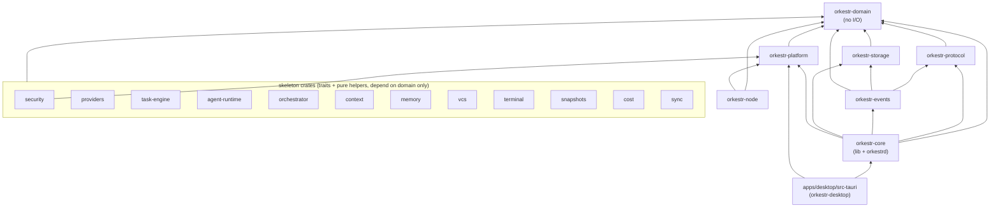
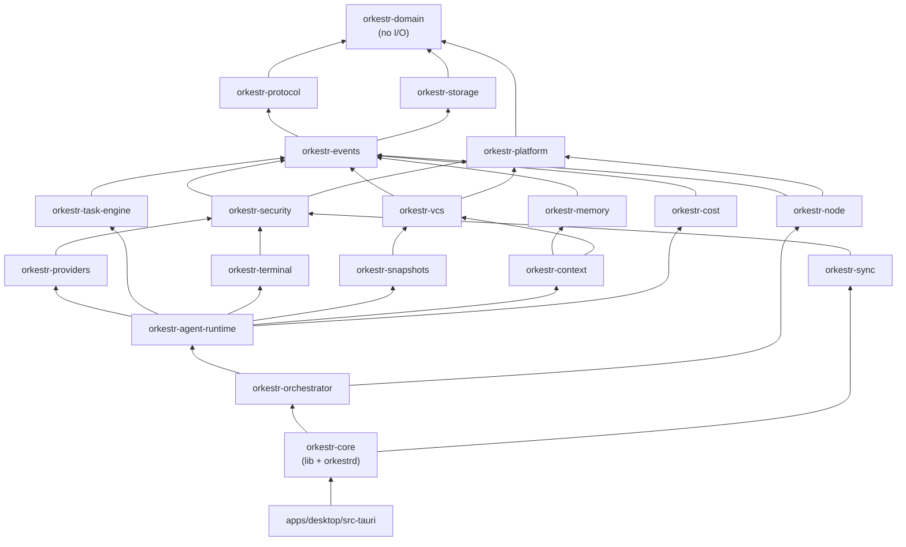
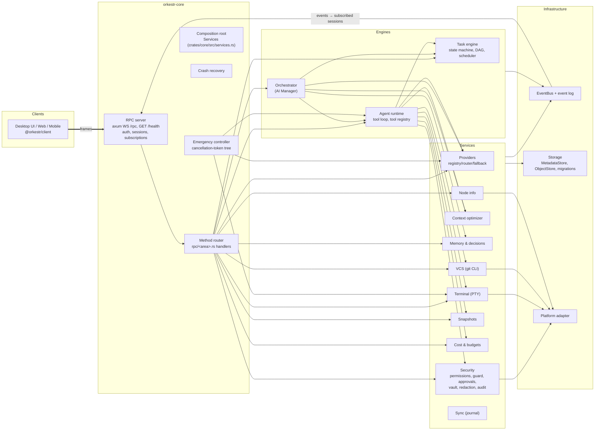

# Component Diagram (C4 Level 3)

> Deliverable §65 #3. One component = one crate (Rust) or one package (TS).
> Crate names, layering and invariants come from `docs/ENGINEERING_CONTRACT.md`
> §2–§8. Each crate section first states what the Phase 0 foundation code
> **actually** exposes ("As built", checked against `crates/*/src` on
> 2026-10-02), then the **target** public surface for the phase that
> implements it; implementers may add items but must not change names/semantics
> fixed by the contract without an ADR. Detailed specs for providers, agent
> runtime, task state machine, permissions, sync and nodes live in their own
> deliverables (§65 #7–#15); this file only fixes each component's boundary.

## 1. Crate dependency graph

### 1.1 As built (Phase 0 foundation, from the `Cargo.toml`s)

Arrows point from dependent to dependency ("A → B" = A uses B).



Notes on the as-built graph:

- **`events` → `storage`** (not `storage` → `events` as drawn in ADR-0001 and
  §1.2): the persisted log `SqliteEventLog` lives in `orkestr-events` and uses
  `orkestr_storage::Db` and its `Migration` type; `orkestr-storage` has no event
  knowledge. CA-3's goal (no dependency cycle, persistence behind a trait —
  `EventLog`) holds; only the placement differs. Engines that need both
  storage and events are unaffected.
- `orkestr-core` does not depend on any skeleton crate yet; they are wired in as
  their phase lands (§3.19).
- No crate depends on `orkestr-core` except the desktop shell.

### 1.2 Target graph (Phase 1+)

Every edge not drawn here is **forbidden**; adding one requires an ADR (rules
enforced in CI once `scripts/check-deps` exists, see `monorepo.md` §3). The
`storage`/`events` edge is drawn as built (events → storage).



Transitive edges are allowed implicitly (e.g. `security` may use `storage`
because `events → storage`). The layering, bottom-up:

| Tier | Crates | Rule |
|---|---|---|
| 0 Model | `domain` | No I/O, no tokio, no filesystem, no network. |
| 1 Wire / persistence | `protocol`, `storage` | `protocol`: serde/ts-rs types and pure routing helpers, no runtime. `storage`: SQLite + object store, knows no events. |
| 2 Bus | `events` | Bus, `EventLog` port and its SQLite implementation (`SqliteEventLog`, on `storage::Db`). |
| 3 Infra | `platform` | The only crate with `#[cfg(target_os)]` (see `monorepo.md` §3.1 rule 2 for the one violation in `orkestrd.rs`) and the only one allowed `unsafe` (documented FFI). Depends on `domain` only. |
| 4 Services | `security`, `vcs`, `terminal`, `snapshots`, `memory`, `cost`, `node`, `sync`, `providers`, `task-engine`, `context` | Depend only on lower tiers and on the explicit same-tier edges drawn above. |
| 5 Engines | `agent-runtime`, `orchestrator` | Depend on service **traits**; never on `core`. |
| 6 Composition | `core`, `apps/desktop/src-tauri` | Only place where concrete implementations are chosen and wired. |

Cross-cutting collaborations that would create cycles are inverted with a
trait owned by the *consumer* and implemented in `core` wiring, e.g.
`providers::RoutingSignals` (implemented with data from `cost` + `node`),
`task-engine::ResourceProbe` (implemented by `node`).

## 2. Core-internal component view



---

## 3. Per-crate specification

Each subsection starts with **As built** — the public surface the Phase 0
foundation code actually has — followed by the **target** surface for the
phase that implements the crate. Target signatures are design intent: when a
crate is implemented, its owner reconciles the target with the as-built
skeleton (keeping the as-built names unless an ADR or this document says
otherwise) and updates this file.

Conventions for every crate: `#![forbid(unsafe_code)]` (`platform` uses
`#![deny(unsafe_code)]` with one documented `#[allow]`), a `thiserror` error
enum (as built the names are domain-specific: `StorageError`, `EventError`,
`PlatformError`, `CoreError`, `TaskError`, `AgentError`, `ProviderError`,
`SecurityError`, `VcsError`, …), async traits via `async-trait` (object-safe,
`Send + Sync`), `tracing` spans carrying `correlation_id`, `project_id`,
`task_id`, `agent_id` where applicable (§50). Each crate that owns tables
exposes its migrations as a function returning `Vec<orkestr_storage::Migration>`
(as built: `orkestr_storage::storage_migrations()`,
`orkestr_events::events_migrations()`, `orkestr_core::migrations::CORE_MIGRATIONS`),
composed by `orkestr_core::migrations::all()` (§3.4).

### 3.1 `orkestr-domain` — entities, IDs, enums (built in Phase 0)

**Responsibilities**: the §51 data model as plain Rust types; ID newtypes;
closed enums shared by every layer; small pure helpers. No I/O, no async.

**As built** (`crates/domain/src/*.rs`; every wire type derives `Serialize`,
`Deserialize`, `TS` with `#[ts(export)]` unconditionally — there is no `ts`
feature, CA-7 was resolved this way):

```rust
// ids.rs — define_id! newtypes over uuid::Uuid (v7), serialized as the hyphenated string
define_id!(UserId); define_id!(DeviceId); define_id!(NodeId); define_id!(ProjectId);
define_id!(RepositoryId); define_id!(WorkspaceId); define_id!(SnapshotId); define_id!(ProviderId);
define_id!(CredentialRefId); define_id!(AgentTemplateId); define_id!(AgentId); define_id!(AgentTeamId);
define_id!(TaskId); define_id!(ExecutionId); define_id!(ToolCallId); define_id!(ApprovalId);
define_id!(MemoryItemId); define_id!(KnowledgeSourceId); define_id!(DecisionId); define_id!(EnvironmentId);
define_id!(DeploymentId); define_id!(SecretRefId); define_id!(UsageRecordId); define_id!(AuditEventId);
define_id!(PluginId); define_id!(McpServerId); define_id!(NotificationId); define_id!(EventId);
define_id!(CorrelationId); define_id!(TerminalId); define_id!(SessionId);
// each: new() (Uuid::now_v7), from_uuid, as_uuid, parse -> Result<_, IdParseError>, Display, FromStr, KIND
// ProviderId is a UUID too (ADR-0020's slug decision is not implemented, see ADR-0020 notes)

pub enum TaskStatus { Planned, Ready, Running, Waiting, Blocked, Review, Testing,
                      Completed, Failed, Cancelled, Interrupted, Recovering }   // ALL, is_terminal(), is_interruptible_on_crash()
pub enum TaskPriority { Background, Low, Normal, High, Critical }              // Ord: Background < … < Critical
pub enum AgentState { Idle, Listening, Thinking, Coding, Testing, Reviewing,
                      Waiting, Error, Completed, Stopped }                     // is_busy(), is_finished()
pub enum AgentRole { Manager, Architect, Backend, Frontend, Database, Qa, Security,
                     DevOps, UiUx, ProductManager, Reviewer, Researcher, Custom(String) }
pub enum Capability { Read, Write, Delete, Terminal, Git, Network, Browser, DbRead,
                      DbWrite, Docker, Ssh, Deploy, ComputerControl, Secrets }  // ALL, is_sensitive()
pub enum ApprovalMode { Ask, SemiAuto, FullAuto }                              // default Ask
pub enum PermissionEffect { Allow, Ask, Deny }
#[serde(tag = "scope")] pub enum PermissionScope { Global, Project{project_id}, Agent{agent_id}, Task{task_id} } // specificity()
pub struct PermissionRule { capability, effect, resource: Option<String>, scope }
pub enum DataClassification { Public, Internal, Confidential, Secret }         // §56
pub struct PrivacyPolicy { pub ai: AiPolicy, pub sync: SyncPolicy }            // allows_provider(), allows_remote_sync()
#[serde(tag = "mode")] pub enum AiPolicy { CloudAllowed, SelectedProvidersOnly{providers: Vec<ProviderId>}, LocalModelsOnly }
pub enum SyncPolicy { Allowed, SelfHostedOnly, NoRemoteSync }
pub enum OsKind { Windows, MacOs, Linux, Other }  pub enum Arch { X64, Arm64, Other }

#[serde(tag = "type", content = "id")]
pub enum Actor { User(UserId), Agent(AgentId), Manager, System }               // {"type":"User","id":"…"}
pub struct ModelRef { pub provider_id: ProviderId, pub model: String }
pub struct Budget { max_cost_usd: Option<f64>, max_tokens, max_duration_secs, period: BudgetPeriod, warn_at: f64 }
pub struct UsageSummary { input_tokens: u64, output_tokens: u64, cost_usd: f64 } // money is f64 USD on the wire
pub type Timestamp = chrono::DateTime<Utc>;  pub fn now() -> Timestamp;  pub fn slugify(&str) -> String;

// Entities (§51): Project, Repository, Workspace, WorkspaceSnapshot, Provider,
// ProviderCredentialReference, Model, AgentTemplate, AgentInstance, AgentTeam,
// Task, TaskDependency, Execution, ToolCall, Approval, MemoryItem,
// KnowledgeSource, Decision, Environment, Deployment, SecretReference,
// UsageRecord, AuditEvent, Plugin, McpServer, Notification, User, Device, Node.
```

Field-level definitions of every entity: `data-model.md` (its §6 lists the
intentional differences between these wire types and the planned tables).

**Depends on**: `serde`, `serde_json`, `uuid` (`v7`), `chrono`, `ts-rs`,
`thiserror`. **Phase**: all of it exists; entities for P4+ (Device,
Deployment, Plugin, …) are declared so the protocol is stable, but unused.

### 3.2 `orkestr-protocol` — wire protocol & TS export (built in Phase 0)

**Responsibilities**: frames, error codes, event envelope and `EventKind`,
method markers and `methods::<area>` param/result types, topics and routing,
`ui_config` schema (§29). Single source for `@orkestr/protocol`.

**As built** (normative details: `../api/protocol.md` §0, `event-model.md` §0):

```rust
pub const PROTOCOL_VERSION: u32 = 1;
pub enum ClientFrame { Auth{token, id, client}, Req{id, method, params}, Sub{id, topics}, Unsub{id, topics} }
pub enum ServerFrame { Res(ResFrame), Event{seq, event: Box<Event>} }
pub struct ResFrame { id, ok, result: Option<Value>, error: Option<RpcError> }
pub struct AuthResult { session_id, server_version, protocol_version, last_seq }  pub struct SubResult { topics }
pub struct RpcError { pub code: RpcErrorCode, pub message: String, pub data: Option<Value> } // unimplemented_feature(), not_found(), …
pub enum RpcErrorCode { Unauthorized, BadRequest, NotFound, Conflict, Forbidden,
                        ApprovalRequired, RateLimited, BudgetExceeded, ProviderError, Internal } // snake_case
pub struct Event { seq, id, ts, project_id, task_id, agent_id, node_id, correlation_id, #[serde(flatten)] kind: EventKind }
pub enum EventKind { /* 39 kinds, tag = "kind", content = "payload" */ }   pub struct NewEvent { … }
pub trait Method: 'static { const NAME: &'static str; type Params; type Result; }
pub mod methods { system, projects, events /* implemented */; tasks, agents, providers, terminal, approvals,
                  emergency, memory, vcs, files, snapshots, cost, nodes, settings /* PLANNED name lists */ }
pub fn methods::registry() -> Vec<MethodDescriptor>;  pub fn methods::is_valid_method_name(&str) -> bool;
pub mod topic { ALL = "*", GLOBAL, project(), task(), agent(), terminal(), node(), is_valid(), event_topics(), matches() }
pub mod ui_config { UiConfig{schema_version, theme, layout, performance_mode}, ThemeConfig, LayoutConfig, PerformanceMode,
                   UiConfig::validate() -> Result<(), Vec<UiConfigIssue>>, is_valid_token_name/value, UI_CONFIG_SCHEMA_VERSION }
pub use orkestr_domain as domain;
```

Topics are plain strings (`"project:<uuid>"`), not a Rust enum. The ADR-0005
extensions (`hello`, `sinceSeq`, `ping`, `lagged`, `idempotencyKey`) are
**(planned)**.

**Depends on**: `domain`, `serde`, `serde_json`, `chrono`, `uuid`, `ts-rs`,
`thiserror`. **Tests**: frame/error/envelope round-trips, contract-minimum event
kinds, routing, method-name rules; `export_bindings` writes
`packages/protocol/src/generated/` (run via `npm run gen:protocol`).

### 3.3 `orkestr-events` — event bus, persistence, correlation (built in Phase 0)

**As built** (details: `event-model.md` §0.2): `EventBus`
(`with_log`/`in_memory`, `publish`, `subscribe`, `subscribe_all`, `last_seq`,
`replay`), `Subscription::recv() -> Option<Received>` (`Event` | `Lagged(n)`),
the `EventLog` trait with `SqliteEventLog` (table `events`, migration
`events_0001_log`) and `MemoryEventLog`, `ReplayQuery`/`ReplayPage`, the
task-local correlation helpers `with_correlation`, `current_correlation`,
`new_correlation`, and `EventError { Invalid, Log(StorageError) }`.
**Depends on**: `domain`, `protocol`, `storage` (for `Db`, `Migration`,
`rusqlite`), `tokio`.

**Target (Phase 1)**: the transactional outbox (`event-model.md` §3.2) — events
appended in the same SQLite transaction as the state change and broadcast
after commit, a persisted seq ceiling (§3.3), durability/retention classes and
the retention job. The publishing surface handed to engines stays
`EventBus::publish` for ephemeral events; durable events go through the outbox
helper next to `Db` (`storage-abstraction.md` S1).

### 3.4 `orkestr-storage` — metadata, objects, migrations (built in Phase 0)

**As built** (details: `storage-abstraction.md` §0):

- `Db` — one SQLite connection behind a mutex, driven from tokio through
  `spawn_blocking` (`open`, `open_in_memory`, `call`, `call_blocking`,
  `migrate`); WAL, `synchronous=NORMAL`, `foreign_keys=ON`,
  `busy_timeout=5s`, `temp_store=MEMORY`.
- `Migration { id, owner, up, down }` and `Migrator` (bookkeeping table
  `_orkestr_migrations(seq, id, owner, checksum, down_sql, applied_at)`,
  blake3 checksum of `up`, drift and unknown-applied-migration detection,
  `rollback_last`, `rollback_to`).
- `MetadataStore { fn projects(&self) -> &dyn ProjectRepository }`,
  `ProjectRepository { list, get, insert, update, delete }`,
  `SqliteMetadataStore` (table `projects`, migration `storage_0001_projects`).
- `ObjectStore { put, get, exists, delete }` and `FsObjectStore`
  (`ObjectId` = 64 lowercase hex of blake3 over the uncompressed bytes;
  layout `objects/ab/cd/<hash>`; header `OKO1` + codec byte; zstd when it
  saves space; atomic temp + rename; verified reads).
- `StorageError { Sqlite, Io, Json, Migration{id, message}, NotFound, Conflict, Corrupt, Invalid, Join }`.

**Target (Phase 1+)**: per-engine repositories on `Db`, a reader pool behind
the same API, `object_refs` + GC, the outbox helper, `rev` columns
(ADR-0007/`storage-abstraction.md` §2–3).

### 3.5 `orkestr-platform` — OS abstraction (built in Phase 0: core set)

**As built** (details: `platform-abstraction.md` §0): `PlatformAdapter` with
`info`, `paths`, `process`, `shells`, `credentials`, `notifications`,
`autostart`, `hotkeys`, `microphone`, `computer_control`, `power`,
`resources`; `NativePlatform::new(paths)` (+ `with_credentials`,
`with_autostart`); `Paths` (`resolve()` honouring `ORKESTR_HOME`,
`from_root`, `database_file`, `objects_dir`, `discovery_file`, `token_file`,
`session_marker`); `fs::write_private_file`; `PlatformError`
(`NotSupported{feature, os, hint}` is the explicit "unimplemented-feature").
GUI-bound capabilities (hotkeys, Windows notifications) and the Phase 3/7 ones
(microphone, computer control) return `NotSupported`.
**Depends on**: `domain` only (+ `directories`, `sysinfo`, `keyring`, …).

**Target**: the richer sub-traits of `platform-abstraction.md` §1–§2
(`ProcessSupervisor` with containment groups, `WindowSupport`,
`HostServices` injected by the desktop host, `PlatformCapabilities`).

### 3.6 `orkestr-security` — permissions, guard, approvals, vault, audit (P1)

**As built (skeleton, `crates/security/src/lib.rs`)**: `Decision { Allow, Ask(String), Deny(String) }`; `ActionContext { project_id, agent_id, task_id, approval_mode, protected_environment }`; `trait PermissionEngine { fn check(&self, actor: &Actor, capability: Capability, resource: &str, ctx: &ActionContext) -> Decision }` (synchronous); `DangerClass { Safe, Dangerous(String), Forbidden(String) }`; `ShellDialect { PowerShell, Cmd, Posix }`; `trait DangerousActionGuard { classify_command(&str, ShellDialect), classify_sql(&str) }`; `trait PathGuard { confine(root, requested) }`; `trait SecretStore { put(name, value), get(&SecretReference), delete(&SecretReference) }` (async); `trait Redactor { redact(&str) -> String }`; `SecurityError { PathEscape, SecretNotFound, VaultLocked, Backend, Unimplemented }`. **No implementation exists yet** (no engine, no guard rules, no vault); the RPC token and log redaction currently live in `orkestr-core` (`auth`, `redact`). Depends on `domain` + `platform`. Phase 1 replaces `resource: &str` with the typed `Resource` and `ActionContext` with `CheckContext` (below, ADR-0010).

**Responsibilities**: the only place that decides whether an action may run
(§23, §52); classify dangerous actions; approval queue; secrets vault
(`SecretStore`, ADR-0011, `storage-abstraction.md` §5); path confinement;
redaction; audit log; global kill-switch flags (Disable Full Auto, Disable
Network Tools, Lock Vault).

Normative signatures: **ADR-0010** (permission engine and dangerous action
guard). Boundary summary:

```rust
// ADR-0010 (abridged)
pub trait PermissionEngine: Send + Sync + 'static {
    /// Pure, synchronous; reads only the in-memory rule snapshot.
    fn check(&self, actor: &Actor, cap: Capability, res: &Resource, ctx: &CheckContext<'_>) -> Decision;
    fn rules_version(&self) -> u64;
}
pub enum Decision { Allow, Ask(Reason), Deny(Reason) }
pub enum Resource { Path{path, op}, Command{shell: ShellKind, line, cwd}, Git{op, repo, args},
    Url{url, method}, Secret{reference}, Database{environment, statement}, Deploy{environment, target},
    Container{op}, Host{host}, Screen, Tool{server, tool} }
pub enum Danger { Safe, Unknown, Dangerous(Vec<DangerTag>), Forbidden(DangerTag) }
pub fn classify_command(shell: ShellKind, line: &str, env: &GuardEnv) -> Danger;
pub fn classify_git(op: &GitOp, args: &[String]) -> Danger;
pub fn classify_sql(stmt: &str) -> Danger;
pub mod fs { pub fn confine(root: &Path, requested: &Path) -> Result<ConfinedPath, PathViolation>; }

// Additional services owned by this crate (async, persisted):
#[async_trait]
pub trait ApprovalService: Send + Sync {
    async fn request(&self, req: ApprovalRequest) -> Result<ApprovalId, SecurityError>;   // ApprovalRequested
    async fn wait(&self, id: ApprovalId, cancel: CancellationToken) -> Result<ApprovalResolution, SecurityError>;
    async fn resolve(&self, id: ApprovalId, by: &Actor, decision: ApprovalDecision,
                     note: Option<String>) -> Result<(), SecurityError>;                 // ApprovalResolved
    async fn pending(&self, project: Option<ProjectId>) -> Result<Vec<Approval>, SecurityError>;
}
#[async_trait]
pub trait PolicyStore: Send + Sync {          // persists rules, publishes new snapshots to the engine
    async fn set_rule(&self, rule: PolicyRule) -> Result<(), SecurityError>;
    async fn rules(&self, scope: &PermissionScope) -> Result<Vec<PolicyRule>, SecurityError>;
}
pub struct Redactor { /* known secret values (Aho-Corasick) + key-shaped patterns */ }
impl Redactor { pub fn register(&self, v: &secrecy::SecretString); pub fn redact<'a>(&self, s: &'a str) -> Cow<'a, str>; }
#[async_trait]
pub trait AuditLog: Send + Sync { async fn record(&self, e: AuditEvent) -> Result<(), SecurityError>; }
```

`check` is synchronous and I/O-free by design (ADR-0010); path
canonicalization (`fs::confine`) runs before it. Evaluation order (ADR-0010):
`Forbidden` ⇒ `Deny` → confinement ⇒ `Deny` → rules narrowest scope first
(Task ⊂ Agent ⊂ Project ⊂ Global; `Deny` beats `Allow` at the same scope) →
approval mode → `Dangerous` ⇒ at least `Ask`, even in `FullAuto`. Every
non-`Allow` and every `Secrets`/`Deploy` decision is audited. Approvals are
bound to the action hash (one-shot `Grant`s in `CheckContext`).
**Depends on**: `storage`, `platform` (shell kinds, credential store, path
helpers), `keyring`, `chacha20poly1305`, `argon2`, `zeroize`, `secrecy`.
**Owns tables**: `policy_rules`, `approvals`, `audit_events`,
`secret_references`. **Events**: `ApprovalRequested`, `ApprovalResolved`,
`Notification` (`EmergencyStop` is emitted by core).

### 3.7 `orkestr-providers` — provider hub (P1; consensus helpers P2)

**As built (skeleton, `crates/providers/src/lib.rs`)**: `ProviderDescriptor { kind, display_name, is_local, capabilities: ModelCapabilities, max_context_tokens, coding_agent }`; `Role`, `ChatMessage`, `ToolSpec`, `ChatRequest { model, messages, tools, max_output_tokens, temperature, reasoning }`; `ChatEvent { TextDelta(String), ToolCall{id, name, arguments}, Usage{input_tokens, output_tokens}, Done, Error(ProviderError) }`; `ProviderError { RateLimited{retry_after_secs}, QuotaExceeded, Auth, Network, BadRequest, Server, Cancelled, Unimplemented }`; `ChatStream = BoxStream<'static, ChatEvent>`; `CodingAgentRequest { prompt, cwd, model, max_turns }`; `trait ProviderAdapter { id() -> ProviderId, descriptor(), auth_state() -> AuthState, list_models() -> Vec<Model>, health() -> ProviderHealth, chat(ChatRequest, CancellationToken) -> ChatStream, run_coding_agent(..) -> ChatStream /* default Unimplemented */ }`. **No adapter (not even `mock`) exists yet.** The target surface below and `provider-adapter-spec.md` refine these types (`ModelInfo`, `HealthReport`, `CodingAgentStream`, a richer adapter-level auth status) — see the reconciliation table in `provider-adapter-spec.md` §0.

**Responsibilities**: `ProviderAdapter` contract (contract §7), adapters
(`openai`, `anthropic`, `gemini`, `deepseek`, `ollama`, `openai_compatible`,
`claude_code`, `codex`, `mock`), registry, router (§7), fallback executor,
error classification, privacy-policy filter (§56).

Normative trait and types: `docs/providers/provider-adapter-spec.md` (§65 #7)
and ADR-0012 (official-only auth). Boundary summary:

```rust
#[async_trait]
pub trait ProviderAdapter: Send + Sync + 'static {
    fn id(&self) -> &ProviderId;
    fn descriptor(&self) -> ProviderDescriptor;          // cheap, no I/O
    async fn auth_state(&self) -> AuthState;             // never spends tokens; < 3 s
    async fn list_models(&self) -> Result<Vec<ModelInfo>, ProviderError>;
    async fn health(&self) -> HealthReport;
    async fn chat(&self, req: ChatRequest, cancel: CancellationToken) -> Result<ChatStream, ProviderError>;
    async fn run_coding_agent(&self, req: CodingAgentRequest, cancel: CancellationToken)
        -> Result<CodingAgentStream, ProviderError>;     // default: unsupported
    async fn refresh(&self) -> Result<(), ProviderError> { Ok(()) }   // hot-swap after config edit
}
// ChatEvent: TextDelta | ToolCall | Usage | Done | Error (contract §7); stream ends with exactly one Done/Error.
// ProviderError classes: RateLimited{retry_after} | QuotaExceeded | Auth | Network | BadRequest | Server | Cancelled.

pub struct ProviderRegistry { /* RwLock<HashMap<ProviderId, Arc<dyn ProviderAdapter>>> — hot-swap */ }
pub trait RoutingSignals: Send + Sync {          // implemented in core from cost + node + benchmarks
    fn budget_headroom_micros(&self, scope: &BudgetScope) -> Option<i64>;
    fn rate_state(&self, p: &ProviderId) -> RateState;
    fn benchmark(&self, model: &ModelRef, task_kind: &str) -> Option<BenchmarkScore>;
}
pub struct Router { pub fn route(&self, req: &RoutingRequest) -> Result<RouteDecision, ProviderError>; }
pub struct RouteDecision { pub primary: ModelRef, pub fallbacks: Vec<ModelRef>, pub reason: String }
pub struct FallbackExecutor { /* runs chat() along RouteDecision; emits ProviderFallback */ }
```

CLI adapters resolve executables through `platform.shell().which()` over the
login environment (GUI apps on macOS do not inherit the shell `PATH`) and run under
`ProcessSupervisor` (tree-kill on cancel). API keys are fetched from
`SecretStore` per request and registered with the `Redactor`.
**Depends on**: `security`, `platform` (transitively), `reqwest` (rustls),
`eventsource-stream`, `tokio-util` (CancellationToken).
**Owns tables**: `providers`, `provider_models`, `provider_credentials`
(references only). **Events**: `ProviderStatusChanged`,
`ProviderRateLimited`, `ProviderFallback`.

### 3.8 `orkestr-task-engine` — tasks, DAG, scheduling (P1; resource-aware P2)

**As built**: `state_machine::{allowed_transitions, can_transition, transition(&mut Task, to, now) -> Result<TaskStatus /*from*/, InvalidTransition>}` — exactly the contract §5 table (41 edges), unit-tested; `transition` maintains `started_at`, `finished_at` (terminal states) and `attempts` (+1 on `Ready|Recovering → Running`). `dependencies_satisfied(&[TaskStatus])`. Skeleton traits `TaskStore { list, get, save, add_dependency, interruptible }` and `Scheduler { next_batch(slots) }`; `TaskError { InvalidTransition, NotFound, Cycle, Storage, Unimplemented }`. No persistence, no RPC, no recovery hook yet. Details: `task-state-machine.md` §0.

**Responsibilities**: the **only** implementation of the task state machine
(contract §5); dependency DAG with cycle rejection; priority queue (§11);
scheduler that admits `Ready` tasks under concurrency/resource limits; crash
recovery transition.

Normative API: `task-state-machine.md` (§65 #9). Boundary summary:

```rust
impl TaskEngine {
    pub fn is_allowed(from: TaskStatus, to: TaskStatus) -> bool;                 // const table = contract §5
    pub async fn transition(&self, req: TransitionRequest) -> Result<Task, TaskEngineError>; // optimistic version + outbox
    pub async fn add_dependency(&self, task: TaskId, depends_on: TaskId, actor: Actor) -> Result<(), TaskEngineError>; // Cycle error
    pub async fn next_admissible(&self, resources: &ResourceView) -> Option<TaskId>;
    pub async fn recover_after_crash(&self, crashed: CoreSessionId) -> Result<RecoveryReport, TaskEngineError>;
    // + create / update / get / list / graph (CRUD used by RPC `tasks.*`)
}
// TaskEngineError: InvalidTransition{from,to} | GuardFailed | VersionConflict | NotFound | Cycle | Storage
pub trait ResourceProbe: Send + Sync { fn view(&self) -> ResourceView; }   // implemented from node + platform, wired in core
```

Side effects on other engines (spawn agent, create worktree, merge) never run
inside the task transaction; the orchestrator reacts to events or checks
guards before requesting the transition (`task-state-machine.md`).

Rule: a task becomes `Ready` automatically only when all dependencies are
`Completed`; dependency failure moves dependents to `Blocked`.
**Owns tables**: `tasks`, `task_dependencies`, `task_transitions`.
**Events**: `TaskCreated`, `TaskUpdated`, `TaskStatusChanged`.
**Tests**: exhaustive 12×12 transition table test; DAG cycle tests; property
test "Ready ⇒ all deps Completed".

### 3.9 `orkestr-agent-runtime` — agents and tool loop (P1; teams/hierarchy P2)

**As built (skeleton)**: `ToolContext { agent_id, project_id, task_id, root, cancel }`; `trait Tool { name(), description(), capability(), input_schema(), call(&ToolContext, Value) }`; `ToolRegistry { register, get, names }`; `Handoff { task_id, summary, relevant_files: Vec<String>, decisions: Vec<String>, unresolved, test_state: Option<String>, artifacts: Vec<String> }`; `trait AgentRuntime { spawn(template, project, task) -> AgentInstance, stop(agent), stop_all() -> u32, list() }`; `AgentError`. No tool loop and no tools yet. The target below (from `agent-runtime-spec.md`) changes `Tool` to the descriptor/resource/execute shape and `Handoff` to typed ids.

**Responsibilities**: AgentTemplate registry and import/export (§6);
AgentInstance lifecycle and state; the tool loop
(provider ⇄ tools) with permission checks, approvals, budgets (max turns,
tokens, cost, wall time); tool registry; structured handoff (§57); per-agent
worktree acquisition via `vcs`; snapshot before risky tool calls.

Normative spec: `docs/agents/agent-runtime-spec.md` (§65 #8). Boundary summary:

```rust
#[async_trait]
pub trait Tool: Send + Sync {
    fn descriptor(&self) -> &ToolDescriptor;            // name, JSON schema, capability, class, timeout, phase
    /// Pure: derive the permission resource from args (paths confined, commands parsed).
    fn resource(&self, args: &Value, env: &ToolEnv) -> Result<Resource, ToolError>;
    async fn execute(&self, args: Value, env: &ToolEnv, cancel: CancellationToken) -> Result<ToolOutput, ToolError>;
}
// Tools never receive the SecretStore (agent-runtime-spec §5).
pub struct ToolRegistry { pub fn register(&mut self, t: Arc<dyn Tool>); pub fn for_template(&self, t: &AgentTemplate) -> Vec<Arc<dyn Tool>>; }

#[async_trait]
pub trait AgentRuntime: Send + Sync {
    async fn spawn(&self, req: SpawnRequest) -> Result<AgentHandle, AgentError>;   // AgentSpawned
    async fn stop(&self, id: AgentId, reason: StopReason) -> Result<(), AgentError>; // cancels token tree
    async fn send(&self, id: AgentId, msg: UserOrManagerMessage) -> Result<(), AgentError>;
    async fn state(&self, id: AgentId) -> Result<AgentInstance, AgentError>;
    async fn handoff(&self, from: AgentId, to: SpawnRequest) -> Result<AgentHandle, AgentError>;
}
pub struct Handoff { pub task: TaskId, pub summary: String, pub relevant_files: Vec<PathBuf>,
    pub decisions: Vec<DecisionId>, pub unresolved: Vec<String>, pub test_state: Option<TestState>,
    pub artifacts: Vec<ObjectId> }
```

Built-in P1 tools (names per agent-runtime-spec §5.2): `fs_read`, `fs_list`,
`fs_search`, `fs_write`, `fs_edit`, `fs_delete`, plus terminal and git tools
confined to the agent's worktree.
P2+: browser, MCP (see ambiguity A6), DB, Docker, SSH, deploy, computer control.
**Events**: `AgentSpawned`, `AgentStarted`, `AgentStateChanged`,
`AgentStopped`, `AgentMessage` (ephemeral deltas), `ToolCallStarted`,
`ToolCallFinished`. **Owns tables**: `agent_templates`, `agent_instances`,
`executions`, `tool_calls`, `handoffs`.
**Rule**: no provider-specific branches (§60.5) — everything provider-specific
is behind `ProviderAdapter`.

### 3.10 `orkestr-orchestrator` — AI Manager (P1 basic; P2 quality loops)

**As built (skeleton)**: `PlannedTask { key, title, description, acceptance_criteria, depends_on, role, model, priority }`, `Plan { project_id, goal, summary, tasks, max_parallel_agents }`, `trait Manager { plan(project, goal) -> Plan, execute(plan) }`, `validate_plan(&Plan)` (unique keys, known dependencies, no cycles — unit-tested), `OrchestratorError { Planning, Unimplemented }`.

**Responsibilities**: understand request with project memory (§1), plan,
decompose into tasks + dependencies, choose roles/models, dynamic spawn,
delegate, monitor, ask the user only when needed; P2: review → build → test →
heal loops with max attempts/time/budget (§17), consensus/adversarial review
(§8), merge manager (§16), product-manager flow (§9).

Split into separate modules with separate traits (no god service, §60.3):

```rust
pub trait Planner { async fn plan(&self, req: &ManagerRequest, ctx: &ContextPack) -> Result<Plan, OrchError>; }
pub trait Decomposer { async fn decompose(&self, plan: &Plan) -> Result<Vec<NewTaskWithDeps>, OrchError>; }
pub trait SpawnPolicy { fn decide(&self, ready: &[Task], res: &ResourceSnapshot, budget: &BudgetView) -> Vec<SpawnRequest>; }
pub trait QualityLoop { async fn run(&self, task: TaskId, gates: &QualityGates) -> Result<LoopOutcome, OrchError>; } // P2
pub trait MergeManager { async fn propose(&self, task: TaskId) -> Result<MergeProposal, OrchError>; } // P2
pub struct Manager { pub async fn handle(&self, project: ProjectId, msg: ManagerRequest) -> Result<PlanId, OrchError>; }
```

Plans are LLM output parsed into a JSON schema and **validated** before any
task is created; invalid plans are retried with the error, never partially
applied. Every loop has explicit `max_attempts`, `deadline`, `budget` (§17).
**Events**: `ManagerMessage`, `ReviewFinished`, `BuildStarted/Failed/Succeeded`,
`TestRunFinished`, `DecisionRecorded` (via memory).
**Owns tables**: `plans`, `plan_steps`, `merge_proposals` (P2).

### 3.11 `orkestr-context` — context optimizer (P1 basic; P2 full)

**As built (skeleton)**: `ContextRequest { project_id, task_id, goal, token_budget }`, `ContextItem { source, content, relevance, tokens }`, `ContextBundle { items, total_tokens }`, `trait ContextOptimizer { build(&ContextRequest) -> ContextBundle }`, `estimate_tokens(&str)` (≈ 4 chars/token) and `pack(items, budget)` (greedy by relevance), both unit-tested. The target names (`ContextPack`, `budget_tokens`) are design names for the same concepts; keep the as-built names unless the Phase 2 owner renames them consistently.

**Responsibilities**: build a token-bounded `ContextPack` for a task instead of
sending the repo (§20): task + acceptance criteria, relevant files/symbols,
dependency neighbours, project rules, memory hits, handoff.

```rust
pub struct ContextRequest { pub project: ProjectId, pub task: Option<TaskId>, pub query: String,
    pub model: ModelRef, pub budget_tokens: u32, pub worktree: PathBuf }
pub struct ContextPack { pub sections: Vec<ContextSection>, pub estimated_tokens: u32,
    pub sources: Vec<SourceRef> }          // every snippet cites path+range or memory id
#[async_trait] pub trait ContextOptimizer: Send + Sync {
    async fn build(&self, req: ContextRequest) -> Result<ContextPack, ContextError>; }
pub trait TokenEstimator: Send + Sync { fn estimate(&self, model: &ModelRef, text: &str) -> u32; }
```

P1: path/name relevance, FTS hits, git-recency, char-based token estimate.
P2: symbol extraction (tree-sitter), import graph, per-model tokenizers.
Respects `.gitignore` and project "never send" globs (secrets, `.env*`).

### 3.12 `orkestr-memory` — memory, knowledge, decisions (P1 basic; P2 decision log)

**As built (skeleton)**: `trait MemoryStore { upsert(&MemoryItem), delete(MemoryItemId), list(MemoryScope), search(&[MemoryScope], query, limit) }`, `trait DecisionLog { record(&Decision), list(ProjectId) }`, `MemoryError { NotFound, Storage, Unimplemented }`. No tables yet.

```rust
#[async_trait] pub trait MemoryStore: Send + Sync {
    async fn upsert(&self, item: NewMemoryItem) -> Result<MemoryItem, MemoryError>;   // MemoryUpdated
    async fn search(&self, q: MemoryQuery) -> Result<Vec<MemoryHit>, MemoryError>;    // FTS5, project before global
    async fn delete(&self, id: MemoryItemId) -> Result<(), MemoryError>;
}
#[async_trait] pub trait DecisionLog: Send + Sync {
    async fn record(&self, d: NewDecision) -> Result<Decision, MemoryError>;          // DecisionRecorded
    async fn list(&self, project: ProjectId) -> Result<Vec<Decision>, MemoryError>;
}
#[async_trait] pub trait KnowledgeBase: Send + Sync {
    async fn ingest(&self, src: KnowledgeSourceSpec) -> Result<KnowledgeSource, MemoryError>; // MD P1, PDF later
}
```

Project rules take precedence over global (§20). **Owns tables**:
`memory_items`, `memory_fts` (FTS5), `decisions`, `knowledge_sources`.

### 3.13 `orkestr-vcs` — Git via CLI (P1)

**As built (skeleton)**: `FileStatus { path, index: char, worktree: char }`, `RepoStatus { branch, head, ahead, behind, files }`, `Worktree { path, branch, head }`, `trait Git { status, diff(repo, base), branches, worktrees, add_worktree(repo, path, branch, base), remove_worktree(repo, path, force) }`, `VcsError { GitNotFound, NotARepository, Command{command, stderr}, Conflict, Unimplemented }`. No `git` invocation exists yet. The target trait is named `GitProvider` (`storage-abstraction.md` §6); whichever name the Phase 1 owner keeps must be used consistently.

Normative: ADR-0008 (git CLI) and ADR-0009 (worktree per agent).
`GitProvider` trait (signature in `storage-abstraction.md` §6) with the `GitCli`
implementation; `WorktreeManager` per ADR-0009 (branch/worktree naming and
`WorktreePolicy` defined there); per-repository mutation lock keyed by
`git rev-parse --git-common-dir` for operations that write shared `.git` state
(§62.5); conflict listing via `merge_preview` (`merge-tree --write-tree`) for
the P2 merge manager; `WorkspaceWatcher` (`notify` crate, debounced, respects
`.gitignore`) emitting `FileChanged`. Invocation rules (ADR-0008):
`--no-pager -c core.quotepath=off -c color.ui=never -c gc.auto=0`,
`GIT_TERMINAL_PROMPT=0`, `GIT_OPTIONAL_LOCKS=0` for reads, `LC_ALL=C`,
NUL-separated output formats only, git binary resolved through
`platform.shell().which("git")`, timeouts with process-tree kill.
**Owns tables**: `repositories`, `worktrees`. **Events**: `FileChanged`.

### 3.14 `orkestr-terminal` — PTY sessions (P1)

**As built (skeleton)**: `TerminalSpec { project_id, agent_id, shell: Option<PathBuf>, cwd, cols, rows }`, `trait TerminalManager { open(spec) -> TerminalId, write(id, &[u8]), resize(id, cols, rows), close(id) }`, `TerminalError { NotFound, Pty, ApprovalRequired, Unimplemented }`. No PTY code yet; shell detection already exists in `orkestr-platform::ShellDetector`.

```rust
pub enum TerminalOwner { User, Agent(AgentId) }
pub struct TerminalSpec { pub shell: ShellId, pub cwd: PathBuf, pub env: Vec<(String, String)>,
    pub cols: u16, pub rows: u16, pub owner: TerminalOwner, pub project: Option<ProjectId> }
#[async_trait] pub trait TerminalManager: Send + Sync {
    async fn open(&self, spec: TerminalSpec) -> Result<TerminalId, TerminalError>;
    async fn write(&self, id: TerminalId, data: &[u8], actor: &Actor) -> Result<(), TerminalError>;
    async fn resize(&self, id: TerminalId, cols: u16, rows: u16) -> Result<(), TerminalError>;
    async fn close(&self, id: TerminalId) -> Result<(), TerminalError>;
    async fn history(&self, id: TerminalId, from: u64, max: usize) -> Result<Vec<u8>, TerminalError>;
    /// Agent path: classify via security, await approval if needed, run non-interactively,
    /// capture exit code + output. Never raw keystroke injection for agents.
    async fn run_command(&self, req: CommandRequest, cancel: CancellationToken) -> Result<CommandResult, TerminalError>;
}
```

`portable-pty` (ConPTY on Windows ≥ 1809, openpty on Unix); ring buffer +
periodic scrollback flush to `ObjectStore`. Agents cannot `write` to a
user-owned terminal (enforced: `Forbidden`). **Events**: `TerminalOutput`
(ephemeral, UTF-8 lossy text + byte offset), `TerminalExited`.

### 3.15 `orkestr-snapshots` — checkpoints & rollback (P1)

**As built (skeleton)**: `trait SnapshotEngine { create(workspace, task, reason: SnapshotReason, label, by: Actor) -> WorkspaceSnapshot, rollback_task(task) -> RollbackReport, rollback_workspace(snapshot) -> RollbackReport }`, `RollbackReport { files_restored, pre_rollback_snapshot }`, `SnapshotError { NotFound, WouldClobber, Storage, Unimplemented }`. `SnapshotReason` (domain) is `Manual | BeforeRiskyAction | TaskCheckpoint | PreRollback | Periodic`; the ADR-0021 names `BeforeTask`/`BeforeRollback` map to `TaskCheckpoint`/`PreRollback`.

```rust
#[async_trait] pub trait SnapshotService: Send + Sync {
    async fn create(&self, ws: &WorkspaceRef, reason: SnapshotReason, task: Option<TaskId>)
        -> Result<WorkspaceSnapshot, SnapshotError>;                 // SnapshotCreated
    async fn rollback_workspace(&self, id: SnapshotId, mode: RollbackMode) -> Result<RollbackReport, SnapshotError>;
    async fn rollback_task(&self, task: TaskId) -> Result<RollbackReport, SnapshotError>; // RollbackPerformed
    async fn list(&self, ws: &WorkspaceRef) -> Result<Vec<WorkspaceSnapshot>, SnapshotError>;
}
```

Mechanism (normative: **ADR-0021**): a snapshot is a JSON **content
manifest** in the `ObjectStore` (HEAD oid, branch, staged-index entries,
changed/untracked/deleted files with their object ids — bare 64-hex blake3 as built), captured from
`git status --porcelain=v2 -z --untracked-files=all` under the worktree's
agent write lock. The user's repo, refs and index are never written (no
private refs, no stashes, no auto-commit, §41/§64). Ignored files are excluded
except `snapshots.includeIgnored` globs; secret-pattern files are stored
encrypted with the vault key. `rollback_task` restores only files in `F(T)`
whose current hash equals the task's post-task hash; anything else is
reported as a conflict for a 3-way merge (§25, §63 J). A `BeforeRollback`
snapshot is taken first; workspace rollback is classified Dangerous (always
asks). Non-git workspaces use a full-tree manifest honouring `.orkestrignore`.
**Owns tables**: `snapshots`. **Events**: `SnapshotCreated`,
`RollbackPerformed`.

### 3.16 `orkestr-cost` — usage, pricing, budgets (P1; benchmarks/analytics P2)

**As built (skeleton)**: `BudgetCheck { Ok, Warn(f64), Exceeded }`, `trait CostLedger { record(&UsageRecord), project_summary(ProjectId) -> UsageSummary }`, `check_budget(&Budget, &UsageSummary)` (USD only; unit-tested), `CostError`. Money is `f64` USD in the domain (`costUsd`); the integer micro-USD below is the planned storage representation (`data-model.md` §1.1).

```rust
#[async_trait] pub trait CostService: Send + Sync {
    async fn record(&self, u: NewUsageRecord) -> Result<UsageRecord, CostError>;
    async fn check(&self, scope: &BudgetScope, estimate_micros: i64) -> Result<BudgetDecision, CostError>;
    async fn summary(&self, q: UsageQuery) -> Result<UsageSummary, CostError>;
    async fn set_budget(&self, b: Budget) -> Result<(), CostError>;
}
pub enum BudgetDecision { Ok, Warn { threshold_pct: u8 }, Exceeded }   // → error code budget_exceeded
// Money = i64 micro-USD (`cost_micros`), never f64 (data-model.md §1)
```

Pricing tables are versioned data (`pricing/*.json`), user-overridable;
subscription/CLI usage is recorded as tokens with `cost = None` when unknown,
never guessed. **Events**: `BudgetThreshold`. **Owns tables**:
`usage_records`, `budgets`, `pricing_overrides`, (P2) `benchmarks`.

### 3.17 `orkestr-sync` — SyncBackend seam (P1 LocalOnly; P4 remote)

**As built**: `trait SyncBackend { name() -> &'static str, is_remote() -> bool, push(&[JournalEntry]) -> SyncReport, pull(ProjectId) -> SyncReport }`, `JournalEntry { seq, project_id, path, object_id, ts }`, `SyncReport { pushed, pulled, bytes, conflicts }`, `SyncError { NotAllowed, Backend }`, and the real `LocalOnlyBackend` (name `local-only`, never transfers; unit-tested). No journal table yet.

`SyncBackend` trait and the `LocalOnly` backend per ADR-0019 (see
`storage-abstraction.md` §7); P4 wire protocol in `docs/sync/sync-protocol.md`.
In P1–P3 the backend reports `Disabled` and the sync worker never starts; the
journal table/seam exists but writes are switched on in P4 (ADR-0019).
**Events**: `SyncCompleted` (P4). **Owns tables**: `sync_journal`,
`sync_cursors`, `sync_conflicts` (created in P1, used from P4).

### 3.18 `orkestr-node` — node info & registry (P1 local; P6 cluster)

**As built**: `describe_local_node(id, &dyn PlatformAdapter, core_version, now) -> Node` (OS, arch, hostname, resources via `ResourceMonitor`, tools found on `PATH` from `PROBED_TOOLS = [git, node, npm, cargo, docker, python, ollama, claude, codex]`), `trait NodeRegistry { list(), heartbeat(Node) }`, `NodeError`. The core does not call it yet (`system.info` reports `nodeId` from `core_meta`).

```rust
pub struct NodeInfo { pub id: NodeId, pub name: String, pub os: OsKind, pub arch: Arch,
    pub cpu: CpuInfo, pub ram_bytes: u64, pub gpus: Vec<GpuInfo>, pub disks: Vec<DiskInfo>,
    pub runtimes: Vec<RuntimeInfo> /* git, node, python, docker, ollama, claude, codex */,
    pub local_models: Vec<String>, pub load: LoadInfo }
#[async_trait] pub trait NodeRegistry: Send + Sync {
    async fn local(&self) -> Result<NodeInfo, NodeError>;
    async fn list(&self) -> Result<Vec<NodeInfo>, NodeError>;          // P1: only local
}
pub struct NodeResourceProbe;   // impl task_engine::ResourceProbe via platform::ResourceMonitor (wired in core)
```

**Events**: `NodeStatus` (periodic, throttled), `NodeOffline` (P6).

### 3.19 `orkestr-core` — composition root, RPC, `orkestrd` (built in Phase 0)

**As built** (`crates/core/src`):

```rust
pub struct CoreConfig {
    pub data_dir: Option<PathBuf>,     // None → ORKESTR_HOME or the OS default (Paths::resolve)
    pub bind_addr: SocketAddr,         // default 127.0.0.1:0; validate() rejects non-loopback
    pub token: Option<String>,         // tests; None → random 256-bit hex token; ≥ 32 chars
    pub write_discovery: bool,         // default true: write core.json + core.token
    pub event_capacity: usize,         // broadcast buffer, default 4096
}
pub struct CoreHandle { pub url, pub http_url, pub token, pub addr, pub data_dir, pub services: Arc<Services>, .. } // Debug redacts the token
impl CoreHandle { pub fn shutdown_token(&self) -> CancellationToken; pub async fn shutdown(self); }
pub async fn start(config: CoreConfig) -> Result<CoreHandle, CoreError>;
pub enum CoreError { Config, AlreadyRunning{url, pid}, Storage, Events, Platform, Io }
pub struct Services { version, started_at, started_instant, node_id, paths, platform: Arc<dyn PlatformAdapter>,
                      db: Db, events: EventBus, projects: Arc<dyn ProjectRepository>, objects: Arc<FsObjectStore>,
                      recovered_from_crash: bool }   // plain struct of handles, no logic
// modules: auth (token gen + constant-time compare), config, discovery (core.json/core.token, find_running,
// probe_health), error, logging (tracing init + EventBusLayer), migrations (CORE_MIGRATIONS, all(),
// load_or_create_node_id), recovery (session.lock, RecoveryHook, default_hooks() = []), redact,
// rpc (RpcRouter, RpcContext, build_router, areas system/projects/events), server (axum /health, /rpc)
```

Startup order (as built, `start`): validate config → resolve and create
`Paths` → `NativePlatform` → refuse if `discovery::find_running` finds another
live core for this data dir (`AlreadyRunning`) → `recovery::begin_session`
(`session.lock`; a live foreign pid also ⇒ `AlreadyRunning`) → open `Db`, run
`migrations::all()` (core → storage → events) → `FsObjectStore` (zstd level 3)
→ `SqliteMetadataStore` → `EventBus::with_log(SqliteEventLog)` → node id from
`core_meta` → `Services` → attach the log bridge → `recovery::run` (only if the
previous session crashed; no hooks registered yet, it records a `Log` event) →
generate token → bind the listener → spawn axum → write `core.token` +
`core.json` (when `write_discovery`). There is no exclusive `core.lock` file
lock (ADR-0004); exclusivity comes from discovery + `session.lock`.
Shutdown: cancel → stop the server (5 s) → remove discovery files if ours →
remove `session.lock` → detach the log bridge.

`orkestrd [--data-dir <path>] [--port <port>] [--log-json]` runs the same
`start` headless and stops on Ctrl-C (and SIGTERM on Unix).

**Target (Phase 1+)**: RPC areas `tasks`, `agents`, `manager`, `providers`,
`approvals`, `permissions`, `files`, `vcs`, `worktrees`, `terminal`,
`snapshots`, `memory`, `cost`, `budgets`, `nodes`, `settings`, `emergency`
(names per `../api/protocol.md` §8); engines added to `Services`; recovery
hooks registered by the task engine, agent runtime and terminal; emergency
controls (`emergency.stopAll`, `emergency.stopProject`, `agents.stop`) cancel
the token tree locally before any provider call returns (§52);
`MethodPolicy`/`Session` principal (protocol §5.2). ADR-0004's `CoreMode`,
`node_name` and `LogConfig` fields and `ShutdownReason` are planned additions.

### 3.20 Apps and TS packages

| Package | Responsibilities | Public surface (as built) | Phase |
|---|---|---|---|
| `apps/desktop/src-tauri` (`orkestr-desktop`) | Find a running `orkestrd` (mode `external`) or start the core embedded; shut it down on exit | Tauri command `core_connection() -> {url, token, mode: "embedded"\|"external", startupMs}` (waits ≤ 30 s); capability `default` allows only window minimize/maximize/close/drag | P0 ✔ |
| `apps/desktop/src` | Frameless shell: title bar, project rail, dockview workspace, command palette, status bar, connection screen; 15 registered panels (`manager`, `code`, `files`, `terminal`, `git`, `agents`, `tasks`, `architecture`, `browser`, `database`, `logs`, `deployments`, `memory`, `costs`, `monitoring`) — `logs` is live, the rest are honest `PhasePlaceholder`s | `panels/registry.ts` (`PANELS`, `getPanel`, `CODING_PRESET`), `PanelProps { projectId: string \| null }`, `lib/tauri.ts` (the only `@tauri-apps/*` import), `core/client.ts` (`bootstrapCore`, `getClient`) | P0 shell ✔, panels P1–P3 |
| `@orkestr/protocol` | Generated TS types + typed helpers | everything in `generated/` (incl. `Methods`, `METHOD_NAMES`, `EVENT_KINDS`, `PROTOCOL_VERSION`), `MethodName`, `ParamsOf`, `ResultOf`, `EventOf`, `PayloadOf`, `isEventKind`, `EPHEMERAL_EVENT_KINDS`, `isLocalNotice`, `topic`, `isValidTopic`, `eventTopics`, `eventMatches` | P0 ✔ |
| `@orkestr/client` | WS RPC client: first-frame auth, typed `call`, ref-counted subscriptions, reconnect with backoff + resubscribe + `events.replay` gap fill | `new OrkestrClient(url, token, options)`, `connect()`, `call(method, params, {timeoutMs, signal})`, `subscribe(topics, handler) → unsubscribe`, `onStateChange`, `state`, `server`, `close()`; `OrkestrError`, `backoffDelay` | P0 ✔ |
| `@orkestr/ui` | Tokens (`--ok-*` CSS variables), theme engine applying a validated `UiConfig`, primitives | `applyTheme`, `applyUiConfig`, `applyPerformanceMode`, `validateTheme`, `validateUiConfig`, `defaultUiConfig`, `BUILTIN_THEMES`, `ThemeValidationError`; `Button`, `IconButton`, `Panel`, `GlassPanel`, `Badge`, `Input`, `Tabs`, `Tooltip`, `StatusDot`, `EmptyState`, `Kbd`, `Spinner` (no React context provider) | P0 ✔ |
| `apps/web` | Web client over gateway | reuses client/protocol/ui | P4 |
| `apps/mobile` | React Native command center | reuses client/protocol | P5 |

## 4. Ownership of §51 entities

| Entity | Owner crate | Entity | Owner crate |
|---|---|---|---|
| Project | storage (as built: `SqliteMetadataStore`, table `projects`, migration `storage_0001_projects`; RPC area `projects` in core) | Task, TaskDependency | task-engine |
| Workspace, Environment | core (planned core migration module) | — | — |
| Repository, worktrees | vcs | WorkspaceSnapshot | snapshots |
| Provider, Model, ProviderCredentialReference | providers | AgentTemplate, AgentInstance, AgentTeam, Execution, ToolCall | agent-runtime |
| Approval, SecretReference, AuditEvent | security | MemoryItem, KnowledgeSource, Decision | memory |
| UsageRecord | cost | Node | node |
| User, Device | core (P1: single local profile) → control plane P4 | Deployment | (P4+, crate TBD via ADR) |
| Plugin | (P7, crate TBD) | McpServer | (P2+, see A6) |
| Notification | core (fan-out of `Notification` events) | — | — |

## 5. Open points (to be settled by ADR)

- **A3** `ts-rs` in `domain` — **resolved in the foundation**: domain types
  derive `TS` unconditionally (no `ts` feature); `ts-rs` is a pure derive
  dependency and adds no I/O (CA-7).
- **A6** MCP hub (§19) has no crate in the contract layout; proposed
  `agent-runtime::tools::mcp` for P2 with an ADR deciding whether to extract
  `crates/mcp`.
- The `projects` table lives in `orkestr-storage` (it was the first metadata
  repository); Workspace/Environment tables are planned in `core` because no
  service crate owns them. If project management grows (purge across engines,
  import, watchers), extract `crates/projects` via ADR.
- **Dependency direction `events → storage`** (as built, §1.1) differs from
  ADR-0001's drawing; it needs an ADR erratum or a superseding ADR (see
  ADR-0001 implementation notes).
- Deployment/Environment management (§26) and Browser agent (§18) have no crate
  yet (P4+ / P2+); they will be tools/services added by ADR, behind the same
  `Tool` + `PermissionEngine` boundaries.
