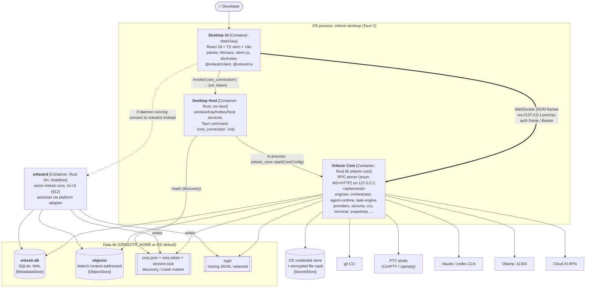
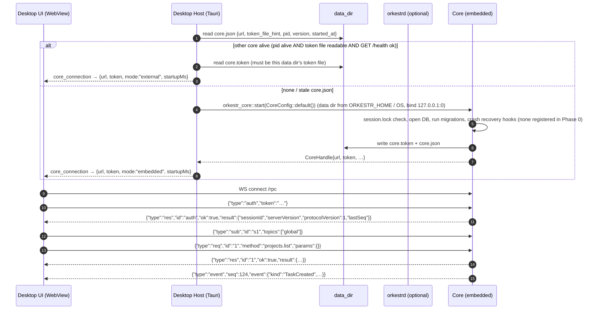
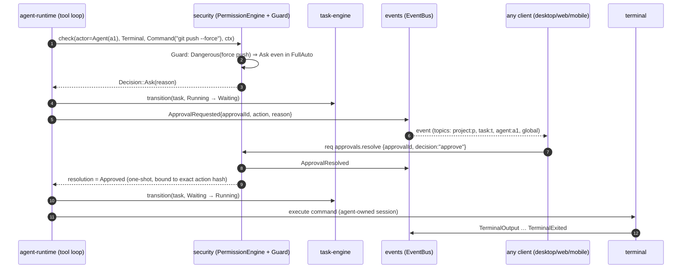
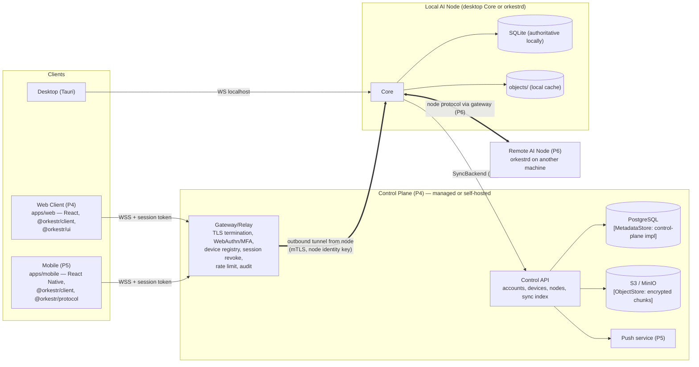

# Container Diagram (C4 Level 2)

> Deliverable §65 #2. A "container" here is a separately runnable/deployable
> unit or a data store (C4 sense), not a Docker container. Contract references:
> §3 (runtime model), §4 (wire protocol), §6 (security invariants).

## 1. Phase 1–3 containers (single machine)

### Container responsibilities

| Container | Tech | Responsibility | Must NOT | Phase |
|---|---|---|---|---|
| **Desktop UI** | React 18, TS strict, Vite, zustand, Monaco, xterm.js, dockview, @xyflow/react, Rive/Lottie, three.js | Render panels (§14), command palette (§54), approvals, Mission Control (P3), themes from validated `ui_config` (§29) | Call Tauri for business data; hardcode colors; eval AI-generated code | P1 (visual P3) |
| **Desktop Host** (`apps/desktop/src-tauri`) | Tauri 2, Rust | Start/locate Core; expose `core_connection`; frameless windows, tray, floating robot windows (P3), global hotkeys (P3) as *host services* injected into Core | Contain business logic or `#[cfg(target_os)]` code (that is `orkestr-platform`'s job) | P1 |
| **Orkestr Core** (`crates/core` lib) | tokio, axum, rusqlite | Composition root; RPC router; event fan-out; crash recovery; emergency stop | Bind non-loopback; log secrets | P1 |
| **orkestrd** (`crates/core` bin) | same | Headless service so agents survive GUI close (§12); later the AI Node (§38) | Expose a raw terminal port (§35) | P1 (basic), P4/P6 (node) |
| **orkestr.db** | SQLite (rusqlite `bundled`), WAL | All metadata; each engine owns its tables via migrations | Store plaintext secrets | P1 |
| **objects/** | Filesystem, blake3 | Snapshot blobs, artifacts, terminal scrollback, knowledge files | Be addressed by anything but `ObjectId` | P1 |
| **SecretStore** | OS keyring via `keyring`; fallback `chacha20poly1305` file vault | API keys, tokens, env secrets | Be readable by agents directly | P1 |

## 2. Runtime: startup, discovery, connection

Rules (contract §3–4, §6):

- Bearer token: 256-bit random (64 hex chars), generated per Core start,
  compared in constant time. As built, **every** core (embedded or daemon)
  writes it to `<data_dir>/core.token` and references that file from
  `<data_dir>/core.json` (`token_file_hint`), so a desktop and a CLI can share
  one core (`CoreConfig::write_discovery`, default `true`). The files are
  written with `platform::fs::write_private_file` (Unix `0600`; on Windows they
  inherit the data directory ACL — an explicit owner-only DACL is a security
  follow-up). ADR-0004's "embedded keeps the token in memory unless the user
  allows other local clients" is **(planned)**.
- File layout and the daemon hand-off are specified in ADR-0004; frames in
  ADR-0005 and `../api/protocol.md` §0 (`unsub` is implemented; `hello`,
  `sinceSeq`, `ping`, `lagged` are planned).
- `core.json` is advisory: a stale file (dead pid or failing `/health`) is
  ignored and overwritten. Two Cores on one data dir are prevented by
  discovery (a live core found through `core.json` ⇒ `CoreError::AlreadyRunning`)
  plus the `<data_dir>/session.lock` marker (a live foreign pid in it ⇒
  `AlreadyRunning`). The exclusive OS file lock `core.lock` of ADR-0004 is
  **(planned)**.
- Browsers cannot set WS headers, so the first-frame `auth` is the portable
  path; desktop uses it too so all clients share one code path in
  `@orkestr/client`.
- `GET /health` is unauthenticated and returns only `{status:"ok",version}`.
- On shutdown the core removes `core.json`/`core.token` (only if they name its
  own pid) and `session.lock`.

## 3. Runtime: an agent tool call that needs approval

An approval is bound to the **exact** action (hash of capability + resource +
normalized command/args). Approving `git push --force origin feature` does not
authorize any other command.

## 4. Target-scope containers (P4–P6)

Design decisions:

- **The local SQLite stays authoritative for the node**; the Control Plane holds
  a synced replica plus device/session state. This is why `MetadataStore`
  needs a PostgreSQL implementation only on the Control Plane side (see
  `storage-abstraction.md` §4), and why "cloud can be disabled" (§67) is cheap.
- The gateway forwards the **same frames** as localhost (contract §4). It adds
  identity (`actor = RemoteDevice(deviceId, userId)`) to every request so the
  PermissionEngine can treat remote approvals differently (e.g. Secrets/Deploy
  may require re-auth with a passkey, §36).
- The tunnel is dialed outbound by the node; there is no listening port on the
  node beyond `127.0.0.1` (§35: "do not expose raw Core/terminal port").

## 5. Inter-container interfaces

| From → To | Protocol | Auth | Payload contract | Phase |
|---|---|---|---|---|
| Desktop UI → Desktop Host | Tauri IPC `invoke` | Tauri capability ACL (only `core_connection` + window cmds) | `{url, token, mode}` | P1 |
| Desktop UI → Core | WS `/rpc` JSON frames | First-frame `auth` | contract §4, types in `@orkestr/protocol` | P1 |
| Desktop Host → Core | Rust fn call `orkestr_core::start` | in-process | `CoreConfig` / `CoreHandle` | P1 |
| Core → git / CLIs / shells | child processes | OS user | stdout/stderr/JSON lines | P1 |
| Core → Ollama / Cloud APIs | HTTP(S) | API key via SecretStore | provider-specific, normalized to `ChatEvent` | P1 |
| Core → Control Plane | HTTPS + WSS | device key + session | Sync protocol (`docs/sync/`) | P4 |
| Web/Mobile → Gateway | WSS | WebAuthn/MFA session | contract §4 frames, unchanged | P4/P5 |
| Node ↔ Node | via gateway, mTLS | node identity | node protocol (§65 #14) | P6 |

## 6. Failure behaviour per container

| Failure | Behaviour |
|---|---|
| WebView reload / crash | Core unaffected (embedded) — UI reconnects, resubscribes, refetches state; agents keep running. |
| Desktop window close / quit with embedded Core | ADR-0004: P1 asks "Keep running in tray" (default) / "Stop all agents"; quitting calls `shutdown(UserQuit)` and running tasks become `Interrupted` (ADR-0022). P2 adds hand-off to a detached `orkestrd` (tasks `Interrupted → Recovering → Running`, gap < 5 s). |
| Core crash | On restart the leftover `<data_dir>/session.lock` of a dead pid is detected (as built; ADR-0022's `sessions` table is planned), `system.info.recoveredFromCrash` becomes `true` and a `Log` event records the recovery. Recovery hooks run before RPC accepts connections; as of Phase 0 none are registered — the task-engine (`Running/Waiting/Testing/Review → Interrupted`), agent-runtime, terminal and child-process containment hooks land in Phase 1. |
| Provider outage / limit | Router fallback chain (§7), `ProviderFallback` event. |
| Network down | Local providers (Ollama), editor, Git, terminal, snapshots keep working; sync journal queues (§42). |
| Keyring unavailable (headless Linux) | SecretStore falls back to encrypted file vault unlocked by user passphrase (see `storage-abstraction.md` §5.3). |
