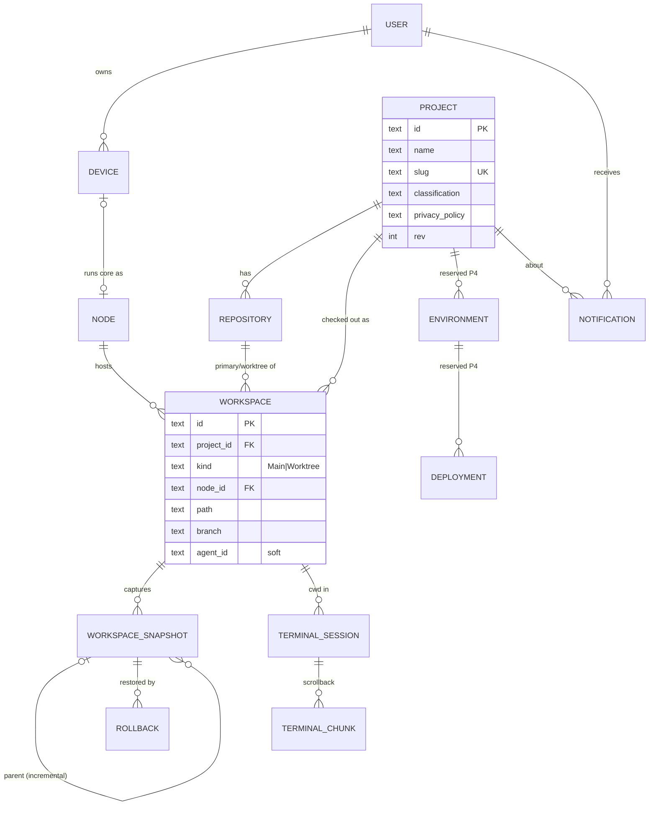
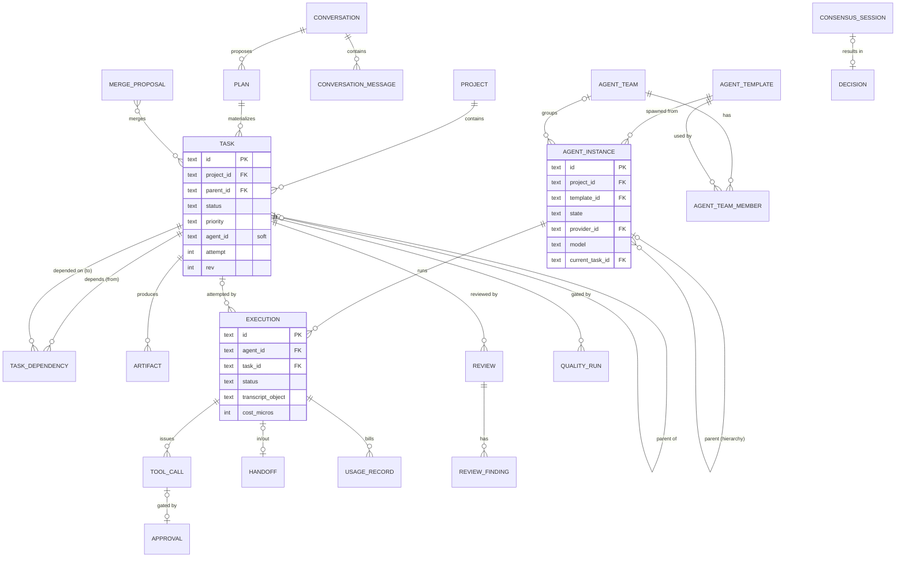
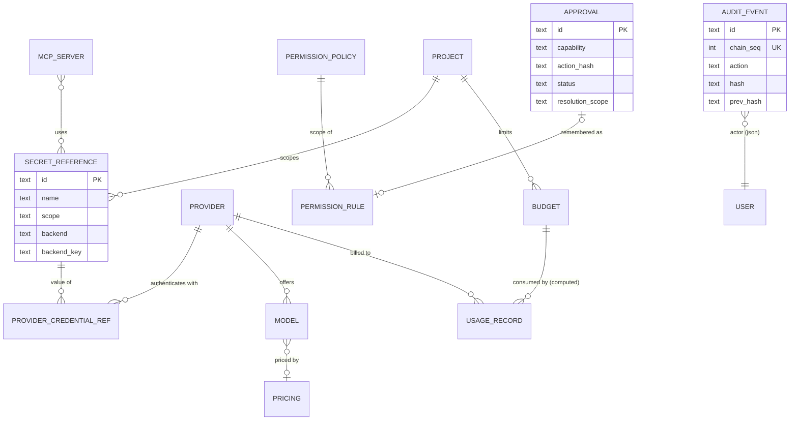
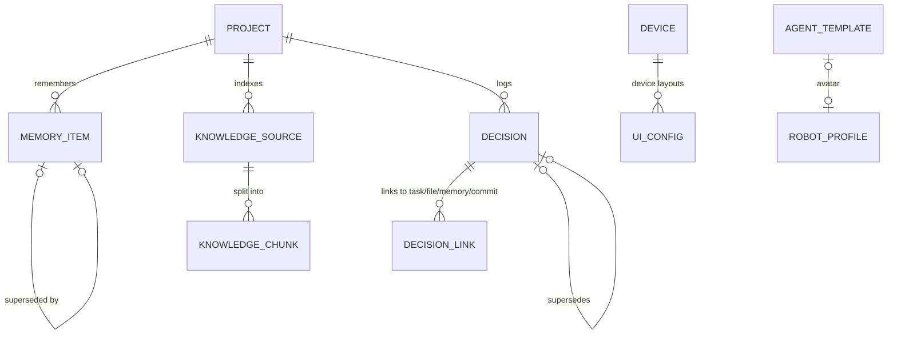
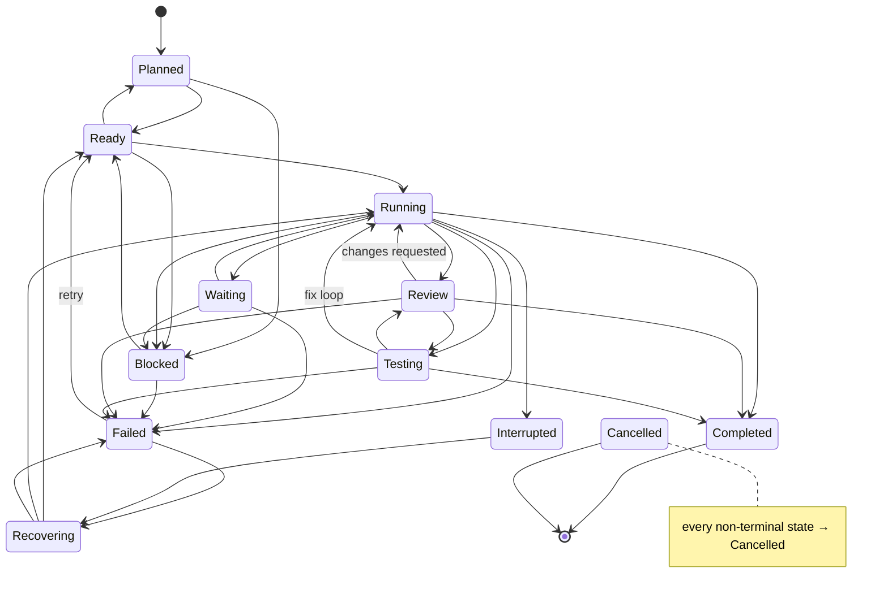

# Data Model

> Deliverable §65 #5. Covers every §51 entity plus the supporting entities that
> Phase 1–3 features need (§6, §10, §16, §17, §21, §22, §23, §29, §30, §33).
> Binding inputs: `docs/ENGINEERING_CONTRACT.md` (§3 persistence/IDs/time, §5 task
> states, §6 capabilities/security). Companion documents:
> `event-model.md` (events that mutate/describe these entities) and
> `../api/protocol.md` (wire shapes).
>
> Rule from §51: **the UI never touches the DB.** Every entity below reaches a
> client only through an RPC method or an event (contract §2, §4).

---

## 0. As built (Phase 0 foundation, 2026-10-02)

The foundation creates exactly **three tables** plus the migration
bookkeeping table, in this order (`orkestr_core::migrations::all()`):

| # | Migration id | Owner crate | Table | Columns |
|---|---|---|---|---|
| — | (bookkeeping) | storage | `_orkestr_migrations` | `seq INTEGER PK AUTOINCREMENT, id TEXT UNIQUE, owner, checksum` (blake3 of `up`), `down_sql`, `applied_at` |
| 1 | `core_0001_meta` | core | `core_meta` | `key TEXT PK, value TEXT` — holds `node_id` (`load_or_create_node_id`) |
| 2 | `storage_0001_projects` | storage | `projects` | `id TEXT PK, name, name_key TEXT UNIQUE` (lower-cased name ⇒ case-insensitive uniqueness), `archived INTEGER, created_at, updated_at, last_opened_at, doc TEXT` (the full `orkestr_domain::Project` JSON); index `projects_last_opened` |
| 3 | `events_0001_log` | events | `events` | see `event-model.md` §0.2 |

Everything else in this document (§1–§7) is the **Phase 1+ target** schema:
the `users`, `devices`, `nodes`, `settings`, `meta`, `sessions`,
`object_refs`, `sync_journal` tables, `rev`/`deleted_at` columns, the outbox
and the fixed-millisecond timestamp helper do **not** exist yet. The wire
types of every §51 entity already exist in `orkestr-domain` (§6). Crash
detection uses a file marker, `<data_dir>/session.lock`, not a `sessions`
table (§5.9).

## 1. Conventions (apply to every table unless stated)

### 1.1 Types

| Concept | Rust (`orkestr-domain`) | SQLite column | Wire (JSON) |
|---|---|---|---|
| Entity id | newtype over `uuid::Uuid` v7, `#[serde(transparent)]`, `#[ts(type = "string")]` (`ProjectId`, `TaskId`, …) | `TEXT PRIMARY KEY` (canonical lowercase hyphenated) | `"0192f0c4-…"` |
| Timestamp | `chrono::DateTime<Utc>` | `TEXT` RFC3339 UTC, **fixed millisecond precision, `Z` suffix** (`2026-10-02T09:15:03.120Z`) so lexical order = time order | same string |
| Enum | Rust enum, serde variant name | `TEXT` + `CHECK (col IN (...))` | variant name (see 1.2) |
| JSON blob | typed struct / `serde_json::Value` | `TEXT CHECK (json_valid(col))` | nested object |
| Boolean | `bool` | `INTEGER CHECK (col IN (0,1))` | `true/false` |
| Money | wire/domain: `f64` USD (`costUsd`, `maxCostUsd` — as defined in `orkestr-domain::common`); storage: `i64` **micro-USD** | `INTEGER` (`cost_micros`) — exact sums; converted at the store boundary (`(usd * 1e6).round()`) | number (`costUsd`) |
| Token / byte counts | `u64` stored as `i64` | `INTEGER` | number. As built, ts-rs exports every 64-bit integer as `number` through `TS_RS_LARGE_INT = "number"` in `.cargo/config.toml` (no per-field `#[ts(type = "number")]` needed); values must stay below 2^53 |
| Object reference | `ObjectId` — as built: 64 lowercase hex of blake3 (`orkestr_storage::ObjectId`, no prefix; ADR-0007/ADR-0020 specify `"b3:" + 64 hex`, not implemented). Wire fields holding one are plain strings (e.g. `WorkspaceSnapshot.manifestObjectId`) | `TEXT` | string |
| Provider id | `ProviderId` — as built: a **UUID v7** newtype like every other id. ADR-0020 / CA-14 decided a **slug** (`anthropic`, `claude_code`, `custom:<slug>`); that is not implemented and needs either a code change before providers land or a superseding ADR | `TEXT PRIMARY KEY` | string |
| Path in project | `RelPath` (UTF-8, `/` separators, no `..`, no leading `/`) | `TEXT` | string |
| Absolute path | `AbsPath` (normalized by `orkestr-platform::paths`, `\\?\` stripped) | `TEXT` | string (local principals only, see 1.5) |
| Actor | `Actor` enum (below) | `TEXT` JSON | tagged object |

**(planned)** A shared serde helper `orkestr_domain::time::millis` MUST be used
for every timestamp so all crates write the identical fixed-width format
(chrono's default serializer emits variable fractional digits, which breaks
lexical ordering). As built, timestamps use chrono's default RFC 3339
serialization (`Timestamp = DateTime<Utc>`), and the `projects` columns are
written with `to_rfc3339()` (`+00:00` suffix, 0/3/6/9 fractional digits).
`projects.last_opened_at` is sorted lexically by `projects.list`; for UTC
values in that format the lexical order still equals time order (`+` sorts
before `.` and the digits), so nothing is broken today, but new tables must
adopt the fixed-width helper before relying on lexical order.

`Actor` is defined in `orkestr-domain::common` (adjacently tagged):

```rust
#[derive(Debug, Clone, Copy, PartialEq, Eq, Hash, Serialize, Deserialize, TS)]
#[serde(tag = "type", content = "id")]
pub enum Actor {
    User(UserId),      // {"type":"User","id":"0192…"}
    Agent(AgentId),    // {"type":"Agent","id":"0192…"}
    Manager,           // {"type":"Manager"}
    System,            // {"type":"System"}
    // Proposed, additive (P4, see remote-access.md §6.2):
    // RemoteDevice(DeviceId)   // {"type":"RemoteDevice","id":"…"}; user/role resolved from devices
}
```

Which system component acted (crash recovery, scheduler, …) is recorded in the
`reason`/`details` of the row or event, not in `Actor`.

### 1.2 Enum casing

- Domain/state enums (task status, agent state, capability, approval mode,
  priority, role, …) serialize as **PascalCase variant names** exactly as the
  contract writes them (`"Running"`, `"SemiAuto"`, `"ComputerControl"`), and are
  stored the same way in SQLite.
- Wire error codes are snake_case (contract §4) — they are not domain enums.
- Provider kinds follow the same rule (`OpenAi`, `OpenAiCompatible`,
  `ClaudeCode`, … — `orkestr-domain::provider::ProviderKind`). The snake_case
  names in contract §2 (`openai_compatible`, `claude_code`) are **module/adapter
  ids** in `orkestr-providers`, not wire values.
- Enums with data (`AgentRole::Custom(String)`, `TeamKind::Custom(String)`) are
  externally tagged by serde (`"Backend"` or `{"Custom":"Payroll"}`); their
  columns store the serde JSON value (`TEXT CHECK (json_valid(col))`).
- Every enum received by a Rust client declares a `#[serde(other)] Unknown`
  variant where forward compatibility matters (see protocol §9).

### 1.3 Standard columns

| Column | Applies to | Meaning |
|---|---|---|
| `id` | all entity tables | UUID v7 (time-ordered ⇒ good B-tree locality) |
| `created_at`, `updated_at` | all mutable tables | set by the owning store, never by clients |
| `rev INTEGER NOT NULL DEFAULT 0` | all **synced** tables | optimistic concurrency; incremented on every update; RPC update methods accept `expectedRev` (protocol §5.3) |
| `deleted_at TEXT NULL` | all **synced** tables | tombstone; rows are hidden by default and physically removed by GC after sync has acknowledged (Phase 4) or after 30 days in Local Only mode |

Append-only tables (`events`, `audit_events`, `usage_records`, `tool_calls`
after finish) carry no `rev`/`deleted_at`.

### 1.4 Sync classes (§40–45; Phase 4 implements replication, Phase 1 records intent)

| Class | Meaning | Phase 1–3 behaviour |
|---|---|---|
| **S** synced | Replicated to Control Plane/other devices via `SyncBackend` (journal-based). | Writes append to `sync_journal`; `LocalOnly` backend keeps it compacted. |
| **SM** synced-metadata | Row syncs, but referenced bodies/values do not (secret values, CLI sessions, absolute paths). | as S |
| **SO** synced-objects | Row syncs and referenced `objects/` content syncs as encrypted content-addressed chunks, subject to project privacy policy (§56: `NoRemoteSync` ⇒ never). | as S |
| **N** node-local | Describes resources of one node/device (paths, PTYs, worktrees). Other devices see a read-only mirror via node protocol (Phase 6), never edit it. | local |
| **L** local-only | Never leaves the device. | local |
| **D** derived | Rebuildable cache/index (FTS, aggregates). Never synced; rebuilt on demand. | local |

### 1.5 Sensitivity (§56 classification)

`Public < Internal < Confidential < Secret`. Notation in this document:

- **Pub / Int / Conf / Sec** — fixed classification of the row.
- **⟨P⟩** — content fields inherit the owning project's `classification`
  (default `Internal`). Provider/tool routing (§56) and remote/sync policy use the
  effective classification.
- **Secret** data is **never** stored in SQLite (contract §6). Only
  `SecretReference` rows exist; values live in `SecretStore`.
- Absolute filesystem paths are `Conf` and are returned only to local principals
  (Phase 4 remote principals get project-relative paths).

### 1.6 Ownership and migrations

Each crate owns its tables and contributes an ordered list of
`orkestr_storage::Migration { id, owner, up, down }` (as built; ids are
globally unique, convention `<owner>_<NNNN>_<name>`). `orkestr-core` applies
them in a fixed order in `orkestr_core::migrations::all()`; new lists are
appended, never reordered. **As built** the order is `core` (`core_meta`) →
`storage` (`projects`) → `events` (`events`). **Target** order for the tables
below (CA-9 with one insertion, `core.identity`, which CA-9 does not place but
every project-scoped table needs; positions 1–3 keep the as-built prefix):

```
 0 core           core_meta                                       ← as built
 1 storage        projects (as built), meta, object_refs, sessions (ADR-0022)
 2 events         events (as built; SqliteEventLog lives in orkestr-events)
 3 core.identity  users, devices, settings                        ← inserted here (not in CA-9)
 4 security       secret_references, permission_policies, permission_rules, approvals, audit_events
 5 providers      providers, provider_credential_refs, models
 6 task-engine    tasks, task_dependencies, artifacts
 7 agent-runtime  agent_templates, agent_teams, agent_team_members, agent_instances,
                  executions, tool_calls, handoffs, mcp_servers
 8 vcs            repositories, workspaces
 9 terminal       terminal_sessions, terminal_chunks
10 snapshots      workspace_snapshots, rollbacks
11 cost           pricing, budgets, usage_records, usage_daily, benchmark_stats
12 memory         memory_items(+fts), knowledge_sources, knowledge_chunks(+fts),
                  decisions, decision_links
13 orchestrator   conversations, conversation_messages, plans, reviews, review_findings,
                  merge_proposals, consensus_sessions, quality_runs
14 sync           sync_journal, sync_outbox (sync-protocol.md §3.1)
15 node           nodes
16 core.late      notifications, ui_configs, robot_profiles
   (reserved, created when their phase starts: environments, deployments, plugins; P4 remote tables per remote-access.md)
```

Rules:

1. **Enforced foreign keys only point to tables created earlier in this
   order.** In the entity tables below, `FK` means the relation; when the target
   comes **later** in the order, the column is implemented as a *soft
   reference*: indexed `TEXT`, validated by the owning service, swept by the
   orphan checker on startup. `~>` marks references that are always soft. With
   the CA-9 order, these columns are soft: every `node_id` (node is last);
   `tasks.workspace_id`, `agent_instances.workspace_id` (vcs comes after
   task-engine/agent-runtime); `approvals.task_id/agent_id/execution_id/tool_call_id`;
   `secret_references.environment_id`; `devices.push_secret_ref_id` (core.identity
   precedes security); `usage_records.*` → executions/tasks are enforced (cost
   comes after them).
2. `PRAGMA foreign_keys = ON`. Default `ON DELETE RESTRICT`; only pure child rows
   (dependencies, team members, FTS shadows, chunks) use `CASCADE`.
3. Within a crate's list, migrations run in list order; `_orkestr_migrations(seq,
   id, owner, checksum, down_sql, applied_at)` records them
   (`storage-abstraction.md` §0). A later
   migration that needs another crate's newer table must live in a set that
   runs after that crate (or in `core.late`). Every migration ships `up` and
   `down` SQL (§60.10). A data-destroying `down` must be marked `irreversible`
   and is refused without `--force`.
4. Project purge is coordinated by core, never by FK cascade:

```rust
/// Implemented by every engine that stores project-scoped rows.
pub trait ProjectDataOwner: Send + Sync {
    fn owner(&self) -> &'static str;                      // crate name
    fn purge_project(&self, tx: &rusqlite::Transaction<'_>, project: ProjectId)
        -> Result<PurgeReport, StorageError>;           // rows deleted, objects released
}
```

`projects.delete` (protocol) defaults to **unregister** (tombstone; no repository
files touched). `purge: true` runs every `ProjectDataOwner` in reverse migration
order inside one transaction and releases object references for GC. Repository
files on disk are never deleted by Orkestr (§60.8, §70).

### 1.7 Transactional outbox

**(planned, Phase 1)** State changes and their events commit atomically
(ADR-0018): repository methods return `(T, Vec<NewEvent>)` and a storage helper
(working name `Db::write_with_events`) appends the durable events in the
**same** SQLite transaction, then publishes them after commit (see
`event-model.md` §3). As built, handlers write state and then call
`EventBus::publish`, which appends the event in a separate statement
(`event-model.md` §0.2). Synced tables also append a
`record_op` entry to `sync_journal` in the same transaction
(`sync-protocol.md` §3.1).

---

## 2. Entity overview

| # | Entity (§51) | Table | Owner crate | Sync | Sensitivity | Phase |
|---|---|---|---|---|---|---|
| 1 | User | `users` | core (`core::identity`) | S | Conf (PII) | P1 (single local owner), P4 multi |
| 2 | Device | `devices` | core (`core::identity`) | S | Conf | P1 (this device), P4/P5 pairing |
| 3 | Node | `nodes` | node | N | Int | P1 (local node), P6 cluster |
| 4 | Project | `projects` | storage (`SqliteMetadataStore`, built in Phase 0; RPC in `core::rpc::projects`) | S | Int, ⟨P⟩ | P1 |
| 5 | Repository | `repositories` | vcs | S | Conf (remote URL) | P1 |
| 6 | Workspace | `workspaces` | vcs | N | Conf (paths) | P1 |
| 7 | WorkspaceSnapshot | `workspace_snapshots` | snapshots | SO | ⟨P⟩ | P1 |
| 8 | Provider | `providers` | providers | S | Int | P1 |
| 9 | ProviderCredentialReference | `provider_credential_refs` | providers | SM | Conf | P1 |
| 10 | Model | `models` | providers | D + S overrides | Pub | P1 |
| 11 | AgentTemplate | `agent_templates` | agent-runtime | S | Int / ⟨P⟩ for project templates | P1 |
| 12 | AgentInstance | `agent_instances` | agent-runtime | S (mirror) | Int | P1 |
| 13 | AgentTeam | `agent_teams`, `agent_team_members` | agent-runtime | S | Int | P2 |
| 14 | Task | `tasks` | task-engine | S | ⟨P⟩ | P1 |
| 15 | TaskDependency | `task_dependencies` | task-engine | S | Int | P1 |
| 16 | Execution | `executions` | agent-runtime | SO | ⟨P⟩ | P1 |
| 17 | ToolCall | `tool_calls` | agent-runtime | SO | ⟨P⟩ | P1 |
| 18 | Approval | `approvals` | security | S | Conf | P1 |
| 19 | MemoryItem | `memory_items` (+`memory_fts`) | memory | S | ⟨P⟩ | P1 basic, P2 full |
| 20 | KnowledgeSource | `knowledge_sources`, `knowledge_chunks` | memory | SO | ⟨P⟩ | P2 |
| 21 | Decision | `decisions`, `decision_links` | memory | S | ⟨P⟩ | P2 |
| 22 | Environment | `environments` | core (`core::environments`, reserved) | S | Conf | P4+ (reserved) |
| 23 | Deployment | `deployments` | core (`core::environments`, reserved) | S | Conf | P4+ (reserved) |
| 24 | SecretReference | `secret_references` | security | SM | Conf (value: Sec, never in DB) | P1 |
| 25 | UsageRecord | `usage_records` | cost | S | Int | P1 |
| 26 | AuditEvent | `audit_events` | security | S (append-only) | Conf | P1 |
| 27 | Plugin | `plugins` | core (`core::plugins`, reserved) | S | Int | P7 (reserved) |
| 28 | MCPServer | `mcp_servers` | agent-runtime (tool registry) | SM | Conf | P2+ |
| 29 | Notification | `notifications` | core (`core::notifications`) | S | Int | P1 |

Supporting entities (not named in §51, required by Phase 1–3 features):

| Entity | Table | Owner | Sync | Sensitivity | Phase | Spec |
|---|---|---|---|---|---|---|
| PermissionRule | `permission_rules` | security | S | Int | P1 | §23 |
| PermissionPolicy | `permission_policies` | security | S | Int | P1 | §23 |
| Budget | `budgets` | cost | S | Int | P1 basic, P2 smart | §22 |
| PricingEntry | `pricing` | cost | S | Pub | P1 | §22 |
| UsageDaily | `usage_daily` | cost | D | Int | P1 | §22 |
| BenchmarkStat | `benchmark_stats` | cost | D | Int | P2 | §22 |
| Artifact | `artifacts` | task-engine | SO | ⟨P⟩ | P1 | §10 |
| Handoff | `handoffs` | agent-runtime | S | ⟨P⟩ | P1 basic, P2 | §57 |
| Conversation | `conversations` | orchestrator | S | ⟨P⟩ | P1 | §5, §57 |
| ConversationMessage | `conversation_messages` | orchestrator | SO | ⟨P⟩ | P1 | §5 |
| Plan | `plans` | orchestrator | S | ⟨P⟩ | P1 | §1, §9 |
| Review / ReviewFinding | `reviews`, `review_findings` | orchestrator | S | ⟨P⟩ | P2 | §8, §17 |
| MergeProposal | `merge_proposals` | orchestrator | S | ⟨P⟩ | P2 | §16 |
| ConsensusSession | `consensus_sessions` | orchestrator | SO | ⟨P⟩ | P2 | §8 |
| QualityRun | `quality_runs` | orchestrator | SO | ⟨P⟩ | P1 manual, P2 auto | §17, §58 |
| TerminalSession | `terminal_sessions`, `terminal_chunks` | terminal | N | Conf | P1 | §15 |
| Rollback | `rollbacks` | snapshots | S | Int | P1 | §25 |
| UiConfig | `ui_configs` | core (`core::ui`) | S | Int | P1 basic, P3 | §29, §34 |
| RobotProfile | `robot_profiles` | core (`core::ui`) | SO | Int | P3 | §30 |
| Setting | `settings` | core | S / L per key | Int | P1 | — |
| Event | `events` | events (`SqliteEventLog` in `orkestr-events`, built in Phase 0) | L (Phase 4: feeds sync journal) | per payload | P1 | §49 |
| Meta | `meta` | storage | L | Int | P1 | — |
| ObjectRef | `object_refs` | storage | L | — | P1 | §45 |
| SyncJournal | `sync_journal`, `sync_state` | sync | L | Int | P1 (journal), P4 | §41 |

---

## 3. ER diagrams

Split by area for readability; `~>` soft references appear as dotted relations.

### 3.1 Identity, projects, VCS, snapshots, terminal



### 3.2 Tasks, agents, execution



### 3.3 Providers, security, cost



### 3.4 Memory, knowledge, decisions, UI



---

## 4. Entity specifications

Format: header line = **table · owner · sync · sensitivity · phase**, then
columns. Standard columns (§1.3) are omitted unless they deviate. `~>` = soft
reference, `FK` = enforced foreign key, `UK` = unique.

### 4.1 User — `users` · core::identity · S · Conf · P1

Phase 1 has exactly one row, the local **Owner**, created on first run (§55 step 1).
Phase 4 adds control-plane accounts; the local row then links to `account_id`.

| Column | Type | Notes |
|---|---|---|
| `id` | `UserId` | |
| `display_name` | TEXT NOT NULL | |
| `email` | TEXT NULL | PII; optional in Local Only mode |
| `role` | TEXT `Owner\|Member\|Viewer` | P1 always `Owner` |
| `account_id` | TEXT NULL | P4 control-plane account id |
| `locale` | TEXT NOT NULL DEFAULT `'en'` | UI + voice language default |
| `avatar_object` | `ObjectId` NULL | |
| `preferences` | JSON | `{ uxMode: "Natural"\|"Expert" (§53), ... }` |

### 4.2 Device — `devices` · core::identity · S · Conf · P1

| Column | Type | Notes |
|---|---|---|
| `id` | `DeviceId` | this device's id stored in `meta.this_device_id` |
| `user_id` | FK users | |
| `name` | TEXT | "Work laptop" |
| `kind` | TEXT `Desktop\|Web\|Mobile\|Headless` | `DeviceKind` |
| `os` | TEXT NULL `Windows\|MacOs\|Linux\|Other` | `OsKind`; mobile OS detail in `os_version` |
| `os_version`, `app_version` | TEXT NULL | |
| `trusted` | BOOL | domain `Device.trusted` |
| `public_key` | TEXT NULL | P4 device key (see `remote-access.md` §3, Core-held) |
| `webauthn_credential` | JSON NULL | P4 step-up credential public key (Core-held) |
| `role` | TEXT NULL `viewer\|operator\|admin` | P4 remote role ceiling (`remote-access.md` §4) |
| `push_secret_ref_id` | FK secret_references NULL | P5 push token stored as secret |
| `paired_at`, `last_seen_at`, `revoked_at` | ts NULL | domain `revoked: bool` = `revoked_at IS NOT NULL`; revoke ⇒ Core refuses handshakes (§36) |

### 4.3 Node — `nodes` · node · N · Int · P1 (local), P6 (cluster)

Static/slow-changing inventory only. Live metrics (CPU %, RAM used, load) are
in-memory in `orkestr-node` and published as `NodeStatus` events, never stored.

| Column | Type | Notes |
|---|---|---|
| `id` | `NodeId` | local node id in `meta.this_node_id` |
| `device_id` | FK devices NULL | null for headless servers without a device row |
| `name`, `hostname` | TEXT | hostname is Int |
| `os` | TEXT `Windows\|MacOs\|Linux\|Other` | `OsKind` |
| `os_version` | TEXT | |
| `arch` | TEXT | `orkestr-domain::common::Arch` |
| `core_version` | TEXT | |
| `resources` | JSON `NodeResources` | last sample `{cpuCores, cpuUsagePercent, memoryTotalBytes, memoryUsedBytes, diskTotalBytes, diskFreeBytes, gpus:[{name, vramBytes?}]}`; refreshed ≤ every 60 s (live 5 s samples are events only) |
| `tools` | JSON `string[]` | detected runtimes/tools (`git`, `node`, `docker`, `wsl`, …) (§38) |
| `local_models` | JSON `string[]` | e.g. Ollama model ids |
| `labels` | JSON `string[]` | scheduler hints (§38), P6 |
| `is_local` | BOOL | |
| `status` | TEXT `Online\|Busy\|Degraded\|Offline` | `NodeStatus` (P6 may append `Draining`) |
| `max_parallel_agents` | INTEGER | resource-aware scheduler cap (§11) |
| `last_heartbeat_at` | ts NULL | |

### 4.4 Project — `projects` · storage (as built) · S · Int (content ⟨P⟩) · P1

> **As built** (§0): `orkestr-storage::SqliteMetadataStore` owns `projects`
> with columns `id, name, name_key UNIQUE, archived, created_at, updated_at,
> last_opened_at, doc`; `doc` holds the whole wire `Project` (including
> `rootPath`, `slug`, `privacy`, `classification`, `approvalMode`, `budget`,
> `color`, `icon`, `tags`). Names are unique case-insensitively; `slug` is
> **not** unique. The column layout below is the Phase 1 target (path moves to
> `workspaces`, policy/budget move to their tables), reached by a migration.

The `projects` row stores **no filesystem path**: paths are per node and live in
`workspaces` (kind `Main`). This keeps Phase 4 sync and Phase 6 multi-node free
of device-specific columns. The wire type `orkestr-domain::project::Project`
still exposes `rootPath`/`repositoryId`; core fills them from this node's `Main`
workspace and primary repository (projection, see §6).

| Column | Type | Notes |
|---|---|---|
| `id` | `ProjectId` | |
| `name` | TEXT NOT NULL | |
| `slug` | TEXT NOT NULL UK | `slugify(name)` with numeric suffix on collision; used by voice/palette ("schoolify") |
| `description` | TEXT NOT NULL DEFAULT `''` | |
| `archived` | BOOL | |
| `classification` | TEXT `Public\|Internal\|Confidential\|Secret` | `DataClassification`, default `Internal` (§56) |
| `privacy` | JSON `PrivacyPolicy` | `{ai: {mode:"CloudAllowed"} \| {mode:"SelectedProvidersOnly", providers:[…]} \| {mode:"LocalModelsOnly"}, sync: "Allowed"\|"SelfHostedOnly"\|"NoRemoteSync"}` (§56) |
| `manager_config` | JSON `ManagerConfig` | §5: `{model: ModelRef, reasoningLevel, systemInstructions, maxParallelAgents, timeLimitSecs, contextPolicy, fallbackChain: ModelRef[]}` |
| `default_worktree_policy` | TEXT `WorktreePolicy` | default `DedicatedWorktree` (§16) |
| `color`, `icon` | TEXT NULL | UI hints |
| `tags` | JSON `string[]` | |
| `last_opened_at` | ts NULL | |

Projections onto the wire `Project`: `approvalMode` = `permission_policies`
row (scope Project); `budget` = the project's `budgets` row (scope Project).

`ModelRef` is `orkestr-domain::common::ModelRef` = `{ providerId, model }`
where `model` is the provider's model id string.

### 4.5 Repository — `repositories` · vcs · S · Conf · P1

| Column | Type | Notes |
|---|---|---|
| `id` | `RepositoryId` | |
| `project_id` | FK projects | |
| `kind` | TEXT `Git` | only Git (§16) |
| `remote_url` | TEXT NULL | **credentials stripped** (`https://user:tok@` rejected/sanitized before storage) |
| `remote_name` | TEXT DEFAULT `'origin'` | |
| `default_branch` | TEXT | |
| `host_hint` | TEXT `GitHub\|GitLab\|Bitbucket\|Other` | |
| `is_primary` | BOOL | exactly one primary per project (partial unique index) |

### 4.6 Workspace — `workspaces` · vcs · N · Conf · P1

A directory on a node where project files live: the main checkout or an agent
worktree (§16). Worktree methods in the protocol operate on rows with
`kind = 'Worktree'`. Wire type: `orkestr-domain::project::Workspace`
(`kind: {kind:"Main"} | {kind:"Worktree", branch, agentId?}`).

| Column | Type | Notes |
|---|---|---|
| `id` | `WorkspaceId` | |
| `project_id` | FK projects | |
| `repository_id` | FK repositories | |
| `node_id` | FK nodes | where the directory exists |
| `kind` | TEXT `Main\|Worktree` | |
| `path` | `AbsPath` | UK(`node_id`,`path`) |
| `branch` | TEXT NULL | e.g. `agent/backend-0192f0c4` |
| `base_ref` | TEXT NULL | commit/branch the worktree forked from |
| `head_commit` | TEXT NULL | cache, refreshed by vcs |
| `agent_id` | `~>` agent_instances NULL | owner agent of a worktree |
| `task_id` | `~>` tasks NULL | |
| `status` | TEXT `Active\|Locked\|Stale\|Removing\|Removed` | `Locked` = exclusive writer (§62.5) |
| `locked_by` | TEXT NULL | `AgentId` or `"user"`; lock lease |
| `lock_expires_at` | ts NULL | lease renewed by holder; expired lock ⇒ `Stale` |
| `removed_at` | ts NULL | |

Invariant: at most one `Main` per (`project_id`, `node_id`).

### 4.7 WorkspaceSnapshot — `workspace_snapshots` · snapshots · SO · ⟨P⟩ · P1

Checkpoint including **uncommitted** state, distinct from Git commits (§25). The
manifest is a JSON object in the ObjectStore:
`{ baseCommit, branch, entries: [{path, mode, blob: ObjectId|null(deleted), size}], staged: ObjectId(patch)|null }`
covering tracked-modified, staged and untracked-not-ignored files. Unchanged
tracked files are recovered from `base_commit` and not copied.

| Column | Type | Notes |
|---|---|---|
| `id` | `SnapshotId` | |
| `project_id` | FK projects | |
| `workspace_id` | FK workspaces | |
| `task_id` | `~>` tasks NULL | enables Rollback Task |
| `agent_id` | `~>` agent_instances NULL | |
| `parent_snapshot_id` | FK workspace_snapshots NULL | incremental chain |
| `reason` | TEXT `Manual\|BeforeRiskyAction\|TaskCheckpoint\|PreRollback\|Periodic` | `SnapshotReason` (domain); proposed additive: `BeforeMerge` |
| `label` | TEXT | human-readable |
| `created_by` | JSON `Actor` | |
| `base_commit` | TEXT NULL; `branch` TEXT NULL | |
| `manifest_object` | `ObjectId` | domain `manifestObjectId` |
| `includes_uncommitted` | BOOL | |
| `file_count`, `size_bytes` | INTEGER | |
| `pinned` | BOOL | pinned snapshots excluded from GC |
| `expires_at` | ts NULL | retention (default 14 days unpinned; configurable) |

**`rollbacks`** (snapshots · S · Int · P1): `id, project_id FK, snapshot_id FK,
mode TEXT(Task|Workspace|Files), task_id ~>, paths JSON RelPath[] NULL,
safety_snapshot_id FK workspace_snapshots` (always taken before rollback, §25),
`restored_count, preserved_count, conflicts JSON [{path, reason}], actor JSON,
status TEXT(Completed|Partial|Failed), created_at`. Rollback Task restores only
paths touched by that task's `tool_calls`/`FileChanged` records and never
overwrites paths changed later by others (reported as `conflicts`).

### 4.8 Provider — `providers` · providers · S · Int · P1

| Column | Type | Notes |
|---|---|---|
| `id` | `ProviderId` | slug (ADR-0020): `anthropic`, `claude_code`, `ollama`, `custom:<slug>` |
| `kind` | TEXT `OpenAi\|Anthropic\|Gemini\|DeepSeek\|Ollama\|OpenAiCompatible\|ClaudeCode\|Codex\|Mock\|Custom` | `ProviderKind`; maps 1:1 to adapter modules of contract §2 |
| `name` | TEXT | display name; mock: "Mock (offline demo)" fixed |
| `base_url` | TEXT NULL | Ollama default `http://localhost:11434` |
| `auth_method` | TEXT `None\|ApiKey\|OAuth\|CliSession\|CloudCredentials\|LocalEndpoint\|CustomHeaders` | `AuthMethod` (§4) |
| `credential_ref_id` | `~>` provider_credential_refs NULL | |
| `enabled`, `is_local` | BOOL | |
| `default_model` | TEXT NULL | |
| `settings` | JSON | non-secret adapter config: `{timeoutMs, maxConcurrency, organization?, cliPath?, extraHeaderNames?}` |
| `descriptor` | JSON `ProviderDescriptor` | last fetched capabilities/limits/cost model (§4), storage-only cache |
| `health` | TEXT `Unknown\|Healthy\|Degraded\|RateLimited\|Down` | `ProviderHealth`, last known |
| `auth_state` | TEXT `Unconfigured\|Unverified\|Authenticated\|Invalid` | `AuthState`, last known |
| `status_message` | TEXT NULL | redacted |
| `last_health_at` | ts NULL | |
| `priority` | INTEGER | router tiebreak |

### 4.9 ProviderCredentialReference — `provider_credential_refs` · providers · SM · Conf · P1

| Column | Type | Notes |
|---|---|---|
| `id` | `CredentialRefId` | |
| `provider_id` | FK providers | (refs are created after providers; `providers.credential_ref_id` is the soft back-pointer) |
| `auth_method` | TEXT `AuthMethod` | |
| `label` | TEXT | |
| `secret_ref_id` | FK secret_references NULL | null for `CliSession` — Orkestr never reads CLI token files (contract §7) |
| `header_name` | TEXT NULL | for `CustomHeader` |
| `account_hint` | TEXT NULL | masked (`sk-…a1b2`) or account label reported by the official CLI (`claude auth status`) |
| `status` | TEXT `Valid\|Invalid\|Expired\|Unknown` | |
| `last_verified_at`, `expires_at` | ts NULL | |

### 4.10 Model — `models` · providers · D (+S `user_overrides`) · Pub · P1

| Column | Type | Notes |
|---|---|---|
Deliberate exception to the UUID-id rule: a model is identified by its provider
plus the provider's model id string (domain `Model {providerId, id}`), so the
primary key is composite.

| Column | Type | Notes |
|---|---|---|
| `provider_id` | FK providers | PK part 1 |
| `model_id` | TEXT | PK part 2; provider's model id string (wire `Model.id`, `ModelRef.model`) |
| `display_name` | TEXT | |
| `context_window` | INTEGER; `max_output_tokens` INTEGER NULL | |
| `capabilities` | JSON `ModelCapabilities` | `{tools, vision, structuredOutput, streaming, reasoning, codingAgent}` |
| `pricing` | JSON `ModelPricing` NULL | `{inputPerMtokUsd, outputPerMtokUsd, cachedInputPerMtokUsd?}`; resolved from `pricing` table + overrides |
| `is_local` | BOOL | |
| `status` | TEXT `Available\|Deprecated\|Unavailable` | storage-only |
| `user_overrides` | JSON | user-set display name, disabled flag, custom pricing |
| `last_seen_at` | ts | refreshed by `list_models()` |

`ModelRef {providerId, model}` is used inside configs and tasks, so references
survive catalog refreshes.

### 4.11 AgentTemplate — `agent_templates` · agent-runtime · S · Int · P1

| Column | Type | Notes |
|---|---|---|
| `id` | `AgentTemplateId` | |
| `project_id` | FK projects NULL | null = global template |
| `name` | TEXT | |
| `role` | JSON `AgentRole` | `"Manager"\|"Architect"\|"Backend"\|"Frontend"\|"Database"\|"Qa"\|"Security"\|"DevOps"\|"UiUx"\|"ProductManager"\|"Reviewer"\|"Researcher"\|{"Custom":"…"}` (§6) |
| `description` | TEXT | |
| `system_prompt` | TEXT | ⟨P⟩ for project templates |
| `preferred_model` | JSON `ModelRef` NULL | null ⇒ router decides (§7) |
| `fallback_models` | JSON `ModelRef[]` | |
| `tools` | JSON `string[]` | tool ids from the tool registry (`fs_read`, `fs_write`, `terminal_run`, `git_commit`, `browser_open`, `mcp__<server>__<tool>`, … — naming rule `agent-runtime-spec.md` §5.1) |
| `permissions` | JSON `PermissionRule[]` | domain `PermissionRule {capability, effect, resource?, scope}`; materialized as Agent-scope `permission_rules` at spawn |
| `memory_scope` | TEXT `MemoryScope` | defined in `orkestr-domain::memory` |
| `budget` | JSON `Budget` NULL | `{maxCostUsd?, maxTokens?, maxDurationSecs?, period, warnAt}` |
| `max_turns` | INTEGER | hard cap on tool loop (§64 no uncontrolled loops) |
| `worktree_policy` | TEXT `DedicatedWorktree\|SharedWorktree\|ReadOnlyMain\|None` | `WorktreePolicy` |
| `quality_gates` | JSON `QualityGate[]` | §58: `Build\|Lint\|Typecheck\|Tests\|Security\|Review\|AcceptanceCriteria` |
| `voice` | JSON `VoiceProfile` NULL | `{provider, voice, language, style?}` (§33) |
| `avatar` | JSON `AvatarConfig` NULL | `{robot, accent?, scale, floating}`; `robot` = `robot_profiles.id` or builtin robot key (§30) |
| `visual_state` | TEXT `AgentState` | default robot state for previews |
| `source` | TEXT `Builtin\|Official\|Community\|Private\|Custom` | `TemplateSource`; builtin rows are read-only (duplicate to edit) |
| `version` | TEXT | semver-ish string (domain); instances freeze the version they used |

### 4.12 AgentInstance — `agent_instances` · agent-runtime · S (mirror) · Int · P1

A real runtime entity with its own task, worktree, permissions and budget —
not "just a different prompt" (§64).

| Column | Type | Notes |
|---|---|---|
| `id` | `AgentId` | robots bind to this id (§30) |
| `project_id` | FK projects | cross-project agents (§68.27) are P2: then a separate `agent_project_grants` table |
| `template_id` | FK agent_templates NULL | null for ad-hoc agents created inline by the Manager |
| `effective_config` | JSON | template snapshot at spawn incl. version (prompt, tools, perms, budget) |
| `name` | TEXT | "Backend #2" |
| `role` | JSON `AgentRole` | copied from template |
| `state` | TEXT `Idle\|Listening\|Thinking\|Coding\|Testing\|Reviewing\|Waiting\|Error\|Completed\|Stopped` | `AgentState`, contract §5 |
| `model` | JSON `ModelRef` NULL | current (changes on fallback) |
| `workspace_id` | FK workspaces NULL | wire: `worktree: WorktreeRef {branch, path}` projection |
| `task_id` | `~>` tasks NULL | current task |
| `team_id` | `~>` agent_teams NULL | (same crate, but teams may be dropped independently) |
| `parent_agent_id` | FK agent_instances NULL | hierarchy (§6) |
| `node_id` | FK nodes | where it runs |
| `spawned_by` | JSON `Actor` | |
| `spawn_reason` | TEXT | Manager explanation (§6 dynamic spawn) |
| `provider_session_id` | TEXT NULL | CLI session id for resume (Claude Code / Codex); Int |
| `turns_used` | INTEGER | |
| `input_tokens`, `output_tokens`, `cost_micros` | INTEGER | rollups → wire `usage: UsageSummary {inputTokens, outputTokens, costUsd}`; authoritative data in `usage_records` |
| `started_at`, `stopped_at`, `last_activity_at` | ts NULL | |
| `stop_reason` | TEXT NULL `Completed\|UserStopped\|EmergencyStop\|BudgetExceeded\|MaxTurns\|Error\|Interrupted` | storage-only (proposed additive wire field) |
| `last_error` | TEXT NULL | redacted |

### 4.13 AgentTeam — `agent_teams` + `agent_team_members` · agent-runtime · S · Int · P2

`agent_teams`: `id, project_id FK NULL (null = reusable team template), name,
kind JSON TeamKind ("Erp"|"Web"|"Mobile"|"Security"|"RapidPrototype"|{"Custom":"…"}),
description, topology TEXT(Flat|Hierarchical) (storage-only, proposed wire field),
policies JSON {maxParallel, reviewRequired, consensusFor: AgentRole[]}`.

`agent_team_members` (CASCADE): `team_id FK, template_id FK, is_lead BOOL,
count INTEGER, ordinal INTEGER, PK(team_id, template_id)` — wire
`TeamMember {templateId, isLead, count}`. Hierarchy (§6): Manager → lead →
executors; reviewers are members whose template role is `Reviewer`.
Instantiation sets `agent_instances.parent_agent_id` (executors → lead).

### 4.14 Task — `tasks` · task-engine · S · ⟨P⟩ · P1

| Column | Type | Notes |
|---|---|---|
| `id` | `TaskId` | |
| `project_id` | FK projects | |
| `parent_id` | FK tasks NULL | Epic → Feature → Story → Task (§9) |
| `plan_id` | `~>` plans NULL | storage + proposed wire field |
| `kind` | TEXT `Epic\|Feature\|Story\|Task\|Subtask\|Review\|Test\|Fix\|Merge\|Research` | **proposed additive** domain field (default `Task`); needed for §9 hierarchy |
| `title` | TEXT NOT NULL | |
| `description` | TEXT | markdown |
| `acceptance_criteria` | JSON `AcceptanceCriterion[]` | `{text, met}` (domain) |
| `priority` | TEXT `Background\|Low\|Normal\|High\|Critical` | `TaskPriority` (§11) |
| `status` | TEXT `TaskStatus` (12 states, contract §5) | changed **only** by `orkestr-task-engine` |
| `status_reason` | TEXT NULL | e.g. "waiting for approval 0192…" (proposed wire field) |
| `agent_id` | `~>` agent_instances NULL | assigned agent |
| `requested_role` | JSON `AgentRole` NULL | role requested before an agent exists (storage-only) |
| `model` | JSON `ModelRef` NULL | manual routing (§7) |
| `workspace_id` | FK workspaces NULL | wire `worktree: WorktreeRef {branch, path}` projection |
| `files_touched` | JSON `RelPath[]` | capped 2000; authoritative per-call detail in `tool_calls` |
| `requirements` | JSON `{os?, gpu?, tools?: string[], localModelOnly?}` | scheduler (§11, §38), storage-only |
| `review_state` | TEXT `NotRequired\|Pending\|ChangesRequested\|Approved\|Rejected` | `ReviewState` |
| `result` | JSON `TaskResult` NULL | `{success, summary}` |
| `log_object` | `ObjectId` NULL | wire `logObjectId` |
| `attempts`, `max_attempts` | INTEGER | self-healing cap (§17) |
| `budget` | JSON `Budget` NULL | per-task limit (§22) |
| `input_tokens`, `output_tokens`, `cost_micros` | INTEGER | rollups → wire `usage` |
| `tags` | JSON `string[]` | |
| `order_key` | TEXT | fractional index for manual ordering within priority |
| `created_by` | JSON `Actor` | |
| `interrupted_session` | TEXT NULL | core session id that crashed (contract §5 crash recovery) |
| `started_at`, `finished_at` | ts NULL | |

Wire projections (`orkestr-domain::task::Task`): `dependencies` from
`task_dependencies`, `executions` from `executions`, `artifacts` from
`artifacts`, `approvals` from `approvals`. List endpoints return a lighter
`TaskSummary` to avoid N+1 projections.

Indexes: `(project_id, status)`, `(project_id, priority, order_key)`,
`(agent_id)`, `(parent_id)`.

Task state machine (contract §5, reproduced for reference — the engine is the
only implementation):



### 4.15 TaskDependency — `task_dependencies` · task-engine · S · Int · P1

| Column | Type | Notes |
|---|---|---|
| `task_id` | FK tasks CASCADE | the dependent task |
| `depends_on` | FK tasks CASCADE | prerequisite |
| `kind` | TEXT `FinishToStart|Soft` | `DependencyKind`. A task becomes `Ready` only when all `FinishToStart` prerequisites are `Completed` (contract §5); `Soft` only orders scheduling and never blocks |
| `created_by` | JSON `Actor` | |
| `created_at` | ts | |

PK(`task_id`,`depends_on`); CHECK(`task_id <> depends_on`). The
engine rejects cycles (DFS on insert, `conflict` / `reason:"cycle"`) and
cross-project edges.

### 4.16 Execution — `executions` · agent-runtime · SO · ⟨P⟩ · P1

One run of an agent (or Manager/reviewer) against a goal. A task retry creates a
new execution with `attempt+1`.

| Column | Type | Notes |
|---|---|---|
| `id` | `ExecutionId` | |
| `project_id` | FK projects | |
| `agent_id` | FK agent_instances | |
| `task_id` | `~>` tasks NULL | null for free chat with an agent |
| `kind` | TEXT `Agent\|Manager\|Review\|Consensus\|QualityFix` | |
| `attempt` | INTEGER | |
| `provider_id` | FK providers; `model` TEXT | at start; fallback ends this execution and starts a new one linked by `handoff_out_id` |
| `status` | TEXT `Running\|Succeeded\|Failed\|Cancelled\|Interrupted` | |
| `transcript_object` | `ObjectId` NULL | JSONL of visible messages + tool calls, **redacted**, no hidden chain-of-thought (§1.14, §21) |
| `summary` | TEXT NULL | short outcome for replay/handoff |
| `error` | JSON NULL `{class: ProviderErrorClass\|"Tool"\|"Budget"\|"MaxTurns"\|"Internal", message}` | |
| `handoff_in_id`, `handoff_out_id` | FK handoffs NULL | |
| `turns`, `input_tokens`, `output_tokens`, `cost_micros` | INTEGER | |
| `correlation_id` | TEXT | ties events/logs (§50) |
| `started_at`, `finished_at` | ts | |

### 4.17 ToolCall — `tool_calls` · agent-runtime · SO · ⟨P⟩ · P1

Every agent tool invocation, including denied ones (audit trail for replay §21).

| Column | Type | Notes |
|---|---|---|
| `id` | `ToolCallId` | |
| `execution_id` | FK executions | |
| `project_id`, `agent_id`, `task_id` | denormalized for queries | |
| `ordinal` | INTEGER | order within execution |
| `tool` | TEXT | registry id |
| `capability` | TEXT (contract §6: `Read\|Write\|Delete\|Terminal\|Git\|Network\|Browser\|DbRead\|DbWrite\|Docker\|Ssh\|Deploy\|ComputerControl\|Secrets`) | |
| `resource` | TEXT | normalized + redacted (RelPath, command line, URL, secret *name*) |
| `action_hash` | TEXT | blake3(capability ‖ resource ‖ normalized args) — approvals bind to this |
| `args_preview` | JSON | redacted, ≤ 4 KiB |
| `args_object` | `ObjectId` NULL | full redacted args when larger |
| `decision` | TEXT `Allow\|Ask\|Deny` | from `PermissionEngine::check` |
| `decision_reason` | TEXT NULL | |
| `dangerous_class` | TEXT NULL | from `DangerousActionGuard` (`RecursiveDelete`, `ForcePush`, `HardReset`, `GitClean`, `DbDrop`, `ProdDeploy`, `SecretChange`, `PrivilegedOs`, `DiskFormat`, `RegistryEdit`, …) |
| `approval_id` | `~>` approvals NULL | |
| `status` | TEXT `Pending\|AwaitingApproval\|Running\|Succeeded\|Failed\|Denied\|Cancelled\|TimedOut` | |
| `exit_code` | INTEGER NULL | |
| `result_preview` | TEXT NULL | redacted ≤ 4 KiB |
| `result_object` | `ObjectId` NULL | |
| `started_at`, `finished_at` | ts; `duration_ms` INTEGER | |

### 4.18 Approval — `approvals` · security · S · Conf · P1

| Column | Type | Notes |
|---|---|---|
| `id` | `ApprovalId` | |
| `project_id` | FK projects NULL | |
| `task_id`, `agent_id`, `execution_id`, `tool_call_id` | `~>` NULL | |
| `requested_by` | JSON `Actor` | agent, manager (plan approval) or system |
| `kind` | TEXT `ToolCall\|Plan\|Merge\|Deploy\|BudgetOverride\|PermissionEscalation\|SpawnAgents` | |
| `capability` | TEXT NULL | |
| `resource` | TEXT | redacted |
| `action_hash` | TEXT | approval is valid only for this exact action |
| `summary` | TEXT | human sentence ("Agent Backend wants to run `git push --force origin agent/backend`") |
| `details` | JSON | redacted: `{commandPreview?, diffStat?, planId?, costEstimateUsd?}` |
| `risk` | TEXT `Low\|Medium\|High\|Critical` | |
| `dangerous_class` | TEXT NULL | non-null ⇒ `resolution_scope` forced to `Once` |
| `reason` | TEXT | why `Ask` |
| `status` | TEXT `Pending\|Approved\|Denied\|Expired\|Cancelled` | |
| `resolution_scope` | TEXT NULL `Once\|Task\|Agent\|Project` | >`Once` creates a `permission_rules` row (`source=ApprovalRemember`) |
| `resolved_by` | JSON `Actor` NULL; `resolved_device_id` FK devices NULL | P4/P5 mobile approval (§63 E) |
| `note` | TEXT NULL | |
| `expires_at` | ts NULL | default 24 h; expiry ⇒ `Expired`, tool call `Denied` |
| `resolved_at` | ts NULL | |

Partial index `(status) WHERE status='Pending'`.

### 4.19 MemoryItem — `memory_items` (+ `memory_fts`) · memory · S · ⟨P⟩ · P1 basic

| Column | Type | Notes |
|---|---|---|
| `id` | `MemoryItemId` | |
| `scope` | TEXT `Global\|Project` | project rules override global (§20) |
| `project_id` | FK projects NULL | required iff `scope=Project` (CHECK) |
| `kind` | TEXT `Requirement\|Architecture\|BusinessLogic\|Convention\|Schema\|Api\|Decision\|Mistake\|Todo\|KnownIssue\|AgentSummary\|Preference\|Rule\|QualityStandard\|Infrastructure` | §20 |
| `title` | TEXT | |
| `body` | TEXT | markdown, ≤ 64 KiB (larger ⇒ KnowledgeSource) |
| `tags` | JSON `string[]` | |
| `source` | JSON `{actor: Actor, taskId?, executionId?}` | |
| `pinned` | BOOL | always included in context |
| `weight` | INTEGER | precedence among rules |
| `superseded_by` | FK memory_items NULL | |
| `valid_until` | ts NULL | |

`memory_fts`: FTS5 `content='memory_items'` over `title, body, tags`, kept in
sync by triggers (class D).

### 4.20 KnowledgeSource — `knowledge_sources`, `knowledge_chunks` (+`knowledge_fts`) · memory · SO · ⟨P⟩ · P2

`knowledge_sources`: `id, scope, project_id FK NULL, kind
TEXT(Markdown|Pdf|Url|ApiDoc|Directory|Schema|CompanyRules), title, uri TEXT
(RelPath, AbsPath or URL), content_object ObjectId NULL (fetched copy),
content_hash, status TEXT(Pending|Indexing|Ready|Failed|Disabled), error,
chunk_count, refresh_policy TEXT(Manual|OnChange|Daily), last_indexed_at`.

`knowledge_chunks` (CASCADE, class D): `id, source_id FK, ordinal, heading_path
TEXT, text TEXT, token_count INTEGER`. `knowledge_fts` FTS5 over `text,
heading_path`. Embedding vectors are out of scope for P2 (FTS + symbol relevance
in `orkestr-context`); a later `knowledge_vectors` table is additive.

### 4.21 Decision — `decisions`, `decision_links` · memory · S · ⟨P⟩ · P2

`decisions`: `id, project_id FK, number INTEGER (UK per project, ADR-like),
title, status TEXT(Proposed|Accepted|Rejected|Superseded), context TEXT,
decision TEXT, alternatives JSON [{title, summary, rejectedBecause}],
reasoning_summary TEXT (summary only, never CoT, §21), consequences TEXT,
decided_by JSON Actor, consensus_session_id ~> NULL, supersedes_id FK decisions NULL`.

`decision_links` (CASCADE): `decision_id FK, target_kind
TEXT(Task|File|Memory|Commit|Review), target_ref TEXT, PK(all three)`.

### 4.22 Environment — `environments` · core::environments (reserved) · S · Conf · P4+

Reserved; not created in P1–3. Shape fixed now so secret scoping can refer to it:
`id, project_id FK, name, kind TEXT(Local|Dev|Test|Staging|Production|Custom),
variables JSON (non-secret), secret_ref_ids JSON, urls JSON, database JSON
{kind, secretRefId}, permission_overrides JSON, protected BOOL` (Production
default `true` ⇒ `Deploy`/`DbWrite` always `Ask`, §23).

### 4.23 Deployment — `deployments` · core::environments (reserved) · S · Conf · P4+

Reserved: `id, project_id FK, environment_id FK, target
TEXT(Docker|Compose|Ssh|Vercel|Cloudflare|Aws|Gcp|Azure|Script), status
TEXT(Pending|AwaitingApproval|Running|Succeeded|Failed|RolledBack|Cancelled),
commit, triggered_by JSON Actor, approval_id FK approvals, url, log_object,
started_at, finished_at` (audit trail §26).

### 4.24 SecretReference — `secret_references` · security · SM · Conf (value Sec) · P1

| Column | Type | Notes |
|---|---|---|
| `id` | `SecretRefId` | |
| `name` | TEXT | `OPENAI_API_KEY`; UK(`scope`,`project_id`,`name`) |
| `scope` | TEXT `Global\|Project\|Environment\|Provider` | §24 scopes |
| `project_id` | FK projects NULL | |
| `environment_id` | TEXT NULL | reserved (`~>` environments) |
| `backend` | TEXT `OsKeyring\|EncryptedFileVault\|SelfHostedVault\|CloudSecretManager` | P1: first two |
| `backend_key` | TEXT | opaque locator (`orkestr/<secret_ref_id>`); never the value |
| `masked_hint` | TEXT NULL | last 4 chars only if the user opts in |
| `description` | TEXT NULL | |
| `allowed_agents` | JSON `{templateIds?, agentIds?, roles?}` NULL | null = no agent may resolve it without an `Ask` (§67: no cross-project secret access) |
| `last_rotated_at`, `last_used_at` | ts NULL | |

### 4.25 UsageRecord — `usage_records` · cost · S (append-only) · Int · P1

| Column | Type | Notes |
|---|---|---|
| `id` | `UsageRecordId` | |
| `ts` | ts | |
| `project_id`, `task_id`, `agent_id`, `execution_id` | NULL | `~>`/FK by rank |
| `node_id` | FK nodes | |
| `provider_id` | FK providers; `model` TEXT | |
| `kind` | TEXT `Chat\|CodingAgentRun\|Embedding\|Tts\|Stt` | |
| `input_tokens`, `output_tokens`, `tokens_cached_in`, `requests` | INTEGER | |
| `cost_micros` | INTEGER | |
| `cost_source` | TEXT `ProviderReported\|Estimated\|Subscription\|Free\|Unpriced` | subscription CLI usage is tracked but costed separately (§4) |
| `latency_ms` | INTEGER NULL | |
| `outcome` | TEXT `Ok\|Error\|RateLimited\|Cancelled` | |

`usage_daily` (D): `(day, project_id, provider_id, model, agent_role) →
sums`; maintained incrementally, rebuildable from `usage_records`.

### 4.26 AuditEvent — `audit_events` · security · S (append-only) · Conf · P1

Tamper-evident, append-only. Triggers `BEFORE UPDATE/DELETE → RAISE(ABORT)`;
retention purge goes through a dedicated `audit.compact` path that writes a
checkpoint row first.

| Column | Type | Notes |
|---|---|---|
| `id` | `AuditEventId` | |
| `chain_seq` | INTEGER UK | strictly increasing |
| `ts` | ts | |
| `actor` | JSON `Actor`; `actor_kind` TEXT | |
| `action` | TEXT | dotted verb: `secret.create`, `secret.rotate`, `approval.resolve`, `permission.rule.set`, `toolcall.denied`, `toolcall.dangerous`, `emergency.stopAll`, `provider.credential.set`, `project.purge`, `snapshot.rollback`, `remote.session.revoke`, … |
| `target_kind`, `target_id` | TEXT NULL | |
| `project_id` | NULL | |
| `outcome` | TEXT `Success\|Failure\|Denied` | |
| `details` | JSON | redacted |
| `device_id` | NULL; `remote_addr` TEXT NULL | P4 |
| `prev_hash`, `hash` | TEXT | `hash = blake3(prev_hash ‖ canonical_json(row without hash))` |

### 4.27 Plugin — `plugins` · core::plugins (reserved) · S · Int · P7

Reserved: `id, name, version, kind TEXT(Provider|Tool|Mcp|Panel|Widget|AgentTemplate|DeploymentProvider|PlatformIntegration),
manifest JSON, granted_permissions JSON, enabled, source, signature, installed_at` (§48).

### 4.28 MCPServer — `mcp_servers` · agent-runtime · SM · Conf · P2+

| Column | Type | Notes |
|---|---|---|
| `id` | `McpServerId` | |
| `project_id` | FK projects NULL | null = global |
| `name` | TEXT | |
| `transport` | TEXT `Stdio\|StreamableHttp\|Sse` | |
| `command`, `args` | TEXT, JSON NULL | stdio |
| `url` | TEXT NULL | http |
| `env` | JSON | non-secret env; secret env via `secret_env: {VAR: SecretRefId}` |
| `secret_env` | JSON | |
| `enabled` | BOOL | |
| `status` | TEXT `Stopped\|Starting\|Running\|Error` | runtime mirror |
| `tools_cache` | JSON `[{name, description, capability}]` | |
| `tool_capabilities` | JSON `{toolName: Capability}` | user-confirmed mapping so every MCP tool still passes `PermissionEngine` |

### 4.29 Notification — `notifications` · core::notifications · S · Int · P1

| Column | Type | Notes |
|---|---|---|
| `id` | `NotificationId` | |
| `user_id` | FK users | |
| `project_id` | FK projects NULL | |
| `category` | TEXT `TaskCompleted\|TaskBlocked\|ApprovalRequired\|BuildFailed\|TestFailed\|SecurityIssue\|NodeOffline\|Deployment\|BudgetThreshold\|ProviderIssue\|AgentMessage\|System` | §37 |
| `level` | TEXT `Info\|Success\|Warning\|Error\|Critical` | |
| `title`, `body` | TEXT | redacted |
| `link` | JSON `{kind: "task"\|"agent"\|"approval"\|"review"\|"file"\|..., id}` NULL | |
| `actions` | JSON `[{label, method, params}]` | e.g. approve/deny buttons → RPC calls |
| `source_event_seq` | INTEGER NULL | |
| `delivery` | JSON `{inApp, os, push, voice}` booleans | DND respected (§33) |
| `read_at`, `dismissed_at`, `expires_at` | ts NULL | |

---

## 5. Supporting entities

### 5.1 PermissionRule / PermissionPolicy — security · S · Int · P1

`permission_policies`: `scope TEXT(Global|Project|Agent|Task), scope_id TEXT
('' for Global), approval_mode TEXT(Ask|SemiAuto|FullAuto), flags JSON
{networkToolsDisabled, fullAutoDisabled}, PK(scope, scope_id)`.

`permission_rules`: `id, scope, scope_id, capability, resource_pattern TEXT
NULL (glob over RelPath / command prefix / domain), effect TEXT(Allow|Ask|Deny),
source TEXT(User|Template|ApprovalRemember|Policy|Builtin), created_by JSON
Actor, expires_at ts NULL, note`. Evaluation (contract §6): narrowest explicit
scope wins (Task ⊂ Agent ⊂ Project ⊂ Global); `Deny` beats `Allow` at the same
scope; `DangerousActionGuard` overrides to `Ask`/`Deny` regardless.

```rust
pub trait PermissionStore: Send + Sync {
    fn effective_rules(&self, ctx: &PermissionContext) -> Result<Vec<PermissionRule>, StorageError>;
    fn approval_mode(&self, ctx: &PermissionContext) -> Result<ApprovalMode, StorageError>;
}
```

### 5.2 Budget, Pricing, Benchmarks — cost

`budgets` (S, P1) stores `orkestr-domain::common::Budget` per scope:
`id, scope TEXT(Global|Project|Task|Agent|Template|Provider|Model), scope_id,
period TEXT(PerTask|Daily|Monthly|Total) (BudgetPeriod), max_cost_micros INTEGER
NULL, max_tokens INTEGER NULL, max_duration_secs INTEGER NULL (all null =
unrestricted, e.g. "Security unrestricted", "Ollama unrestricted" §22),
warn_at REAL (0..1, default 0.8), on_exceed TEXT(Notify|PauseNew|Block)
(storage + proposed wire field, default PauseNew), enabled BOOL`.
`BudgetThreshold` fires once per period at `warn_at` and at 100 %. Spent amounts
are computed from `usage_daily`/`usage_records`, not stored. Task and template
budgets embedded in `tasks.budget`/`agent_templates.budget` are evaluated the
same way.

`pricing` (S, P1): `id, provider_kind, model_pattern (glob), input_per_mtok_micros,
output_per_mtok_micros, cached_input_per_mtok_micros, per_request_micros,
effective_from ts, source TEXT(Builtin|User)` → wire `ModelPricing` (USD f64).

`benchmark_stats` (D, P2): `(provider_id, model, role, task_kind, window_days)
→ samples, first_pass_success_rate, build_success_rate, defects_found_avg,
retries_avg, latency_p50_ms, latency_p95_ms, cost_avg_micros,
review_rejection_rate, post_merge_bug_count`; agent performance (§22) is the same
aggregation grouped by `template_id`.

### 5.3 Artifact — `artifacts` · task-engine · SO · ⟨P⟩ · P1

`id, project_id FK, task_id FK NULL, execution_id ~> NULL, kind
TEXT(Patch|Log|Report|Screenshot|File|TestReport|Plan|Diagram), name, mime,
object_id ObjectId, size_bytes, created_at`.

### 5.4 Handoff — `handoffs` · agent-runtime · S · ⟨P⟩ · P1

Structured handoff (§7, §57), never the full chat history.
`id, project_id, task_id ~>, from_agent_id FK NULL, to_agent_id FK NULL, reason
TEXT(Delegation|Fallback|Resume|Migration|Review), body JSON:`

```json
{ "task": "…", "context": "concise summary", "relevantFiles": ["src/api.rs"],
  "decisions": ["DecisionId…"], "unresolved": ["…"], "testState": {"passed": 40, "failed": 2},
  "artifacts": ["ArtifactId…"], "nextSteps": ["…"] }
```
`token_estimate INTEGER, created_at`.

### 5.5 Conversation / ConversationMessage / Plan — orchestrator · P1

`conversations` (S): `id, project_id FK NULL (null = global Manager), kind
TEXT(Manager|Agent|Voice), agent_id ~> NULL, title, rolling_summary TEXT (§57),
last_message_at, archived BOOL`.

`conversation_messages` (SO): `id, conversation_id FK, role
TEXT(User|Manager|Agent|System), content TEXT (≤ 64 KiB; larger ⇒
content_object), content_object ObjectId NULL, plan_id ~> NULL, attachments JSON
[{kind, ref}], device_id FK NULL, tokens INTEGER, created_at`. Only visible
content is stored, never hidden reasoning.

`plans` (S): `id, project_id FK, conversation_id FK, goal TEXT, version INTEGER,
status TEXT(Draft|Proposed|Approved|Rejected|Executing|Completed|Cancelled|Superseded),
body JSON PlanBody, estimate JSON {costUsd, durationSecs, agents, parallelism},
approved_by JSON Actor NULL, approved_at`.

```rust
#[serde(rename_all = "camelCase")]
pub struct PlanBody {
    pub summary: String,
    pub items: Vec<PlanItem>,          // become tasks on approval
    pub agents: Vec<PlannedAgent>,     // {templateId|role, model: Option<ModelRef>, count}
    pub risks: Vec<String>,
}
pub struct PlanItem { pub key: String, pub kind: TaskKind, pub title: String,
    pub description: String, pub acceptance_criteria: Vec<String>,
    pub priority: Priority, pub depends_on: Vec<String> /* keys */, pub role: Option<AgentRole>,
    pub parent: Option<String> }
```

### 5.6 Reviews, merge, consensus, quality runs — orchestrator · P2 (manual quality run P1)

`reviews`: `id, project_id, task_id FK, execution_id ~>, reviewer_agent_id ~> NULL
(null = human), kind TEXT(Standard|Adversarial|Security|Consensus|Human), status
TEXT(Pending|Running|Completed|Cancelled), verdict TEXT(Approved|ChangesRequested|Rejected) NULL,
diff_base, diff_head TEXT, summary, created_at, finished_at`.

`review_findings` (CASCADE): `id, review_id FK, severity
TEXT(Info|Low|Medium|High|Critical), category
TEXT(Security|Architecture|Concurrency|DataLoss|Performance|EdgeCase|Assumption|Ux|Correctness|Tests|Style),
path RelPath NULL, line_start, line_end, title, body, suggestion, status
TEXT(Open|Accepted|Fixed|WontFix|Disputed), resolved_by JSON Actor NULL`.

`merge_proposals`: `id, project_id, source_workspace_id FK, source_branch,
target_branch, task_ids JSON, status
TEXT(Draft|Checking|Ready|Conflicted|AwaitingApproval|Merged|Rejected|Abandoned),
checks JSON {build, lint, typecheck, tests, review, security, acceptance:
Pass|Fail|Pending|Skipped}, conflicts JSON [{path, kind}], semantic_summary TEXT,
approval_id ~> NULL, merged_commit TEXT NULL`. Auto-merge only when policy allows
(§16).

`consensus_sessions`: `id, project_id, task_id ~> NULL, question, participants
JSON [{providerId, model, agentId, executionId}], proposals JSON [{participant,
summary, objectId}], synthesis TEXT, decision_id ~> NULL, status
TEXT(Running|Completed|Failed|Cancelled)`.

`quality_runs`: `id, project_id, task_id ~> NULL, workspace_id FK, kind
TEXT(Build|Lint|Typecheck|UnitTest|IntegrationTest|E2E|Smoke|Custom), command
TEXT (redacted), trigger JSON Actor, status
TEXT(Running|Passed|Failed|Cancelled|Error), exit_code, passed, failed, skipped,
diagnostics_object ObjectId NULL, log_object ObjectId NULL, started_at,
finished_at`. `BuildStarted/BuildFailed/BuildSucceeded/TestRunFinished` events
carry `runId = quality_runs.id`.

### 5.7 TerminalSession — `terminal_sessions`, `terminal_chunks` · terminal · N · Conf · P1

`terminal_sessions`: `id TerminalId, project_id FK NULL, workspace_id FK NULL,
owner TEXT(User|Agent), agent_id ~> NULL, shell TEXT(PowerShell|Pwsh|Cmd|GitBash|Wsl|Bash|Zsh|Fish|Custom),
shell_path AbsPath, cwd AbsPath, cols, rows, title, status
TEXT(Running|Exited|Killed|Lost), pid INTEGER NULL (L), exit_code NULL,
total_bytes INTEGER, started_at, ended_at`. `Lost` = session existed when the
core crashed (PTYs do not survive restart).

`terminal_chunks` (CASCADE): `terminal_id FK, ordinal, byte_offset, bytes,
object_id ObjectId, created_at`. Scrollback is persisted **after redaction**, in
64 KiB chunks; retention 30 days or 50 MiB per session (oldest chunks dropped
first).

### 5.8 UI, robots, voice — core::ui · P1 basic / P3

`ui_configs` (S, P1 theme+layout, P3 full): `id, scope TEXT(Global|Device|Project),
scope_id, kind TEXT(Theme|Layout|Hud|PerformanceMode|Sounds), name, schema_version
INTEGER, config JSON (validated by orkestr-protocol::ui_config, never code §29),
is_active BOOL, source TEXT(Builtin|User|Manager)`. Layouts are per device
(§34); themes are global.

`robot_profiles` (SO, P3): `id, name, template_id ~> NULL, renderer
TEXT(Rive|Lottie|Three), asset_object ObjectId, skin JSON, scale REAL,
state_animations JSON {AgentState: animationName}, sounds JSON, behavior JSON
{clickThroughWhenIdle, snapToEdges, alwaysOnTop}, voice JSON VoiceProfile NULL`.
Referenced from `AvatarConfig.robot`.

Per-agent voice is the inline `VoiceProfile {provider, voice, language, style?}`
on templates (§33); no separate table. Global voice settings (wake words,
local-only wake-word detection, cloud STT consent, DND windows, Manager voice)
live in `settings` under `voice.*`.

### 5.9 Settings, meta, objects, sync journal

- `settings` (core): `key TEXT PK, value JSON, scope TEXT(Global|Device),
  updated_at, rev`. Keys namespaced (`events.retention.standardDays`,
  `voice.wakeWords`, `ui.performanceMode`, `privacy.telemetry`). Device-scoped
  keys are class L.
- `core_meta` (core, L; **as built**): `key TEXT PK, value TEXT` — today only
  `node_id`. The planned `meta` keys below may live in this table instead of
  a second one; the owner decides when the first one is needed.
- `meta` (storage, L; planned): `key TEXT PK, value TEXT` — `this_device_id`,
  `this_node_id`, `event_seq_ceiling` (event-model §3.3),
  `consumer_cursor.<name>` (event-model §9).
- **As built** crash detection is the file `<data_dir>/session.lock`
  (`{pid, startedAt}`, written at start, removed on clean shutdown; a marker
  of a dead pid at the next start ⇒ previous session crashed). The table below
  is the planned replacement:
- `sessions` (storage, L; ADR-0022, planned): `id, core_pid, mode, started_at,
  ended_at, clean_shutdown BOOL` — one row per core run; drives crash detection.
- `object_refs` (storage, L): `(object_id, owner_kind, owner_id)` written in the
  owner's transaction; mark-and-sweep GC with 24 h grace
  (`storage-abstraction.md` §4).
- `sync_journal`, `sync_outbox` (sync, L): schema in `sync-protocol.md` §3.1.
  Synced-table writes append `entry_kind = 'record_op'`, `path_or_key =
  '<table>/<id>'`. In P1–3 (`LocalOnlyBackend`) entries are compacted once
  `snapshotted`.

### 5.10 Event log — `events` · events (`SqliteEventLog` in `orkestr-events`) · L · P1

As built: `event-model.md` §0.2 (migration `events_0001_log`). Target schema,
indexes and retention: `event-model.md` §4 (ADR-0018).

---

## 6. Reconciliation with `orkestr-domain` (wire view vs storage view)

`orkestr-domain` structs are the **wire/API view** (what `orkestr-protocol`
returns and ts-rs exports). Tables are the **storage view**. Each store owns a
`to_domain(row, projections) -> DomainType` mapping. Differences are intentional
and listed here so nobody "fixes" one side to match the other:

| Domain field | Storage | Why |
|---|---|---|
| `Project.rootPath`, `Project.repositoryId` | `workspaces` (kind `Main`, this node) / `repositories.is_primary` | paths are node-local (§1.4 class N); sync-safe |
| `Project.approvalMode`, `Project.budget` | `permission_policies`, `budgets` | single source for permission/budget evaluation |
| `Task.dependencies`, `.executions`, `.artifacts`, `.approvals` | child tables | relational integrity, cycle checks |
| `Task.usage`, `AgentInstance.usage` (`costUsd: f64`) | `cost_micros` INTEGER rollups | exact sums; f64 only at the edge |
| `Task.worktree`, `AgentInstance.worktree` (`WorktreeRef {branch, path}`) | `workspace_id` FK | one place for branch/path/lock |
| `Repository.path` | `workspaces.path` of the `Main` workspace | as above |
| `Device.revoked: bool` | `revoked_at` timestamp | audit needs when |
| `Model {providerId, id}` | composite PK (`provider_id`, `model_id`) | catalog entries, not entities |
| `AgentTemplate.voice` / `.avatar` (inline) | JSON columns | — |

Proposed **additive** domain fields (optional, so non-breaking), needed by
Phase 1–3 features and already present in storage: `Task.kind`,
`Task.planId`, `Task.statusReason`, `AgentInstance.stopReason`,
`AgentTeam.topology`, `Budget.onExceed`, `Actor::RemoteDevice` (P4),
`SnapshotReason::BeforeMerge` (P2), `NodeStatus::Draining` (P6). Proposed
**new id types** (same `define_id!` macro): `ConversationId`, `MessageId`,
`PlanId`, `ReviewId`, `FindingId`, `MergeProposalId`, `ConsensusSessionId`,
`QualityRunId`, `ArtifactId`, `HandoffId`, `RollbackId`, `PermissionRuleId`,
`BudgetId`, `UiConfigId`, `RobotProfileId`, `UtteranceId`.

## 7. Cross-cutting invariants (test-enforced)

1. No column anywhere stores a secret value; `secret_references.backend_key` is a
   locator. A storage test scans all `TEXT` columns of a seeded DB for planted
   secret values.
2. `tasks.status` is written only through `orkestr-task-engine`
   (`TaskStore::transition` is the only `UPDATE … SET status`).
3. `audit_events` rejects `UPDATE`/`DELETE`; the hash chain verifies on startup
   (failure ⇒ `Notification{level: Critical}` + `Log`, core keeps running).
4. Every write to a class S/SM/SO table appends to `sync_journal` in the same
   transaction.
5. Soft references are validated on write and swept on startup (orphans logged,
   never silently deleted except derived rows).
6. Paths stored as `RelPath` never contain `..`, drive letters, UNC prefixes, or
   leading separators (validated by `orkestr-platform::paths`).
7. Crash recovery (contract §5, ADR-0022): when the previous session ended
   uncleanly (as built: `<data_dir>/session.lock` left by a dead pid; target:
   the `sessions` row has `clean_shutdown = 0`), every task in `Running|Waiting|Testing|Review` →
   `Interrupted` (privileged cause `CrashRecovery`, CA-2), every `Running`
   execution → `Interrupted`, every `Running` terminal session → `Lost`, every
   `Locked` workspace lease → `Stale`. Pending approvals stay pending and are
   re-linked. One `TaskStatusChanged` is emitted per task, with
   `actor = System` and `cause = CrashRecovery`.
