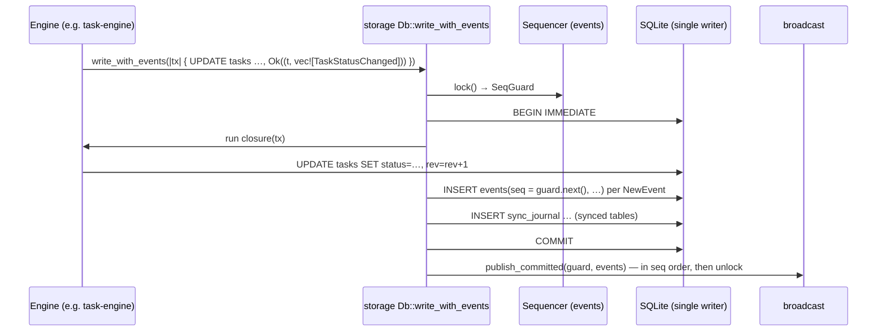
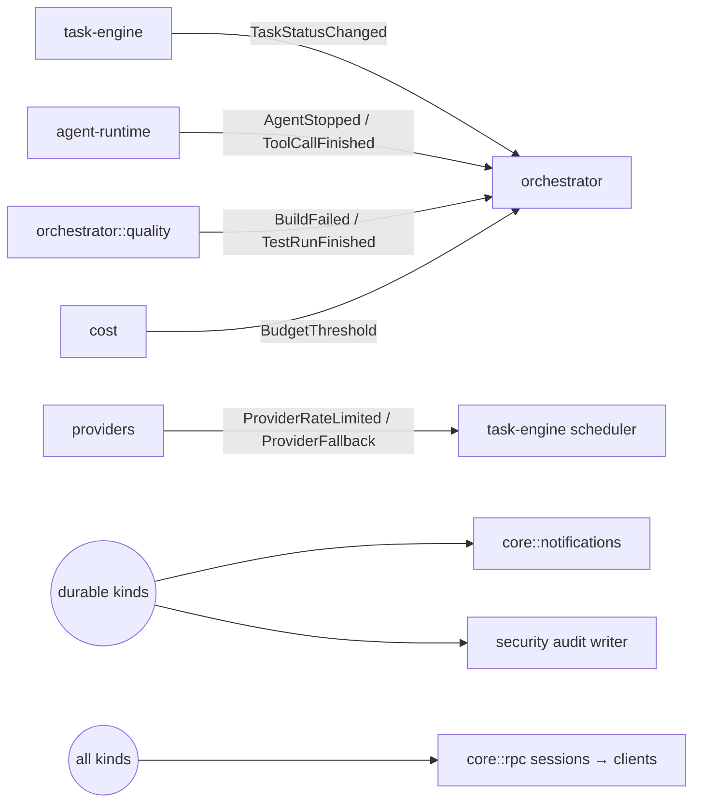

# Event Model

> Deliverable §65 #6. Binding inputs: `docs/ENGINEERING_CONTRACT.md` §4 (event
> envelope, minimum `EventKind`s, topics) and §6 (secrets never in events).
> Accepted decisions this document details (and must not contradict):
> ADR-0005 (frames incl. `lagged`), ADR-0018 (event sourcing light, `EventLogStore`
> port), ADR-0020 (ids), ADR-0022 (crash recovery, `TransitionCause`),
> `docs/requirements-review.md` CA-3, CA-6, CA-8, CA-10, CA-13.
> Spec: §49 (event-driven architecture), §50 (observability, correlation,
> redaction), §21 (replay), §37 (push categories). Entities are defined in
> `data-model.md`; wire framing in `../api/protocol.md`.

---

## 0. As built (Phase 0 foundation, 2026-10-02)

This section is normative for the code that exists today
(`crates/protocol/src/event.rs`, `crates/protocol/src/topic.rs`,
`crates/events`, `crates/core/src/logging.rs`). Sections 1–10 are the Phase
1–4 design; where they go beyond the code they say **(planned)**. Payload
fields listed in §7 that are not in §0.4 are **planned additive optional
fields** (append-only rule): they may be added later without breaking v1
clients. Where §7 gives a field a different name or type than §0.4 (for
example `final` vs `done`, `cause`/`actor` on `TaskStatusChanged`, or
`ApprovalResolved.status` `"Denied"` vs the domain's `"Rejected"`), the v1
name in §0.4 wins and §7 must be read as "add these fields".

### 0.1 Envelope

```rust
#[derive(Serialize, Deserialize, TS)] #[serde(rename_all = "camelCase")] #[ts(export)]
pub struct Event {
    pub seq: u64,                              // assigned by EventBus::publish, starts at 1; exported to TS as `number`
    pub id: EventId,                           // UUID v7
    pub ts: Timestamp,                         // chrono DateTime<Utc>, RFC 3339
    pub project_id: Option<ProjectId>,         // always serialized; `null` when absent
    pub task_id: Option<TaskId>,
    pub agent_id: Option<AgentId>,
    pub node_id: Option<NodeId>,
    pub correlation_id: Option<CorrelationId>,
    #[serde(flatten)] pub kind: EventKind,     // "kind": "...", "payload": {...}
}
#[serde(tag = "kind", content = "payload")]
pub enum EventKind { ProjectCreated(ProjectPayload), /* … 39 kinds, §0.4 … */ Log(LogPayload) }
impl EventKind {
    pub const NAMES: &'static [&'static str];  // declaration order (exported to TS as EVENT_KINDS)
    pub fn name(&self) -> &'static str;
    pub fn is_ephemeral(&self) -> bool;        // TerminalOutput | AgentMessage | ManagerMessage
}
pub struct NewEvent { kind, project_id, task_id, agent_id, node_id, correlation_id }
// builder: NewEvent::new(kind).project(id).task(id).agent(id).node(id).correlation(id)
```

- The envelope does **not** use `skip_serializing_if`: absent scope ids are
  sent as `null` (the generated TS type is `projectId: ProjectId | null`).
- `NewEvent::new(kind)` infers scope ids from the payload where unambiguous
  (e.g. `ProjectCreated` → `projectId`; `TaskCreated` → `projectId`+`taskId`;
  `AgentSpawned` → `agentId`+`projectId`+`taskId`; `ApprovalRequested`,
  `Notification` → the entity's project/task/agent ids; `EmergencyStop` → the
  project or agent of its scope; `NodeStatus`/`NodeOffline` → `nodeId`).
  Producers add the rest with the builder methods.
- `TerminalOutput`/`TerminalExited` carry the terminal id only in the payload
  (`Event::terminal_id()`); there is no `terminalId` envelope field.
- Local notices created by the RPC layer (subscription lag) use `seq: 0` and
  are never persisted (protocol §0.3).

### 0.2 Publishing, persistence, replay

```rust
// orkestr-events
pub struct EventBus;                                              // cloneable handle
impl EventBus {
    pub fn in_memory(capacity: usize) -> Self;                    // tests
    pub async fn with_log(log: Arc<dyn EventLog>, capacity: usize) -> EventResult<Self>; // seq continues after log.last_seq()
    pub async fn publish(&self, new: NewEvent) -> EventResult<Arc<Event>>;
    pub fn subscribe<I, S>(&self, topics: I) -> EventResult<Subscription>;   // topics validated
    pub fn subscribe_all(&self) -> Subscription;                  // topic "*"
    pub fn last_seq(&self) -> u64;
    pub async fn replay(&self, query: &ReplayQuery) -> EventResult<ReplayPage>;
}
pub enum Received { Event(Arc<Event>), Lagged(u64) }               // Subscription::recv()
#[async_trait] pub trait EventLog: Send + Sync {
    async fn append(&self, event: &Event) -> EventResult<()>;
    async fn last_seq(&self) -> EventResult<u64>;
    async fn range(&self, query: &ReplayQuery) -> EventResult<ReplayPage>;
    async fn prune_before(&self, before: u64) -> EventResult<u64>;
}
pub struct SqliteEventLog;   // lives in orkestr-events, on top of orkestr_storage::Db
pub struct MemoryEventLog;   // tests
pub struct ReplayQuery { from_seq: u64, to_seq: Option<u64>, limit: u32, topics: Option<Vec<String>>, newest_first: bool }
pub fn with_correlation(id, fut); pub fn current_correlation() -> Option<CorrelationId>;  // task-local ambient id
pub const DEFAULT_CAPACITY: usize = 4096;                          // broadcast buffer
```

`publish` takes a mutex, assigns `seq = last + 1`, `id` (v7), `ts`, the
ambient correlation id (when none is set), **persists** the event through
`EventLog::append` unless the kind is ephemeral, then broadcasts it. If the
append fails, the event is not broadcast and the seq is not consumed. Seq
order = log order = delivery order. The append is its own SQLite statement,
**not** part of the caller's state transaction: the transactional outbox of
§3.2 is **(planned)**.

Consequence (foundation spike, finding 4): ephemeral events consume seqs that
are not stored, so after a restart the bus resumes from the last *persisted*
seq and may hand out seqs that a client already saw for an ephemeral event.
`@orkestr/client` detects a server seq lower than its own and resets its
cursor. The seq ceiling of §3.3 is the planned fix.

The table (migration `events_0001_log`, owner `events`):

```sql
CREATE TABLE events (
    seq            INTEGER PRIMARY KEY NOT NULL,
    id             TEXT NOT NULL,
    ts             TEXT NOT NULL,
    kind           TEXT NOT NULL,
    project_id     TEXT,
    task_id        TEXT,
    agent_id       TEXT,
    correlation_id TEXT,
    topics         TEXT NOT NULL,   -- " t1 t2 … " routing topics (§0.3) for topic-filtered replay
    doc            TEXT NOT NULL    -- the full event JSON
);
CREATE INDEX events_project ON events(project_id, seq);
CREATE INDEX events_correlation ON events(correlation_id);
```

There is no retention job yet (`prune_before` exists but nothing schedules
it), no redaction pass inside the log (producers and the logging bridge
redact), and no `node_id`/`expires_at` columns.

`events.replay` (protocol §0.4) maps to `EventBus::replay`; topics `None` or
containing `*` mean "all".

**Log events.** `orkestr_core::logging::EventBusLayer` forwards `INFO`+
`tracing` records of `orkestr*` targets as `Log` events through a bounded,
lossy channel (1024 records); every message and field passes
`orkestr_core::redact` first. They are persisted like any non-ephemeral kind.

### 0.3 Topic routing (`orkestr_protocol::topic`, mirrored by `@orkestr/protocol` `eventTopics`)

```
topic := "*" | "global" | ("project" | "task" | "agent" | "terminal" | "node") ":" <uuid>
```

- An event is published on each scope topic it carries: `project:<projectId>`,
  `task:<taskId>`, `agent:<agentId>`, `node:<nodeId>`, and `terminal:<id>` for
  `TerminalOutput`/`TerminalExited`.
- Events **without** a `projectId`, and the project lifecycle kinds
  `ProjectCreated/Updated/Deleted`, are also published on `global`.
- `*` matches every event.

This replaces §6.2's richer table (stream-only kinds, global kinds) until
that design is implemented **(planned)**.

### 0.4 Kinds and v1 payloads (all camelCase)

| Kind | v1 payload | Ephemeral |
|---|---|---|
| `ProjectCreated`, `ProjectUpdated` | `{ project: Project }` | — |
| `ProjectDeleted` | `{ projectId }` | — |
| `TaskCreated`, `TaskUpdated` | `{ task: Task }` | — |
| `TaskStatusChanged` | `{ taskId, from: TaskStatus, to: TaskStatus, reason: string \| null }` | — |
| `AgentSpawned` | `{ agent: AgentInstance }` | — |
| `AgentStarted` | `{ agentId, taskId: TaskId \| null }` | — |
| `AgentStateChanged` | `{ agentId, from: AgentState, to: AgentState, activity: string \| null }` | — |
| `AgentStopped` | `{ agentId, reason: "Completed" \| "UserRequested" \| "LimitReached" \| "EmergencyStop" \| "Error" \| "Shutdown", detail: string \| null }` | — |
| `AgentMessage`, `ManagerMessage` | `MessageDeltaPayload { agentId: AgentId \| null, messageId, role: "User" \| "Assistant" \| "System", delta, done: boolean }` | **yes** |
| `ToolCallStarted` | `{ toolCall: ToolCall }` (input already redacted) | — |
| `ToolCallFinished` | `{ toolCallId, status: ToolCallStatus, outputSummary: string \| null, durationMs }` | — |
| `FileChanged` | `{ path, oldPath: string \| null, change: "Created" \| "Modified" \| "Deleted" \| "Renamed" }` (one file per event) | — |
| `BuildStarted` | `{ buildId, command }` | — |
| `BuildFailed`, `BuildSucceeded` | `BuildFinishedPayload { buildId, exitCode: number \| null, durationMs, summary }` | — |
| `TestRunFinished` | `{ runId, passed, failed, skipped, durationMs, summary }` | — |
| `ReviewFinished` | `{ reviewerAgentId: AgentId \| null, verdict: ReviewState, findings: number, summary }` | — |
| `ApprovalRequested` | `{ approval: Approval }` | — |
| `ApprovalResolved` | `{ approvalId, status: ApprovalStatus, resolvedBy: Actor \| null }` | — |
| `ProviderStatusChanged` | `{ providerId, health: ProviderHealth, authState: AuthState, detail: string \| null }` | — |
| `ProviderRateLimited` | `{ providerId, model: string \| null, retryAfterSecs: number \| null }` | — |
| `ProviderFallback` | `{ from: ModelRef, to: ModelRef, reason: string }` | — |
| `BudgetThreshold` | `{ scope: string, spentUsd, limitUsd, fraction }` | — |
| `SnapshotCreated` | `{ snapshot: WorkspaceSnapshot }` | — |
| `RollbackPerformed` | `{ snapshotId, scope: "Task" \| "Workspace", filesRestored, preRollbackSnapshotId: SnapshotId \| null }` | — |
| `TerminalOutput` | `{ terminalId, data: string /* UTF-8 lossy, ANSI included */ }` | **yes** |
| `TerminalExited` | `{ terminalId, exitCode: number \| null }` | — |
| `NodeStatus` | `{ node: Node }` | — (persisted in v1) |
| `NodeOffline` | `{ nodeId, lastSeenAt: string \| null }` | — |
| `SyncCompleted` | `{ backend, items, bytes, conflicts }` | — |
| `DeploymentFinished` | `{ deployment: Deployment }` | — |
| `MemoryUpdated` | `{ item: MemoryItem, deleted: boolean }` | — |
| `DecisionRecorded` | `{ decision: Decision }` | — |
| `EmergencyStop` | `{ scope: {scope:"All"} \| {scope:"Project", projectId} \| {scope:"Agent", agentId}, agentsStopped, triggeredBy: Actor }` | — |
| `Notification` | `{ notification: Notification }` | — |
| `Log` | `{ level: "trace" \| "debug" \| "info" \| "warn" \| "error", target, message, fields: JSON }` | — (persisted in v1) |

Producers in v1: the `projects.*` handlers (`ProjectCreated/Updated/Deleted`),
crash recovery (`Log`), the logging bridge (`Log`) and the RPC lag notice
(local `Log`, `seq 0`). No other kind is emitted yet. The kinds of §7.11
(`TerminalStarted`, `WorktreeCreated`, …) do **not** exist in the code; they
are appended when their feature lands (CA-6).

---

## 1. Principles

1. **Events describe facts that already happened** (past tense). Commands are
   RPC requests; events never ask a component to do something.
2. **State tables are the source of truth; events are the change feed**
   (ADR-0018 "light"). Every durable event is appended in the same SQLite
   transaction as the state change it describes. A client rebuilds its view by
   calling `*.list/get` (results carry `asOfSeq`) and then applying events with
   `seq > asOfSeq` (protocol §5.3).
3. **One envelope, one tagged enum.** `orkestr-protocol::Event` + `EventKind`
   (serde `tag = "kind", content = "payload"`). Kinds are **append-only; never
   renamed or removed** (contract §4). Payload fields may be added only as
   optional fields; never renamed or retyped.
4. **No secrets, no hidden reasoning.** Payloads are built without secret
   values; the `Redactor` pass is defense-in-depth (§5). Model chain-of-thought is
   never emitted or stored (§1.14, §21).
5. **Subscribers** (§49): UI clients (RPC `sub`), notifications
   (`core::notifications`), automation (orchestrator), audit writer
   (`orkestr-security`), cost thresholds (`orkestr-cost`), robots/HUD/voice (via
   UI), plugins (P7).

---

## 2. Envelope

Target shape per contract §4 and ADR-0018. **As built** (§0.1) the scope ids
are always serialized (as `null` when absent) instead of being skipped, and
`durability()`/`retention()` do not exist yet: v1 has only
`EventKind::is_ephemeral()`. Adding `Durability`/`Retention` is **(planned)**.

```rust
// crates/protocol/src/event.rs
#[derive(Clone, Debug, Serialize, Deserialize, TS)]
#[serde(rename_all = "camelCase")]
#[ts(export)]
pub struct Event {
    #[ts(type = "number")] pub seq: u64,   // global per core, strictly increasing, NOT dense (§3.3)
    pub id: EventId,                        // UUID v7
    pub ts: DateTime<Utc>,                  // RFC3339 UTC
    #[serde(flatten)] pub kind: EventKind,  // => "kind": "...", "payload": {...}
    #[serde(skip_serializing_if = "Option::is_none")] pub project_id: Option<ProjectId>,
    #[serde(skip_serializing_if = "Option::is_none")] pub task_id: Option<TaskId>,
    #[serde(skip_serializing_if = "Option::is_none")] pub agent_id: Option<AgentId>,
    #[serde(skip_serializing_if = "Option::is_none")] pub node_id: Option<NodeId>,
    #[serde(skip_serializing_if = "Option::is_none")] pub correlation_id: Option<CorrelationId>,
}

#[derive(Clone, Debug, Serialize, Deserialize, TS)]
#[serde(tag = "kind", content = "payload")]
#[ts(export)]
pub enum EventKind {
    ProjectCreated(ProjectCreated),
    // ... one variant per kind (§7), each with its own `#[serde(rename_all = "camelCase")]` payload struct
}

pub enum Durability { Durable, Ephemeral }        // ADR-0018
pub enum Retention  { Standard, Forever }         // §4.2

impl EventKind {
    pub const fn durability(&self) -> Durability { /* exhaustive match, §7 */ }
    pub const fn retention(&self)  -> Retention  { /* exhaustive match, §7 */ }
    pub fn name(&self) -> &'static str           { /* "TaskCreated", ... (column `kind`) */ }
}
```

Rules:

- `seq` and every count/byte/token field carry `#[ts(type = "number")]`
  (CA-8); all stay below 2^53.
- Each payload repeats the primary id it describes (`taskId`, `agentId`, …) even
  when it is also on the envelope, so a payload is self-contained when forwarded
  to notifications, audit or plugins.
- Envelope ids drive **topic routing** (§6) and must be set whenever applicable.
- Unknown kinds: Rust consumers that may see newer servers deserialize
  `Event` through `RawEvent { …, kind: String, payload: serde_json::Value }`
  first and skip unknown kinds; TS consumers use a `default:` branch
  (protocol §9).

Example frame:

```json
{"type":"event","seq":4182,"event":{
  "seq":4182,"id":"0192f0d1-7c1e-7a40-9f5e-2b1f3c4d5e6f","ts":"2026-10-02T09:15:03.120Z",
  "kind":"TaskStatusChanged",
  "payload":{"taskId":"0192…","from":"Running","to":"Waiting","cause":"Policy",
             "reason":"approval 0192… pending","actor":{"type":"System"},"attempts":1},
  "projectId":"0192…","taskId":"0192…","agentId":"0192…","correlationId":"0192…"}}
```

### 2.1 Correlation (§50)

- Every RPC `req` starts a `CorrelationId`, or adopts `params.correlationId`
  when the client supplies one (ADR-0018). Long-running results return it
  (protocol §5.5).
- It is carried in `tracing` spans (`correlation_id`), executions
  (`executions.correlation_id`), provider calls and audit rows, so logs, events
  and DB rows join.
- Work started on behalf of an earlier request keeps a link:
  `TaskCreated.parentCorrelationId`, `AgentSpawned.parentCorrelationId`
  (ADR-0018 replay chain).

### 2.2 Shared payload types

```ts
// orkestr-domain::common::Actor (adjacently tagged)
type Actor =
  | { type: "User"; id: string }
  | { type: "Agent"; id: string }
  | { type: "Manager" }
  | { type: "System" }
  | { type: "RemoteDevice"; id: string };      // proposed additive variant (P4)
type ModelRef = { providerId: string; model: string };          // ProviderId: UUID v7 as built (ADR-0020 slug decision not implemented)
type TransitionCause = "User" | "Agent" | "Manager" | "Scheduler" | "Dependency"
                     | "Policy" | "Shutdown" | "CrashRecovery" | "EmergencyStop";   // ADR-0022
type ProjectSummary  = { id; name; slug; archived; classification; privacy: PrivacyPolicy; rev };
type TaskSummary     = { id; projectId; parentId?; kind; title; priority: TaskPriority;
                         status: TaskStatus; agentId?; reviewState: ReviewState; attempts; rev };
type AgentSummary    = { id; projectId; templateId?; name; role: AgentRole; state: AgentState;
                         model?: ModelRef; workspaceId?; taskId?; parentAgentId?; teamId? };
type ApprovalSummary = { id; projectId?; taskId?; agentId?; kind; capability?; resource; summary;
                         risk: RiskLevel; dangerousClass?; reason; expiresAt?; createdAt };
```

---

## 3. Producing events

### 3.1 Ports and API (ADR-0018, CA-3) — (planned)

> **As built** (§0.2) the dependency runs the other way: `orkestr-events`
> depends on `orkestr-storage` and contains `SqliteEventLog` itself (it reaches
> SQLite through `orkestr_storage::Db` and the re-exported `rusqlite`);
> `orkestr-storage` knows nothing about events. The port is the `EventLog`
> trait (`append`, `last_seq`, `range`, `prune_before`), and publishing is the
> single `EventBus::publish`. The API below is the Phase 1 target that adds the
> transactional outbox; when it lands, the transaction helper lives next to
> `Db` (see `storage-abstraction.md` S1) and the crate direction stays as built.

Target design:

```rust
// crates/events/src/lib.rs
pub struct NewEvent {
    pub kind: EventKind,
    pub project_id: Option<ProjectId>,
    pub task_id: Option<TaskId>,
    pub agent_id: Option<AgentId>,
    pub node_id: Option<NodeId>,
    pub correlation_id: Option<CorrelationId>,
}

/// Opaque handle to the caller's open write transaction (implemented by orkestr-storage).
pub trait EventTx { fn as_any(&self) -> &dyn std::any::Any; }

pub trait EventLogStore: Send + Sync + 'static {
    /// Append inside the caller's write transaction; `seq` is supplied by the sequencer (§3.3).
    fn append(&self, tx: &dyn EventTx, seq: u64, ev: &NewEvent) -> Result<Event, EventError>;
    fn read_since(&self, since_seq: u64, filter: &TopicFilter, limit: usize) -> Result<Vec<Event>, EventError>;
    fn query(&self, q: &EventQuery) -> Result<Page<Event>, EventError>;   // replay §8.2, events.query
    fn last_seq(&self) -> Result<u64, EventError>;
    fn seq_ceiling(&self) -> Result<u64, EventError>;                     // §3.3
    fn raise_seq_ceiling(&self, new_ceiling: u64) -> Result<(), EventError>;
    fn purge_expired(&self, now: DateTime<Utc>, batch: usize) -> Result<usize, EventError>;
}

pub struct EventBus { /* broadcast::Sender<Arc<Event>> (capacity 8192), Sequencer, Arc<dyn EventLogStore> */ }

impl EventBus {
    /// Durable path, called by an engine INSIDE its write transaction
    /// (the storage `Db::write` closure holds the sequencer guard, §3.2).
    pub fn append(&self, guard: &mut SeqGuard<'_>, tx: &dyn EventTx, ev: NewEvent) -> Result<Event, EventError>;
    /// Called by storage right after COMMIT with the events appended in that tx (still under the guard).
    pub fn publish_committed(&self, guard: SeqGuard<'_>, evs: Vec<Event>);
    /// Ephemeral path (no DB write).
    pub fn publish_ephemeral(&self, ev: NewEvent) -> Arc<Event>;
    pub fn subscribe(&self, filter: TopicFilter) -> EventStream;           // yields StreamItem
    pub fn latest_seq(&self) -> u64;
}

pub enum StreamItem { Event(Arc<Event>), Lagged { last_delivered_seq: u64 } }
```

Engines never call `append` directly in practice: repository methods return
`(T, Vec<NewEvent>)` and the storage helper `Db::write_with_events(|tx| …)` does
the append/commit/publish sequence (ADR-0018 lint test: every state-mutating
repository method emits at least one kind).

### 3.2 Write path (transactional outbox)



If the process dies between `COMMIT` and publish, nothing is lost: clients and
in-core consumers resume from the log via `sinceSeq` (ADR-0018). If the closure
fails, the transaction rolls back and the guard releases **without consuming
any seq**.

### 3.3 Sequence numbers & ordering guarantees

**Refinement of ADR-0018 "Seq allocation".** ADR-0018 lets durable events take
the SQLite `INTEGER PRIMARY KEY` and ephemeral events take
`max(lastDurable, lastEphemeral)+1`. Taken literally, the next durable insert
would get `max(rowid)+1`, which can equal a seq already handed to an ephemeral
event (duplicate seq). It also reuses ephemeral seqs after a restart. This
document therefore fixes:

- One `Sequencer` (mutex + `u64` counter) allocates **every** seq, durable and
  ephemeral. Durable rows are inserted with an **explicit** `seq` value.
- The counter starts at `max(last_seq(), seq_ceiling())` on boot. The ceiling
  lives in `meta.event_seq_ceiling`; when the counter reaches it, the sequencer
  raises it by 1 000 000 (one small write per million events). A crash therefore
  never reuses a seq (ephemeral seqs included); it leaves a harmless gap.
- Publishing happens while the guard is held, so broadcast order equals seq
  order across concurrent writers. Holding the guard during the write
  transaction adds no contention: SQLite already serializes writers. Writes that
  emit no events (FTS reindex, aggregates) do not take the guard.

| Guarantee | Mechanism |
|---|---|
| `seq` strictly increasing for all events of one core, never reused | single sequencer + persisted ceiling |
| Live delivery order = seq order | publish under the guard |
| Per connection: seq order, each event at most once even if several subscribed topics match | RPC session dedupes by seq (ADR-0005) |
| A durable event is committed **before** anyone sees it | publish after `COMMIT` ⇒ a client that receives seq *n* can `get` consistent state |
| Per-entity causality | all changes of an entity go through its owning engine; summaries carry `rev`, so clients ignore payloads whose `rev` ≤ the one they hold |
| Gaps | **expected**: seq is monotonic, not dense (per-topic filtering, ephemeral events not stored, ceiling jumps). Loss is signalled only by the `lagged` frame (ADR-0005) or `resyncRequired` (protocol §4.5) |

Phase 6: seq is per core. Events relayed from remote nodes carry their
`nodeId`; cross-node order uses `(ts, nodeId, seq)`. Out of scope for P1–3.

### 3.4 Coalescing (high-rate kinds)

| Kind | Rule |
|---|---|
| `AgentMessage`, `ManagerMessage` deltas | buffer per message; flush every **16 ms** (ADR-0005) or **2 KiB**, whichever comes first; the last frame has `final: true` |
| `TerminalOutput` | flush every **16 ms** or **32 KiB**; incremental UTF-8 decoding (split multibyte sequences carried over); OSC filtering per threat model SR-45 |
| `FileChanged` | watcher debounce **250 ms** per workspace; paths deduplicated; max 500 paths per event (more ⇒ `truncated: true`, client re-lists) |
| `NodeStatus` | every **5 s**, or immediately on `status` change |
| `GitStateChanged` | debounce **500 ms** per workspace |
| `Log` | rate limit 50/s per target; excess folded into one `Log{message:"N lines suppressed"}` |

---

## 4. Persistence & retention

### 4.1 Table (`SqliteEventLog`, ADR-0018) — (planned target)

The v1 table is in §0.2 (`topics` + `doc` columns, no `node_id`,
`expires_at`, `payload`). The target below replaces it with a migration when
retention lands.

```sql
CREATE TABLE events (
  seq            INTEGER PRIMARY KEY,   -- explicit value from the sequencer (§3.3)
  id             TEXT    NOT NULL UNIQUE,
  ts             TEXT    NOT NULL,
  kind           TEXT    NOT NULL,
  project_id     TEXT,
  task_id        TEXT,
  agent_id       TEXT,
  node_id        TEXT,
  correlation_id TEXT,
  payload        TEXT    NOT NULL CHECK (json_valid(payload)),   -- redacted JSON
  expires_at     TEXT                                             -- NULL = Forever
);
CREATE INDEX events_project ON events(project_id, seq) WHERE project_id IS NOT NULL;
CREATE INDEX events_task    ON events(task_id, seq)    WHERE task_id IS NOT NULL;
CREATE INDEX events_agent   ON events(agent_id, seq)   WHERE agent_id IS NOT NULL;
CREATE INDEX events_corr    ON events(correlation_id)  WHERE correlation_id IS NOT NULL;
CREATE INDEX events_kind_ts ON events(kind, ts);
CREATE INDEX events_expiry  ON events(expires_at)      WHERE expires_at IS NOT NULL;
```

No foreign keys: events outlive the rows they describe. Phase 4 feeds the sync
journal from durable events plus entity revs (ADR-0018/0019).

### 4.2 Durability & retention classes — (planned target)

As built: only `TerminalOutput`, `AgentMessage` and `ManagerMessage` (all
deltas, including the last one) are ephemeral; `NodeStatus` and every `Log`
level are persisted; nothing expires. The classes below are the Phase 1
target.

| Durability | Stored | Replayable via `sinceSeq` |
|---|---|---|
| `Durable` | yes | yes |
| `Ephemeral` | no | no; recovered via `agents.transcript`, `terminal.history`, `nodes.get` |

| Retention (durable only) | Default | Setting |
|---|---|---|
| `Standard` | **180 days** (ADR-0018) | `events.retention.standardDays` |
| `Forever` | not auto-expired: `Approval*`, `DecisionRecorded`, `EmergencyStop`, `RollbackPerformed`, `SnapshotCreated`, `ProjectDeleted`, `SecretChanged`, `SecretAccessed`, `PermissionRuleChanged` (ADR-0018 "audit-related kinds") | manual compaction only |

A daily job (ADR-0018) deletes expired rows in batches of 10 000.
`EventKind::durability()`/`retention()` are exhaustive `const fn` matches, so a
new kind cannot be added without being classified (unit test).

---

## 5. Redaction

`orkestr-security::redaction::Redactor` (contract §6, ADR-0011):

```rust
pub trait Redactor: Send + Sync {
    /// Replace known secret values and secret-shaped patterns with `[REDACTED:<label>]`.
    fn redact<'a>(&self, input: &'a str) -> Cow<'a, str>;
    /// Register a live secret value (plus base64 / URL-encoded / JSON-escaped variants)
    /// when SecretStore resolves it; deregistered on rotation/delete/vault lock.
    fn register_secret(&self, label: &str, value: &SecretString);
}
```

- **Producer obligation:** fields marked **R** in §7 are redacted by the
  producer before the `NewEvent` is built.
- **Belt and braces:** `SqliteEventLog::append` and `publish_ephemeral` run a
  pattern-only pass over the serialized payload of free-text kinds (`Log`,
  `TerminalOutput`, `AgentMessage`, `ManagerMessage`, `ToolCall*`,
  `BuildFailed`, `TestRunFinished`, `Notification`, `ApprovalRequested`).
- **Patterns** (unit-tested, non-exhaustive): `Authorization: Bearer …`;
  `sk-…`, `sk-ant-…`, `sk-proj-…`; `ghp_`/`gho_`/`github_pat_`; `xox[abp]-`;
  `AKIA[0-9A-Z]{16}` and AWS secret pairs; `AIza…`; JWTs; PEM private key
  blocks; URL credentials (`scheme://user:pass@`); connection strings with
  `Password=`/`pwd=`; env-style `*_KEY=`, `*_SECRET=`, `*_TOKEN=`, `PASSWORD=`.
- Never redacted: ids, enum values, counts, timestamps.
- `FileChanged` / `ToolCall*` use project-relative paths only; absolute paths
  can appear only inside terminal output and logs.
- Raw unredacted text is never persisted anywhere (terminal scrollback is
  stored redacted, data-model §5.7; transcripts are redacted).
- **Size caps** after redaction: previews 4 KiB, excerpts 8 KiB, whole event
  256 KiB. Larger content goes to the ObjectStore and the event carries an
  `ObjectId` (`logRef`, `transcriptRef`, `contentRef`).

---

## 6. Topics & routing

### 6.1 Grammar (contract §4)

```
topic := "*" | "global" | "project:" ProjectId | "task:" TaskId | "agent:" AgentId | "terminal:" TerminalId | "node:" NodeId
```
A malformed topic makes the `sub` fail with `bad_request`. `*` (every event)
and `node:` are implemented additions to the contract §4 list.

### 6.2 Routing — (planned target)

As built, routing is `orkestr_protocol::topic::event_topics(&Event) -> Vec<String>`
with the simpler rules of §0.3 (no stream-only kinds, no extra global kinds).
Target rules:

| Event | Topics |
|---|---|
| has `projectId` | `project:<projectId>` (except *stream-only* kinds below) |
| has `taskId` | `task:<taskId>` |
| has `agentId` | `agent:<agentId>` |
| `TerminalOutput` | `terminal:<terminalId>` **only** |
| `TerminalStarted`, `TerminalExited` | `terminal:<terminalId>` + `project:` |
| **global kinds**: `ProjectCreated/Updated/Deleted`, `ApprovalRequested/Resolved/Expired`, `Provider*`, `BudgetThreshold`, `NodeStatus`, `NodeOffline`, `SyncCompleted`, `EmergencyStop`, `Notification`, `UiConfigChanged`, `SecretChanged`, `PermissionRuleChanged`, `VoiceCommand`; and **every** event without `projectId` | `global` (plus the derived topics above) |

**Stream-only** (kept off `project:` to keep project feeds light):
`TerminalOutput` (`terminal:` only); `AgentMessage` (`agent:` and `task:` only).
`ManagerMessage` deltas go to `project:<id>` for project conversations (the
Manager panel lives there) and to `global` for the global Manager. `Log` goes
to `agent:`/`task:` when tagged; otherwise only `warn`/`error` reach `global`.

### 6.3 Access filtering

Every RPC session has a principal. P1–3: the local owner sees everything.
P4 (`remote-access.md` §7.4): topics are filtered by device role and project
allowlist. `TerminalOutput` requires remote terminal enabled for the device.
Projects whose `privacy.sync` is `NoRemoteSync` are withheld from remote
principals. The filter runs per session, after routing.

---

## 7. Event catalogue

The payload column is the **target** payload. The v1 payloads that the code
serializes today are in §0.4; every field below that §0.4 does not list is a
planned additive field, and where names differ the §0.4 name wins.

Legend. **Producer**: crate/module emitting the event. **Consumers**: in-core
subscribers (every kind is also available to UI clients). **Topics**: beyond
those derived from envelope ids; `G` = also `global`. **Dur**: `D` Durable /
`E` Ephemeral. **Ret**: `Std` (180 d) / `Fvr` (Forever). **R**: fields the
producer must redact. **Ph**: phase that first emits the kind.

### 7.1 Projects

| Kind | Payload | Producer | Consumers | Topics | Dur | Ret | R | Ph |
|---|---|---|---|---|---|---|---|---|
| `ProjectCreated` | `{ project: ProjectSummary, actor: Actor, imported: bool }` | core::projects | memory (init scope), notifications, audit | G | D | Std | — | P1 |
| `ProjectUpdated` | `{ projectId, changed: string[] /* field names */, project: ProjectSummary, actor }` | core::projects | router (privacy policy), context, UI | G | D | Std | — | P1 |
| `ProjectDeleted` | `{ projectId, name, mode: "Unregistered" \| "Purged", actor }` | core::projects | all engines (stop work, purge), audit | G | D | Fvr | — | P1 |

### 7.2 Tasks

| Kind | Payload | Producer | Consumers | Topics | Dur | Ret | R | Ph |
|---|---|---|---|---|---|---|---|---|
| `TaskCreated` | `{ task: TaskSummary, planId?, actor, parentCorrelationId? }` | task-engine | orchestrator (scheduling), Mission Control | — | D | Std | — | P1 |
| `TaskUpdated` | `{ taskId, changed: string[], task: TaskSummary, actor }` (non-status fields) | task-engine | scheduler, UI graph | — | D | Std | — | P1 |
| `TaskStatusChanged` | `{ taskId, from: TaskStatus, to: TaskStatus, cause: TransitionCause, reason?, actor, attempts, pendingApprovalIds?: string[] }` | task-engine (**only**, contract §5) | orchestrator (DAG unblock, self-heal), agent-runtime, notifications (`Completed`, `Blocked`, `Failed`), cost, voice | — | D | Std | `reason` | P1 |

### 7.3 Agents & tool calls

| Kind | Payload | Producer | Consumers | Topics | Dur | Ret | R | Ph |
|---|---|---|---|---|---|---|---|---|
| `AgentSpawned` | `{ agent: AgentSummary, spawnedBy: Actor, reason, parentCorrelationId? }` | agent-runtime | robots (create robot §30), Mission Control | — | D | Std | — | P1 |
| `AgentStarted` | `{ agentId, executionId, taskId?, model: ModelRef, attempt /* execution attempt */ }` | agent-runtime | cost, UI | — | D | Std | — | P1 |
| `AgentStateChanged` | `{ agentId, from: AgentState, to: AgentState, detail? }` | agent-runtime | robots (animation), HUD, voice | — | D | Std | `detail` | P1 |
| `AgentStopped` | `{ agentId, reason: "Completed"\|"UserStopped"\|"EmergencyStop"\|"BudgetExceeded"\|"MaxTurns"\|"Error"\|"Interrupted", error?: {class, message} }` | agent-runtime | orchestrator, robots, notifications (`Error`) | — | D | Std | `error.message` | P1 |
| `AgentMessage` | `{ agentId, executionId, messageId, role: "assistant"\|"tool"\|"system"\|"user", delta: string, final: bool }` — visible output only; full text lives in the execution transcript (ADR-0018, RR-A5) | agent-runtime | agent panel, robots (speech bubble), voice (TTS) | stream-only | E | — | `delta` | P1 |
| `ToolCallStarted` | `{ toolCallId, executionId, agentId, tool, capability, resource, decision: "Allow"\|"Ask"\|"Deny", dangerousClass?, approvalId?, argsPreview }` | agent-runtime | replay, UI timeline | — | D | Std | `resource`, `argsPreview` | P1 |
| `ToolCallFinished` | `{ toolCallId, status: "Succeeded"\|"Failed"\|"Denied"\|"Cancelled"\|"TimedOut", durationMs, exitCode?, resultPreview?, error? }` | agent-runtime | replay, self-healing | — | D | Std | `resultPreview`, `error` | P1 |

### 7.4 Files & quality pipeline

| Kind | Payload | Producer | Consumers | Topics | Dur | Ret | R | Ph |
|---|---|---|---|---|---|---|---|---|
| `FileChanged` | `{ workspaceId, changes: [{ path: RelPath, change: "Created"\|"Modified"\|"Deleted"\|"Renamed", oldPath? }], source: "Agent"\|"User"\|"External", toolCallId?, truncated: bool }` | agent-runtime fs tools (`Agent`); core files service (`User` via `files.write`, `External` via watcher) | editor reload + agent change markers (§15), git panel, snapshots (task path tracking for Rollback Task), context index | — | D | Std | — | P1 |
| `BuildStarted` | `{ runId, workspaceId, kind: QualityRunKind, command, trigger: Actor }` | orchestrator::quality | UI, robots (`Testing`) | — | D | Std | `command` | P1 (manual) |
| `BuildFailed` | `{ runId, kind, exitCode, durationMs, errorExcerpt, diagnostics: [{path?, line?, col?, severity, message}] /* ≤ 200 */, logRef? }` | orchestrator::quality | self-healing (§17), notifications, Bug Detective | — | D | Std | `errorExcerpt`, `diagnostics[].message` | P1 |
| `BuildSucceeded` | `{ runId, kind, durationMs, logRef? }` | orchestrator::quality | merge manager checks | — | D | Std | — | P1 |
| `TestRunFinished` | `{ runId, framework?, passed, failed, skipped, durationMs, failures: [{name, path?, message}] /* ≤ 100 */, logRef? }` | orchestrator::quality | self-healing, merge manager, benchmarks, notifications (`failed > 0`) | — | D | Std | `failures[].message` | P1 manual, P2 auto |
| `ReviewFinished` | `{ reviewId, taskId, kind: "Standard"\|"Adversarial"\|"Security"\|"Consensus"\|"Human", reviewerAgentId?, verdict: "Approved"\|"ChangesRequested"\|"Rejected", findings: {critical, high, medium, low, info}, summary }` | orchestrator::review | orchestrator (→ task transition via task-engine), merge manager, benchmarks, notifications (critical > 0) | — | D | Std | `summary` | P2 |

`QualityRunKind = "Build"|"Lint"|"Typecheck"|"UnitTest"|"IntegrationTest"|"E2E"|"Smoke"|"Custom"`.
Lint/typecheck runs reuse the `Build*` kinds with their `kind` field set.

### 7.5 Approvals

| Kind | Payload | Producer | Consumers | Topics | Dur | Ret | R | Ph |
|---|---|---|---|---|---|---|---|---|
| `ApprovalRequested` | `{ approval: ApprovalSummary }` | security::approvals | notifications (OS / push / voice §37), HUD, robots (`Waiting`), mobile (P5) | G | D | Fvr | `approval.resource`, `approval.summary` | P1 |
| `ApprovalResolved` | `{ approvalId, status: "Approved"\|"Denied"\|"Cancelled", resolvedBy: Actor, scope?: "Once"\|"Task"\|"Agent"\|"Project", ruleId?, stepUp?: bool }` | security::approvals | agent-runtime (informational; the waiting call is woken by a oneshot), orchestrator, audit | G | D | Fvr | — | P1 |

### 7.6 Providers & cost

| Kind | Payload | Producer | Consumers | Topics | Dur | Ret | R | Ph |
|---|---|---|---|---|---|---|---|---|
| `ProviderStatusChanged` | `{ providerId, health: ProviderHealth, previousHealth: ProviderHealth, authState: AuthState, enabled: bool, message? }` (`ProviderHealth = Unknown\|Healthy\|Degraded\|RateLimited\|Down`, `AuthState = Unconfigured\|Unverified\|Authenticated\|Invalid`) | providers::registry (health loop, config changes) | router, Mission Control, notifications (→ `Down` / `Invalid`) | G | D | Std | `message` | P1 |
| `ProviderRateLimited` | `{ providerId, model?, limitKind: "Requests"\|"Tokens"\|"Quota"\|"Concurrency", retryAfterMs?, resetAt? }` | providers::router | scheduler (backoff), Cost Center | G | D | Std | — | P1 |
| `ProviderFallback` | `{ from: ModelRef, to: ModelRef, reason: "RateLimited"\|"QuotaExceeded"\|"Unavailable"\|"Error"\|"Policy", agentId?, taskId?, handoffId? }` — the "explicit event to the user" of §7 | providers::router + agent-runtime (handoff) | notifications, benchmarks, UI | G | D | Std | — | P1 |
| `BudgetThreshold` | `{ budgetId, scope, scopeId?, period: BudgetPeriod, fraction /* 0..1, warnAt or 1.0 */, spentUsd, maxCostUsd?, tokensUsed?, maxTokens?, action: "Notify"\|"PauseNew"\|"Block" }` | cost | orchestrator (pause/stop), notifications | G | D | Std | — | P1 |

### 7.7 Snapshots & terminal

| Kind | Payload | Producer | Consumers | Topics | Dur | Ret | R | Ph |
|---|---|---|---|---|---|---|---|---|
| `SnapshotCreated` | `{ snapshotId, workspaceId, reason: SnapshotReason, label, fileCount, sizeBytes, includesUncommitted, taskId? }` | snapshots | UI timeline, crash-recovery UX | — | D | Fvr | — | P1 |
| `RollbackPerformed` | `{ rollbackId, snapshotId, mode: "Task"\|"Workspace"\|"Files", restoredCount, preservedCount, conflicts: [{path, reason}], safetySnapshotId, status }` | snapshots | editor reload, git panel, audit | — | D | Fvr | — | P1 |
| `TerminalOutput` | `{ terminalId, data: string /* UTF-8, coalesced */, offset: number /* byte offset in scrollback */ }` | terminal | terminal panels (xterm) | `terminal:` only | E | — | `data` | P1 |
| `TerminalExited` | `{ terminalId, exitCode?, reason: "Exited"\|"Killed"\|"Lost" }` | terminal | agent-runtime (command completion), UI | `terminal:` + project | D | Std | — | P1 |

### 7.8 Nodes, sync, deployments

| Kind | Payload | Producer | Consumers | Topics | Dur | Ret | R | Ph |
|---|---|---|---|---|---|---|---|---|
| `NodeStatus` | `{ nodeId, status: NodeStatus, resources: NodeResources, runningAgents, statusChanged: bool }` | node (sampler) | scheduler (§11), Mission Control (§32), performance mode | G | E (ADR-0018) | — | — | P1 |
| `NodeOffline` | `{ nodeId, lastSeen, affectedTaskIds: string[] }` | node registry | scheduler (job migration §39), notifications | G | D | Std | — | P6 |
| `SyncCompleted` | `{ backend, direction: "Push"\|"Pull"\|"Both", items, bytes, durationMs, conflicts }` | sync | UI status, notifications (`conflicts > 0`) | G | D | Std | — | P4 |
| `DeploymentFinished` | `{ deploymentId, environmentId, status, url?, durationMs }` | deployments (reserved) | notifications, audit | — | D | Std | — | P4+ |

`NodeStatus` is ephemeral per ADR-0018. Status transitions that matter
historically (node going `Offline`) have their own durable kind
(`NodeOffline`, P6).

### 7.9 Memory, decisions, Manager

| Kind | Payload | Producer | Consumers | Topics | Dur | Ret | R | Ph |
|---|---|---|---|---|---|---|---|---|
| `MemoryUpdated` | `{ memoryItemId, scope: "Global"\|"Project", op: "Created"\|"Updated"\|"Deleted", kind, title, actor }` | memory | context optimizer (cache invalidation) | G if Global | D | Std | — | P1 |
| `DecisionRecorded` | `{ decisionId, number, title, status, taskIds: string[], actor }` | memory (decision log) | architecture map, UI | — | D | Fvr | — | P2 |
| `ManagerMessage` | `{ conversationId, messageId, role: "manager"\|"user"\|"system", delta: string, final: bool, planId?, contentRef?: ObjectId }` | orchestrator::manager | Manager panel, HUD mini-manager, voice (TTS) | project or G (§6.2) | **D only for `final: true`**, E for deltas | Std | `delta` | P1 |

**Refinement of ADR-0018:** ADR-0018 lists `ManagerMessage` as durable. Storing
every 16 ms delta would bloat the log, so only the `final: true` event is
appended. It carries the complete visible message (≤ 8 KiB in `delta`, the
full text in `contentRef`). Deltas are ephemeral; the authoritative copy is
`conversation_messages`.

### 7.10 Safety, notifications, logs

| Kind | Payload | Producer | Consumers | Topics | Dur | Ret | R | Ph |
|---|---|---|---|---|---|---|---|---|
| `EmergencyStop` | `{ control: "StopAll"\|"StopProject"\|"StopAgent"\|"DisableFullAuto"\|"DisableNetworkTools"\|"LockVault"\|"RevokeRemoteSessions"\|"Rearm", scope: "All"\|"Project"\|"Agent", projectId?, agentId?, actor: Actor, stoppedAgents, cancelledTasks, interruptedTerminals, snapshotIds: string[] }` (single kind with a `control` discriminator, `security/permission-model.md` §9) | core::emergency | all engines (informational; cancellation is token-based), robots, notifications (`Critical`) | G | D | Fvr | — | P1 (`RevokeRemoteSessions` P4) |
| `Notification` | `{ notification: { id, category, level, title, body, link?, actions? } }` | core::notifications | UI toasts, OS notifications (platform), push (P5), voice | G | D | Std | `title`, `body` | P1 |
| `Log` | `{ level: "trace"\|"debug"\|"info"\|"warn"\|"error", target, message, fields: object }` | any crate via the `tracing` layer `EventLogLayer` (allow-listed targets) | Logs panel (§14) | §6.2 | E below `warn`, D at `warn`+ (ADR-0018) | Std | `message`, `fields` | P1 |

Task effects of emergency controls (CA-10, ADR-0022): `agents.stop` → agent
`Stopped`, its `Running` task → `Interrupted` (cause `User`, resumable);
`emergency.stop*` → tasks → `Cancelled` (cause `EmergencyStop`), after a
snapshot of any dirty worktree.

### 7.11 Additional kinds for Phases 1–3 (append in this order; CA-6 names)

| Kind | Payload | Producer | Topics | Dur | Ret | Ph |
|---|---|---|---|---|---|---|
| `TerminalStarted` | `{ terminalId, owner: "User"\|"Agent", agentId?, shell, cwd?: RelPath, title }` | terminal | `terminal:` + project | D | Std | P1 |
| `WorktreeCreated` | `{ workspaceId, branch, baseRef, agentId?, taskId? }` | vcs | — | D | Std | P1 |
| `WorktreeRemoved` | `{ workspaceId, branch, reason }` | vcs | — | D | Std | P1 |
| `GitStateChanged` | `{ workspaceId, head, branch, ahead, behind, dirtyCount, conflicted: bool }` | vcs | — | E | — | P1 |
| `TaskDependencyChanged` | `{ taskId, dependsOn, kind: DependencyKind, op: "Added"\|"Removed", actor }` | task-engine | — | D | Std | P1 |
| `ApprovalExpired` | `{ approvalId, expiredAt }` | security::approvals | G | D | Fvr | P1 |
| `PermissionRuleChanged` | `{ scope: PermissionScope, approvalMode?, ruleIds: string[], op: "Set"\|"Removed", actor }` | security | G | D | Fvr | P1 |
| `SecretChanged` | `{ secretRefId, name, scope, op: "Created"\|"Rotated"\|"Deleted", actor }` — **never a value** | security | G | D | Fvr | P1 |
| `SecretAccessed` | `{ secretRefId, name, actor, purpose: "Provider"\|"ToolEnv"\|"Mcp", toolCallId? }` | security | — | D | Fvr | P1 |
| `UsageRecorded` | `{ usageRecordId, providerId, model, inputTokens, outputTokens, costUsd, costSource }` | cost | — | E | — | P1 |
| `PlanProposed` | `{ planId, conversationId, version, goal, taskCount, estimate: {costUsd, durationSecs, agents} }` | orchestrator::manager | — | D | Std | P1 |
| `MergeProposed` | `{ mergeId, sourceBranch, targetBranch, taskIds, checks }` | orchestrator::merge | — | D | Std | P2 |
| `MergeCompleted` | `{ mergeId, status: "Merged"\|"Rejected"\|"Abandoned", mergedCommit? }` | orchestrator::merge | — | D | Std | P2 |
| `MergeConflictDetected` | `{ mergeId?, workspaceId, paths: RelPath[] }` | vcs / orchestrator::merge | — | D | Std | P2 |
| `ConsensusFinished` | `{ sessionId, taskId?, participants, decisionId? }` | orchestrator::consensus | — | D | Std | P2 |
| `UiConfigChanged` | `{ configId, kind, scope, scopeId?, source: "User"\|"Manager", version }` | core::ui | G | D | Std | P1 basic, P3 |
| `VoiceCommand` | `{ utteranceId, text, intent?, deviceId, handledBy?: "Manager"\|"Palette"\|"None" }` (text only, never audio) | core::voice | G | D | Std | P3 |

Remote-access kinds (`RemoteSessionOpened`, `RemoteSessionRevoked`,
`DeviceAuthorized`, `DeviceRevoked`, `SecurityAlert`) are defined by
`remote-access.md` §10 for Phase 4 and appended after these.

---

## 8. Replay

### 8.1 Subscription catch-up (transport level; ADR-0005) — (planned)

As built: no `sinceSeq`; clients call `events.replay` after reconnects and
after the `seq:0` lag notice (protocol §4.5, §4.7). Target design:

A client (re)subscribes with `sinceSeq` = the last seq it processed
(protocol §4.5). The session:

1. registers the live subscription first and buffers its events,
2. pages `EventLogStore::read_since(sinceSeq, filter, 1000)` up to the buffer's
   first seq,
3. drains the buffer, skipping seqs already sent,
4. continues live.

If `sinceSeq` predates retention for those topics, or catch-up would exceed
10 000 events, the server replays nothing and the sub ack returns
`resyncRequired: true`. The client then refetches via `*.list/get` (results
carry `asOfSeq`) and resubscribes with `sinceSeq = asOfSeq`.

Slow consumers: when the per-connection queue (4096 frames) is full or the
broadcast receiver reports `Lagged`, the server stops sending to that
connection and emits **one** `{"type":"lagged","topics":[…],"lastSeq":n}`,
where `n` is the last seq actually delivered. The client resubscribes with
`sinceSeq: n`. Durable events come back through catch-up. Ephemeral ones come
back through `agents.transcript` / `terminal.history`.

### 8.2 Execution replay (§21 product feature)

`tasks.replay {taskId}` and `events.query {correlationId}` rebuild the chain
user request → Manager plan → agent creation → delegation → tool events →
files changed → tests → reviews → approvals → merge. They query `events` by
`correlation_id` (following `parentCorrelationId` links) and/or `task_id` in
seq order, and join `executions`, `tool_calls` and `conversation_messages` for
content previews. Hidden CoT is never stored, so it can never be replayed.
Every kind in this chain is durable (§7).

---

## 9. In-core consumers



- Consumers that must not miss events (orchestrator reactions, audit writer,
  notifications) keep their own durable cursor
  (`meta.consumer_cursor.<name>`). On `Lagged` or restart they catch up through
  `read_since`. Their handlers are idempotent, keyed by `seq`.
- **Safety never depends on the bus.** Emergency stop cancels
  `CancellationToken`s directly and only *reports* through `EmergencyStop`
  (contract §6). An approval wakes its waiting tool call through a `oneshot`
  owned by security; `ApprovalResolved` is informational.
- The audit writer turns security-relevant kinds (all `Fvr` kinds plus
  `ToolCallStarted` with `decision ≠ Allow` or `dangerousClass` set) into
  `audit_events` rows. It is the only consumer allowed to apply backpressure,
  because losing audit records is unacceptable (§70.1).

---

## 10. Testing obligations

As built: envelope round-trip and flattening, kind names vs serde tags,
contract-minimum kind list (`crates/protocol/src/event.rs`); topic routing and
validation (`topic.rs`, plus the TS mirror in `packages/protocol`); bus seq
ordering, persistence, ephemeral handling, lag reporting and replay paging
(`crates/events`); seq continuity across a core restart
(`crates/core/tests/rpc_integration.rs`). Target obligations:

- Serde round-trip and a JSON fixture for every `EventKind`
  (`crates/protocol/tests/fixtures/events/<Kind>.json`), plus a ts-rs export
  check.
- Exhaustive `durability()`, `retention()` and `topics_for()` tests.
- Sequencer: N threads running concurrent `write_with_events` ⇒ broadcast order
  equals commit order, seqs strictly increase, a rollback consumes no seq, a
  restart resumes above the ceiling, and no seq is ever duplicated between
  durable and ephemeral events.
- Redaction: secrets planted in every **R** field never reach the `events`
  table or the broadcast.
- Catch-up: a subscriber with `sinceSeq` receives exactly the missing durable
  events, once, then live events with no duplicates. `lagged` is emitted at
  most once per overflow episode.
