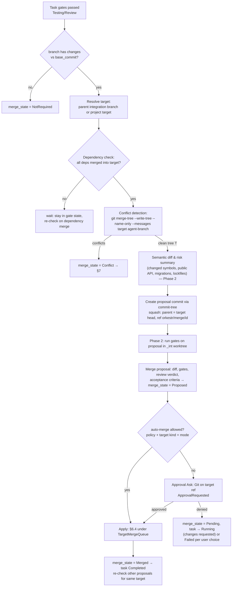

# Git & Worktree Strategy (incl. Merge Manager)

Status: Phase 0 deliverable #13 (§65). Crate: `orkestr-vcs` (git mechanics) +
`orkestr-orchestrator::merge` (Merge Manager policy). Interacts with
`orkestr-snapshots`, `orkestr-task-engine`, `orkestr-security`, `orkestr-sync`.
Spec references: §1.7, §1.12, §13, §16, §17, §25, §40–41, §58, §62.4–5, §62.14, §63.J, §64.

**Implementation status (2026-10-02):** design only. `orkestr-vcs` has the
skeleton trait `Git` (`status`, `diff`, `branches`, `worktrees`,
`add_worktree`, `remove_worktree`); no git invocation, lock or reconciliation
exists yet. The domain already has `WorktreePolicy { DedicatedWorktree,
SharedWorktree, ReadOnlyMain, None }`, `WorkspaceKind { Main, Worktree{branch,
agentId} }` and `WorktreeRef { branch, path }`; RPC names are `vcs.*` and
`worktrees.*` (`../api/protocol.md` §8.6–§8.7, §8.27).

---

## 1. Principles

1. **Git is the version-control layer, not the sync layer** (§41). Orkestr never
   commits to make sync or snapshots work; no "auto-commit spam" (§64).
2. **One agent ⇒ one branch + one worktree** by default (§16). Agents never write
   into the user's primary checkout (permission-model P8).
3. **The user's history stays clean**: agent branches may hold checkpoint commits;
   delivery to the user's branch is **one squashed commit per task** by default
   (policy: `squash` | `merge-commit` | `rebase`).
4. All git access through the `git` CLI (contract §2), argument vectors only,
   `GIT_TERMINAL_PROMPT=0`, `-c core.longpaths=true -c gc.auto=0
   -c core.quotepath=false` on every invocation, output parsed from
   `--porcelain=v2 -z` / `-z` formats.
5. Minimum supported git: **2.38** (`git merge-tree --write-tree`). Detected at
   startup; older ⇒ worktrees still work, Merge Manager degrades to an
   integration-worktree trial merge (§6.3) and the UI warns.

---

## 2. Naming

| Object | Pattern | Example |
|---|---|---|
| Agent branch | `agent/<role>-<shortid>` | `agent/backend-3f9a1c2e` |
| Integration branch (parent task, Phase 2) | `orkestr/integration/<task-shortid>` | `orkestr/integration/7c01d9aa` |
| Merge proposal branch | `orkestr/merge/<merge-shortid>` | `orkestr/merge/b41e0f63` |
| Recovery branch (never auto-deleted) | `orkestr/recovered/<task-shortid>-<yyyymmddhhmm>` | |

- `<role>`: lowercase slug of `AgentRole` (`custom` roles slugified, `[a-z0-9-]`,
  ≤ 24 chars).
- `<shortid>`: **last 8 hex chars** of the UUID v7 (the random part). The first
  8 hex chars of a v7 UUID are timestamp bits and collide for agents spawned in
  the same ~minute — never use them.
- Validation with `git check-ref-format --branch`; on collision with an existing
  ref append `-2`, `-3`… All Orkestr-created refs are recorded in table
  `vcs_refs{project_id, ref, kind, created_by, task_id, agent_id, created_at}`.
  **Orkestr only ever deletes refs it recorded.**

---

## 3. Worktree layout

```text
<data_dir>/worktrees/
  <project-short>/                 last 8 hex of ProjectId
    .orkestr.lock                  advisory lock file (fs2) — one core per data dir
    <agent-short>/                 worktree of agent/<role>-<agent-short>
    _int/<task-short>/             integration worktree (Phase 2, gates on merged result)
    _merge/<merge-short>/          trial-merge worktree (fallback for git < 2.38)
```

- `<data_dir>` from `orkestr-platform` path helpers (`ORKESTR_HOME` override);
  never inside the user's repository (keeps IDE indexers, file watchers and
  `git status` of the main checkout clean) and short (Windows `MAX_PATH`).
- The project's repository is the user's existing clone; worktrees share its
  object database (`git worktree add`), so creation is cheap and commits are
  immediately visible to the main repo.
- Worktree metadata row `worktrees{id, project_id, agent_id, task_id, path,
  branch, base_ref, base_commit, state: Creating|Active|Merging|Retained|PendingRemoval|Removed, created_at}`.

### 3.1 Creation (on task `Ready → Running` guard, task-state-machine #4)

```text
1. base_ref    = parent integration branch (if parent has one) else project.target_branch
2. base_commit = git rev-parse --verify <base_ref>^{commit}
3. take RepoLock(project)
4. git worktree add --no-track -b <agent-branch> <path> <base_commit>
5. release RepoLock
6. if repo uses submodules: git -C <path> submodule update --init --recursive   (needs Network check)
7. if repo uses LFS:        git -C <path> lfs pull                               (needs Network check)
8. row.state = Active; record base_commit on task
```

Failure at any step ⇒ `git worktree remove --force <path>` (own, just-created
path only) + delete the just-created branch, then the transition guard fails.
Pre-conditions: repository has ≥ 1 commit (else onboarding asks the user to make
an initial commit — Orkestr does not create it silently); disk free ≥ 2 GB.

Dependency installs (`node_modules`, `target/`) are per worktree. Phase 2:
shared caches (`CARGO_TARGET_DIR` per project, npm cache) to reduce disk/time.

---

## 4. Concurrency & locking (§62.5)

| Lock | Granularity | Held for | Implementation |
|---|---|---|---|
| Core instance lock | data dir | process lifetime | `fs2` exclusive lock on `<data_dir>/worktrees/<p>/.orkestr.lock` and `core.json` pid check — prevents a second core (desktop + stray `orkestrd`) mutating the same worktrees |
| `RepoLock` | repository (keyed by canonical `git rev-parse --git-common-dir`) | worktree add/remove/prune, branch create/delete, `update-ref` on shared refs, fetch, merges into integration/target | `tokio::sync::Mutex` in `orkestr-vcs` registry |
| `WorktreeLock` | one worktree | any mutating git op inside it (commit, checkout, reset by recovery, conflict resolution) | `tokio::sync::Mutex` per worktree id |
| `TargetMergeQueue` | (repo, target branch) | applying merges | FIFO by task priority (Critical first) |
| git's `index.lock` / `*.lock` | per worktree / ref | git internal | on `Unable to create '…lock'`: retry with backoff 50 ms → 2 s, total ≤ 10 s; never delete except in crash recovery (task-state-machine §8.3) |

Read-only operations (`status`, `diff`, `log`, `merge-tree`) take no Orkestr
lock. Lock order is always `RepoLock → WorktreeLock` (deadlock freedom).

**User concurrency**: the user may work in the main checkout at any time.
Orkestr (a) never runs mutating commands there except the approved fast-forward
in §6.4, (b) updates shared refs only with compare-and-swap
(`git update-ref <ref> <new> <expected-old>`) so a concurrent user commit makes
the operation fail with `conflict` instead of clobbering it, (c) re-validates
`base_commit`/target heads immediately before each merge step.

---

## 5. Commits on agent branches

- Agents commit only through the `git_commit` tool (agent spec §5.2) on their own
  branch, at checkpoints: before `submit_result`, before a handoff/fallback, and
  when the agent chooses (bounded by `max_commits_per_task`, default 20).
- Author: `<Role> agent (Orkestr) <agents@orkestr.invalid>` (configurable);
  committer: the user's git identity. Trailers: `Orkestr-Task: <id>`,
  `Orkestr-Agent: <id>`, `Orkestr-Model: <provider/model>`.
- Repository hooks run as configured by the user (they are user code; Orkestr
  does not pass `--no-verify`). Hook failures are returned to the agent as tool
  errors.
- `git push` is never performed automatically (Phase 1). Pushing/PR creation is a
  user action or an approved agent request (`Git` + `Network`, D3 for protected
  branches). PR creation via GitHub/GitLab MCP: Phase 2.

---

## 6. Merge Manager (§16, §17, §58)

### 6.1 States

`Task.merge_state`: `NotRequired` (no changes vs base) → `Pending` (gates
running/passed, not yet analysed) → `Proposed` (proposal ready, awaiting
approval/auto policy) → `Merged` | `Conflict`.

A task can enter `Completed` only with `merge_state ∈ {Merged, NotRequired}`
(task-state-machine #12/#25/#30).

### 6.2 Flow



### 6.3 Conflict detection details

- Primary (git ≥ 2.38): `git merge-tree --write-tree --name-only --messages -z
  <target> <agent-branch>` — exit 0 ⇒ clean, stdout = tree OID; exit 1 ⇒
  conflicted file list + messages. Touches no worktree.
- Fallback (git < 2.38): `git worktree add --detach _merge/<id> <target>` +
  `git merge --no-commit --no-ff <agent-branch>`; inspect; `git merge --abort`;
  remove worktree.
- **Predictive** (Phase 2, feeds the scheduler §7.2 of task-state-machine): for
  every pair of active agent branches in a project, periodically run merge-tree
  between them; overlapping conflicting paths are published as risk and used to
  serialize or re-plan tasks.

### 6.4 Applying a merge

Target is an Orkestr-owned integration branch:
`git update-ref refs/heads/<target> <proposal> <expected-old>` (CAS). Allowed
automatically in SemiAuto/FullAuto (policy `autoMergeIntegration = true` default).

Target is a user branch (e.g. `main`):
- Always Ask unless project policy `autoMergeToTarget = true` **and** mode is
  FullAuto **and** the branch is not protected (protected: `main`, `master`,
  `release/*`, `production`, plus configured) — protected branches always Ask.
- If the target is **not checked out** in any worktree: CAS `update-ref`.
- If it **is checked out in the user's main worktree**: updating the ref under a
  checkout would make the user's working tree appear reversed, so:
  - main worktree clean (`git status --porcelain=v2` empty, no in-progress
    merge/rebase) ⇒ snapshot of main worktree metadata, then
    `git -C <main> merge --ff-only refs/heads/orkestr/merge/<id>` (proposal is
    built on the current target head so it is a fast-forward; if the head moved,
    the proposal is rebuilt first);
  - dirty ⇒ never stash or reset user changes; the approval dialog offers
    "Retry when clean", "Deliver as branch only" (leave `orkestr/merge/<id>`
    for the user to merge), or "Cancel".
- After apply: `merge_state = Merged`; emit `FileChanged` for paths changed in
  the main checkout; record a `Decision` if the proposal carried decisions;
  re-run conflict detection for remaining proposals on the same target.

Rollback of a merged task (Phase 2, §63.J): a revert proposal
(`git revert --no-commit` in an `_int` worktree → proposal → same approval
flow). Never `reset --hard` on user branches.

---

## 7. Conflict handling

| Class | Detection | Resolution path |
|---|---|---|
| Lockfile / generated (`package-lock.json`, `Cargo.lock`, `pnpm-lock.yaml`, generated bindings) | path patterns | Phase 2: merge target into agent branch in the agent worktree, take target version, regenerate with the package manager, re-run gates |
| Trivial textual (imports order, adjacent edits) | merge-tree messages | author agent resolves (below) |
| Textual | merge-tree | author agent resolves |
| Semantic (clean merge but gates fail on proposal) | Phase 2 gates on proposal | treated as test failure: fix loop |

Agent resolution: task transitions `Review → Running` or `Testing → Running`
(reason `merge_conflict`, both allowed edges) with a handoff listing conflicted
paths and the target commits that touched them. In its worktree the agent runs
`git merge <target>` (via a dedicated `git_merge_target` tool, Git capability,
own worktree only), resolves markers with fs tools, commits, then gates rerun.
Max 2 resolution rounds, then the user is asked (3-way view in Monaco, §15) or
the task fails. Conflicts are never resolved by "take ours/theirs" wholesale
without approval.

---

## 8. Cleanup & retention

| Situation | Worktree | Branch |
|---|---|---|
| Task Completed + Merged | removed immediately after merge (snapshot kept per snapshot retention) | agent branch deleted after `branchRetentionDays` (default 7) if fully contained in target (`git merge-base --is-ancestor` or squash-equivalence via trailer); otherwise kept |
| Task Completed, NotRequired | removed | deleted |
| Task Failed / Cancelled | `Retained` for `failedRetentionDays` (default 3), then snapshot + remove | kept until branch retention elapses; unmerged commits ⇒ renamed to `orkestr/recovered/…` and never auto-deleted |
| Agent reused for next task | kept (reset to new base only if clean and previous work merged) | new branch per task is **not** created; the same agent branch continues from the merged target — rebased by `git -C wt checkout -B <agent-branch> <new base>` only when it has no unmerged commits |
| Startup | `git worktree prune`; rows `PendingRemoval` retried; worktree dirs without rows are reported (not deleted) | — |

Removal: `git worktree remove <path>` (never `--force` on a dirty worktree
without a snapshot first). Windows sharing violations (IDE, antivirus, running
dev server) ⇒ kill agent-owned processes in that dir, retry 5× over 10 s, then
`PendingRemoval`. Disk budget per project (default 20 GB) ⇒ `Notification` and
cleanup suggestions; never silent deletion of unmerged work.

---

## 9. Snapshots interaction (§25)

- A **workspace snapshot** records `{worktree_id, head_commit, branch,
  index_tree (git write-tree of the index), files: [{path, blake3, mode, size}],
  deleted: [path]}` for tracked-modified + untracked-not-ignored files (ignored
  files optional by policy, default excluded, size cap 50 MB/file). Blobs go to
  `<data_dir>/objects` (content addressed, dedup across snapshots).
- Snapshots **do not use git refs, commits or `git stash`** (the stash is shared
  across all worktrees of a repo and would leak between agents/user).
- Taken: before `Ready → Running` for tasks flagged risky, before any approved
  Dangerous action, on `Running → Interrupted|Blocked|Failed`, at the start of
  recovery, before conflict resolution, before worktree removal of unmerged work.
- **Rollback Task** = restore that task's worktree to a snapshot: check out
  `head_commit` on the agent branch (CAS on the branch ref), restore the index
  tree, write files, delete files created since. Only that worktree changes, so
  unrelated work (other agents, the user's checkout) is untouched (§25, §63.J).
- **Rollback Workspace** (user's main checkout, explicit user action only):
  restores files from a snapshot of the main checkout taken before an Orkestr
  merge; files modified by the user after the snapshot are listed and require
  per-file confirmation.

---

## 10. Interaction with live sync (§40–41, Phase 4) and nodes (§38–39, Phase 6)

- The sync journal (`orkestr-sync`) watches worktrees and the main checkout but
  **excludes** `.git/` directories and worktree `.git` files; git objects are not
  live-synced file-by-file.
- Cross-device continuation transfers *logical* state: `{branch, base_commit,
  head_commit, snapshot_id}` + the commits themselves as a `git bundle` stored in
  the object store (incremental: `bundle create <file> <old>..<head>`). The target
  device recreates the worktree at its own path (paths are device-local) and
  applies the snapshot.
- **Ownership lease**: an agent worktree is writable on exactly one node/device
  at a time (lease row with expiry, renewed by heartbeat). A second device opens
  it read-only until the lease is released/expired — prevents divergent edits in
  the same agent workspace (§62.4).
- The user's main checkout across devices is ordinary sync with conflict
  detection (sync protocol doc, deliverable #12); Orkestr never auto-commits to
  resolve sync conflicts.
- Task migration (§39) = handoff + bundle + snapshot ⇒ recreate worktree on the
  target node; never moves an OS process.

---

## 11. Platform notes

| Concern | Handling |
|---|---|
| Windows path length | short layout (§3), `-c core.longpaths=true`, `\\?\` never passed to git |
| Case-insensitive FS (Windows/macOS) | detect case-only path collisions in agent changes ⇒ tool error before commit |
| Line endings | honour repo `core.autocrlf`/`.gitattributes`; Orkestr never rewrites EOLs |
| Symlinks on Windows | respect `core.symlinks`; fs tools refuse to create symlinks (confinement) |
| File locking / AV | retry policy (§8); suggest (never perform) AV exclusions |
| Credential prompts | `GIT_TERMINAL_PROMPT=0`, `GCM_INTERACTIVE=never` for agent-initiated network ops; user-initiated push/fetch run in a user terminal |

---

## 12. API surface (area `vcs`, `merge`)

`vcs.status`, `vcs.diff`, `vcs.log`, `vcs.branches`, `vcs.worktrees`,
`vcs.worktreeRemove` (user), `merge.proposals`, `merge.get`, `merge.apply`
(user approval path), `merge.reject`, `merge.deliverAsBranch`.

Events: existing `FileChanged`, `ReviewFinished`, `ApprovalRequested/Resolved`,
`SnapshotCreated`, `RollbackPerformed`, `Notification`. Proposed append-only kinds
(need integrator sign-off): `MergeProposed`, `MergeCompleted`, `MergeConflict`,
`WorktreeCreated`, `WorktreeRemoved`.

---

## 13. Phasing

| Item | Phase |
|---|---|
| Naming, layout, creation, locks, agent commits, basic Merge Manager (merge-tree detection, squash proposal, approval, ff-only into main checkout / CAS), cleanup, snapshots/rollback task | 1 |
| Integration branches & `_int` gates on merged result, predictive conflicts, semantic diff, lockfile regeneration, agent conflict resolution tool, revert proposals, PR creation via MCP | 2 |
| Bundles, ownership lease, sync exclusions | 4 |
| Node migration of worktrees | 6 |

## 14. Test obligations

Integration tests with temp repos (`tempfile`, real `git`): worktree create/
remove incl. failure rollback; concurrent creation by 8 tasks (RepoLock);
`index.lock` retry; CAS ref update losing to a concurrent commit ⇒ `conflict`;
merge-tree clean/conflict parsing; ff-only into clean main checkout; refusal on
dirty main checkout; rollback task restores exactly one worktree and leaves a
sibling worktree and the main checkout byte-identical; branch-name collision;
shortid uses random suffix.
