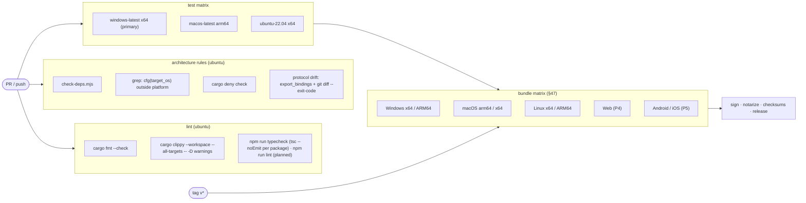

# Monorepo Proposal

> Deliverable §65 #4. The layout itself is fixed by
> `docs/ENGINEERING_CONTRACT.md` §2 (finalized by ADR-0001; npm workspaces per
> ADR-0002). This document **justifies** it, states the dependency rules that
> keep it healthy, and defines the build/CI matrix for every §47 target.

## 1. Layout (from the contract)

```
/Cargo.toml                 cargo workspace: members = crates/*, apps/desktop/src-tauri; default-members = crates/*
/package.json               npm workspaces: apps/*, packages/* (scripts: gen:protocol, build, build:packages, typecheck, test, dev, tauri, icons)
/.cargo/config.toml         [env] TS_RS_EXPORT_DIR (generated TS dir), TS_RS_LARGE_INT = "number"
/rust-toolchain.toml        stable + rustfmt + clippy
/tsconfig.base.json         strict, noUncheckedIndexedAccess, … (every TS package extends it)
/scripts                    gen-protocol.mjs (ts-rs export + barrel), gen-icon.mjs
/docs                       architecture, adr, security, sync, agents, providers, platform, api, spikes
/crates/<name>              orkestr-<name>: domain, protocol, events, storage, platform, security,
                            providers, task-engine, agent-runtime, orchestrator, context, memory,
                            vcs, terminal, snapshots, cost, sync, node, core
/apps/desktop               Tauri 2 shell (src-tauri/) + React UI (src/)
/apps/web                   P4   (reuses @orkestr/client, @orkestr/protocol, @orkestr/ui)
/apps/mobile                P5   (React Native; reuses @orkestr/client, @orkestr/protocol)
/packages/protocol          @orkestr/protocol — TS generated from Rust (ts-rs)
/packages/client            @orkestr/client — WS RPC client
/packages/ui                @orkestr/ui — tokens, theme engine, primitives
```

## 2. Why this layout

| Decision | Rationale | Spec |
|---|---|---|
| **One repo, two workspaces (cargo + npm)** | Protocol types are generated from Rust into TS in the same commit; a protocol change and all its consumers land atomically. Drift is detectable in CI (§4.3). | §19 (#19 shared protocol), §67 |
| **Many small crates instead of one `core` crate** | Enforces "no god services" (§60.3) and "interfaces at boundaries" (§60.4) with the compiler: an engine cannot reach into another's tables because it cannot even name its types. Also parallelizes compilation and parallel human/agent work (contract §9). | §60.3–4, §64 |
| **`domain` with no I/O at the bottom** | Lets every layer — including future WASM/mobile helpers — share entities without dragging tokio/rusqlite. | §51 |
| **`protocol` separate from `domain`** | Wire evolution (append-only event kinds, method params) is versioned independently of internal models; TS export lives in one place. | contract §4 |
| **`platform` as the only cfg/unsafe crate** | Linux/macOS support become "add a PlatformAdapter", not a code-wide hunt for `#[cfg]` (§67: "Linux добавляется PlatformAdapter'ом"). | §46, §60.6 |
| **`providers` as the only provider-aware crate** | "Claude replaced by GPT without rewriting Agent Runtime", "Gemini added as adapter" (§67). | §4, §60.5 |
| **`core` as lib + `orkestrd` bin** | Same code embedded in desktop and headless; background agents and future AI Node (§12, §38) need no second implementation. | §12 |
| **Business data only over RPC, even in desktop** | Web and Mobile get every feature "for free"; the Tauri bridge exposes only `core_connection` and window/host commands. | contract §2, §67 |
| **TS packages split protocol / client / ui** | Mobile (React Native) needs protocol + client but not DOM UI; web needs all three. | §2, §47 (90–95% shared) |
| **npm workspaces, not pnpm** | pnpm not installed on the reference host; npm workspaces are sufficient for 3–6 packages (ADR-0002). | contract §1 |

Rejected alternatives: a single `orkestr` crate with modules (no enforced
boundaries, slow incremental builds); separate repos per client (protocol
drift, cross-repo PR choreography); Nx/Turborepo (tooling weight not justified
for this package count; revisit at P5 if mobile build orchestration needs it).

## 3. Dependency rules

### 3.1 Rust (normative)

Allowed direct edges (any other edge is a CI failure unless an ADR adds it).
This table refines the minimum graph sketched in ADR-0001 (it adds the edges
needed to reach trait-owning crates, e.g. engines → `storage` for
`MetadataStore`). It **reverses** one ADR-0001 edge to match the code: the
foundation built `events → storage`, not `storage → events` (see
`components.md` §1.1 and the ADR-0001 implementation notes). As built, every
skeleton crate depends on `domain` only (`security` and `node` also on
`platform`); the wider rows below are what they are *allowed* to add.

| Crate | May depend on (direct, internal) |
|---|---|
| `domain` | — |
| `protocol` | `domain` |
| `storage` | `domain` (as built; it knows no events) |
| `events` | `storage`, `protocol`, `domain` (as built: `SqliteEventLog` lives here, on `storage::Db`) |
| `platform` | `domain` |
| `security` | `storage`, `platform`, `events`, `protocol`, `domain` |
| `vcs` | `platform`, `events`, `protocol`, `domain` |
| `terminal` | `security`, `platform`, `storage`, `events`, `protocol`, `domain` |
| `snapshots` | `vcs`, `storage`, `events`, `protocol`, `domain` |
| `memory` | `storage`, `events`, `protocol`, `domain` |
| `cost` | `storage`, `events`, `protocol`, `domain` |
| `node` | `platform`, `events`, `protocol`, `domain` |
| `sync` | `storage`, `security`, `events`, `protocol`, `domain` |
| `providers` | `security`, `platform`, `storage`, `events`, `protocol`, `domain` |
| `task-engine` | `storage`, `events`, `protocol`, `domain` |
| `context` | `memory`, `vcs`, `storage`, `events`, `protocol`, `domain` |
| `agent-runtime` | `providers`, `task-engine`, `terminal`, `snapshots`, `context`, `memory`, `vcs`, `cost`, `security`, `storage`, `events`, `protocol`, `domain` |
| `orchestrator` | `agent-runtime`, `node` + everything `agent-runtime` may use |
| `core` | all crates |
| `apps/desktop/src-tauri` | `core`, `platform`, `protocol`, `domain` |

Further rules:

1. No crate depends on `core` (contract §2). Engines receive collaborators as
   `Arc<dyn Trait>`; `core` picks implementations.
2. `#[cfg(target_os = ...)]` appears only in `crates/platform` (§60.6). CI greps
   for it elsewhere. `cfg(windows)`/`cfg(unix)` count too. **Known violation
   (as built):** `crates/core/src/bin/orkestrd.rs` uses `#[cfg(unix)]` /
   `#[cfg(not(unix))]` to wait for SIGTERM; it should move behind a
   `platform` helper (e.g. `platform::signals::terminate()`). ADR-0001 rule 3
   allows a narrow exception in `src-tauri` for window plumbing; this document
   recommends not using it (window capability data comes from
   `platform::WindowSupport`, effects via cross-platform Tauri APIs — see
   `platform-abstraction.md` §1.1) and the contract (§2: "ALL") currently
   forbids it — the conflict needs integrator resolution.
3. `unsafe` only in `crates/platform`, each block with a `// SAFETY:` comment;
   every other crate has `#![forbid(unsafe_code)]`. As built, `platform` uses
   `#![deny(unsafe_code)]` with a single `#[allow(unsafe_code)]` around the
   Win32 `GetSystemPowerStatus` call in `power.rs`.
4. Provider names/endpoints (`api.openai.com`, `claude`, `codex`, ...) appear
   only in `crates/providers` (and docs/tests).
5. Third-party deps are declared once in `[workspace.dependencies]` and used as
   `foo.workspace = true`; versions pinned via `Cargo.lock` (committed).
6. `domain` and `protocol` must compile without `tokio` (checked by
   `cargo tree -p orkestr-domain -e normal | grep tokio` returning nothing).

Enforcement: `scripts/check-deps.mjs` (Node, no extra install) reads
`cargo metadata --format-version 1 --no-deps` and compares each workspace
member's internal dependencies against the table above (kept as JSON in
`scripts/dep-rules.json`). Plus `cargo deny check` for licenses/advisories/
duplicate major versions. ADR-0001 names the checker `scripts/check-deps`
(Phase 1 milestone M1.1); the script and JSON are integrator-owned shared
files, not yet created — see "Open items".

### 3.2 TypeScript

| Package | May import |
|---|---|
| `@orkestr/protocol` | nothing (generated + hand-written index) |
| `@orkestr/client` | `@orkestr/protocol` |
| `@orkestr/ui` | `@orkestr/protocol` (e.g. `ui_config` types), `@orkestr/client` (ADR-0001 rule 5), `react`, `clsx`, `motion`; **no** `@tauri-apps/*` |
| `apps/desktop/src` | all three packages, `@tauri-apps/api` **only** in `src/lib/tauri.ts` (connection bootstrap `getCoreConnection`, `windowControls`) |
| `apps/web` (P4), `apps/mobile` (P5) | protocol, client (+ ui for web); never `@tauri-apps/*` |

As built, `@orkestr/ui` and `@orkestr/client` both depend only on
`@orkestr/protocol` (the UI package does not use the client). **(planned)**
Enforced with ESLint `no-restricted-imports` per package (no ESLint config
exists yet). TS `strict: true`, `noUncheckedIndexedAccess: true` everywhere via
`tsconfig.base.json`; each package is type-checked with `tsc -p … --noEmit`
(`npm run typecheck`), not with project references.

## 4. Build and CI

### 4.1 Pipelines



Test job (every OS): `cargo test --workspace` (temp `ORKESTR_HOME`, never the
real data dir), `npm test --workspaces` (vitest + jsdom), and a Core smoke test
that starts `orkestrd` on `127.0.0.1:0`, calls `GET /health`, authenticates over
WS and lists projects with the `mock` provider. Windows is the gating platform
(Windows-first, §2); macOS/Linux must pass before release from P1 end onward
(warn-only until the platform adapters reach parity, tracked per capability in
`platform-abstraction.md` §4).

### 4.2 Target matrix (§47)

| Target | Rust triple | Runner | Artifacts | Notes | Phase |
|---|---|---|---|---|---|
| Windows x64 | `x86_64-pc-windows-msvc` | `windows-latest` | NSIS `.exe`, `.msi` (Tauri bundler) | WebView2 bootstrapper embedded; Authenticode signing; AppUserModelID registered by installer (toasts) | P1 |
| Windows ARM64 | `aarch64-pc-windows-msvc` | `windows-11-arm` (native) or cross from x64 | NSIS `.exe`, `.msi` | `rusqlite bundled` C build needs ARM64 MSVC tools; WebView2 ARM64 runtime | P1 (build), P3 (QA) |
| macOS Apple Silicon | `aarch64-apple-darwin` | `macos-latest` | `.app`, `.dmg` | Developer ID signing + notarization required for Keychain ACL stability, notifications, mic/accessibility prompts | P1 build / P3 parity |
| macOS Intel | `x86_64-apple-darwin` | `macos-13` or cross | `.app`, `.dmg` (or one `universal-apple-darwin` dmg) | | P1 build / P3 parity |
| Linux x64 | `x86_64-unknown-linux-gnu` | `ubuntu-22.04` (glibc baseline) | AppImage, `.deb`, `.rpm` | Tauri 2 needs `libwebkit2gtk-4.1-dev`, `libayatana-appindicator3-dev`, `librsvg2-dev` | P1 build / P3 parity |
| Linux ARM64 | `aarch64-unknown-linux-gnu` | `ubuntu-22.04-arm` | AppImage, `.deb`, `.rpm` | | P1 build / P3 parity |
| Headless `orkestrd` | all six triples above | same | plain binary + service files (systemd user unit, LaunchAgent plist, Task Scheduler XML) | No WebView deps (core crate only) | P1 Win, P4 all |
| Web client | n/a (Vite) | `ubuntu-latest` | static bundle served by gateway | Same `@orkestr/client` | P4 |
| Android | n/a (React Native) | `ubuntu-latest` + Android SDK | `.aab`/`.apk` | Push via FCM | P5 |
| iOS | n/a (React Native) | `macos-latest` + Xcode | `.ipa` (TestFlight) | Push via APNs | P5 |

"90–95% shared code" (§47) is achieved by construction: all logic is in Rust
crates shared by every desktop target and by `orkestrd`; all client logic is in
`@orkestr/protocol` + `@orkestr/client`, shared by desktop, web and mobile;
per-OS Rust code is confined to `crates/platform` (as built it is written as
`#[cfg]` branches inside each capability module, not as
`platform/src/{windows,macos,linux}` directories, so the CI metric must count
`cfg`-gated items rather than directories; reported, not gated).

### 4.3 Protocol drift check

```
cargo test -p orkestr-protocol export_bindings      # TS_RS_EXPORT_DIR=packages/protocol/src/generated
git diff --exit-code packages/protocol/src/generated
```

A PR that changes a Rust protocol type without regenerating fails. Event kinds
are append-only: a second check compares the `EventKind` variant list with the
previous release tag and fails on removal/rename.

### 4.4 Caching and local builds

- `Swatinem/rust-cache` keyed by OS + triple + `Cargo.lock`; npm cache keyed by
  `package-lock.json`.
- Parallel local work uses isolated target dirs:
  `CARGO_TARGET_DIR=target/agent-<name> cargo test -p <crate>` (contract §9.3).
- Release profile: `lto = "thin"`, `codegen-units = 1`, `strip = "symbols"`
  for `orkestrd` and the desktop binary; debug symbols uploaded separately for
  crash reports.

## 5. Versioning and releases

- Single product version in `[workspace.package] version` and root
  `package.json`; crates are not published to crates.io (internal).
- `PROTOCOL_VERSION` (u32) in `orkestr-protocol` bumps only on breaking wire
  changes; the server announces it in the `auth` response
  (`AuthResult.protocolVersion`) and in `system.info` (the `hello` frame of
  ADR-0005 is planned) so a P5 mobile app can detect an older desktop node.
- DB schema version = set of applied migration ids; downgrade path = `down`
  migrations in reverse order (contract §3).

## 6. Open items

1. `scripts/check-deps.mjs`, `scripts/dep-rules.json`, `deny.toml`,
   `.github/workflows/*.yml` are not yet in the repo; they touch shared root
   files and must be added by the integrator.
2. The repository was initialised with git (`main`) but has no commits yet;
   the drift check and CI assume a committed baseline.
3. Protocol version negotiation is covered by the `hello` frame of ADR-0005,
   which is not yet folded into the contract (ADR-0005 "CA-5").
