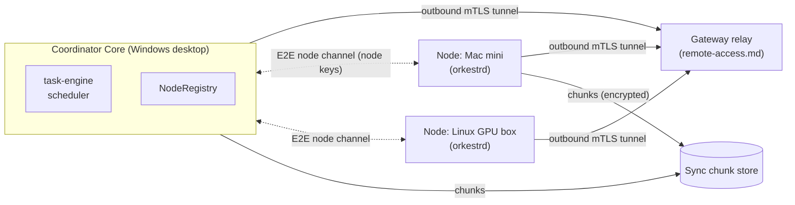
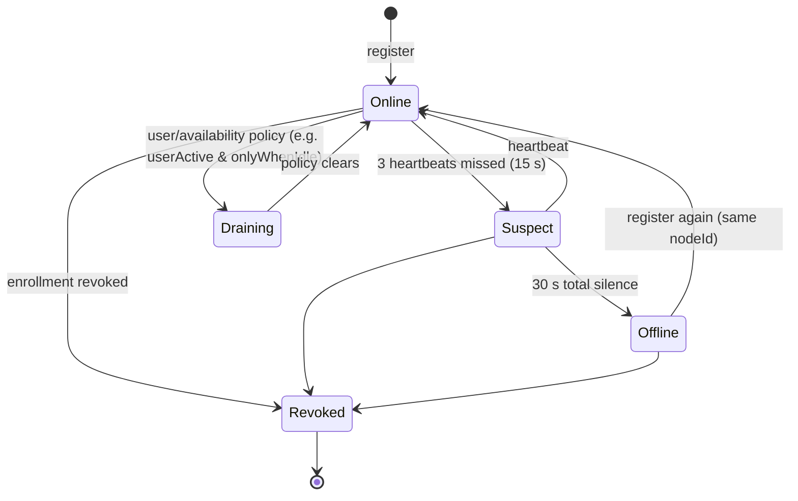
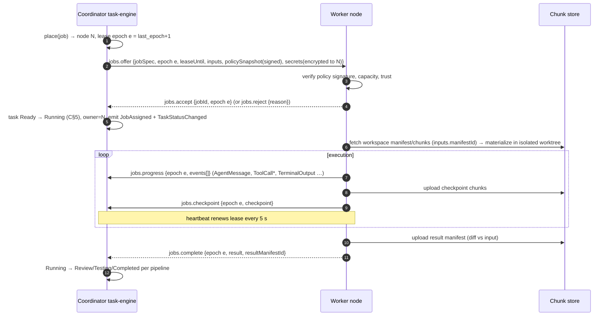
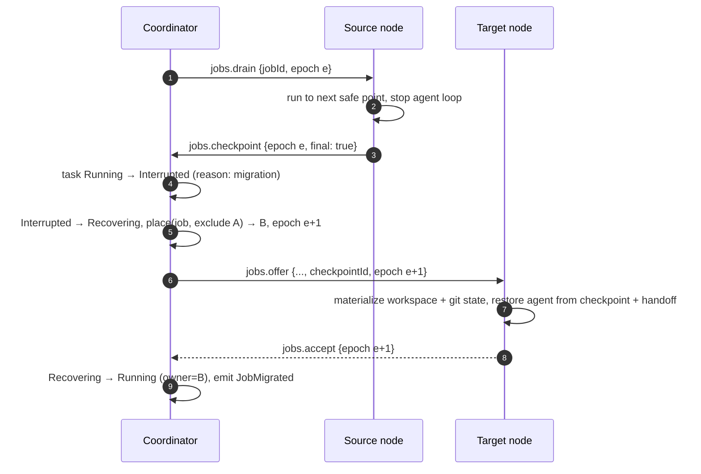

# Node Protocol

Status: Phase 0 deliverable #14 (§65). Covers §38 (AI Nodes, Cluster), §39 (Job
Migration), §11 (resource-aware parallelism), §27 (node health), §62.10 (node task
migration risk), scenario §63 F ("macOS build → Mac node").

Crates: `orkestr-node` (C§2: "NodeInfo/resources (sysinfo), node registry trait (Phase 6
extends)"), `orkestr-task-engine` (scheduler, state machine — the only place task status
changes, C§5), `orkestr-core` (wiring, RPC). Transport reuses the remote-access tunnel and
E2E channel (`docs/architecture/remote-access.md`). Checkpoint storage reuses the sync chunk
store (`docs/sync/sync-protocol.md`). Threat analysis: TB12, SR-80..83.

**Phase split**
- **P1**: `NodeInfo` + live `ResourceSnapshot` of the local node (sysinfo; GPU via
  platform adapter where available), `NodeRegistry` trait with a single-node
  `LocalNodeRegistry`, scheduler consumes local resources (§11), `NodeStatus` events for
  Mission Control. Agent loop has **checkpoint safe points** from day one (needed for crash
  recovery §62.13 anyway).
- **As built (Phase 0, 2026-10-02):** `orkestr-node` has
  `describe_local_node(id, &dyn PlatformAdapter, core_version, now) -> Node`
  (wire `orkestr_domain::Node {id, name, hostname, os, osVersion, arch,
  coreVersion, status, resources: NodeResources, tools, localModels, isLocal,
  lastHeartbeatAt}`; tools probed on `PATH` from `PROBED_TOOLS`), a skeleton
  `NodeRegistry { list(), heartbeat(Node) }` and `NodeError`. The live sample is
  `orkestr_platform::ResourceSnapshot` (via `PlatformAdapter::resources()`),
  GPU info is empty. The core persists its node id in `core_meta` and reports it
  in `system.info`; it does not call `describe_local_node` or emit
  `NodeStatus` yet. `NodeStatus` (domain) is `Online | Busy | Degraded |
  Offline` (`Draining` is a planned additive variant). The names below
  (`NodeDescriptor`, `NodeSnapshot`, `LocalNodeRegistry`, `ResourceProbe`) are the
  P1/P6 target and extend this skeleton.
- **P2**: checkpoints persisted per task (`JobCheckpoint`) and used by `Recovering`.
- **P6**: remote nodes: enrollment, heartbeats, job leases, remote execution, logical
  migration.

## 1. Concepts

| Term | Definition |
|------|------------|
| Node | Any Orkestr Core instance (desktop app or headless `orkestrd`) able to execute jobs (§38). Identity `NodeId` (UUIDv7) + Ed25519 node key. |
| Coordinator | The Core that **owns** a project's task graph (by default the user's primary desktop; configurable per project). Runs `orkestr-task-engine` for that project; the only writer of task status. |
| Worker | A node executing a job on behalf of a coordinator. A coordinator is also a worker for itself. |
| Job | A unit of execution placed on one node: `AgentTask` (an agent working on a task), `Command` (build/test/lint step, e.g. macOS build), or `Service` (long-running tool, e.g. local model serving). |
| Lease | Time-bounded exclusive right of a node to execute a job, with a monotonically increasing `epoch` used as a fencing token. |
| Checkpoint | Serializable state sufficient to logically resume a job elsewhere (§39). **Not** an OS process image. |

## 2. Topology and transport



- Nodes never listen on public interfaces (same rule as Core, C§3). All node↔coordinator
  traffic is relayed through the gateway tunnel with an **E2E channel** using the
  `e2e-v1` handshake of remote-access.md §6, with Ed25519 node keys instead of P-256
  device keys (both ends are Rust).
- P6+ optional optimisation: direct LAN path with mutual TLS using certificates pinned at
  enrollment (no new trust; ADR required).
- Messages are C§4 RPC frames over the E2E channel. Node methods live in area `nodes` and
  `jobs`. The calling principal is `Actor::Node{nodeId}` (threat-model.md §5.1).

## 3. Registration (enrollment)

1. On the new machine the user runs `orkestrd node join` (or desktop Settings → "Use this
   computer as a node"). It generates the node key and shows a device-authorization code.
2. Pairing/approval exactly as remote-access.md §4.2 (SAS comparison on a trusted
   surface), role `node` with a **trust level** chosen by the user:

| Trust level | May run | Secrets delivered |
|-------------|---------|-------------------|
| `restricted` | `Command` jobs without network/secrets (builds/tests from snapshot) | none |
| `standard` | + `AgentTask` jobs for allowed projects | per-job, scoped, env-specific (non-Production) |
| `trusted` | + Deploy/Ssh/Production-scoped jobs (still subject to approvals) | per-job incl. Production when policy allows |

3. Coordinator writes a signed `NodeEnrollment` record (synced in `records:global`):

```json
{
  "nodeId": "0192f6…",
  "name": "mac-mini-office",
  "publicKey": "ed25519:…",
  "trustLevel": "standard",
  "allowedProjects": ["0192…"],          // [] = none, ["*"] = all
  "enrolledBy": {"kind": "device", "id": "dev_A"},
  "enrolledAt": "2026-10-02T10:00:00Z",
  "sig": "ed25519:<coordinator signature>"
}
```

4. Node calls `nodes.register` with its descriptor:

```json
{"type":"req","id":"1","method":"nodes.register","params":{
  "nodeId":"0192f6…","coreVersion":"0.6.0","protocolVersion":1,
  "descriptor":{
    "os":{"family":"macos","version":"15.1","arch":"aarch64"},
    "cpu":{"model":"Apple M4","physicalCores":10,"logicalCores":10},
    "memory":{"totalMb":32768},
    "gpus":[{"vendor":"apple","model":"M4 GPU","vramMb":null,"unifiedMemory":true}],
    "disks":[{"mount":"/","totalGb":512,"freeGb":210}],
    "runtimes":[{"name":"node","version":"24.1.0"},{"name":"rustc","version":"1.99.0"},
                {"name":"xcode","version":"16.1"},{"name":"python","version":"3.13.1"}],
    "docker":{"available":true,"version":"27.3.1","arch":"arm64"},
    "localModels":[{"provider":"ollama","model":"qwen2.5-coder:14b","sizeMb":9000}],
    "tools":["git","pwsh","bash","xcodebuild","fastlane"],
    "shells":["zsh","bash","pwsh"],
    "projectCaches":[{"projectId":"0192…","headCommit":"9f1c…","manifestId":"b3:…"}],
    "labels":{"site":"office"},
    "availability":{"schedule":"always","onlyWhenIdle":false,"onlyOnAcPower":true,
                    "maxConcurrentJobs":2,"reserveCpuPct":20,"reserveMemMb":4096}
  }}}
```

Result: `{"accepted":true,"heartbeatIntervalMs":5000,"leaseTtlMs":30000}`. Rejected if node
key ∉ enrollments or enrollment revoked → `unauthorized`.

Types (P1 for the local node):

```rust
// orkestr-node
pub struct NodeDescriptor {
    pub os: OsInfo, pub cpu: CpuInfo, pub memory: MemoryInfo, pub gpus: Vec<GpuInfo>,
    pub disks: Vec<DiskInfo>, pub runtimes: Vec<RuntimeInfo>, pub docker: Option<DockerInfo>,
    pub local_models: Vec<LocalModelInfo>, pub tools: Vec<String>, pub shells: Vec<ShellKind>,
    pub project_caches: Vec<ProjectCache>, pub labels: BTreeMap<String, String>,
    pub availability: AvailabilityPolicy,
}

#[async_trait::async_trait]
pub trait NodeRegistry: Send + Sync {
    async fn local(&self) -> Result<NodeSnapshot, NodeError>;
    async fn list(&self) -> Result<Vec<NodeSnapshot>, NodeError>;      // P1: [local]
    async fn get(&self, id: &NodeId) -> Result<Option<NodeSnapshot>, NodeError>;
    async fn register(&self, enrollment: &NodeEnrollment, d: NodeDescriptor) -> Result<(), NodeError>; // P6
    async fn heartbeat(&self, hb: Heartbeat) -> Result<HeartbeatAck, NodeError>;                     // P6
    async fn mark_offline(&self, id: &NodeId, reason: OfflineReason) -> Result<(), NodeError>;
    fn subscribe(&self) -> tokio::sync::broadcast::Receiver<NodeChange>;
}

pub trait ResourceProbe: Send + Sync {            // implemented via orkestr-platform + sysinfo
    fn descriptor(&self) -> NodeDescriptor;       // slow, cached, refreshed every 10 min or on demand
    fn sample(&self) -> ResourceSample;           // fast, called every heartbeat
}
```

## 4. Heartbeats and resource reporting

`nodes.heartbeat` every 5 s (jittered ±10 %), payload ≤ 4 KiB:

```json
{"nodeId":"0192f6…","seq":1832,"ts":"2026-10-02T11:00:05Z",
 "resources":{"cpuPct":37.5,"memUsedMb":18200,"memAvailMb":14568,
              "gpus":[{"index":0,"utilPct":12,"vramUsedMb":null}],
              "diskFreeGb":209,"netRttMsToGateway":34,"onAcPower":true,"batteryPct":null,
              "userActive":false,"thermalThrottled":false},
 "slots":{"max":2,"used":1},
 "leases":[{"jobId":"0192…","epoch":4,"phase":"running","progress":0.42,"lastCheckpoint":"ck_…"}],
 "cacheDelta":[{"projectId":"0192…","manifestId":"b3:…"}]}
```

Ack: `{"renewed":[{"jobId":"…","epoch":4,"leaseUntil":"…"}],"revoked":[{"jobId":"…","reason":"cancelled"}]}`
— heartbeats renew all leases held by the node in one round trip.

Node health state (coordinator view):



Events: `NodeStatus` on state change and at most every 5 s for resource updates
(cadence per `event-model.md` §3.4; v1 payload `{node: Node}`, the slimmer
`{nodeId, status, resources, runningAgents, statusChanged}` of event-model §7.8 is
the target); `NodeOffline {nodeId, lastSeenAt}` on → Offline (existing kind). Proposed append-only: `NodeRegistered`, `JobAssigned`, `JobCheckpointed`,
`JobMigrated`. Proposed topic: `node:<id>` (not in C§4 topic list).

## 5. Scheduling

Scheduling is done by `orkestr-task-engine` on the coordinator. Inputs (§38 list):

| Input | Source |
|-------|--------|
| OS / arch requirement | `JobSpec.requirements.os` (e.g. macOS build ⇒ `macos`), detected from task tags or build target |
| Resources | CPU/RAM/GPU/VRAM/disk from descriptor + latest sample minus reservations |
| Tools / runtimes | `requirements.tools`, `requirements.runtimes` (semver ranges) |
| Local models | required when project privacy policy = `Local Models Only` (§56) or the agent's routed model is local |
| Project cache | node has a recent manifest/commit of the project ⇒ less transfer |
| Load | `slots.used`, cpu/mem pressure, thermal throttling |
| Network | RTT to gateway; bandwidth estimate from recent chunk transfers |
| User preference | per-project `preferredNodes`, `forbiddenNodes`; node `availability` policy |
| Trust & policy | node trust level vs job needs (secrets, network, Production) |
| Cost / energy | battery state, `onlyOnAcPower` |

```rust
// orkestr-task-engine::scheduler
pub struct JobSpec {
    pub job_id: JobId,
    pub task_id: TaskId,
    pub project_id: ProjectId,
    pub kind: JobKind,                       // AgentTask | Command | Service
    pub requirements: Requirements,          // os, arch, tools, runtimes, min_mem_mb, gpu, local_models, docker
    pub estimate: ResourceEstimate,          // cpu_cores, mem_mb, vram_mb, disk_mb, duration_s
    pub needs: Needs,                        // network: bool, secrets: Vec<SecretReference>, environment: EnvironmentKind
    pub priority: Priority,                  // Critical | High | Normal | Low | Background (§11)
    pub affinity: Affinity,                  // preferred / forbidden nodes, sticky_to_cache
}

pub enum Placement {
    Place { node_id: NodeId, score: f64, explanation: Vec<String> },
    Wait { reason: WaitReason },            // no feasible node now (task stays Ready/Blocked)
    Infeasible { reason: String },          // no enrolled node can ever satisfy → task Blocked
}

pub trait NodeScheduler: Send + Sync {
    fn place(&self, job: &JobSpec, nodes: &[NodeSnapshot], policy: &ProjectPolicy) -> Placement;
}
```

Algorithm (deterministic, unit-tested):
1. **Filter** (hard constraints): enrollment allows project; trust level sufficient; OS/arch;
   tools/runtimes; docker; local models; free resources ≥ estimate + reservations;
   availability policy (idle/AC/schedule); state = Online.
2. **Score** (weights configurable; defaults):
   `0.30·headroom + 0.25·cacheWarmth + 0.15·(1−load) + 0.10·network + 0.15·preference + 0.05·energy`,
   each term normalized to [0,1]; `preference` = 1 for preferred node, 0.5 neutral.
3. Tie-break: coordinator itself (avoid transfer), then lowest `NodeId`.
4. Explanation strings are stored on the task (`execution history`) and shown in UI.

Priority preemption: a `Critical` job may request checkpoint-and-yield of a `Background` job
on the chosen node (same migration machinery, §6) — never kill without checkpoint.

## 6. Job assignment (leases)



- **Fencing**: every job-side call carries `epoch`; the coordinator rejects calls with an
  epoch ≠ current for that job (`conflict`). A partitioned old node therefore cannot
  overwrite results after reassignment (SR-81).
- **Lease expiry**: no renewal for `leaseTtlMs` (30 s) ⇒ coordinator considers the job
  lost → §7.2 unplanned migration.
- **Inputs**: `{manifestId, gitState, handoff, checkpointId?}`; the node never receives the
  coordinator's whole data dir.
- **Policy snapshot**: coordinator-signed `{capabilityRules, approvalMode, dangerousOverrides,
  egressAllowlist, budget}`; node's PermissionEngine enforces the stricter of node-local
  policy and snapshot (SR-83).
- **Approvals** raised on a worker are forwarded to the coordinator as `ApprovalRequested`
  (with `nodeId`); the job waits (`Running → Waiting` on coordinator) until resolved; the
  decision returns via `jobs.approvalResolved`.
- **Secrets**: per-job HPKE envelopes to the node key containing only the job's
  `SecretReference` values, TTL = lease; node keeps them in memory only (SR-82).
- **Cancellation / emergency stop**: `jobs.cancel {jobId, epoch, mode: graceful|immediate}`;
  `emergency.stopAll` on the coordinator broadcasts cancel to all nodes; each node *also*
  honours its own local emergency stop independently (§52).

Job RPC methods (area `jobs`, principal `Node` or coordinator): `jobs.offer`,
`jobs.accept`, `jobs.reject`, `jobs.progress`, `jobs.checkpoint`, `jobs.complete`,
`jobs.fail`, `jobs.cancel`, `jobs.approvalResolved`, `jobs.drain`.

## 7. Checkpoints and logical migration (§39)

### 7.1 Checkpoint content

```rust
pub struct JobCheckpoint {
    pub checkpoint_id: CheckpointId,
    pub job_id: JobId,
    pub task_id: TaskId,
    pub epoch: u64,
    pub created_at: DateTime<Utc>,
    pub workspace: ManifestId,               // incremental snapshot of the job worktree (sync chunk store)
    pub git: GitStateDescriptor,             // branch/commit/unpushed bundle/staged patch (sync-protocol.md §7)
    pub agent: AgentStateCheckpoint,
    pub handoff: Handoff,                    // §57 structure: task, concise context, relevant files, decisions, unresolved issues, test state, artifacts
    pub artifacts: Vec<ArtifactRef>,
    pub side_effects: Vec<SideEffectRecord>, // non-idempotent actions performed since previous checkpoint
}

pub struct AgentStateCheckpoint {
    pub agent_id: AgentId,
    pub template_id: AgentTemplateId,
    pub provider_model: ProviderModelRef,    // routed model at checkpoint time
    pub turn: u32,
    pub budget_used: BudgetUsage,            // tokens, cost, wall time
    pub tool_log_cursor: u64,                // index into persisted ToolCall history
    pub conversation_summary: String,        // structured summary — NOT hidden chain-of-thought (§1.14, §21)
    pub pending_plan: Vec<PlanStep>,         // remaining steps known to the runtime
    pub open_approvals: Vec<ApprovalId>,
}
```

Safe points (where checkpoints may be taken): between tool calls in the agent loop; after
each build/test command finishes; before any action classified dangerous; at most every
N minutes (default 5) during long commands via workspace snapshot only. Coding-agent CLIs
(Claude Code, Codex, C§7) are checkpointed at the boundary of their runs (their internal
session state is not portable; we pass a handoff to a fresh run) — limitation recorded.

### 7.2 Migration flows

Planned (drain, user request, preemption, node going to sleep):



Unplanned (node lost / lease expired): coordinator transitions `Running → Interrupted`
(reason `node_lost`), then `Interrupted → Recovering`, picks the latest checkpoint, and:
- if `side_effects` after that checkpoint include non-idempotent actions (deploy, DB write,
  push, external API with side effects) **or** the side-effect log is unknown (lost
  since last heartbeat), the task goes `Recovering → Failed` with reason
  `needs_user_decision`, and an `ApprovalRequested` asks the user to resume — never blind
  re-execution of side effects;
- otherwise placement as in planned flow (`Recovering → Running`).
- If the old node returns, its calls carry the stale epoch and are rejected; its
  worktree changes after the checkpoint are surfaced as a sync conflict, not discarded.

All transitions used are in the C§5 table: `Running→Interrupted`, `Interrupted→Recovering`,
`Recovering→Running|Ready|Failed`, `Running→Waiting` (approvals).

## 8. Failure matrix

| Failure | Detection | Action |
|---------|-----------|--------|
| Worker crash | lease expiry | unplanned migration |
| Coordinator crash | worker sees tunnel loss | worker continues to next safe point, checkpoints locally, pauses after `leaseTtl`; on coordinator restart its crash recovery marks tasks `Interrupted` (C§5) then reconciles with node-reported leases (resume on same node if epoch matches) |
| Network partition | both sides | as above; fencing prevents split brain |
| Chunk store unavailable | upload errors | checkpoints queued locally (sync outbox); migration impossible → task stays on node or fails over to "resume from older checkpoint" with user approval |
| Node revoked mid-job | registry | immediate cancel, secrets wiped, job → `Interrupted` → user decision |

## 9. Security summary

- Enrollment through device authorization; Ed25519 node keys; E2E channel (SR-80).
- Fencing tokens (SR-81). Per-job scoped secrets with TTL (SR-82). Policy min (SR-83).
- Node runs job in an isolated worktree under its data dir; same path confinement and
  DangerousActionGuard as local agents.
- Audit: every offer/accept/complete/migrate recorded on the coordinator with `nodeId`.

## 10. Open issues / contract notes

- New event kinds (`NodeRegistered`, `JobAssigned`, `JobCheckpointed`, `JobMigrated`) and
  topic `node:<id>` are append-only proposals.
- `JobId`, `CheckpointId`, `NodeId`, `DeviceId` newtypes should be added to `orkestr-domain`
  in P1 (cheap, avoids later churn).
- Task "owner" (device/node) is not part of the C§5 Task fields; needed by sync (status
  authority) and scheduling — propose `owner: Option<ExecutorRef>` on Task.
- `Interrupted` is reused for planned migration (reason field distinguishes); C§5 says
  `Interrupted` is set on crash — confirm reuse is intended (no new state needed).
