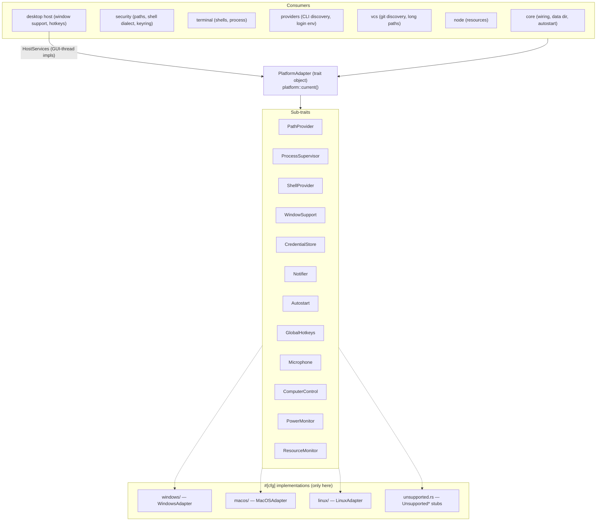

# Platform Abstraction

> Deliverable §65 #17. Spec §46: `PlatformAdapter` with Process, Shell,
> Window, CredentialStore, Notifications, Autostart, GlobalHotkeys,
> Microphone, ComputerControl, Power; implementations WindowsAdapter,
> MacOSAdapter, LinuxAdapter; no hardcoded `C:\Users\...`.
> Contract §1–2: `orkestr-platform` holds **all** `#[cfg(target_os)]` code and
> also paths, shells, credential store, autostart, notifications, resources;
> `ORKESTR_HOME` overrides the data dir; it is the only crate allowed `unsafe`
> (documented FFI).

## 0. As built (Phase 0 foundation, 2026-10-02)

Normative for `crates/platform/src`. §1–§5 are the target design (richer
sub-traits, containment groups, `HostServices`); where they differ, the names
below are what code uses today and the target is reached by additive change or
by an explicit rename in the implementing phase.

```rust
pub trait PlatformAdapter: Send + Sync {
    fn info(&self) -> &PlatformInfo;                       // {os: OsKind, arch: Arch, hostname, os_version}
    fn paths(&self) -> &Paths;                             // concrete struct, not a trait
    fn process(&self) -> &dyn ProcessControl;              // which(name), is_alive(pid), kill_tree(pid), current_pid()
    fn shells(&self) -> &dyn ShellDetector;                // detect() -> Vec<ShellInfo>, default_shell()
    fn credentials(&self) -> &dyn CredentialStore;         // set/get/delete(service, account, secret: &str), sync
    fn notifications(&self) -> &dyn Notifier;              // notify(&DesktopNotification)
    fn autostart(&self) -> &dyn Autostart;                 // enable(&AutostartEntry{id, program, args}), disable(id), is_enabled(id)
    fn hotkeys(&self) -> &dyn GlobalHotkeys;               // register(action, accelerator), unregister(action)
    fn microphone(&self) -> &dyn Microphone;               // list_devices()
    fn computer_control(&self) -> &dyn ComputerControl;    // is_available(), screenshot_png(), click(x,y), type_text()
    fn power(&self) -> &dyn Power;                         // status() -> PowerStatus
    fn resources(&self) -> &dyn ResourceMonitor;           // snapshot() -> ResourceSnapshot (cpu, memory, disk)
}
pub struct NativePlatform;  // NativePlatform::new(paths).with_credentials(..).with_autostart(..)
pub enum ShellKind { PowerShell7, WindowsPowerShell, Cmd, GitBash, Wsl, Bash, Zsh, Fish, Sh }
pub struct ShellInfo { kind, name /* display name */, path, args, is_default }
pub enum PlatformError { NotSupported{feature, os, hint}, Io, Credential, Command{command, status, stderr}, Invalid, NoDataDir }
pub fn fs::write_private_file(path, bytes);   // temp + rename; Unix 0600, Windows inherits the profile ACL
pub fn process::which(name) -> Option<PathBuf>;
pub const paths::ORKESTR_HOME_ENV: &str = "ORKESTR_HOME";
```

| Capability | Windows | macOS | Linux |
|---|---|---|---|
| paths | ✔ `directories` crate | ✔ | ✔ |
| process (`which`, `is_alive` via sysinfo, `kill_tree`) | ✔ `taskkill /T /F` | ✔ `kill -TERM -- -pgid`, then pid | ✔ same |
| shell detection | ✔ PowerShell 7/5.1, cmd, Git Bash, WSL | ✔ `/etc/shells` | ✔ `/etc/shells` |
| credential store | ✔ Credential Manager (`keyring`) | ✔ Keychain | ✔ kernel keyutils (not persistent across reboots; Secret Service is a Phase 1 follow-up) |
| notifications | ✖ `NotSupported` (the Tauri shell provides them) | ✔ `osascript` | ✔ `notify-send` |
| autostart | ✔ `HKCU\…\Run` via `reg.exe` | ✔ LaunchAgent plist | ✔ XDG autostart `.desktop` |
| global hotkeys | ✖ (Tauri shell) | ✖ | ✖ |
| microphone, computer control | ✖ (Phase 3 / Phase 7) | ✖ | ✖ |
| power | ✔ `GetSystemPowerStatus` (the only `unsafe` in the workspace, documented) | ✔ `pmset` | ✔ `/sys/class/power_supply` |
| resources | ✔ sysinfo | ✔ | ✔ |

There is no containment group / Job Object, no `spawn_detached`, no
`WindowSupport`, no `HostServices`, no `PlatformCapabilities` and no async
methods yet. `ProcessControl::is_alive` does not guard against pid reuse
(no start-time check).

**Paths as built** (`Paths::resolve`, `directories::ProjectDirs::from("dev", "Orkestr", "Orkestr")`):

| | Windows | macOS | Linux |
|---|---|---|---|
| data (`orkestr.db`, `objects/`, `core.json`, `core.token`, `session.lock`) | `%APPDATA%\Orkestr\Orkestr\data` (roaming profile) | `~/Library/Application Support/dev.Orkestr.Orkestr` | `$XDG_DATA_HOME/orkestr` |
| config | `%APPDATA%\Orkestr\Orkestr\config` | `~/Library/Application Support/dev.Orkestr.Orkestr` | `$XDG_CONFIG_HOME/orkestr` |
| cache | `%LOCALAPPDATA%\Orkestr\Orkestr\cache` | `~/Library/Caches/dev.Orkestr.Orkestr` | `$XDG_CACHE_HOME/orkestr` |
| logs | `<data>/logs` | `<data>/logs` | `<data>/logs` |

With `ORKESTR_HOME=<dir>` (or `Paths::from_root`): data = `<dir>` itself,
config = `<dir>/config`, cache = `<dir>/cache`, logs = `<dir>/logs`. There is
no separate runtime directory; run files live in the data dir. (macOS and
Linux paths are derived from the `directories` 6 rules; the foundation was
run on Windows only.)

## 1. Shape



Module layout (target). As built the crate has one module per capability —
`autostart.rs`, `credentials.rs`, `error.rs`, `fs.rs`, `hotkeys.rs` (also holds
`ComputerControl`), `info.rs`, `microphone.rs`, `notifications.rs`, `paths.rs`,
`power.rs`, `process.rs`, `resources.rs`, `shell.rs` — with the per-OS code as
`#[cfg]` branches inside each module and no `windows/`, `macos/`, `linux/`
directories:

```
crates/platform/src/
  lib.rs            PlatformAdapter, current(), PlatformInfo, PlatformError, HostServices
  paths.rs  process.rs  shell.rs  window.rs  credentials.rs  notify.rs
  autostart.rs  hotkeys.rs  microphone.rs  computer.rs  power.rs  resources.rs
  common/           cross-platform helpers (sysinfo, keyring, which) — no cfg
  windows/  macos/  linux/      #[cfg(target_os = "...")] mod per OS
  unsupported.rs    explicit "unimplemented-feature" errors
```

### 1.1 Why `HostServices`

Global hotkeys, tray and window effects need the GUI event loop, which only
exists inside the Tauri process; the Core may run headless (`orkestrd`).
Therefore:

- `orkestr-platform` defines the traits and provides **headless-capable**
  implementations (paths, process, shell, credentials, autostart,
  notifications, power, resources, microphone, computer control).
- For GUI-bound capabilities (`GlobalHotkeys`, window operations) the desktop
  host injects implementations through `CoreConfig.host_services`, built on
  cross-platform Tauri 2 APIs/plugins (no `#[cfg]` needed in `src-tauri`).
  The platform crate supplies the *capability data* (`WindowSupport`) those
  implementations consult (e.g. "Mica available", "Wayland: no global
  positioning").
- In `orkestrd`, GUI-bound sub-traits return
  `PlatformError::Unsupported { capability, reason: "headless" }`.

## 2. Rust signatures

```rust
// lib.rs
pub trait PlatformAdapter: Send + Sync + 'static {
    fn info(&self) -> &PlatformInfo;
    fn paths(&self) -> &dyn PathProvider;
    fn process(&self) -> &dyn ProcessSupervisor;
    fn shell(&self) -> &dyn ShellProvider;
    fn window(&self) -> &dyn WindowSupport;
    fn credentials(&self) -> &dyn CredentialStore;
    fn notify(&self) -> &dyn Notifier;          // name used by ADR-0003
    fn autostart(&self) -> &dyn Autostart;
    fn hotkeys(&self) -> &dyn GlobalHotkeys;
    fn microphone(&self) -> &dyn Microphone;
    fn computer_control(&self) -> &dyn ComputerControl;
    fn power(&self) -> &dyn PowerMonitor;
    fn resources(&self) -> &dyn ResourceMonitor;
    /// Machine-readable support matrix for UI/onboarding (§55 checks).
    fn capabilities(&self) -> PlatformCapabilities;
}

/// Builds the adapter for the compiled target. `host` overrides GUI-bound parts.
pub fn current(host: HostServices) -> Result<Arc<dyn PlatformAdapter>, PlatformError>;

#[derive(Default)]
pub struct HostServices {
    pub hotkeys: Option<Arc<dyn GlobalHotkeys>>,
    pub notifier: Option<Arc<dyn Notifier>>,     // ADR-0003: tauri-plugin-notification is only a fallback
}

#[derive(Clone, Serialize, Deserialize, TS)]
pub struct PlatformInfo {
    pub os: OsKind, pub arch: Arch /* X86_64 | Aarch64 */, pub os_version: String,
    pub kernel: String, pub hostname: String,
    pub linux: Option<LinuxSession>,             // { display: X11 | Wayland | Headless, desktop: Option<String>, distro }
    pub windows_build: Option<u32>,              // e.g. 22631 — gates Mica, ConPTY (≥17763)
}

#[derive(Debug, thiserror::Error)]
pub enum PlatformError {
    #[error("{capability} is not supported on this platform: {reason}")]
    Unsupported { capability: &'static str, reason: String },     // == "unimplemented-feature" (contract §9.6)
    #[error("permission denied by OS for {capability}: {hint}")]
    OsPermissionDenied { capability: &'static str, hint: String }, // e.g. macOS TCC
    #[error("not found: {0}")] NotFound(String),
    #[error("io: {0}")] Io(#[from] std::io::Error),
    #[error("os error: {0}")] Os(String),
}
```

### 2.1 Paths

```rust
pub trait PathProvider: Send + Sync {
    fn data_dir(&self) -> &Path;      // ORKESTR_HOME, else OS default; created 0700 / owner-only DACL
    fn config_dir(&self) -> &Path;
    fn cache_dir(&self) -> &Path;
    fn log_dir(&self) -> &Path;
    fn runtime_dir(&self) -> &Path;   // lock file, core.json, token
    fn home_dir(&self) -> Option<&Path>;
    /// Canonicalize without `\\?\` prefix on Windows (dunce), resolve symlinks.
    fn canonicalize(&self, p: &Path) -> Result<PathBuf, PlatformError>;
    /// Lexical normalization + OS rules: case-insensitivity (Win, default macOS), drive letters,
    /// UNC/verbatim detection, reserved names (CON, NUL, COM1…), trailing dots/spaces (Win).
    fn classify(&self, p: &Path) -> PathClass;     // Normal | Unc | Verbatim | DeviceNamespace | Reserved
    fn same_path(&self, a: &Path, b: &Path) -> bool;
    fn restrict_to_owner(&self, p: &Path) -> Result<(), PlatformError>; // file ACL/mode for secrets
}

// Free-function forms used by ADR-0004 (callable before an adapter exists, e.g. in CoreConfig defaults):
pub mod paths { pub fn data_dir() -> Result<PathBuf, PlatformError>; /* honours ORKESTR_HOME */ }
pub mod fs { pub fn restrict_to_user(p: &Path) -> Result<(), PlatformError>; }
```

| | Windows | macOS | Linux |
|---|---|---|---|
| data | `%LOCALAPPDATA%\Orkestr` (Known Folder `FOLDERID_LocalAppData`) | `~/Library/Application Support/dev.orkestr.Orkestr` | `$XDG_DATA_HOME/orkestr` (`~/.local/share/orkestr`) |
| config | `%APPDATA%\Orkestr` | same as data | `$XDG_CONFIG_HOME/orkestr` |
| cache | `%LOCALAPPDATA%\Orkestr\cache` | `~/Library/Caches/dev.orkestr.Orkestr` | `$XDG_CACHE_HOME/orkestr` |
| logs | `%LOCALAPPDATA%\Orkestr\logs` | `~/Library/Logs/Orkestr` | `$XDG_STATE_HOME/orkestr/logs` |
| runtime | data dir | data dir | `$XDG_RUNTIME_DIR/orkestr` (fallback data dir) |
| owner-only | DACL: owner + SYSTEM, inheritance off | `chmod 700/600` | `chmod 700/600` |

Target layout (Phase 1+). **As built** (§0) the data dir is the roaming `%APPDATA%\Orkestr\Orkestr\data` on Windows, logs are `<data>/logs`, there is no runtime dir, and `ORKESTR_HOME=<dir>` maps to data = `<dir>`, `<dir>/config`, `<dir>/cache`, `<dir>/logs` (tests always set it or use `Paths::from_root`). Moving the Windows data dir to `%LOCALAPPDATA%` (not roamed, better for a SQLite WAL database) is a Phase 1 decision that needs a data-dir migration for existing installs. Implementation uses the `directories` crate; no string-built OS paths anywhere.

### 2.2 Process

Normative core: **ADR-0022** (process containment); this section adds the
spec fields and per-OS notes.

```rust
pub struct CommandSpec { pub program: PathBuf, pub args: Vec<OsString>, pub cwd: PathBuf,
    pub env: EnvPolicy /* Inherit | Clean{allow: Vec<String>} + overrides */,
    pub stdin: Stdio, pub stdout: Stdio, pub stderr: Stdio,
    pub priority: ProcPriority /* Normal | BelowNormal | Idle */, pub limits: Option<ResourceLimits>,
    pub hide_window: bool /* Windows CREATE_NO_WINDOW */ }
pub struct ResourceLimits { pub memory_bytes: Option<u64>, pub cpu_percent: Option<u8> }

#[async_trait]
pub trait ProcessSupervisor: Send + Sync {
    /// ADR-0022: spawn into a containment group that dies with the core process.
    fn spawn_contained(&self, cmd: CommandSpec, group: &ContainmentGroup) -> Result<ChildHandle, PlatformError>;
    fn new_group(&self, label: &str) -> Result<ContainmentGroup, PlatformError>;
    /// Graceful then forced: Windows CTRL_BREAK -> TerminateJobObject; Unix SIGTERM -> SIGKILL to -pgid.
    async fn kill_tree(&self, child: &ChildHandle, grace: Duration) -> Result<(), PlatformError>;
    /// ADR-0004 daemon hand-off: outside any job/group, survives the parent.
    fn spawn_detached(&self, cmd: CommandSpec) -> Result<u32, PlatformError>;
    fn is_alive(&self, pid: u32, start_time: Option<u64>) -> bool;   // start_time guards pid reuse
}
```

| | Windows | macOS | Linux |
|---|---|---|---|
| containment / tree kill | Job Object with `JOB_OBJECT_LIMIT_KILL_ON_JOB_CLOSE` (ConPTY children too); `CREATE_NEW_PROCESS_GROUP` for Ctrl-Break | no PDEATHSIG: process group + `(pid, start_time, pgid)` recorded in `<data_dir>/children.json` (ADR-0022; there is no `run/` directory), killed by startup recovery | `PR_SET_PDEATHSIG(SIGKILL)` in `pre_exec` + dedicated process group, `kill(-pgid)` |
| limits | Job Object memory / CPU-rate limits | `setrlimit` (RLIMIT_AS weakly enforced) — best effort | cgroup v2 via systemd user scope when available, else `setrlimit` |
| priority | `BELOW_NORMAL_PRIORITY_CLASS` / `IDLE_PRIORITY_CLASS` | `nice` | `nice` + `ioprio_set` |
| quoting | build the command line per `CommandLineToArgvW` rules; `.cmd/.bat` targets need cmd.exe escaping (the "BatBadBut" class of bugs) — refuse args that cannot be escaped safely | argv array | argv array |

Crates: `tokio::process`, `windows` / `windows-sys` (Job Objects), `nix`
(process groups, prctl). `unsafe` is limited to these FFI calls, each with a
`// SAFETY:` comment.

### 2.3 Shell

```rust
// Same variant set as ADR-0010's Resource::Command{shell}; Custom is for user-defined shells.
pub enum ShellKind { Bash, Zsh, Fish, Sh, PowerShell /* 5.1 */, Pwsh /* 7+ */, Cmd, GitBash, Wsl, Custom }
pub struct ShellInfo { pub id: ShellId, pub kind: ShellKind, pub path: PathBuf, pub version: Option<String>,
    pub wsl_distro: Option<String>, pub display_name: String, pub is_default: bool }

#[async_trait]
pub trait ShellProvider: Send + Sync {
    async fn detect(&self) -> Result<Vec<ShellInfo>, PlatformError>;
    fn default_shell(&self) -> Option<ShellId>;
    /// argv to start an interactive PTY session.
    fn interactive_argv(&self, shell: &ShellInfo) -> Vec<OsString>;
    /// argv to run one command non-interactively, with correct quoting for the dialect.
    fn command_argv(&self, shell: &ShellInfo, command: &str) -> Result<Vec<OsString>, PlatformError>;
    /// Dialect used by DangerousActionGuard to parse/classify commands.
    fn dialect(&self, shell: &ShellInfo) -> ShellDialect;   // PowerShell | Cmd | Posix | Fish
    /// The user's login environment (PATH etc.), cached; needed to find git/claude/codex/node.
    async fn login_env(&self) -> Result<ResolvedEnv, PlatformError>;
    /// Resolve an executable against the login env (PATHEXT on Windows). Used by ADR-0008 (git)
    /// and ADR-0012 (provider CLIs).
    async fn which(&self, program: &str) -> Option<PathBuf>;
}
```

| | Windows | macOS | Linux |
|---|---|---|---|
| detection | `pwsh.exe` on PATH / `%ProgramFiles%\PowerShell\7`; `%SystemRoot%\System32\WindowsPowerShell\v1.0\powershell.exe`; `%ComSpec%`; Git Bash from the git install (`git --exec-path` → `../../bin/bash.exe`, ADR-0014), fallback registry `HKLM\SOFTWARE\GitForWindows\InstallPath`; WSL via `wsl.exe -l -q` (**UTF-16LE output**) | `/etc/shells`, `$SHELL` (default zsh), Homebrew paths | `/etc/shells`, `$SHELL`, `getent passwd` |
| login env | process env (GUI apps inherit user env); refresh from registry `HKCU\Environment` + `HKLM\...\Session Manager\Environment` after installs | **GUI apps don't inherit shell PATH** → run `$SHELL -l -i -c 'env -0'` once with timeout, cache | usually inherited; same login-shell probe for desktop launches |
| PTY | ConPTY (Windows ≥ 1809, build 17763), via `portable-pty` in `terminal` | openpty | openpty |
| notes | `cmd /d /s /c` for commands; PowerShell `-NoLogo -NoProfile -NonInteractive -Command`; ConPTY emits UTF-8 via portable-pty, so `chcp 65001` is not forced (ADR-0014); for captured non-PTY commands set `$OutputEncoding`/`[Console]::OutputEncoding` to UTF-8 | | |

### 2.4 Window (P3; basic frameless P1)

```rust
pub struct WindowSupportInfo {
    pub transparency: bool, pub blur: BlurKind /* None|Acrylic|Mica|Vibrancy|CompositorBlur */,
    pub click_through: bool, pub always_on_top: bool, pub global_positioning: bool,
    pub per_monitor_dpi: bool, pub multi_monitor: bool, pub notes: Vec<String> }
pub trait WindowSupport: Send + Sync {
    fn support(&self) -> WindowSupportInfo;
    fn monitors(&self) -> Result<Vec<MonitorInfo>, PlatformError>;   // id, bounds, work area, scale
    fn reduce_motion(&self) -> bool;                                  // OS accessibility setting
    fn high_contrast(&self) -> bool;
    fn accent_color(&self) -> Option<Rgba>;
}
```

Actual window creation/effects are done by the desktop host through Tauri 2
(`transparent`, `decorations(false)`, `always_on_top`,
`set_ignore_cursor_events`, `set_effects`) after consulting `support()`.

| | Windows | macOS | Linux |
|---|---|---|---|
| frameless + custom title bar | ✔ (snap layouts need `WM_NCHITTEST` handling — spike) | ✔ (traffic lights overlay option) | ✔ (X11/Wayland; client-side decorations) |
| transparency | ✔ WebView2 transparent background | ✔ | X11 needs compositor; Wayland ✔ |
| blur | Mica (build ≥ 22000), Acrylic (Win10) | NSVisualEffectView vibrancy | compositor-dependent (KDE blur), else none |
| click-through (robots §30) | ✔ `WS_EX_TRANSPARENT` via `set_ignore_cursor_events` | ✔ | X11 ✔ (input shape); Wayland: input region — compositor-dependent |
| always-on-top | ✔ | ✔ (and over full-screen spaces needs level tweak) | X11 ✔; **Wayland: not guaranteed** (no protocol for arbitrary clients; layer-shell only on wlroots/KDE) |
| global positioning / snap | ✔ | ✔ | X11 ✔; **Wayland: apps cannot position windows** → robots dock inside main window |

This is risk §62.1. ADR-0016 fixes the robot strategy: one small transparent window per robot, "docked robots" inside the main window as the default on Linux Wayland and on X11 without a compositor; the SP-04 spike validates memory and click-through.

### 2.5 CredentialStore (P1)

```rust
#[async_trait]
pub trait CredentialStore: Send + Sync {
    fn backend_name(&self) -> &'static str;           // "wincred" | "keychain" | "secret-service"
    async fn available(&self) -> bool;
    async fn set(&self, service: &str, account: &str, secret: &[u8]) -> Result<(), PlatformError>;
    async fn get(&self, service: &str, account: &str) -> Result<Option<Zeroizing<Vec<u8>>>, PlatformError>;
    async fn delete(&self, service: &str, account: &str) -> Result<(), PlatformError>;
    fn max_secret_len(&self) -> Option<usize>;       // Some(2560) on Windows
}
```

Raw OS access only; scoping, audit and fallback vault are in
`security::SecretStore` (see `storage-abstraction.md` §5).

| | Windows | macOS | Linux |
|---|---|---|---|
| backend | Credential Manager, generic credentials (`CredWriteW`), per-user, DPAPI-protected | Keychain generic passwords (Security framework) | Secret Service D-Bus (gnome-keyring, KWallet ≥ 5.97) |
| limits/caveats | blob ≤ 2560 bytes | ACL bound to code signature — unsigned dev builds trigger prompts after each rebuild | may be absent/locked on headless/SSH sessions → `available()=false` → passphrase vault |
| crate | `keyring` v3 (`windows-native`) | `keyring` (`apple-native`) | `keyring` (`sync-secret-service` + `crypto-rust`) |

### 2.6 Notifications (P1 basic; actions P3)

```rust
pub struct NotificationSpec { pub title: String, pub body: String, pub kind: NotificationKind,
    pub actions: Vec<NotificationAction> /* P3 */, pub deep_link: Option<String> /* "orkestr://approval/<id>" */,
    pub sound: Option<SoundId>, pub silent: bool }
#[async_trait]
pub trait Notifier: Send + Sync {
    async fn permission(&self) -> NotificationPermission;     // Granted | Denied | NotDetermined
    async fn request_permission(&self) -> NotificationPermission;
    async fn show(&self, n: NotificationSpec) -> Result<NotificationHandle, PlatformError>;
    fn dnd_active(&self) -> Option<bool>;                      // Focus Assist / Focus / DND (best effort)
    /// Presentation / fullscreen app / quiet hours — used to hide robots (ADR-0016) and pause
    /// wake word (ADR-0017). Windows: SHQueryUserNotificationState.
    fn user_attention_state(&self) -> UserAttentionState;     // Normal | Busy | Presentation | FullscreenApp | QuietHours | Unknown
}
```

Security rule: a notification action may **open** an approval but never
approve a dangerous action directly (approval must happen in an authenticated
client UI; §23, §70).

| | Windows | macOS | Linux |
|---|---|---|---|
| API | WinRT `ToastNotificationManager` | `UNUserNotificationCenter` | `org.freedesktop.Notifications` (D-Bus) |
| requirement | AppUserModelID registered by installer Start-menu shortcut; dev builds use fallback AUMID | signed `.app` bundle; user permission prompt | notification daemon present (absent on some WMs → `Unsupported`) |
| actions | ✔ toast buttons + protocol activation | ✔ categories | server-dependent (`capabilities` call) |
| headless orkestrd | ✔ (same API, needs AUMID) | ✔ only if bundled | ✔ if session bus present |

### 2.7 Autostart (P3 per ADR-0004; daemon-on-boot for nodes P4/P6)

```rust
pub enum AutostartTarget { DesktopApp { minimized: bool }, Daemon }
#[async_trait]
pub trait Autostart: Send + Sync {
    async fn is_enabled(&self, t: AutostartTarget) -> Result<bool, PlatformError>;
    /// ADR-0004 uses `set_enabled(true)` for `orkestrd --background`.
    async fn set_enabled(&self, t: AutostartTarget, enabled: bool, exe: &Path, args: &[OsString]) -> Result<(), PlatformError>;
}
```

| | DesktopApp | Daemon (`orkestrd`) |
|---|---|---|
| Windows | `HKCU\Software\Microsoft\Windows\CurrentVersion\Run` value | ADR-0004 baseline: `HKCU\...\Run` value for `orkestrd --background`. Recommended upgrade: a per-user Task Scheduler task (logon trigger, restart-on-failure). Never a Windows Service: session 0 cannot host user PTYs/keyring |
| macOS | `SMAppService.mainApp` (13+), LaunchAgent fallback | LaunchAgent `~/Library/LaunchAgents/dev.orkestr.orkestrd.plist` (`RunAtLoad`, `KeepAlive` on crash) |
| Linux | XDG autostart `~/.config/autostart/orkestr.desktop` | ADR-0004 baseline: XDG autostart `.desktop`. Recommended for headless hosts: systemd user unit `~/.config/systemd/user/orkestrd.service` (`Restart=on-failure`; `loginctl enable-linger` only on explicit opt-in) |

Autostart is enabled only with user consent (§12, onboarding §55).

### 2.8 GlobalHotkeys (P3)

```rust
pub struct Hotkey { pub mods: Modifiers, pub key: KeyCode }   // parsed from "CmdOrCtrl+Shift+Space"
#[async_trait]
pub trait GlobalHotkeys: Send + Sync {
    async fn register(&self, id: HotkeyId, hk: Hotkey) -> Result<(), PlatformError>;   // Err if taken by OS/app
    async fn unregister(&self, id: HotkeyId) -> Result<(), PlatformError>;
    fn events(&self) -> BoxStream<'static, HotkeyId>;
}
```

| Windows | macOS | Linux |
|---|---|---|
| `RegisterHotKey` (fails if another app owns the combo) | Carbon `RegisterEventHotKey` (no Accessibility permission needed) | X11 `XGrabKey`; Wayland: `xdg-desktop-portal` GlobalShortcuts portal (KDE, recent GNOME) else `Unsupported` |

Desktop implementation: `tauri-plugin-global-shortcut` injected via `HostServices`.

### 2.9 Microphone (P3)

```rust
// ADR-0017 core + permission methods added here.
pub struct CaptureConfig { pub sample_rate: u32 /* 16_000 */, pub channels: u16 /* 1 */ }
pub trait Microphone: Send + Sync {
    fn permission(&self) -> MicPermission;                      // Granted | Denied | NotDetermined | Restricted
    fn request_permission(&self) -> MicPermission;              // macOS TCC prompt; others return current state
    fn devices(&self) -> Result<Vec<AudioDevice>, PlatformError>;
    /// 16 kHz mono i16 frames delivered locally only; dropping the stream stops capture
    /// (and the OS microphone indicator).
    fn open(&self, device: Option<&str>, cfg: CaptureConfig) -> Result<Box<dyn AudioStream>, PlatformError>;
}
```

| Windows | macOS | Linux |
|---|---|---|
| WASAPI via `cpal`; privacy toggle Settings › Privacy › Microphone (desktop apps) → detect denial and show hint | CoreAudio via `cpal`; TCC prompt requires `NSMicrophoneUsageDescription` in Info.plist; hardened runtime entitlement `com.apple.security.device.audio-input` | ALSA/PulseAudio/PipeWire via `cpal`; no OS permission model (Flatpak: portal) |

Privacy (§33): wake-word detection runs locally on this stream; audio is never
sent to a cloud provider without explicit, per-provider consent. Battery/CPU
budget (§62.8): capture is paused in Battery Saver unless the user opts in.

### 2.10 ComputerControl (trait P3; implementation after the §62.12 spike)

```rust
pub enum InputAction { MouseMove { x: i32, y: i32 }, Click { button: MouseButton, count: u8 },
    Scroll { dx: i32, dy: i32 }, KeyChord(Hotkey), TypeText(String) }
#[async_trait]
pub trait ComputerControl: Send + Sync {
    async fn permission(&self) -> ComputerControlPermission;  // input + screen capture separately
    async fn screenshot(&self, target: CaptureTarget /* Monitor|Window|Region */) -> Result<Png, PlatformError>;
    async fn perform(&self, actions: &[InputAction], cancel: CancellationToken) -> Result<(), PlatformError>;
    async fn list_windows(&self) -> Result<Vec<WindowRef>, PlatformError>;
}
```

Never callable without `Capability::ComputerControl` granted explicitly (not
in any default template, §18); every `perform` is `Ask` unless the user grants
a time-boxed session; the emergency stop cancels in-flight input.

| Windows | macOS | Linux |
|---|---|---|
| `SendInput` (UIPI: cannot drive elevated windows); capture via Windows.Graphics.Capture / DXGI duplication; UI Automation for window list | `CGEvent` posting requires **Accessibility** permission; capture via ScreenCaptureKit requires **Screen Recording** permission | X11: XTest + `XGetImage`; **Wayland: no global injection** — `xdg-desktop-portal` RemoteDesktop/ScreenCast (user consent dialog each session) or `Unsupported` |

### 2.11 Power (P1 inhibit + battery; P3 performance modes §31)

```rust
pub struct PowerState { pub on_battery: bool, pub battery_pct: Option<u8>, pub saver_mode: bool,
    pub thermal: Option<ThermalState> }
pub enum PowerEvent { Suspending, Resumed, SourceChanged(PowerState), SaverChanged(bool) }
#[async_trait]
pub trait PowerMonitor: Send + Sync {
    fn state(&self) -> PowerState;
    fn on_battery(&self) -> bool { self.state().on_battery }   // ADR-0017 power policy
    fn events(&self) -> BoxStream<'static, PowerEvent>;
    /// Keeps the system awake while agents run; released on drop.
    fn inhibit_sleep(&self, reason: &str) -> Result<SleepInhibitor, PlatformError>;
}
```

| | Windows | macOS | Linux |
|---|---|---|---|
| inhibit | `SetThreadExecutionState(ES_CONTINUOUS \| ES_SYSTEM_REQUIRED)` on a dedicated thread | `IOPMAssertionCreateWithName(kIOPMAssertPreventUserIdleSystemSleep)` | `org.freedesktop.login1.Manager.Inhibit("sleep:idle", …, "block")` |
| suspend/resume | `PowerRegisterSuspendResumeNotification` | `NSWorkspaceWillSleepNotification` / IOKit | login1 `PrepareForSleep` signal |
| battery/saver | `GetSystemPowerStatus` (saver flag) | IOKit power sources, `NSProcessInfo.isLowPowerModeEnabled` | UPower D-Bus; power-profiles-daemon |

On `Resumed`, Core re-checks provider health and re-establishes streams;
tasks interrupted by sleep go through the normal `Interrupted → Recovering`
path only if their process died.

### 2.12 Resources (P1; GPU detail P2)

```rust
pub struct ResourceSample { pub cpu_pct: f32, pub cpu_cores: u16, pub mem_total: u64, pub mem_used: u64,
    pub gpus: Vec<GpuSample>, pub disks: Vec<DiskSample>, pub net: Option<NetSample>, pub at: DateTime<Utc> }
pub trait ResourceMonitor: Send + Sync {
    fn sample(&self) -> ResourceSample;                         // cached, refreshed ≤ 1 Hz
    fn process_usage(&self, pid: u32) -> Option<ProcUsage>;     // per agent process accounting
}
```

CPU/RAM/disk: `sysinfo` everywhere. GPU/VRAM: NVML (NVIDIA, all OSes);
Windows DXGI adapter memory + PDH GPU engine counters (any vendor); macOS
IOKit/Metal (unified memory → report shared); Linux sysfs `amdgpu`/`drm`
counters. Missing data is `None`, never zero. `orkestr-node` aggregates samples
into `NodeInfo`; `task-engine::ResourceProbe` is implemented from it.

## 3. Capability matrix (implementation status targets)

| Capability | Windows | macOS | Linux X11 | Linux Wayland | Headless | Phase |
|---|---|---|---|---|---|---|
| Paths | ✔ | ✔ | ✔ | ✔ | ✔ | P1 |
| Process | ✔ | ✔ | ✔ | ✔ | ✔ | P1 |
| Shell | ✔ | ✔ | ✔ | ✔ | ✔ | P1 |
| CredentialStore | ✔ | ✔ | ✔ | ✔ | fallback vault | P1 |
| Notifications | ✔ | ✔ (signed) | ✔ | ✔ | ✔/partial | P1 |
| Autostart | ✔ | ✔ | ✔ | ✔ | ✔ (daemon) | P3 (ADR-0004) |
| Power | ✔ | ✔ | ✔ | ✔ | ✔ | P1 basic / P3 |
| Resources | ✔ | ✔ | ✔ | ✔ | ✔ | P1 |
| Window support | ✔ | ✔ | ✔ | partial (no positioning/on-top) | — | P1 basic / P3 |
| GlobalHotkeys | ✔ | ✔ | ✔ | portal / ✗ | — | P3 |
| Microphone | ✔ | ✔ (TCC) | ✔ | ✔ | ✔ | P3 |
| ComputerControl | ✔ | ✔ (TCC ×2) | ✔ | portal / ✗ | ✗ | post-P3 spike |

`✗` means `PlatformError::Unsupported` with a human-readable reason that the UI
shows (onboarding §55, settings). No capability ever fakes success.

## 4. Testing strategy

- Pure logic (path classification, quoting, shell argv building, dialect
  selection, `.cmd` escaping refusal) is unit-tested on all three OSes in CI.
- `ORKESTR_HOME` + `tempfile` for every test touching paths; credential tests
  use a unique service name `orkestr-test-<uuid>` and clean up, and are
  `#[ignore]` on CI runners without a keyring (Linux) — run them in a nightly
  job with `gnome-keyring-daemon --unlock`.
- Process tree-kill test spawns a grandchild and asserts it dies (all OSes).
- GUI/TCC-dependent capabilities (mic, computer control, notifications on
  macOS) are covered by manual checklists in `docs/platform/` until spikes
  produce automation.

## 5. Alignment notes and open points

- Names follow the ADRs that already reference this crate: `process()` returns
  `ProcessSupervisor` (ADR-0022), `shell().which/detect` (ADR-0008, ADR-0012,
  ADR-0014), `notify()` (ADR-0003), `autostart().set_enabled` (ADR-0004),
  `power().on_battery()` and `Microphone::open` (ADR-0017),
  `platform::paths::data_dir()` and `platform::fs::restrict_to_user` (ADR-0004).
- **P1** ADR-0001 rule 3 allows `#[cfg]` in `src-tauri` for window plumbing;
  contract §2 says `platform` holds **all** of it. This document's
  `HostServices` + `WindowSupport` design needs no `#[cfg]` in `src-tauri`; the
  integrator should settle which rule is binding.
- **P2** Windows Job Objects, `prctl` and macOS child tracking require `unsafe`
  FFI. Contract §9.4 allows it only in `platform`, documented. Each block needs
  a `// SAFETY:` comment and a test.
- **P3** ADR-0010's `Actor` and `data-model.md`'s `Actor` have different
  variants. The built `orkestr_domain::Actor` is `User(UserId) | Agent(AgentId)
  | Manager | System` (data-model's shape). This crate does not use `Actor`.
- **P4** As built, shell kinds are `PowerShell7 | WindowsPowerShell | Cmd |
  GitBash | Wsl | Bash | Zsh | Fish | Sh` (§0). The target `ShellKind`
  (`Pwsh`, `PowerShell`, `Custom`, …) in §2.3, ADR-0010 and the protocol
  `terminal.shells` sketch must be reconciled with these names when the
  terminal lands; the security guard's dialect enum is `ShellDialect
  { PowerShell, Cmd, Posix }`.
