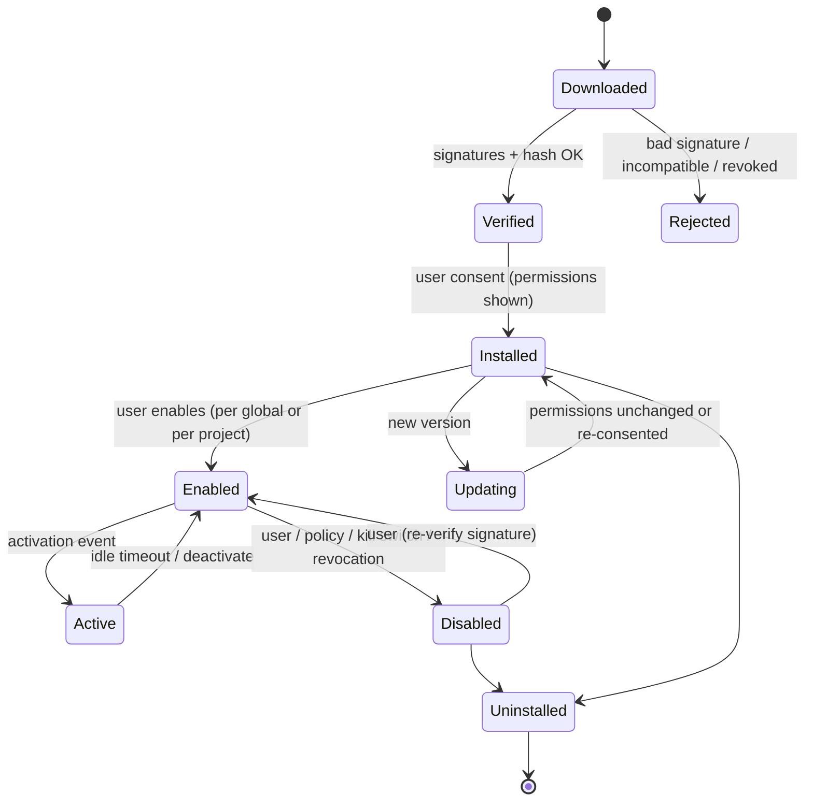
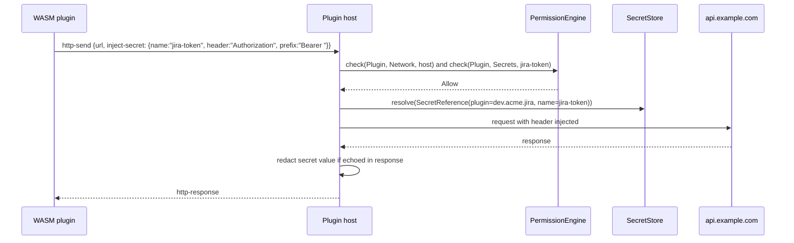
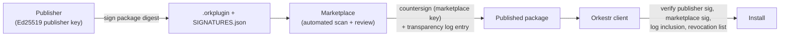

# Plugin Architecture (Plugin SDK, Widget SDK, Dashboard Builder)

Status: Phase 0 deliverable #18 (§65). Covers §48 (Plugin SDK, Widget SDK, Dashboard
Builder), §6 Agent Marketplace, §19 MCP Hub, §29 AI-editable UI, §32 Mission Control,
§68 inventory items (Agent Marketplace, MCP Hub, Plugin SDK, Widget SDK, Dashboard Builder).
Threat analysis: `docs/security/threat-model.md` TB8 (SR-51..55, SR-41).

**As built (Phase 7):** the decisions that won are in ADR-0034 (plugin and
widget sandbox: signed `.orkp`, wasmtime 50 ABI v1, grants as permission
rules, kill switch, safe mode, widget iframe + CSP + `orkestr-widget` scheme,
dashboards) and ADR-0040 (marketplace registries and signing). Where this
document differs from those ADRs (for example the WASI / component-model
sketch, JS plugins, `Provider` / `Panel` kinds, auto-update), the ADRs win;
the differing parts are deferred.

**Implementation status (2026-10-02):** design only (Phase 7; MCP P2). The
domain declares `Plugin`, `PluginKind { Provider, Tool, Mcp, Panel, Widget,
AgentTemplate, DeploymentProvider, PlatformIntegration }`, `McpServer` and
`McpTransport { Stdio{command, args, env} | Http{url} }` so the protocol is
stable; nothing loads plugins. `MethodPolicy` (referenced below) does not exist
yet (`../api/protocol.md` §5.2).

**Phase split**
- **P1**: internal extension points exist as Rust traits / TS registries and are used by
  first-party code: `ProviderAdapter` registry (C§7), tool registry (`orkestr-agent-runtime`),
  MCP client (stdio servers as child processes, §19), panel registry
  (`apps/desktop/src/panels/registry.ts`, C§8), agent templates as data (§6). MCP tools go
  through `PermissionEngine` (capability mapping §5.2).
- **P2**: agent template import/export (signed bundles optional), MCP Hub UI.
- **P3**: Widget SDK + Dashboard Builder for Mission Control, **first-party widgets only**,
  built on the exact public contract below (dogfooding); dashboards stored in UI config
  (§29 schema).
- **P7 (Ecosystem)**: third-party plugin loading (WASM + process + UI frames), marketplace,
  signing, permission consent UI, revocation.

New crate proposed: `orkestr-plugins` (manifest parsing, registry, permission resolution,
WASM host, process host) — requires ADR + contract update (not in C§2). TS packages
proposed for P3/P7: `@orkestr/widget-sdk`, `@orkestr/plugin-sdk`.

## 1. Plugin kinds and extension points

| Kind (`contributes` key) | What it adds | Runtime | Host integration point | Phase (3rd-party) |
|--------------------------|--------------|---------|------------------------|-------------------|
| `providers` | AI provider adapter (custom HTTP, enterprise gateway) | WASM | `ProviderAdapter` (C§7) via `WasmProviderAdapter` bridge | P7 |
| `tools` | Agent tools (e.g. Jira lookup, lint runner) | WASM or process | `ToolPlugin` → agent-runtime tool registry | P7 |
| `mcpServers` | MCP server definitions (command, args, env refs, tool→capability map) | process (stdio) or remote (HTTP/SSE via host) | MCP Hub (§19) | P1 (user-added), P7 (packaged) |
| `panels` | Project Desktop panel (§14) | UI frame | dockview panel host | P7 |
| `widgets` | Mission Control / dashboard widgets | declarative JSON (preferred) or UI frame | Widget SDK (§6) | P3 first-party, P7 third-party |
| `agentTemplates` | Agent templates and teams (§6) | data only | template store | P2 import, P7 marketplace |
| `deploymentProviders` | Deploy targets (Vercel, Fly, custom) (§26) | WASM or process | `DeploymentProvider` | P7 |
| `integrations` | External platform integrations (GitHub/GitLab issues, Slack, Jira, webhooks) | WASM | event subscriptions + `IntegrationPlugin` | P7 |
| `themes` | Theme/layout presets (§29) | data only (UI config schema) | theme engine | P3 |

"Platform integration" in §48 is interpreted as **external platform** integration. OS
platform code stays exclusively in `orkestr-platform` (C§2, §60.6): plugins can never
provide a `PlatformAdapter` (ambiguity noted in §11).

## 2. Package format and manifest

Package: `.orkplugin` = zip (no symlinks, no absolute paths, ≤ 50 MiB) containing
`orkestr-plugin.json`, `SIGNATURES.json`, and payload files (`*.wasm`, `ui/**`, `bin/<os>-<arch>/**`,
`templates/**`, `assets/**`).

### 2.1 Manifest example

```json
{
  "$schema": "https://schemas.orkestr.dev/plugin/v1.json",
  "manifestVersion": 1,
  "id": "dev.acme.jira",
  "name": "Jira for Orkestr",
  "version": "1.4.2",
  "publisher": {"id": "acme", "name": "Acme Inc.", "keyId": "ed25519:9a7c…"},
  "description": "Link tasks to Jira issues; agent tool to read issues.",
  "license": "MIT",
  "engines": {"orkestr": ">=0.7.0 <0.9.0", "pluginApi": "1"},
  "categories": ["integration", "tools"],
  "activation": ["onTool:jira.getIssue", "onEvent:TaskCreated", "onPanel:jira.board"],
  "runtime": {
    "wasm": {"module": "plugin.wasm", "world": "orkestr:plugin/plugin@1.0.0",
             "limits": {"memoryMb": 128, "fuelPerCall": 2000000000, "timeoutMs": 30000}},
    "ui":   {"root": "ui/", "entry": "ui/index.html"}
  },
  "contributes": {
    "tools": [{
      "name": "jira.getIssue",
      "description": "Fetch a Jira issue by key",
      "inputSchema": {"type": "object", "required": ["key"],
                      "properties": {"key": {"type": "string", "pattern": "^[A-Z][A-Z0-9]+-\\d+$"}}},
      "effects": ["Network"]
    }],
    "panels": [{"id": "jira.board", "title": "Jira", "icon": "assets/jira.svg", "entry": "ui/board.html"}],
    "widgets": [{"id": "jira.openIssues", "title": "Open issues", "kind": "declarative",
                 "definition": "widgets/open-issues.json"}],
    "settings": {"type": "object", "properties": {"baseUrl": {"type": "string", "format": "uri"}}}
  },
  "permissions": [
    {"capability": "Network", "hosts": ["*.atlassian.net"], "reason": "Call Jira REST API"},
    {"capability": "Secrets", "secrets": [{"name": "jira-token", "kind": "apiToken"}],
     "use": "inject", "reason": "Authenticate to Jira"},
    {"rpc": ["tasks.list", "tasks.get"], "reason": "Show linked tasks"},
    {"events": ["TaskCreated", "TaskStatusChanged"], "topics": ["project:*"], "reason": "Sync status"}
  ]
}
```

### 2.2 Manifest rules (validated by `orkestr-plugins::manifest`, JSON Schema in
`orkestr-protocol::plugin_manifest`, exported via ts-rs)

- `id`: reverse-DNS, `^[a-z0-9]+(\.[a-z0-9-]+)+$`, unique; `version`: semver; immutable per
  `(id, version)`.
- `engines.orkestr` semver range; host refuses incompatible plugins.
- `contributes.tools[].effects` ⊆ C§6 capabilities; host uses them for `PermissionEngine`
  checks of every invocation (§5).
- `permissions` is the **maximum** a plugin can ever get; anything not declared is denied.
- Unknown top-level fields rejected (`deny_unknown_fields`) for forward-safety; additions
  come with `manifestVersion` bumps.
- `activation` events are lazy-loading hints; plugins never run at startup unless declared
  `onStartup` (requires user acknowledgement in consent UI).

## 3. Lifecycle



RPC (area `plugins`): `plugins.list`, `plugins.get`, `plugins.install` (local_only),
`plugins.enable`, `plugins.disable` (remote-callable: safety-reducing), `plugins.uninstall`
(local_only), `plugins.grant`, `plugins.revoke`, `plugins.settings.update`. Events
(append-only proposals): `PluginInstalled`, `PluginStateChanged {pluginId, from, to, reason}`.

Install location: `<data_dir>/plugins/<id>/<version>/` (read-only after install; integrity
hash re-checked at load). Plugin data: `<data_dir>/plugin-data/<id>/` (the only writable
dir granted by default). Plugins are **not** synced automatically to other devices
(sync records only the installed list; each device installs/consents itself).

## 4. Permission model

### 4.1 Principal and effective permissions

Every host call made by plugin code is checked as `Actor::Plugin{plugin_id}`
(threat-model.md §5.1). When a plugin tool is invoked *by an agent*, both are checked:

```
effective(plugin call) = manifest.permissions
                       ∩ user grants (install-time consent, per project overrides)
                       ∩ policy (privacy §56, environment, hard-deny)
tool invocation by agent: PermissionEngine.check(Agent, effect, resource, ctx) must Allow/Ask→approved
                       AND PermissionEngine.check(Plugin, effect, resource, ctx) must Allow
```

Approvals (`Ask`) are shown with both actors ("Backend agent wants to use tool
`jira.getIssue` from plugin Acme Jira → Network to acme.atlassian.net").

### 4.2 Permission vocabulary

| Permission | Shape | Notes |
|------------|-------|-------|
| C§6 capability | `{"capability":"Read"|"Write"|…,"paths":[…]}` etc. | `Read/Write/Delete` paths are relative to project root or plugin data dir; never absolute. `Terminal`, `Docker`, `Ssh`, `Deploy`, `ComputerControl` are **process runtime only** and always `Ask` at first use per project. |
| Network | `{"capability":"Network","hosts":["api.example.com","*.example.org"]}` | host-mediated HTTP only (WASM); process plugins get egress policy best-effort (P7 sandbox) |
| Secrets | `{"capability":"Secrets","secrets":[{name,kind}],"use":"inject"}` | `use:"inject"` only (plaintext never handed to plugin, SR-41). `use:"read"` exists only for process plugins that must pass creds to a CLI, requires explicit warning consent |
| RPC | `{"rpc":["tasks.list","cost.*"]}` | allowlist of C§4 methods; methods with `MethodPolicy.local_only` or security areas are never grantable |
| Events | `{"events":[kinds],"topics":[patterns]}` | read-only subscription |
| UI | implicit by `contributes.panels/widgets` | frames only |
| Agent templates | none (data) | templates may *request* capabilities; on import the user grants them per template |

Default for widgets (§48): **no** filesystem, **no** secrets, **no** network; read-only RPC
allowlist (§6.3) only.

## 5. Sandboxing

### 5.1 WASM runtime (default for code plugins)

- Engine: `wasmtime` with the Component Model; interface defined in WIT
  (`orkestr:plugin@1.0.0`). WASI preview 2 with **no** preopened directories except
  `plugin-data` (and project paths only if granted, via host-mediated file API rather than
  preopens, so path confinement SR-21 applies).
- Limits: memory (`limits.memoryMb`, max 512), fuel per call + epoch interruption for
  wall-clock timeout, max concurrent instances per plugin (4), max outbound requests/min.
- Runs on a dedicated blocking thread pool, never on the Core async runtime threads.
- Crash/trap ⇒ call fails with `ToolError::PluginFault`; 3 faults/10 min ⇒ plugin disabled
  with `PluginStateChanged{reason:"faulting"}`.

WIT sketch:

```wit
package orkestr:plugin@1.0.0;

interface types {
  record http-request { method: string, url: string, headers: list<tuple<string,string>>,
                        body: option<list<u8>>, inject-secret: option<secret-injection> }
  record secret-injection { secret-name: string, header: string, prefix: option<string> }
  record http-response { status: u16, headers: list<tuple<string,string>>, body: list<u8> }
  variant host-error { denied(string), approval-required(string), not-found, network(string),
                       rate-limited(u64), invalid(string), internal(string) }
}

interface host {
  use types.{http-request, http-response, host-error};
  http-send: func(req: http-request) -> result<http-response, host-error>;   // allowlist + secret injection by host
  rpc-call: func(method: string, params-json: string) -> result<string, host-error>;  // RPC allowlist
  read-file: func(rel-path: string) -> result<list<u8>, host-error>;          // needs Read grant; confined
  write-file: func(rel-path: string, data: list<u8>) -> result<_, host-error>; // needs Write grant
  kv-get: func(key: string) -> option<list<u8>>;                               // plugin-data scoped
  kv-set: func(key: string, value: list<u8>);
  log: func(level: u8, msg: string);                                           // redacted by host
  emit-notification: func(title: string, body: string);
}

interface tool {
  invoke: func(name: string, input-json: string, ctx-json: string) -> result<string, string>;
}

interface provider {
  descriptor: func() -> string;                                   // JSON ProviderDescriptor
  list-models: func() -> result<string, string>;
  chat-start: func(request-json: string) -> result<u64, string>;  // returns stream handle
  chat-next: func(handle: u64) -> option<string>;                 // JSON ChatEvent per C§7; none = done
  chat-cancel: func(handle: u64);
}

// One world per contribution kind; a package may ship several components.
world tool-plugin     { import host; export tool; }
world provider-plugin { import host; export provider; }
world plugin          { import host; export tool; export provider; }  // combined (manifest "world")
```

### 5.2 Process runtime (MCP servers, CLIs, heavy tools)

- Spawned via `orkestr-platform` process builder: env from allowlist (SR-39) + declared
  secret refs (process plugins only, with `use:"read"` consent), cwd = plugin data dir or
  granted project root, no inherited handles, process-group/job-object for kill.
- P7 OS sandbox profiles where practical: Windows AppContainer/LPAC or restricted token +
  Job Object (no UI, memory/CPU caps), Linux bubblewrap + landlock + seccomp, macOS
  `sandbox-exec` profile. Where unavailable the UI shows "Not sandboxed" and requires
  explicit consent (residual risk, threat-model R-10).
- MCP specifics (§19): each MCP tool exposed to agents carries a capability mapping. For
  packaged MCP servers it comes from the manifest; for user-added servers the MCP Hub asks
  the user to classify each tool (defaults: unknown ⇒ treated as `Network` + `Write` ⇒
  `Ask`). MCP tool output is tagged `ContentOrigin::Mcp` ⇒ taints the task (SR-25).
  Remote MCP (HTTP/SSE) connections are made by the host (Network allowlist), never by the
  webview.

```json
{"mcpServers":[{"id":"github","command":"bin/{os}-{arch}/github-mcp","args":["stdio"],
  "env":{"GITHUB_TOKEN":{"secret":"github-token"}},
  "tools":{"create_issue":{"effects":["Network"]},"push_files":{"effects":["Git","Network"],"dangerous":true},
           "*":{"effects":["Network"]}}}]}
```

### 5.3 UI runtime (panels, frame widgets)

- Rendered in an `<iframe sandbox="allow-scripts">` (no `allow-same-origin`, no
  `allow-top-navigation`, no `allow-popups`) served from custom protocol
  `orkestr-plugin://<id>/` with CSP `default-src 'self'; connect-src 'none'; img-src 'self' data:`.
- The frame **never** receives the RPC token. It talks to the host via `postMessage` using
  the SDK bridge; the host (desktop app) validates each message, maps it to an allowlisted
  RPC call/event subscription under `Actor::Plugin`, and forwards results.
- Theming: host passes `--ok-*` token values (C§8) at init and on theme change; plugins
  must use them (lint in SDK template).

### 5.4 Secret injection (no plaintext to plugins)



## 6. Widget SDK and Dashboard Builder (§48, §32)

### 6.1 Widget kinds

- **Declarative** (preferred; P3): JSON definition = data bindings + a visualization from the
  host's built-in set (`stat`, `timeseries`, `bar`, `table`, `list`, `progress`, `status-grid`,
  `log-tail`, `robot-strip`, `markdown`(sanitized)). No code ⇒ safe to be AI-authored under
  §29 ("AI-editable UI" changes schema, not code).
- **Frame** (P7): sandboxed iframe (§5.3) using `@orkestr/widget-sdk` for custom rendering.

### 6.2 Data binding model

```ts
// @orkestr/widget-sdk (types also generated from orkestr-protocol::ui_config via ts-rs)
export type DataSource =
  | { type: "rpc"; method: AllowedReadMethod; params?: Record<string, ParamValue>; refreshMs?: number }  // min 2000
  | { type: "events"; topic: TopicPattern; kinds: EventKindName[]; window?: { count?: number; ms?: number } }
  | { type: "metric"; name: MetricName; scope?: { projectId?: string; nodeId?: string; agentId?: string };
      range: "15m" | "1h" | "24h" | "7d"; step?: "10s" | "1m" | "5m" | "1h" }
  | { type: "static"; value: unknown };

export type ParamValue = string | number | boolean | null | { $var: "projectId" | "nodeId" | "agentId" | "timeRange" };

export interface Binding {
  id: string;
  source: DataSource;
  transform?: Transform[];          // pure, whitelisted ops — no eval
}

export type Transform =
  | { op: "pick"; path: string }                          // JSON Pointer
  | { op: "filter"; field: string; eq?: Scalar; in?: Scalar[]; gt?: number; lt?: number }
  | { op: "map"; fields: Record<string, string> }         // rename / project via JSON Pointer
  | { op: "groupBy"; field: string; agg: "count" | "sum" | "avg" | "min" | "max"; value?: string }
  | { op: "sort"; field: string; dir: "asc" | "desc" }
  | { op: "limit"; n: number }
  | { op: "reduceEvents"; strategy: "latestBy" | "countBy" | "append"; key?: string };

export interface WidgetDefinition {
  id: string; title: string; version: 1;
  bindings: Binding[];
  view: { kind: BuiltinView; props: Record<string, unknown>; bind: Record<string, string> }; // prop ← binding id
  actions?: WidgetAction[];          // e.g. open task, open panel; mutations only via host confirm dialogs
}

export type WidgetAction =
  | { kind: "navigate"; target: "task" | "agent" | "node" | "panel"; idFrom: string }
  | { kind: "rpc"; method: AllowedActionMethod; paramsFrom: Record<string, string>; confirm: true };
```

Frame widget SDK surface:

```ts
export interface WidgetContext {
  vars: { projectId?: string; nodeId?: string; agentId?: string; timeRange: string };
  theme: Record<`--ok-${string}`, string>;
  data<T = unknown>(bindingId: string): AsyncIterable<T>;   // host-evaluated bindings only
  navigate(target: NavigateTarget): void;
  requestAction(action: WidgetAction): Promise<"done" | "cancelled" | "denied">;
}
export function defineWidget(def: { id: string; mount(el: HTMLElement, ctx: WidgetContext): () => void }): void;
```

### 6.3 Allowed read methods for widgets (default grant)

`projects.list`, `projects.get`, `tasks.list`, `tasks.get`, `agents.list`, `agents.get`,
`cost.summary`, `cost.usage`, `nodes.list`, `providers.status`, `deployments.list`,
`approvals.list` (read), `metrics.query`. All results pass through the same principal
filtering as remote viewers (no secrets, no file contents). File-content or terminal
methods are never in the default set.

### 6.4 Dashboard Builder

Dashboards are part of the UI config (§29, `orkestr-protocol::ui_config`), validated by
schema, editable by the user or the Manager (AI-editable UI):

```json
{
  "dashboards": [{
    "id": "mission-control-default",
    "title": "Mission Control",
    "scope": "global",
    "grid": {"columns": 12, "rowHeight": 48, "gap": 8},
    "vars": {"timeRange": "24h"},
    "items": [
      {"widget": "builtin.activeAgents", "x": 0, "y": 0, "w": 4, "h": 4},
      {"widget": "builtin.spend", "x": 4, "y": 0, "w": 4, "h": 4, "config": {"groupBy": "provider"}},
      {"widget": "dev.acme.jira/jira.openIssues", "x": 8, "y": 0, "w": 4, "h": 6,
       "vars": {"projectId": "0192…"}}
    ]
  }]
}
```

Rules: layout per device by default (multi-monitor §34); widget references resolve to
installed + enabled plugins, else render a "missing widget" placeholder; max 50 items per
dashboard; binding refresh throttled globally by Performance Mode (§31).

## 7. Other extension-point contracts (Rust)

```rust
// orkestr-agent-runtime::tools (P1 internal; P7 plugin bridge implements it)
#[async_trait::async_trait]
pub trait Tool: Send + Sync {
    fn descriptor(&self) -> ToolDescriptor;          // name, description, input JSON Schema, effects: Vec<Capability>, origin: ToolOrigin
    async fn invoke(&self, input: serde_json::Value, ctx: ToolContext, cancel: CancellationToken)
        -> Result<ToolOutput, ToolError>;            // ToolOutput carries ContentOrigin for taint (SR-25)
}
pub enum ToolOrigin { Builtin, Mcp { server_id: String }, Plugin { plugin_id: PluginId } }

// orkestr-plugins (P7)
#[async_trait::async_trait]
pub trait DeploymentProvider: Send + Sync {
    fn descriptor(&self) -> DeploymentProviderDescriptor;     // id, name, supported envs, required secrets
    async fn plan(&self, req: DeployRequest) -> Result<DeployPlan, DeployError>;     // no side effects
    async fn apply(&self, plan: DeployPlan, approval: ApprovalToken, cancel: CancellationToken)
        -> Result<DeployResult, DeployError>;                // ApprovalToken required for Production (always Ask)
    async fn status(&self, id: &DeploymentId) -> Result<DeployStatus, DeployError>;
    async fn rollback(&self, id: &DeploymentId, approval: ApprovalToken) -> Result<DeployResult, DeployError>;
}

#[async_trait::async_trait]
pub trait IntegrationPlugin: Send + Sync {
    fn subscriptions(&self) -> Vec<EventSubscription>;        // kinds + topics, must be ⊆ manifest grant
    async fn on_event(&self, event: &Event) -> Result<(), PluginError>;
}

pub trait PluginHost: Send + Sync {
    fn install(&self, package: &std::path::Path, consent: Consent) -> Result<InstalledPlugin, PluginError>;
    fn set_enabled(&self, id: &PluginId, enabled: bool, scope: PluginScope) -> Result<(), PluginError>;
    fn uninstall(&self, id: &PluginId, remove_data: bool) -> Result<(), PluginError>;
    fn list(&self) -> Vec<InstalledPlugin>;
    fn effective_permissions(&self, id: &PluginId, project: Option<&ProjectId>) -> EffectivePermissions;
}
```

Provider plugins are wrapped by `WasmProviderAdapter: ProviderAdapter` in
`orkestr-providers` so the router/fallback (C§7, §7) treat them like built-in adapters; the
provider plugin never sees the API key (host injects it via §5.4).

Agent templates (data; P2 import/export):

```json
{"kind":"agentTemplate","version":1,"id":"acme.security-reviewer","name":"Security Reviewer",
 "role":"Security","systemPrompt":"…","preferredModel":{"provider":"anthropic","model":"…"},
 "fallbackModels":[…],"tools":["read_file","search","jira.getIssue"],
 "requestedPermissions":[{"capability":"Read"},{"capability":"Network","hosts":["*.atlassian.net"]}],
 "budget":{"maxCostUsd":5,"maxTurns":60},"worktreePolicy":"perAgent",
 "qualityGates":["noCriticalFindings"],"avatar":{"robot":"assets/robot.riv"}}
```

Importing a template never grants permissions automatically: requested permissions are
shown and granted per template (`Agent` scope rules).

## 8. Marketplace signing and distribution (P7)



`SIGNATURES.json`:

```json
{
  "digest": {"alg": "blake3", "value": "…"},            // over canonical zip listing + file hashes, manifest included
  "signatures": [
    {"role": "publisher", "keyId": "ed25519:9a7c…", "sig": "…", "ts": "2026-10-01T10:00:00Z"},
    {"role": "marketplace", "keyId": "ed25519:orkestr-mp-2026", "sig": "…", "logIndex": 812345}
  ]
}
```

Rules:
- Official/community packages need both signatures. Marketplace root keys are pinned in
  the app (rotatable via signed key-rotation statements).
- **Private/enterprise** plugins: organisation adds its own trusted publisher key (local
  setting, local_only); marketplace signature not required for those keys.
- **Dev mode**: unsigned local plugins allowed only when `plugins.devMode=true` (local_only),
  shown with a persistent "Unsigned" badge, never installable from a remote client.
- Install pins `(id, version, digest)`; load re-verifies digest (tamper detection).
- **Revocation**: client fetches signed revocation list daily (and on start); revoked
  plugin/version/publisher ⇒ disabled immediately with `PluginStateChanged{reason:"revoked"}`.
  Global kill switch "Disable all third-party plugins" (local and remote-callable — it only
  reduces capability).
- **Updates**: automatic only if the new manifest's permissions ⊆ old grants; otherwise the
  update waits for re-consent showing the permission diff (SR-52).
- Agent templates and themes (data-only) use the same signing but are lower risk; they still
  cannot carry executable content.

## 9. Testing requirements

- Manifest validation fuzzing; rejection of unknown fields, bad ids, bad semver, absolute
  paths, zip-slip entries.
- Permission intersection unit tests (manifest ∩ grant ∩ policy; Deny precedence).
- WASM host: fuel/timeout/memory limit enforcement; denied host calls return `denied`;
  secret never observable from plugin memory (test plugin tries to read injected header via
  echo server ⇒ redacted).
- UI bridge: frame without grant cannot call RPC; token never present in frame context.
- Signature verification: tampered file, wrong key, revoked key, missing countersignature.

## 10. Phase checklist

| Phase | Done when |
|-------|-----------|
| P1 | Tool trait with `effects` + `ToolOrigin`; MCP stdio servers via MCP Hub with per-tool capability mapping and taint; panel registry; provider registry. |
| P2 | Agent template import/export (JSON), requested-permission grant flow. |
| P3 | Declarative widgets + Dashboard Builder for Mission Control using §6 contracts; dashboards in UI config schema. |
| P7 | `orkestr-plugins` crate, WASM + process hosts, UI frames, consent UI, signing, marketplace, revocation. |

## 11. Open issues / contract notes

- `orkestr-plugins` crate and `@orkestr/widget-sdk`/`@orkestr/plugin-sdk` packages are not
  in C§2 — ADR needed.
- §48 "platform integration" interpreted as external platforms (not OS adapters).
- No capability exists for "subscribe to events" or "call RPC"; plugin permission vocabulary
  adds `rpc`/`events` grants that are enforced by the plugin host, not by `PermissionEngine`
  capabilities. Alternative: add `Events`/`Rpc` capabilities to C§6 (append-only) — integrator
  to decide.
- `metrics.query` RPC and `MetricName` registry do not exist yet in C§4; needed by P3
  Mission Control widgets.
- Frame widget CSP requires `frame-src orkestr-plugin:` in the desktop CSP (threat-model
  TB2) only from P7.
