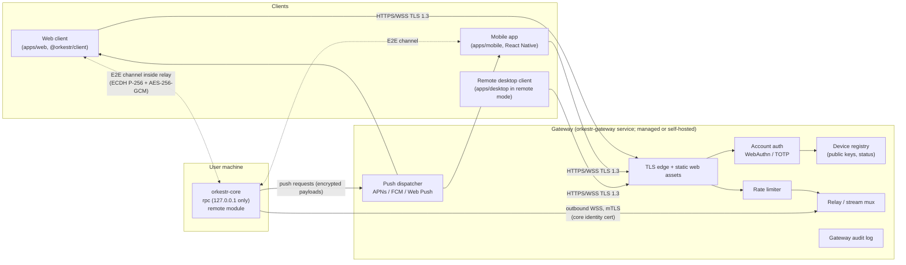
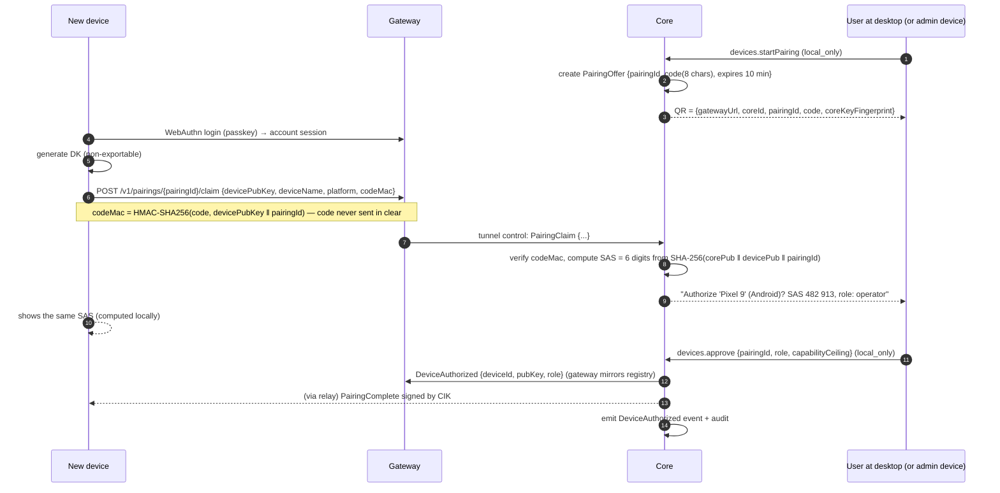

# Remote Access Architecture

Status: Phase 0 deliverable #15 (§65). Covers §35 (Remote Web Control), §36 (Remote
Security), §37 (Mobile Push), §52 emergency controls, §63 scenarios D (Remote Web with
MFA/passkey) and E (Mobile approval). Implementation: **Phase 4** (web), **Phase 5**
(mobile + push). Phase 1–3 obligations are listed in §11 so nothing built earlier blocks
this design.

**Implementation status (2026-10-22):** Phase 4 web half implemented —
see ADR-0030 for decisions and deviations. Built: `orkestr-gateway` (SQLite,
passkey + TOTP, sessions, enrollment, tunnel with CIK challenge instead of
mTLS, opaque relay, pairing relay, audit, rate limits, `/v1/sync`, static web
client; no TLS — loopback or `--behind-tls-proxy`), `orkestr-core::remote`
(`e2e-v1` with published test vector, device registry, pairing with codeMac +
SAS, step-up verified in Core, kill switch, revocation), MethodPolicy
enforcement in `RpcRouter::dispatch`, `Actor::RemoteDevice`, events
`RemoteSessionOpened/Revoked`, `DeviceAuthorized`, `DeviceRevoked`. Deviations
from this document: CIK is P-256 (no X.509/mTLS), record AAD is the counter
only, the remote client's `auth` frame is accepted and its token ignored,
PostgreSQL deferred. Mobile/native push stays P5.

**Phase 5 status (2026-10-22):** mobile half implemented — Android app
`apps/mobile` (Expo/React Native, ADR-0032; verified on the emulator, iOS
unbuilt), native push via FCM HTTP v1 and APNs with AES-256-GCM payloads and
a generic visible alert (ADR-0037; verified against mock FCM/APNs only), and
a biometric-gated native step-up credential `orkestr-native-v1` verified in
Core with the existing WebAuthn verifier (ADR-0038). Deviations from §12 P5:
device and step-up keys are SecureStore-wrapped software keys, not
non-exportable Keystore/Secure Enclave keys; lock-screen alerts are always
generic and approve-from-notification opens the app (no background
decryption); passkey login on mobile, DPoP and admin-device approval are
deferred.

Binding: `docs/ENGINEERING_CONTRACT.md` (C§N). Threat analysis: `docs/security/threat-model.md`
(TB9, TB11; requirements SR-60..66, SR-77..79).

## 1. Goals and non-goals

Goals
- Use Orkestr from a browser, phone or another desktop **through the same application
  protocol** as the desktop (C§4 frames), never via screen sharing/RDP (§2).
- **Never expose a raw Core, RPC or terminal port** to any network (§35, §64). Core only
  listens on `127.0.0.1` (C§3) and dials **out**.
- Phishing-resistant authentication (WebAuthn/passkeys), MFA, explicit device
  authorization, revocable sessions, rate limiting, audit, emergency kill switch (§36).
- Relay/gateway compromise must not grant control of Core or reveal content
  (end-to-end channel between device and Core).
- Local emergency controls keep working when the gateway/control plane is down (§52).

Non-goals (for P4/P5)
- Multi-user collaboration on one Core with different human users (data model has `User`,
  but P4 assumes **one owner account**, many devices). Multi-user is later (P7+).
- Direct inbound LAN exposure of Core. A "LAN relay" is simply a self-hosted gateway on the
  LAN (§9).

## 2. Components



| Component | Location | Responsibility | Trust |
|-----------|----------|----------------|-------|
| `orkestr-core::remote` | Core (new module, P4) | Tunnel dialer, E2E endpoint, device key registry (authoritative), remote principal mapping, MethodPolicy enforcement, local kill switch | Trusted |
| `orkestr-gateway` | Separate deployable (Rust, axum) — new crate, ADR required | TLS termination, account login (WebAuthn), device registry mirror, relay, rate limiting, push dispatch, audit | Trusted for availability & auth gating; untrusted for content |
| Storage for gateway | PostgreSQL (self-hosted mode, §45) | accounts, credentials (WebAuthn public keys), device records, sessions, audit | — |
| `@orkestr/client` | Web/Mobile/Desktop | Transport abstraction: `LocalTransport` (C§4 WS) and `RemoteTransport` (gateway + E2E) with identical RPC API | — |

## 3. Identities and keys

| Key | Holder | Algorithm | Storage | Purpose |
|-----|--------|-----------|---------|---------|
| Core identity key (`CIK`) | Core | Ed25519 (signing) + X.509 cert with P-256 key for mTLS | OS keystore via `orkestr-platform` CredentialStore | Authenticates Core to gateway (mTLS), signs E2E handshake |
| Device key (`DK`) | each client device | ECDSA P-256 (signing) + ECDH P-256 (ephemeral per session) | iOS Secure Enclave / Android Keystore (StrongBox if present) / WebCrypto non-extractable (IndexedDB) / desktop OS keystore | Proves device identity to **Core** |
| WebAuthn credential | user's authenticator (passkey) | per WebAuthn | authenticator | Proves user to **gateway**; step-up for dangerous approvals (verified by Core, see §6.3) |
| Push key | each device | Web Push: P-256 + auth secret (RFC 8291); native: AES-256-GCM key shared at pairing | device keystore + Core | Encrypt push payloads |

P-256 is chosen for device keys because WebCrypto, Secure Enclave and Android Keystore all
support it natively; Core uses `p256` + `ecdsa` + `aes-gcm` + `hkdf` crates (RustCrypto).

## 4. Enrollment flows

### 4.1 Enabling remote access on a Core (local only)

1. User opens Settings → Remote Access locally (method `remote.enable` is `local_only`).
2. User signs in to a gateway account (managed URL or self-hosted URL) inside the desktop
   app using WebAuthn (passkey creation on first use).
3. Core generates `CIK`, sends a CSR to gateway → gateway issues a client certificate
   bound to `{accountId, coreId}` (gateway-run CA; short-lived, 30 days, auto-renew).
4. Core stores cert + key; persists `remote.enabled=true`; dials tunnel (§5).

### 4.2 Device authorization (pairing)

A device is only usable after **Core** has recorded its public key and the user approved
it on an already-trusted surface (the local desktop or an `admin` device).



Alternative for devices without a camera: **device code flow** (RFC 8628 shape) — device
shows `user_code`; user enters it on the desktop's "Authorize device" screen; SAS still
compared.

Device record (authoritative copy in Core `remote_devices` table; mirror at gateway):

```json
{
  "deviceId": "0192f5d4-…",
  "name": "Pixel 9",
  "platform": "android",
  "publicKey": "base64url(SEC1 P-256)",
  "role": "operator",
  "capabilityCeiling": ["Read", "Git"],
  "remoteTerminal": false,
  "createdAt": "2026-10-02T10:00:00Z",
  "lastSeenAt": "2026-10-02T11:00:00Z",
  "status": "active"
}
```

Roles (ceilings; per-device overrides may only narrow):

| Role | Can | Cannot |
|------|-----|--------|
| `viewer` | read projects, tasks, agents, logs, diffs, costs, node status; receive push | any mutation except `emergency.*` |
| `operator` | viewer + Manager chat, create/transition tasks, spawn/stop agents, resolve non-dangerous approvals, light file edits (Write within project), run tests | dangerous approvals without step-up; terminal unless `remoteTerminal=true`; deploys to Production |
| `admin` | operator + dangerous approvals (with step-up), remote terminal (if enabled), deploy approvals, approve new devices | `local_only` methods (§7.2) |

All roles can call `emergency.stopAll` / `emergency.stopProject` / `agents.stop` (§52):
stopping is always safe; restarting is not.

## 5. Tunnel (Core ↔ Gateway)

- Core dials `wss://<gateway>/v1/tunnel` with mTLS (client cert from §4.1), TLS 1.3 only
  (rustls). Gateway verifies cert chain + `coreId` ∈ account.
- One WebSocket carries multiplexed **streams**; each stream = one client connection.
- Reconnect with exponential backoff (1 s → 60 s, jitter); Core never listens.
- Keepalive: WS ping every 20 s; gateway marks Core offline after 60 s → devices see
  "Core offline" (gateway-generated status, not an Orkestr `Event`).

Tunnel frames (JSON text frames for control, binary frames for data):

```json
{"t":"hello","coreId":"…","version":"0.4.0","capabilities":["e2e-v1","push-v1"]}
{"t":"open","sid":17,"deviceId":"…","accountSessionId":"…","clientIp":"203.0.113.9"}
{"t":"close","sid":17,"reason":"device_revoked"}
{"t":"pairingClaim", …}
{"t":"push","deviceIds":["…"],"payload":"base64url(ciphertext)","collapseKey":"approval:…","priority":"high"}
{"t":"revokeDevice","deviceId":"…"}
```

Binary data frame: `u32 sid (BE) ‖ E2E record` (opaque to gateway).

Limits: max 256 concurrent streams per Core, 1 MiB max record, per-stream window 4 MiB.

## 6. End-to-end channel (Device ↔ Core)

### 6.1 Handshake (`e2e-v1`)

Signed ephemeral ECDH, modelled on SIGMA-I; all P-256, implementable with WebCrypto.

```
D → C : ClientHello { deviceId, ephPubD, nonceD, ts }
C → D : ServerHello { ephPubC, nonceC, sigC = Sign_CIK(transcript) }
D → C : ClientFinish { sigD = Sign_DK(transcript), webauthnAssertion? }
k = HKDF-SHA256(ikm = ECDH(ephD, ephC), salt = nonceD ‖ nonceC,
                info = "orkestr-e2e-v1" ‖ coreId ‖ deviceId) → kD2C (32B), kC2D (32B)
```

- Core verifies `sigD` with the **Core-held** device public key; unknown or revoked
  `deviceId` → close. The gateway cannot complete this handshake.
- Device verifies `sigC` against `coreKeyFingerprint` pinned at pairing.
- `ts` within ±5 min; `(deviceId, nonceD)` replay cache 10 min.

### 6.2 Records

`AES-256-GCM`, 96-bit nonce = 32-bit direction ‖ 64-bit counter, AAD = `sid ‖ counter`.
Plaintext = one C§4 JSON frame (`req`/`res`/`sub`/`event`). Counter gaps or reuse → close.
Rekey every 2^20 records or 1 h.

After handshake there is **no `{"type":"auth"}` frame**: the principal is
`Actor::RemoteDevice{deviceId, userId, role}` derived from the handshake.

### 6.3 Step-up for dangerous actions

Dangerous approvals (DangerousActionGuard class `dangerous`, Production deploys, enabling
remote terminal for this session) require a fresh **WebAuthn assertion with user
verification** whose `challenge` = `SHA-256("orkestr-approve" ‖ approvalId ‖ decision ‖ Core
nonce)`. Core verifies the assertion itself against a **Core-held** WebAuthn credential
public key: right after pairing completes, the device performs a WebAuthn *registration*
(`navigator.credentials.create`, same RP ID as the gateway, `userVerification: "required"`)
whose attestation is sent to Core **inside the E2E channel**; Core stores the credential
public key in the device record. Keys are never taken from the gateway, so a compromised
gateway cannot substitute an authenticator. Max age 5 min. RPC:

```json
{"type":"req","id":"42","method":"approvals.resolve",
 "params":{"approvalId":"…","decision":"approve",
           "stepUp":{"credentialId":"…","authenticatorData":"…","clientDataJSON":"…","signature":"…"}}}
```

Missing/invalid step-up → `{"ok":false,"error":{"code":"forbidden","data":{"stepUpRequired":true,"challenge":"…"}}}`.

## 7. Authorization of remote calls

### 7.1 MethodPolicy

Every RPC method (C§4) is registered with a policy (also required by SR-10):

```rust
// orkestr-protocol::policy  (types)  — enforced in orkestr-core::rpc
pub struct MethodPolicy {
    pub min_role: Role,             // Viewer | Operator | Admin (LocalUser > Admin)
    pub local_only: bool,           // reject any RemoteDevice principal
    pub agents_allowed: bool,       // whether Actor::Agent may call (almost always false)
    pub step_up: StepUp,            // Never | Always | WhenDangerous
    pub rate_class: RateClass,      // Read | Write | Expensive | Auth | Emergency
    pub capability: Option<Capability>, // checked against device capabilityCeiling + PermissionEngine
}

pub trait PolicyRegistry {
    fn policy(&self, method: &str) -> Option<&MethodPolicy>; // None => method rejected (fail closed)
}
```

### 7.2 Local-only methods (non-exhaustive, fail closed)

`remote.enable`, `remote.disable`, `remote.configure`, `devices.startPairing`,
`devices.approve` (admin devices may approve **only** with step-up, P5 option, default off),
`permissions.setApprovalMode` (to `FullAuto`), `permissions.setRule`, `secrets.reveal`,
`secrets.export` (both not defined in P1–3), `providers.upsert`, `plugins.install`,
`sync.rotateKeys`, `secrets.unlock` (catalogue names per `../api/protocol.md` §8.27;
this document originally used `security.*`, `providers.configure`, `vault.unlock`).

Remote clients *may* call the safety-reducing counterparts: `emergency.*`,
`security.disableFullAuto`, `remote.revokeAllSessions`, `vault.lock`,
`tools.disableNetwork` (§52).

### 7.3 Remote terminal

Off by default per device. When enabled: `terminal.*` methods over E2E only, user-owned
sessions only for `admin`; output passes the same redaction (SR-44); every keystroke batch is
audited (size + hash, not content, by default; content audit optional per project). There
is never a raw PTY socket.

### 7.4 Topic authorization

`sub` topics filtered by role and project allowlist of the device (`projectIds: [] = all`).

## 8. Sessions, revocation, kill switch

| Session | Issued by | Lifetime | Bound to |
|---------|-----------|----------|----------|
| Gateway account session | gateway after WebAuthn | 12 h absolute, 30 min idle (web); 30 days refresh (mobile, refresh token bound to DK via DPoP-style proof) | account + device |
| E2E session | Core after handshake | until tunnel stream closes; re-handshake ≤ 1 h | device key |

Revocation paths:

| Action | Where | Effect | Works if gateway down? |
|--------|-------|--------|------------------------|
| `devices.revoke {deviceId}` | Core (local or admin+step-up) | Core marks device revoked (authoritative), closes its streams, tells gateway to drop sessions & push tokens; emits `DeviceRevoked` | **Yes** (Core refuses handshakes from that key) |
| `remote.revokeAllSessions` | Core / any device | Close all streams, require re-handshake + fresh WebAuthn | Yes |
| `remote.disable` (kill switch) | Core local; also remotely callable | Close tunnel, persist `remote.enabled=false`; Core will not re-dial until **local** `remote.enable` | Yes |
| Account "panic" | Gateway web UI (WebAuthn) | Gateway drops all tunnels/sessions for account | n/a (gateway-side) |
| Lost device | any trusted surface | `devices.revoke` + (sync) key rotation, see sync doc §4.5 | Yes |

## 9. Deployment modes

| Mode | Gateway | Notes |
|------|---------|-------|
| Managed | Orkestr cloud | default for convenience; E2E keeps content private |
| Self-hosted | `orkestr-gateway` container + PostgreSQL (+ optional push credentials) (§45) | user supplies TLS cert (ACME supported) |
| LAN | self-hosted gateway on LAN host | same protocol; no exception to "no raw Core port" |
| Disabled | — | default after install (§55 step 10 is optional) |

## 10. Rate limiting, abuse, audit

Gateway (token bucket, Redis-less: in-process + PostgreSQL for distributed counters in
multi-instance deployments):
- Login/WebAuthn: 10/min per IP, 20/h per account; exponential lockout.
- Pairing claims: 5/pairingId, 20/h per account.
- Tunnel streams: 30 opens/min per device.

Core (per device, per `RateClass`): Read 50 rps, Write 10 rps, Expensive (agent spawn,
Manager message, test run) 1 rps burst 5, Auth n/a, Emergency unlimited. Exceeding →
error code `rate_limited` with `data.retryAfterMs`.

Audit (`AuditEvent`, §51): Core records every remote handshake, method call (method,
params hash, decision), approval with step-up result, device lifecycle; gateway records
logins, pairings, tunnel connects, IPs. Both exportable. Events (append-only proposals):
`RemoteSessionOpened`, `RemoteSessionRevoked`, `DeviceAuthorized`, `DeviceRevoked`,
`SecurityAlert` (e.g. repeated failed step-ups).

## 11. Push notifications (§37, P5; Web Push P4)

Triggers (mapped from existing contract `EventKind`s by `orkestr-core::remote::push`):

| §37 trigger | EventKind | Default |
|-------------|-----------|---------|
| Task completed | `TaskStatusChanged` → `Completed` | on |
| Task blocked | `TaskStatusChanged` → `Blocked` / `Waiting` (user) | on |
| Approval needed | `ApprovalRequested` | on, high priority |
| Build/test failed | `BuildFailed`, `TestRunFinished{failed>0}` | on |
| Security issue | `ReviewFinished{severity≥high}`, `SecurityAlert` | on |
| Node offline | `NodeOffline` | on (P6) |
| Deployment | `DeploymentFinished` | on |
| Budget threshold | `BudgetThreshold` | on |

Payload (encrypted with device push key; APNs/FCM/Web Push see only ciphertext):

```json
{"v":1,"eventId":"0192…","category":"approval","projectId":"0192…","ts":"2026-10-02T11:00:00Z",
 "title":"Approval needed","body":"Schoolify · Backend agent"}
```

`title/body` follow per-device lock-screen privacy (`generic` → "Orkestr: action needed").
Details are fetched over the E2E channel when the user opens the notification. Mobile
"Approve" from notification opens the app and requires biometric/WebAuthn step-up for
dangerous items (SR-77). Dedup via `collapseKey`; DND respected (§33).

## 12. Phase plan

| Phase | Deliverables |
|-------|--------------|
| P1 | RPC server loopback only, MethodPolicy type exists (all methods `LocalUser`), `Actor` enum with `RemoteDevice` variant reserved, `@orkestr/client` transport abstraction (`LocalTransport`), emergency methods local. Nothing listens beyond loopback. |
| P2 | MethodPolicy populated for every method + registry test; audit records principal. |
| P3 | none specific (UI for devices list can be stubbed with explicit "unavailable until Phase 4"). |
| P4 | `orkestr-gateway` (managed + self-hosted), tunnel, E2E, WebAuthn, pairing, roles, web client, Web Push, rate limits, kill switch, audit. Scenario D. |
| P5 | Mobile app, native push, Secure Enclave/Keystore device keys, biometric step-up. Scenario E. |
| P6 | Nodes reuse tunnel + pairing for node enrollment (node-protocol.md). |

## 13. Open issues

- Gateway serving the web client's JS is a trust gap for the web client (threat model R-08).
  Mitigation options: SRI-pinned bootstrap, installable PWA with update signature check.
- New crate `orkestr-gateway` and module `orkestr-core::remote` require ADR + contract update.
- WebAuthn step-up verification in Core (§6.3) needs `webauthn-rs`-style verification
  (RP ID hash = gateway domain, origin = gateway web origin or native app origin); ensure no
  runtime dependency on the gateway for step-up verification.
- C§4 lists `unauthorized/forbidden/rate_limited`; `forbidden` + `data.stepUpRequired` is used
  for step-up; no new error code needed.
