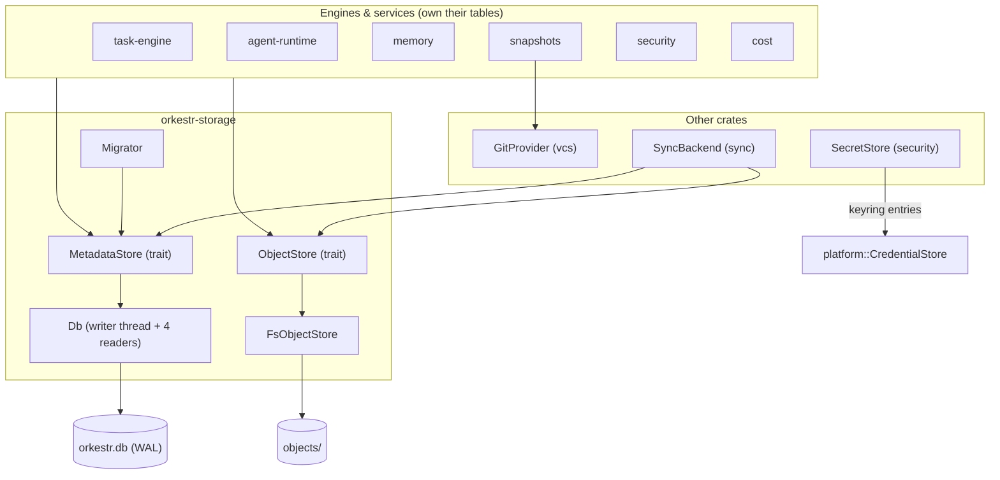
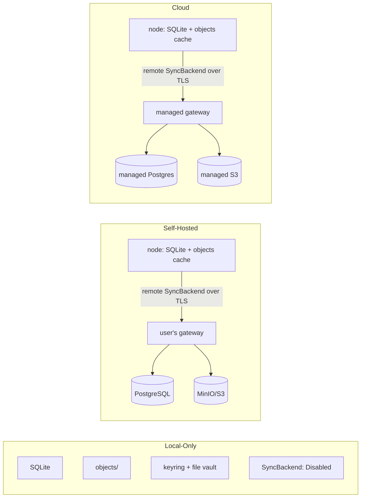

# Storage Abstraction

> Deliverable §65 #16. Interfaces named by §45: **MetadataStore, ObjectStore,
> GitProvider, SecretStore, SyncBackend**. Storage modes: **Local-Only,
> Self-Hosted, Cloud** (§45). Contract constraints (§3, §6): one SQLite DB
> `<data_dir>/orkestr.db` in WAL mode via rusqlite (`bundled`); objects in
> `<data_dir>/objects/` addressed by blake3; ordered reversible migrations
> contributed per crate and composed by `core`; secrets never in SQLite
> plaintext — only `SecretReference`.

## 0. As built (Phase 0 foundation, 2026-10-02)

Normative for the code in `crates/storage`, `crates/events/src/log.rs`,
`crates/sync`, `crates/vcs` and `crates/security`; §1–§9 below are the target
design and say **(planned)** where they go beyond it.

| Interface | Crate | As built |
|---|---|---|
| `Db` | `orkestr-storage` | One `rusqlite::Connection` behind a `parking_lot::Mutex`, driven through `tokio::task::spawn_blocking`: `Db::open(path)`, `open_in_memory()`, `call(|conn| …)`, `call_blocking(|conn| …)` (startup/tests only), `migrate(Vec<Migration>)`, `path()`. Pragmas: `journal_mode=WAL` (file DBs), `synchronous=NORMAL`, `foreign_keys=ON`, `busy_timeout=5s`, `temp_store=MEMORY`. No reader pool, no dedicated writer thread, no `write`/`read`/`checkpoint`/`backup_to` yet |
| Migrations | `orkestr-storage` | `Migration { id, owner, up, down }` (all `&'static str`; `down` is mandatory), `Migrator::{new, apply, applied, rollback_last, rollback_to}`, `MigrationReport { applied, already_applied }`. Bookkeeping table `_orkestr_migrations(seq, id UNIQUE, owner, checksum, down_sql, applied_at)`; checksum = blake3 of `up`; an edited applied migration (checksum drift) or an applied id unknown to this binary (DB written by a newer version) is refused; each migration runs in its own transaction; `down_sql` is stored so rollbacks work after the code is gone. Composition: `orkestr_core::migrations::all()` = core → storage → events |
| `MetadataStore` | `orkestr-storage` | `trait MetadataStore { fn projects(&self) -> &dyn ProjectRepository }`; `trait ProjectRepository { list(include_archived), get(id), insert(&Project), update(&Project), delete(id) -> bool }`; `SqliteMetadataStore::new(db)` (table `projects`, see `data-model.md` §0). Other engines will add their repositories in their own crates on top of `Db` |
| `ObjectStore` | `orkestr-storage` | `trait ObjectStore { put(Vec<u8>) -> ObjectId, get(&ObjectId) -> Option<Vec<u8>>, exists, delete -> bool }`; `FsObjectStore::open(root, Compression)`; `ObjectId` = 64 lowercase hex of blake3 over the **uncompressed** bytes (no `b3:` prefix); layout `<data_dir>/objects/<h[0..2]>/<h[2..4]>/<h>`; file = 4-byte magic `OKO1` + codec byte (`0` raw, `1` zstd) + body; the core opens it with `Compression::Zstd { level: 3 }` and zstd is kept only when it saves space (objects ≤ 64 bytes stay raw); writes go to a temp file and are renamed; every `get` re-hashes and returns `StorageError::Corrupt` on mismatch. No `object_refs`, no GC, no streaming API yet |
| Event log | `orkestr-events` | `SqliteEventLog` implements `orkestr_events::EventLog` on `Db` (see `event-model.md` §0.2) — this resolves S1 (§9) |
| `GitProvider` | `orkestr-vcs` | Skeleton trait named `Git` (`status`, `diff`, `branches`, `worktrees`, `add_worktree`, `remove_worktree`); no implementation |
| `SecretStore` | `orkestr-security` | Skeleton trait `SecretStore { put(name, value) -> SecretReference, get(&SecretReference) -> String, delete }`; no implementation. The OS keyring is reachable through `orkestr-platform::CredentialStore` (`KeyringCredentialStore`, `MemoryCredentialStore`), used by nothing yet |
| `SyncBackend` | `orkestr-sync` | `trait SyncBackend { name(), is_remote(), push(&[JournalEntry]) -> SyncReport, pull(ProjectId) -> SyncReport }` and the real `LocalOnlyBackend` |

`StorageError { Sqlite, Io, Json, Migration{id, message}, NotFound(String),
Conflict(String), Corrupt(String), Invalid(String), Join(String) }`; the core
maps `NotFound`/`Conflict`/`Invalid` to the RPC codes of the same meaning and
everything else to `internal` (`orkestr_core::error::storage_to_rpc`).

## 1. Where each interface lives

| Interface | Crate | P1 implementation | Later implementations |
|---|---|---|---|
| `MetadataStore` | `orkestr-storage` | `Db` (SQLite, ADR-0007) | control plane keeps its own PostgreSQL schema fed by sync (P4) |
| `ObjectStore` | `orkestr-storage` | `FsObjectStore` | `S3ObjectStore` (S3/MinIO, P4), `CachedObjectStore<Local, Remote>` (P4) |
| `EventLog` (trait in `events`; design name `EventLogStore`) | `orkestr-events` (as built) | `SqliteEventLog` (`events` table) | — |
| `GitProvider` | `orkestr-vcs` | `GitCli` | `GitHostingProvider` for PR/remote APIs (P4/P7, separate trait) |
| `SecretStore` | `orkestr-security` | `VaultSecretStore` = OS keyring (`platform::CredentialStore`) + encrypted file vault | `HashiCorpVault`, cloud secret managers (P4+) |
| `SyncBackend` | `orkestr-sync` | `LocalOnly` (ADR-0019) | remote backend (self-hosted & cloud share one impl, P4) |



## 2. MetadataStore

The normative P1 design is **ADR-0007** (SQLite + object store). This section
restates it and adds the storage-mode view.

### 2.1 Design choice

- Engines own their schema and their **typed repositories** (e.g.
  `task-engine::TaskRepo`) built on `Db`; no crate runs SQL against another
  crate's tables (contract §3, ADR-0007).
- The **node-local SQLite is authoritative in every storage mode.** The P4
  control plane keeps its own PostgreSQL schema (separate service) that is
  filled by `SyncBackend`, not by engines. Therefore engine SQL does not need
  to be portable to PostgreSQL, and `MetadataStore` does not abstract the SQL
  dialect; it abstracts *where the local DB is and how it is accessed*. FTS5
  tables are local-only and rebuilt after sync pulls.

### 2.2 Rust signatures (ADR-0007) — target

As built see §0 (single connection, `call`/`call_blocking`/`migrate`,
`MetadataStore::projects()`). The target below keeps `Db` as the type name and
adds the writer thread, reader pool and transaction helpers.

```rust
// crates/storage/src/db.rs
pub struct Db { /* one writer connection on a dedicated OS thread (mpsc queue)
                   + pool of 4 SQLITE_OPEN_READ_ONLY readers via spawn_blocking */ }
impl Db {
    pub async fn open(path: &Path, migrations: &[MigrationSet]) -> Result<Db, StorageError>;
    pub async fn open_in_memory(migrations: &[MigrationSet]) -> Result<Db, StorageError>; // tests
    /// One BEGIN IMMEDIATE transaction on the writer thread.
    pub async fn write<T: Send + 'static>(&self,
        f: impl FnOnce(&rusqlite::Transaction<'_>) -> Result<T, StorageError> + Send + 'static)
        -> Result<T, StorageError>;
    pub async fn read<T: Send + 'static>(&self,
        f: impl FnOnce(&rusqlite::Connection) -> Result<T, StorageError> + Send + 'static)
        -> Result<T, StorageError>;
    pub async fn checkpoint(&self) -> Result<(), StorageError>;            // wal_checkpoint(TRUNCATE)
    pub async fn backup_to(&self, dest: &Path) -> Result<(), StorageError>; // online backup API
}

/// Engine-facing port (ADR-0007). Engines receive `Arc<dyn MetadataStore>` from core.
pub trait MetadataStore: Send + Sync + 'static {
    fn db(&self) -> &Db;
}

#[derive(Debug, thiserror::Error)]
pub enum StorageError {
    #[error("not found")] NotFound,
    #[error("conflict: {0}")] Conflict(String),            // constraint / optimistic `rev` mismatch -> RPC `conflict`
    #[error("busy")] Busy,
    #[error("migration {owner}/{version} failed: {msg}")] Migration { owner: String, version: u32, msg: String },
    #[error("checksum mismatch for migration {owner}/{version}")] ChecksumMismatch { owner: String, version: u32 },
    #[error("object {0} corrupted")] Corrupted(String),
    #[error("io: {0}")] Io(#[from] std::io::Error),
    #[error("sqlite: {0}")] Sqlite(#[from] rusqlite::Error),
}
```

Rules: no `rusqlite::Connection` crosses an `.await`; pragmas on open
`journal_mode=WAL`, `synchronous=NORMAL`, `foreign_keys=ON`,
`busy_timeout=5000`, `temp_store=MEMORY`, `wal_autocheckpoint=1000`; every
entity row has `id` (UUID v7), `created_at`, `updated_at`, `rev` (optimistic
concurrency: `... WHERE id=? AND rev=?`, zero rows => `Conflict`) and
`origin_device_id` (needed by P4 sync).

**Transactional outbox.** State changes that emit events use the outbox
described in `event-model.md` §3.2: the event sequencer is held while
`Db::write` runs; durable events are inserted into the `events` table in the
same transaction and broadcast after commit. The `events` table and the
`EventLogStore` implementation (`SqliteEventLog`) live in `orkestr-storage`;
see ambiguity S1 (§9) about which crate hosts the `transact` helper.

### 2.3 Migrations (ADR-0007, CA-9) — target

As built see §0: `Migration { id, owner, up, down }` with globally unique ids
and the `_orkestr_migrations` table; there is no `MigrationSet`/`version` and no
`orkestrd migrate` command. The as-built shape satisfies the rules below
(ordered, checksummed, reversible) and should be kept; the `MigrationSet` form
is superseded by it.

```rust
pub struct Migration { pub version: u32, pub name: &'static str, pub up: &'static str, pub down: &'static str }
pub struct MigrationSet { pub owner: &'static str /* "task-engine" */, pub migrations: &'static [Migration] }
// each owning crate: pub fn migrations() -> MigrationSet
// _migrations(owner TEXT, version INTEGER, name TEXT, checksum TEXT, applied_at TEXT, PRIMARY KEY(owner, version))
```

- `core` applies sets in a fixed owner order (CA-9); new owners are appended.
  Foreign keys may only point to tables of earlier owners; reverse ownership
  uses soft references (no FK).
- Checksum = blake3 of `up`; a mismatch on an applied migration is a fatal
  start-up error (released migrations are immutable).
- Each migration runs in its own transaction; `down` runs in exact reverse
  order (`orkestrd migrate down --owner X --to N`, dev only).
- Every owning crate has an `up -> down -> up` round-trip test on a temp DB.
- Recommended addition: before applying pending migrations to an existing DB,
  Core writes `backup_to(<data_dir>/backups/orkestr-<ts>.db)` (§70
  recoverability; keep the last 3).

## 3. ObjectStore

Normative: ADR-0007. As built see §0 (`put/get/exists/delete` over
`Vec<u8>`, bare-hex `ObjectId`, `objects/ab/cd/<hash>` layout, `OKO1` header,
zstd already enabled). The target API below adds streaming, `restore_to`,
sizes and GC; the `b3:` prefix and the `objects/b3/…` layout are **not**
implemented and should be dropped from the target unless a second hash
algorithm is ever needed.

```rust
#[derive(Clone, PartialEq, Eq, Hash, Serialize, Deserialize, TS)]
#[serde(transparent)] #[ts(export)]
pub struct ObjectId(String);              // target sketch; as built: 64 lowercase hex of blake3 over the plaintext, no "b3:" prefix (§0)

#[async_trait::async_trait]
pub trait ObjectStore: Send + Sync + 'static {
    async fn put_bytes(&self, data: bytes::Bytes) -> Result<ObjectId, StorageError>;     // idempotent
    async fn put_file(&self, path: &Path) -> Result<ObjectId, StorageError>;             // streaming hash + copy
    async fn get_bytes(&self, id: &ObjectId) -> Result<bytes::Bytes, StorageError>;
    async fn open_read(&self, id: &ObjectId) -> Result<Box<dyn tokio::io::AsyncRead + Send + Unpin>, StorageError>;
    async fn restore_to(&self, id: &ObjectId, dest: &Path) -> Result<(), StorageError>;  // atomic temp+rename
    async fn exists(&self, id: &ObjectId) -> Result<bool, StorageError>;
    async fn size(&self, id: &ObjectId) -> Result<u64, StorageError>;
    async fn delete_unreferenced(&self, live: &dyn Fn(&ObjectId) -> bool) -> Result<GcReport, StorageError>;
}
```

- `FsObjectStore` layout `<data_dir>/objects/b3/ab/cdef...`; writes go to
  `objects/tmp/<uuid>` -> `fsync` -> `rename`; an existing object is a no-op
  (a racing writer of the same id is harmless: identical content).
- Reads re-hash when verification is requested (snapshot restore, GC) and
  return `Corrupted` on mismatch.
- References: `object_refs(object_id, owner_kind, owner_id)` rows are written
  in the owner's write transaction; GC is mark-and-sweep over them, runs at
  idle, and never while a snapshot is being created (advisory lock).
  Recommended: a grace period (default 24 h) for objects whose ref is not yet
  committed.
- P1 stores objects uncompressed; a header byte reserved for zstd arrives in
  P4.

P4 additions (owned by `docs/sync/`, summarized for the mode mapping):
`S3ObjectStore` implementing the same trait; content-defined chunking (FastCDC,
~1 MiB average) for large files; chunks compressed, then encrypted
(XChaCha20-Poly1305 with a per-project data key). Recommended: remote object
keys = `HMAC-SHA256(project_key, ObjectId)` so the server cannot confirm
known-plaintext hashes. This narrows ADR-0007's "ObjectId stays the content
hash so local and remote objects deduplicate" to per-project dedup on the
server; to be decided in the sync protocol (§65 #12), see S3 in §9.

## 4. Storage modes (§45) mapping

| Interface | Local-Only | Self-Hosted (P4) | Cloud (P4) |
|---|---|---|---|
| **MetadataStore** | SQLite `Db` (authoritative) | Node: SQLite (authoritative locally) · Control plane: user's PostgreSQL holding the sync replica + accounts/devices/nodes | Node: SQLite · Control plane: managed PostgreSQL |
| **ObjectStore** | `FsObjectStore` | `CachedObjectStore<FsObjectStore, S3ObjectStore>` against MinIO/any S3 | Same, against managed S3-compatible bucket |
| **GitProvider** | `GitCli` on local repos; remotes optional | `GitCli`; hosting API: Gitea/GitLab self-managed (P4/P7) | `GitCli`; hosting API: GitHub/GitLab.com/Bitbucket (P4/P7) |
| **SecretStore** | OS keyring + encrypted file vault | + optional HashiCorp Vault/OpenBao for environment secrets; device-bound secrets stay in OS keyring | + cloud secret manager (AWS SM / GCP SM / Azure Key Vault) for environment secrets; provider API keys default to local keyring |
| **SyncBackend** | `LocalOnly` (status `Disabled`; nothing leaves the machine) | remote backend → user's gateway | remote backend → managed gateway |
| Event log | SQLite `events` | SQLite + selected kinds replicated | same |

Switching mode is an explicit, resumable operation (`sync.enable`), never
implicit. Per-project privacy policy (§56) overrides mode: `NoRemoteSync` and
`LocalModelsOnly` projects are excluded from every remote backend; data
classified `Secret` is never synced except as encrypted `SecretReference`
metadata (values stay in the vault of the device that created them unless the
user explicitly exports them to a remote secret backend).



## 5. SecretStore

### 5.1 Signatures

The normative signature is in **ADR-0011** (secrets keyring and encrypted
vault); reproduced here for the storage-mode mapping:

```rust
// crates/security/src/vault.rs  (ADR-0011)
#[serde(tag = "kind", rename_all = "camelCase")]
pub enum SecretScope { Global, Project { project_id: ProjectId },
    Environment { project_id: ProjectId, environment_id: EnvironmentId },
    Provider { provider_id: ProviderId } }

/// Only this metadata is stored in SQLite (`secret_references`) or sent on the wire.
pub struct SecretReference { /* id, scope, name, backend, created_at, updated_at,
                                fingerprint (8 hex of blake3, UI only) — see ADR-0011 */ }

#[async_trait::async_trait]
pub trait SecretStore: Send + Sync + 'static {
    async fn put(&self, scope: SecretScope, name: &str, value: secrecy::SecretString, by: &Actor)
        -> Result<SecretReference, SecretError>;
    /// Only callable inside core by engines (providers, terminal env injection). Audited.
    async fn resolve(&self, id: &SecretReferenceId, by: &Actor, ctx: &AccessContext)
        -> Result<secrecy::SecretString, SecretError>;
    async fn delete(&self, id: &SecretReferenceId, by: &Actor) -> Result<(), SecretError>;
    async fn list(&self, scope: Option<&SecretScope>) -> Result<Vec<SecretReference>, SecretError>;
    async fn lock(&self) -> Result<(), SecretError>;     // §52 Lock Vault
    async fn unlock(&self, method: UnlockMethod) -> Result<(), SecretError>;
    fn status(&self) -> VaultStatus;                    // { backend, locked, keyringAvailable }
}
```

`resolve` enforces scope isolation (a `Project`/`Environment` secret requires
matching `ctx.project_id`; an agent actor additionally needs
`PermissionEngine::check(.., Secrets, Resource::Secret{..})`, §67), writes an
audit record, and registers the value with the `Redactor`. Provider keys are
resolved only by `orkestr-providers` as `Actor::System`.

Remote secret backends (P4+: HashiCorp Vault/OpenBao, AWS Secrets Manager,
GCP Secret Manager, Azure Key Vault) implement the same trait; the
`VaultSecretStore` façade routes by `SecretReference.backend`.

### 5.2 Local backends (P1)

- **OS keyring** through `platform::CredentialStore` (`keyring` v3): service
  `orkestr`, account `{dataDirHash8}/{secretRefId}` (several `ORKESTR_HOME`s
  never collide). Values over 2048 bytes (Windows blob limit is 2560) go to the
  file vault.
- **Encrypted file vault** `<data_dir>/vault/secrets.bin`: XChaCha20-Poly1305
  per entry, random 24-byte nonce, AAD = `secretRefId ‖ scope-json`; the random
  32-byte data key is wrapped by the keyring entry `orkestr/vault-key`.
- Tests use the `MemoryKeyring` backend (`ORKESTR_SECRET_BACKEND=memory`,
  refused in release builds).

### 5.3 Keyring unavailable

Headless Linux without Secret Service, locked keychain over SSH, Windows
service accounts: the vault key is derived from a user passphrase with
Argon2id (m=64 MiB, t=3, p=1, per-vault salt) and the vault starts **locked**;
`orkestrd` is unlocked by `orkestrd unlock` or by the first authenticated
client (ADR-0011). There is no silent plaintext fallback (contract §6).

## 6. GitProvider

Normative: **ADR-0008** (git CLI over libgit2) and ADR-0009 (worktree per
agent). `GitProvider` is the *local* Git engine (P1). Repository *hosting*
APIs (PRs, issues, remote creation) are a separate `GitHostingProvider` trait
(P4/P7) because they need network credentials and vary by vendor.

```rust
#[async_trait::async_trait]
pub trait GitProvider: Send + Sync + 'static {
    async fn version(&self) -> Result<GitVersion, VcsError>;                         // must be >= 2.38
    async fn repo_root(&self, path: &Path) -> Result<PathBuf, VcsError>;
    async fn status(&self, repo: &Path) -> Result<RepoStatus, VcsError>;             // porcelain=v2 -z --branch
    async fn diff(&self, repo: &Path, spec: &DiffSpec) -> Result<Vec<FileDiff>, VcsError>;
    async fn log(&self, repo: &Path, q: &LogQuery) -> Result<Vec<CommitInfo>, VcsError>;
    async fn branches(&self, repo: &Path) -> Result<Vec<BranchInfo>, VcsError>;
    async fn worktree_add(&self, repo: &Path, req: &WorktreeAdd) -> Result<WorktreeInfo, VcsError>;
    async fn worktree_list(&self, repo: &Path) -> Result<Vec<WorktreeInfo>, VcsError>;
    async fn worktree_remove(&self, repo: &Path, path: &Path, force: bool) -> Result<(), VcsError>;
    async fn worktree_prune(&self, repo: &Path) -> Result<(), VcsError>;
    async fn commit(&self, worktree: &Path, req: &CommitRequest) -> Result<CommitId, VcsError>;
    async fn merge_preview(&self, repo: &Path, base: &str, head: &str) -> Result<MergePreview, VcsError>;
    async fn merge(&self, repo: &Path, req: &MergeRequest) -> Result<MergeOutcome, VcsError>;
    async fn rev_parse(&self, repo: &Path, rev: &str) -> Result<CommitId, VcsError>;
}
```

As built the vcs skeleton trait is called `Git` and has only `status`, `diff`,
`branches`, `worktrees`, `add_worktree`, `remove_worktree` (§0); the Phase 1
owner either renames it to `GitProvider` or keeps `Git` and updates this
section. Gaps this document asks the vcs owner to add (additive; not yet in
ADR-0008):
`init`, `clone_repo` (with `CancellationToken`), `create_branch`, `fetch`,
`push` (both behind `Capability::Git` checks; `push --force` => guard tag
`GitForcePush`), `abort_merge`, and `reset_branch(repo, branch, to)` for the
ADR-0021 task-rollback step that resets an *unmerged agent branch* to the
snapshot's HEAD. Snapshots themselves never write to the repo (ADR-0021).

`GitProvider` performs no permission checks; callers (agent tools, RPC
handlers) call `PermissionEngine::check(.., Git, Resource::Git{..}, ..)` first.
Credentials for fetch/push come from the user's git credential helper;
Orkestr stores no Git passwords in P1.

## 7. SyncBackend

Normative for P1–P3: **ADR-0019** (sync deferred behind `SyncBackend`). The P4
wire design is `docs/sync/sync-protocol.md` (§65 #12). The two documents
currently define **different trait shapes** (see S5 in §9); this section
records the P1 trait from ADR-0019 and how the storage modes map onto it. The
code has a third, minimal shape (§0: `name`, `is_remote`, `push(&[JournalEntry])`,
`pull(ProjectId)` + `LocalOnlyBackend`); it satisfies the LocalOnly behaviour
below and is what P1–P3 build on. ADR-0031 (P4) picks the final shape.

```rust
// crates/sync/src/backend.rs  (ADR-0019)
#[async_trait::async_trait]
pub trait SyncBackend: Send + Sync + 'static {
    fn kind(&self) -> SyncBackendKind;                    // LocalOnly | Cloud | SelfHosted
    async fn status(&self) -> SyncStatus;                 // { state: Disabled|Idle|Syncing|Offline|Error, pendingOps, lastSyncedAt? }
    async fn push(&self, batch: JournalBatch) -> Result<PushAck, SyncError>;     // ack per op: Applied | Conflict{server_rev}
    async fn pull(&self, cursor: &SyncCursor, limit: u32) -> Result<PullBatch, SyncError>;
    async fn put_chunks(&self, chunks: Vec<ObjectId>) -> Result<(), SyncError>;  // encrypted client-side (P4)
    async fn get_chunk(&self, id: &ObjectId) -> Result<bytes::Bytes, SyncError>;
}

pub struct JournalOp {
    pub op_id: OpId,                      // UUID v7
    pub entity: EntityKind,               // EntityKind::is_syncable() decided in orkestr-domain now
    pub entity_id: String,
    pub op: OpKind,                       // Upsert | Delete
    pub base_rev: u64, pub new_rev: u64,  // #[ts(type = "number")]
    pub origin_device_id: DeviceId,
    pub at: DateTime<Utc>,
    pub payload: serde_json::Value,       // redacted entity JSON; never secrets
}
```

- **LocalOnly (P1–P3):** `kind() = LocalOnly`, `status() = Disabled`; the
  sync worker never starts, so `push/pull/put_chunks` return
  `SyncError::Disabled` if called. Per ADR-0019 the journal is **off by
  default** in P1–P3; instead every syncable row carries `rev`, `updated_at`,
  `origin_device_id` from day one, and enabling sync in P4 starts with a
  full-state upload (rows at their current `rev` + referenced objects), after
  which the journal runs. (This refines the contract's "LocalOnly backend +
  journal": the journal *table and write seam* exist in P1, writes are
  switched on in P4.)
- **Remote (P4, self-hosted and cloud share one implementation):** resumable,
  compressed, client-side encrypted, offline queue (§41–42). Metadata: per
  entity last-writer-wins on `rev`, conflicts surfaced for user-authored text;
  task state has an authoritative owner (the node running the task) and other
  devices send *commands*, not state. Files sync **as ADR-0021 snapshot
  manifests over content-addressed chunks, never through Git** (§41, §62.4);
  Git refs move only by explicit push.
- Privacy (§56): `NoRemoteSync` / `LocalModelsOnly` projects are excluded;
  secret values never sync; `SecretReference` metadata syncs only to a
  self-hosted vault provider.

## 8. Phase summary

| Item | P1 | P2 | P3 | P4+ |
|---|---|---|---|---|
| SQLite `Db`/MetadataStore + migrations + event log | ✔ | | | Pg on control plane (separate service) |
| FsObjectStore + GC | ✔ | | | S3/MinIO, chunking, encryption |
| GitCli GitProvider + worktrees | ✔ | merge manager (`merge_preview`) | | GitHostingProvider |
| SecretStore (keyring + file vault, passphrase fallback) | ✔ | | | Vault / cloud SM |
| SyncBackend LocalOnly (journal seam, writes off — ADR-0019) | ✔ | | | remote backend + journal on |

## 9. Ambiguities found while writing this document

- **S1** — **resolved by the foundation code, differently than proposed**:
  `orkestr-events` depends on `orkestr-storage` and contains `SqliteEventLog`
  (it uses `Db` and the re-exported `rusqlite`); `orkestr-storage` knows no
  events. With that direction, the Phase 1 outbox helper that joins a `Db`
  write transaction with seq allocation belongs in `orkestr-events` (it can
  see both), not in `storage`. ADR-0001's drawing (`storage → events`) needs
  an erratum (see ADR-0001 implementation notes).
- **S2** ADR-0007 ties `MetadataStore` to rusqlite (`fn db(&self) -> &Db`), so
  §45's "storage replaceable" holds via the node-SQLite / control-plane-Postgres
  split described in §2.1, not by swapping the local store.
- **S3** Remote object key derivation (content hash vs keyed hash), see §3.
- **S4** ADR-0011's `SecretScope::Environment` uses `EnvironmentId`, but
  Environment has no owning crate yet (components.md §4).
- **S5** `SyncBackend` shape differs between ADR-0019 (`push/pull/put_chunks/
  get_chunk` over a `JournalOp` stream) and `docs/sync/sync-protocol.md` §11
  (`has_chunks/put_chunk/get_chunk/put_manifest/cas_head/key ring`, plus a
  higher-level `SyncEngine`). Both agree on LocalOnly behaviour for P1–P3, so
  P1 is unaffected; the P4 ADR (ADR-0031 per ADR-0019) must pick one.
- **S6** ADR-0019 keeps the journal off in P1–P3, while the contract lists
  "LocalOnly backend + journal" for `orkestr-sync`. Reading adopted here: the
  journal table and write seam exist in P1, writes are enabled in P4.
