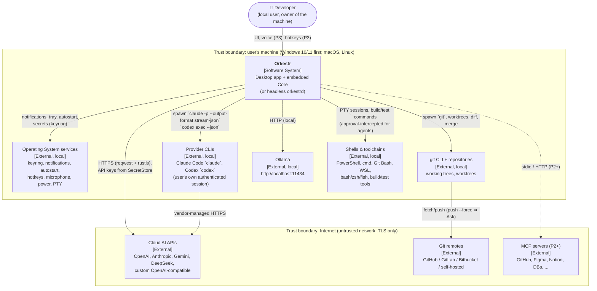
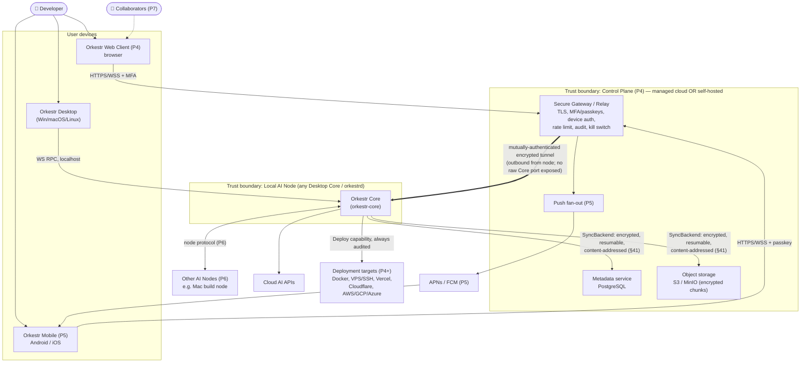
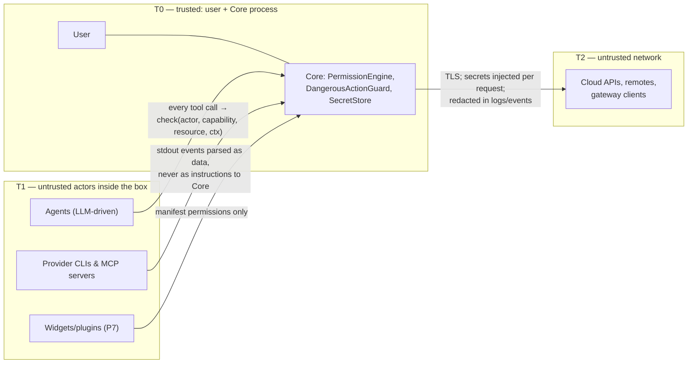

# System Context (C4 Level 1)

> Deliverable §65 #1. Binding inputs: `docs/ENGINEERING_CONTRACT.md` (the
> "contract") and `docs/spec/MASTER_SPEC.md` (§N). Where this document and the
> contract disagree, the contract wins and this document is a bug.

Orkestr is a local-first **AI Development OS** (§1, §3): a user drives one AI
Manager which plans work, spawns isolated agents (own task, branch/worktree,
budget, permissions), runs them against many AI providers, and keeps the human
in control of every dangerous action. This document shows Orkestr as a single
box and everything it talks to, plus the trust boundaries between them.

Phase legend used everywhere in `/docs/architecture`:

| Tag | Meaning (§61) |
|---|---|
| **P0** | Architecture & spikes (this document set) |
| **P1** | Windows Desktop Core MVP |
| **P2** | Multi-agent quality (review/test/heal, merge manager, consensus, context optimizer, decision log, benchmarks) |
| **P3** | Visual OS (Mission Control, themes/layouts, robots, voice, HUD, multi-monitor, performance modes) |
| **P4+** | Remote & Sync (P4), Mobile (P5), Multi-node (P6), Ecosystem/plugins (P7) |

---

## 1. Context diagram — Phase 1–3 (single machine)

Notes:

- The **Core** is the system's brain; the desktop UI is only one client of it.
  All business data crosses the WebSocket RPC protocol (contract §4), even when
  the Core is embedded in the Tauri process (contract §3), so Web/Mobile reuse
  it unchanged (§67).
- Provider CLIs are driven only through their official non-interactive modes;
  Orkestr never reads their token files or browser cookies (contract §7, §4).
- Ollama, the editor, Git, terminals, snapshots and the sync queue keep working
  with no network (§42 offline-first, acceptance scenario §63 I).

## 2. Context diagram — target scope (P4–P7)

Invariants carried into every later phase:

1. Core never binds `0.0.0.0`; remote access only via the gateway tunnel that
   the node dials **outbound** (contract §3, §35–37).
2. Cloud can be switched off entirely (Local-Only storage mode, §45, §67).
3. Local emergency stop works when the Control Plane is unreachable (§52).
4. The same RPC protocol (contract §4) serves desktop, web and mobile; the
   gateway is a transport, not a second API.

## 3. Actors and external systems

| Element | Kind | Interaction | Data crossing the boundary | Phase |
|---|---|---|---|---|
| Developer | Person | UI, command palette (§54), voice (§33), approvals | Commands, approvals, code edits | P1 (voice P3) |
| Collaborator | Person | Web client with scoped permissions | Same as developer, permission-scoped | P7 |
| OS services | Local system | `orkestr-platform` sub-adapters (see `platform-abstraction.md`) | Secrets (keyring), notifications, power state | P1 (hotkeys/mic P3) |
| git CLI | Local system | `orkestr-vcs` spawns `git` | Repo content, refs | P1 |
| Claude Code CLI / Codex CLI | Local system → vendor cloud | `orkestr-providers` spawns official CLI in JSON streaming mode | Prompt/context, tool events, usage | P1 (spike P0) |
| Ollama | Local system | HTTP `localhost:11434` | Prompt/context (never leaves machine) | P1 |
| Cloud AI APIs | External SaaS | HTTPS, API key from `SecretStore` | Prompt/context **filtered by privacy policy** §56 | P1 |
| Git remotes | External | `git fetch/push` | Commits | P1 |
| MCP servers | External or local | MCP stdio/HTTP via MCP hub (§19) | Tool calls, scoped secrets | P2+ |
| Control Plane | External (managed or self-hosted) | `SyncBackend`, gateway tunnel | Encrypted chunks, metadata, events | P4 |
| Other AI nodes | Peer systems | Node protocol (§38–39) | Task checkpoints, handoffs, artifacts | P6 |
| APNs/FCM | External SaaS | Push via control plane | Notification titles only (no code/secrets) | P5 |
| Deployment targets | External | Deploy tools (Docker/SSH/vendor CLIs) | Build artifacts, env secrets | P4+ |

## 4. Trust model at context level (§23, §52, §70)

- Agents are **untrusted autonomous actors** (§23). They never hold raw
  secrets; tools resolve `SecretReference`s at the last moment inside Core.
- Output from LLMs, CLIs, MCP servers and web pages is data. It can propose
  actions, never authorize them (prompt-injection containment).
- Dangerous actions are `Ask` even in `FullAuto`; hard-denied actions are
  `Deny` (contract §6).
- Data classification (Public/Internal/Confidential/Secret, §56) gates which
  providers may receive a project's context: a "Local Models Only" project can
  only route to Ollama/local endpoints — enforced in the provider router, not UI.

## 5. Key end-to-end flows at context level

| Flow | Path | Spec |
|---|---|---|
| User asks Manager for a feature | User → UI → RPC `manager.*` → Orchestrator → Provider → Tasks/Agents → events → UI | §1, §5, §63 A |
| Provider hits limit | Provider adapter returns `RateLimited{retry_after}` → router fallback → `ProviderFallback` event + structured handoff | §7, §63 B |
| Dangerous command by agent | Agent tool `terminal_run` → Guard = Dangerous → `ApprovalRequested` → user approves on desktop (mobile P5) → `ApprovalResolved` → command runs | §23, §63 E |
| Rollback task | Snapshot taken before risky change → `snapshots.rollbackTask` reverts only that task's files, 3-way checked | §25, §63 J |
| Crash | Core restarts → orphaned `Running/Waiting/Testing/Review` tasks → `Interrupted` → `Recovering` on user/Manager action | §62.13, contract §5 |

## 6. Out of scope for this system

- Not a VS Code extension, not a chat wrapper (§64). An "Open in external IDE"
  action exists (§15) but the IDE is not a dependency.
- No scraping of vendor web sessions, no reuse of other apps' tokens (§4).
- No hidden chain-of-thought persistence; only visible outputs, tool events and
  summaries are stored (§1.14, §21).
