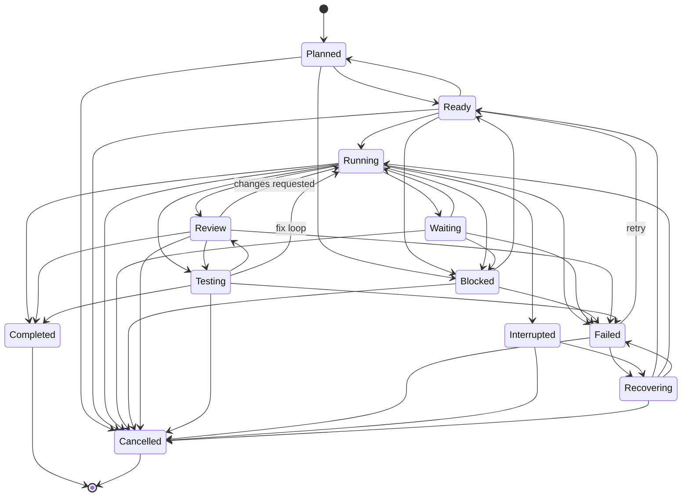

# Task State Machine, DAG & Scheduler

Status: Phase 0 deliverable #9 (§65). Crate: `orkestr-task-engine` — the **only**
place where task status changes (contract §5).
Spec references: §9, §10, §11, §16, §17, §22, §38–39, §57, §58, §62.13.

---

## 0. As built (Phase 0 foundation, 2026-10-02)

`crates/task-engine/src/state_machine.rs` implements the contract §5 table
exactly (the 41 edges of §2) as pure functions; nothing else of this document
is implemented yet.

```rust
pub fn allowed_transitions(from: TaskStatus) -> &'static [TaskStatus];
pub fn can_transition(from: TaskStatus, to: TaskStatus) -> bool;
/// Applies a transition in memory and returns the previous status.
/// Sets `updated_at`; on `→ Running` sets `started_at` (first time) and increments
/// `attempts` when coming from `Ready` or `Recovering`; on a terminal target
/// (`Completed`, `Cancelled`) sets `finished_at`.
pub fn transition(task: &mut Task, to: TaskStatus, now: Timestamp) -> Result<TaskStatus, InvalidTransition>;
pub struct InvalidTransition { pub from: TaskStatus, pub to: TaskStatus }
pub fn dependencies_satisfied(dependency_statuses: &[TaskStatus]) -> bool; // all Completed (vacuously true)
pub enum TaskError { InvalidTransition(InvalidTransition), NotFound(TaskId), Cycle(TaskId), Storage(String), Unimplemented(&'static str) }
#[async_trait] pub trait TaskStore { list(project), get(id), save(&Task), add_dependency(TaskDependency), interruptible() }
#[async_trait] pub trait Scheduler { next_batch(slots: usize) -> Vec<TaskId> }
```

Domain helpers (`orkestr-domain::task`): `TaskStatus::ALL`,
`is_terminal()` (`Completed | Cancelled`), `is_interruptible_on_crash()`
(`Running | Waiting | Testing | Review`); `TaskPriority` is ordered
`Background < Low < Normal < High < Critical`.

Not yet implemented: `TransitionRequest`, versions/`expected_version`, guards,
`task_transitions` history, cascades, the DAG store and cycle check, the
priority queue and admission, `recover_after_crash` (the core's recovery hook
list is empty), RPC `tasks.*`, and the privileged
`{Waiting, Review, Testing} → Interrupted` edges (CA-2): with the as-built
table, `can_transition(Waiting, Interrupted)` is `false`, so the crash-recovery
hook must bypass `transition()` exactly as §8.2 describes. The design names
`TaskEngineError`/`is_allowed` correspond to the as-built `TaskError`/
`can_transition`; keep the as-built names.

## 1. States

| State | Meaning | Agent attached? | In queue? |
|---|---|---|---|
| `Planned` | Exists in a plan; not yet approved for execution | no | no |
| `Ready` | Approved, all dependencies `Completed`, no policy block | no | **yes** |
| `Running` | An agent is executing it | yes | no |
| `Waiting` | Paused on approval / user answer / provider limit | yes (agent `Waiting`) | no |
| `Blocked` | Unmet dependency or policy block | no (released) | no |
| `Review` | Result under review (reviewer agent or user) | reviewer | no |
| `Testing` | Quality gates running (build/lint/tests §58) | test runner / QA agent | no |
| `Completed` | Accepted; result merged or merge not required | no | terminal |
| `Failed` | Attempt failed; retryable | no | no |
| `Cancelled` | Abandoned | no | terminal |
| `Interrupted` | Execution stopped externally (pause, emergency, crash, node loss) | no | no |
| `Recovering` | Workspace/agent state being verified and repaired | system | no |

---

## 2. Transition diagram (exactly contract §5)



41 edges. Any other `(from, to)` pair ⇒ `InvalidTransition{from, to}` (as built:
`orkestr_task_engine::InvalidTransition`, wrapped in `TaskError`; RPC `conflict`
once `tasks.transition` exists). Self-transitions are invalid (use `tasks.update` for field edits).

---

## 3. API

```rust
pub struct TransitionRequest {
    pub task_id: TaskId,
    pub to: TaskStatus,
    pub expected_version: u64,          // optimistic concurrency
    pub actor: Actor,                   // User{device} | Manager | Agent(AgentId) | System(SystemReason)
    pub reason: TransitionReason,       // typed, see §4 column "reason codes"
    pub note: Option<String>,           // human text, redacted, ≤ 2 kB
    pub correlation_id: Option<CorrelationId>,
}

#[derive(thiserror::Error, Debug)]
pub enum TaskEngineError {
    #[error("invalid transition {from:?} -> {to:?}")] InvalidTransition { from: TaskStatus, to: TaskStatus },
    #[error("guard failed: {guard}")]                  GuardFailed { guard: &'static str, detail: String },
    #[error("version conflict")]                       VersionConflict { current: u64 },
    #[error("not found")]                              NotFound,
    #[error("cycle: {0:?}")]                           Cycle(Vec<TaskId>),
    #[error(transparent)]                              Storage(#[from] StorageError),
}

impl TaskEngine {
    pub fn is_allowed(from: TaskStatus, to: TaskStatus) -> bool;          // const table, pure
    pub async fn transition(&self, req: TransitionRequest) -> Result<Task, TaskEngineError>;
    pub async fn add_dependency(&self, task: TaskId, depends_on: TaskId, actor: Actor) -> Result<(), TaskEngineError>;
    pub async fn next_admissible(&self, resources: &ResourceView) -> Option<TaskId>;   // §7
    pub async fn recover_after_crash(&self, crashed: CoreSessionId) -> Result<RecoveryReport, TaskEngineError>; // §8
}
```

Atomicity: one SQLite transaction performs (1) `UPDATE tasks SET status=?,
version=version+1 … WHERE id=? AND version=?` (0 rows ⇒ `VersionConflict`),
(2) `INSERT INTO task_transitions(task_id, from, to, actor, reason, note, at,
version)`, (3) cascaded transitions of dependents (§6), (4) `INSERT INTO events`
(outbox). After commit, `orkestr-events` publishes the outbox rows to the bus.
Side effects that touch other engines (spawn agent, create worktree, merge) are
executed by the orchestrator **reacting to events** or **before** requesting the
transition (guards) — never inside the DB transaction.

Every transition emits `TaskStatusChanged` (target payload below; the v1 wire
payload is `{taskId, from, to, reason}` — `event-model.md` §0.4 — and the
other fields are planned additive fields; the actor uses the domain shape
`{"type":"Agent","id":…}`):

```json
{ "kind": "TaskStatusChanged", "projectId": "…", "taskId": "…", "agentId": "…|null",
  "correlationId": "…",
  "payload": { "from": "Running", "to": "Review", "reason": "result_submitted",
               "actor": {"type": "agent", "id": "…"}, "version": 7, "forced": false } }
```

---

## 4. Guards, side effects, events per transition

Notation: **G** guard (must hold, else `GuardFailed`), **S** side effects
(performed by the named engine), **E** extra events beyond `TaskStatusChanged`.
Reason codes in `code` font.

### From Planned
| # | Transition | Trigger / reason | Guards | Side effects | Extra events |
|---|---|---|---|---|---|
| 1 | Planned → Ready | `plan_approved` (user, or manager when approval mode ≠ Ask) | all deps `Completed`; title + description present; budget available for task estimate; privacy policy allows at least one route | S: enqueue (§7) | — |
| 2 | Planned → Blocked | `plan_approved_deps_pending` / `policy_block` | ≥1 dep not `Completed` OR a policy blocker present | S: record `blockers[]` | — |
| 3 | Planned → Cancelled | `cancelled_by_user` / `plan_rejected` / `superseded` | — | S: cascade children (§6.3) | — |

### From Ready
| # | Transition | Trigger | Guards | Side effects | Extra events |
|---|---|---|---|---|---|
| 4 | Ready → Running | `scheduled` (scheduler) / `manual_start` | admission (§7) passed; agent assigned (`agent_id` set); worktree exists & clean-or-owned (git strategy §4); emergency not armed; deps still `Completed` | S: dequeue; record `started_at`, `attempt += 1`, `provider/model`; snapshot if task marked risky (§25) | `SnapshotCreated` (if taken) |
| 5 | Ready → Blocked | `dependency_added` / `policy_block` (budget exhausted, privacy policy leaves no route) | blocker present | S: dequeue; record blockers | — |
| 6 | Ready → Cancelled | `cancelled_by_user` / `manager_cancel` | — | S: dequeue; cascade | — |
| 7 | Ready → Planned | `replan` | actor is User or Manager | S: dequeue; clear approval | — |

### From Running
| # | Transition | Trigger | Guards | Side effects | Extra events |
|---|---|---|---|---|---|
| 8 | Running → Waiting | `approval_pending` / `user_input_pending` / `provider_limit` / `no_provider_available` | a pending item exists (approval id, question id, limit reset ts) and is recorded in `waiting_on` | S: start wait timer if configured; resources released except worktree and provider permit (permit released) | `ApprovalRequested` (by security), `ProviderRateLimited` (by providers) |
| 9 | Running → Blocked | `dependency_discovered` / `policy_block` | blocker recorded | S: agent → Idle (released), worktree kept; snapshot | `SnapshotCreated` |
| 10 | Running → Review | `result_submitted` | `submit_result.status ∈ {done, partial}`; next gate in task's gate order is Review | S: assign reviewer (user or reviewer agent); compute diff vs base | — |
| 11 | Running → Testing | `result_submitted` | as #10, next gate is Testing | S: start gate runner (`run_checks`) | `BuildStarted` |
| 12 | Running → Completed | `result_submitted` | task has no gates OR all gates satisfied in-run (evidence attached); acceptance criteria all `met`; **merge state ∈ {Merged, NotRequired}** (git strategy §6) | S: record result, release agent, `completed_at`; unblock dependents (§6.2) | `MemoryUpdated`/`DecisionRecorded` if result carried decisions |
| 13 | Running → Failed | `agent_error` / `budget_exceeded` / `timeout` / `self_heal_exhausted` / `result_failed` | — | S: release agent (→ Idle/Stopped); snapshot; record `failure{reason, detail}` | `BudgetThreshold` (100 %) when budget |
| 14 | Running → Cancelled | `cancelled_by_user` / `manager_cancel` | — | S: cancel agent token, kill processes; worktree retained per cleanup policy; cascade | `AgentStopped` |
| 15 | Running → Interrupted | `paused` / `emergency_stop` / `agent_lost` / `node_offline` / `shutdown` | — | S: cancel agent token; snapshot worktree (incl. uncommitted, §25) | `EmergencyStop` (if emergency), `SnapshotCreated` |

### From Waiting
| # | Transition | Trigger | Guards | Side effects | Extra events |
|---|---|---|---|---|---|
| 16 | Waiting → Running | `approval_granted` / `user_answered` / `limit_reset` / `provider_available` | the `waiting_on` item resolved; provider permit re-acquired; emergency not armed | S: clear `waiting_on`; resume agent | `ApprovalResolved` |
| 17 | Waiting → Blocked | `approval_denied_blocking` / `dependency_discovered` | blocker recorded | S: release agent; snapshot | `ApprovalResolved` |
| 18 | Waiting → Cancelled | `cancelled_by_user` | — | S: cancel pending approvals (`ApprovalResolved{status: cancelled}`); kill agent | `ApprovalResolved` |
| 19 | Waiting → Failed | `approval_denied` / `approval_timeout` / `input_timeout` | denial policy = fail, or timeout elapsed | S: release agent; snapshot | `ApprovalResolved` |

### From Blocked
| # | Transition | Trigger | Guards | Side effects | Extra events |
|---|---|---|---|---|---|
| 20 | Blocked → Ready | `unblocked` (system, on dependency completion or policy cleared) | all deps `Completed`; no blockers | S: enqueue | — |
| 21 | Blocked → Cancelled | `cancelled_by_user` / `dependency_cancelled` (when project policy `onDependencyCancelled = cascade`) | — | S: cascade | — |
| 22 | Blocked → Failed | `dependency_failed_permanently` / `block_timeout` | dep is `Failed` with `retryable=false` or `Cancelled`, or block timeout configured & elapsed | S: record failure | `Notification` |

### From Review
| # | Transition | Trigger | Guards | Side effects | Extra events |
|---|---|---|---|---|---|
| 23 | Review → Testing | `review_approved` | next gate is Testing | S: start gate runner | `ReviewFinished{verdict: approved}`, `BuildStarted` |
| 24 | Review → Running | `changes_requested` | `review_round < max_review_rounds` (default 3); author agent alive or re-spawnable | S: `review_round += 1`; deliver review findings as handoff (§57) to author | `ReviewFinished{verdict: changes_requested}` |
| 25 | Review → Completed | `review_approved` | no remaining gates; acceptance criteria met; merge state ∈ {Merged, NotRequired} | as #12 | `ReviewFinished` |
| 26 | Review → Failed | `review_rejected` / `review_rounds_exhausted` / `critical_security_finding` | — | S: record findings | `ReviewFinished{verdict: rejected}` |
| 27 | Review → Cancelled | `cancelled_by_user` | — | S: stop reviewer; cascade | — |

### From Testing
| # | Transition | Trigger | Guards | Side effects | Extra events |
|---|---|---|---|---|---|
| 28 | Testing → Review | `gates_passed` | next gate is Review | S: assign reviewer | `BuildSucceeded`, `TestRunFinished{passed}` |
| 29 | Testing → Running | `gates_failed_fix` | `self_heal_attempt < max_self_heal_attempts` (§17, default 3); budget remains | S: `self_heal_attempt += 1`; failures → handoff to author | `BuildFailed` / `TestRunFinished{failed}` |
| 30 | Testing → Completed | `gates_passed` | no remaining gates; acceptance met; merge ok | as #12 | `BuildSucceeded`, `TestRunFinished` |
| 31 | Testing → Failed | `self_heal_exhausted` / `gate_infra_error` | attempts exhausted or gate runner cannot run | S: snapshot; failure record | `BuildFailed` / `TestRunFinished` |
| 32 | Testing → Cancelled | `cancelled_by_user` | — | S: kill gate processes; cascade | — |

### From Failed
| # | Transition | Trigger | Guards | Side effects | Extra events |
|---|---|---|---|---|---|
| 33 | Failed → Ready | `retry` (user, or manager when `retry_count < max_auto_retries`, default 1) | all deps `Completed`; budget available; workspace consistent (no recovery needed) | S: reset per-attempt counters (`self_heal_attempt`, `review_round`); optional new model/agent; enqueue | — |
| 34 | Failed → Recovering | `recover` (workspace needs repair/rollback before retry) | snapshot or worktree exists | S: start recovery job (§8.3) | — |
| 35 | Failed → Cancelled | `abandoned` | — | S: cascade; cleanup schedule | — |

### From Interrupted
| # | Transition | Trigger | Guards | Side effects | Extra events |
|---|---|---|---|---|---|
| 36 | Interrupted → Recovering | `resume` (user) / `auto_resume` (policy) / `node_back_online` | emergency not armed | S: start recovery job | — |
| 37 | Interrupted → Cancelled | `cancelled_by_user` | — | S: cascade | — |

### From Recovering
| # | Transition | Trigger | Guards | Side effects | Extra events |
|---|---|---|---|---|---|
| 38 | Recovering → Ready | `recovered_fresh` | workspace verified; deps `Completed`; new agent needed | S: enqueue; handoff prepared from persisted state | — |
| 39 | Recovering → Running | `recovered_resume` | workspace verified; resumable agent (CLI session id or transcript) available; admission passed | S: re-attach agent; re-establish pending approval (→ may immediately go #8) | `AgentStarted` |
| 40 | Recovering → Failed | `recovery_failed` | — | S: preserve everything for inspection; `Notification` | `Notification` |
| 41 | Recovering → Cancelled | `cancelled_by_user` | — | S: stop recovery job | — |

Gate order: per task `quality_gates` (from template §6 / project defaults). Default
order for code tasks: `Testing (build, lint, typecheck, tests) → Review`. A task
flagged `security_sensitive` appends a security review (§17 "Security/QA").

---

## 5. Task fields relevant to the machine

```rust
pub struct Task {
    pub id: TaskId, pub project_id: ProjectId, pub parent_id: Option<TaskId>,
    pub title: String, pub description: String, pub acceptance_criteria: Vec<String>,
    pub priority: Priority,                 // Critical | High | Normal | Low | Background (§11)
    pub status: TaskStatus, pub version: u64,
    pub agent_id: Option<AgentId>, pub model: Option<ModelRef>,
    pub worktree: Option<WorktreeRef>, pub merge_state: MergeState, // NotRequired | Pending | Proposed | Merged | Conflict
    pub quality_gates: Vec<QualityGate>, pub gate_cursor: u8,
    pub attempt: u32, pub retry_count: u32, pub self_heal_attempt: u32, pub review_round: u32,
    pub waiting_on: Option<WaitingOn>, pub blockers: Vec<Blocker>,
    pub resource_profile: ResourceProfile, pub file_scope: Vec<String>, // globs predicted by planner
    pub budget: TaskBudget, pub failure: Option<FailureInfo>,
    pub session_id: Option<CoreSessionId>,  // core session that last started it (crash detection)
    pub created_at: DateTime<Utc>, pub updated_at: DateTime<Utc>,
}
```

---

## 6. DAG rules

### 6.1 Structure
- Two relations: **parent/child** (decomposition tree, §9 Epic→…→Tasks) and
  **dependency** (`TaskDependency{task, depends_on}`: finish-to-start). They are
  independent; a child does not implicitly depend on siblings.
- Dependencies must be **acyclic**. `add_dependency` runs DFS from `depends_on`
  over existing edges; reaching `task` ⇒ `Cycle(path)`. Self-edges rejected.
- Dependencies are **intra-project** (cross-project deps: Phase 7).
- Parent depth ≤ 6 (Epic, Feature, Story, Task, Subtask + 1 spare).

### 6.2 Readiness propagation
On any task entering `Completed`, the engine (same transaction) evaluates each
dependent: if dependent is `Blocked` and all its deps are now `Completed` and it
has no other blockers ⇒ transition #20 (`unblocked`). Dependents in `Planned`
are untouched (they still need plan approval).

### 6.3 Cascades
| Event on task X | Effect on dependents D | Effect on children C |
|---|---|---|
| X → Cancelled | D (Blocked/Ready/Planned) receives blocker `dependency_cancelled`; if project policy `onDependencyCancelled = cascade` ⇒ D → Cancelled; default `block` (user/manager decides: remove edge or cancel) | all non-terminal C → Cancelled (#3, #6, #14, #18, #21, #27, #32, #35, #37, #41 as applicable) |
| X → Failed | D is necessarily `Planned` or `Blocked` (it cannot be Ready while X is not Completed); a `Blocked` D gets informational blocker `dependency_failed` and stays Blocked — Failed is retryable. #22 applies only when X is marked non-retryable | non-terminal children of X are left as-is (manager decides); running children are not killed |
| X re-enters Ready via retry | no change for D (still blocked until Completed) | — |

### 6.4 Edge mutations vs states
- Adding a dependency to a task in `Ready` ⇒ #5 if the new dep is not `Completed`.
- In `Running`/`Waiting`: allowed only with `block_now = true` ⇒ #9/#17; else
  rejected with `conflict` (prevents silently invalidating in-flight work).
- In `Review`/`Testing`/`Completed`/`Cancelled`: rejected.
- Removing a dependency may unblock (#20).
- A **parent** can reach `Completed` only if every non-cancelled child is
  `Completed` (guard on #12/#25/#30 for tasks with children).

### 6.5 Graph view (§11 visual DAG)
`tasks.graph {projectId}` returns nodes (id, title, status, priority, agent) and
edges (dependency + parent) — rendered with `@xyflow/react`. Critical path length
(in estimated minutes) is computed per node for scheduling (§7).

---

## 7. Priority queue & resource-aware scheduling (§11, §38)

### 7.1 Queue ordering
Only `Ready` tasks are queued. Sort key (descending importance):

1. `effective_priority` = base priority boosted by **aging**: +1 level per
   `aging_interval` (default 20 min) waiting in `Ready`, capped at `High`
   (aging never creates `Critical`; `Background` caps at `Normal`).
2. `critical_path_remaining` (longest estimated downstream chain) — unblocks most work.
3. `ready_since` (FIFO).

### 7.2 Resource profile & admission
```rust
pub struct ResourceProfile {
    pub cpu_weight: f32,            // 0.25 chat agent … 2.0 heavy build
    pub ram_mb: u32,
    pub gpu_vram_mb: u32,           // local model inference
    pub disk_mb: u32,               // worktree + build artefacts
    pub needs_network: bool,
    pub provider: Option<ModelRef>, // routed model → concurrency permit
    pub exclusive: Vec<String>,     // named locks: "port:5432", "build:<project>", "docker:<compose>"
    pub os_requirement: Option<OsKind>, // multi-node (§38) Phase 6
}
```
`ResourceView` comes from `orkestr-node` (sysinfo: CPU, RAM, GPU/VRAM where
available, disk free, network up) plus engine-level counters (running agents,
provider permits, named locks, merge-manager file locks).

Admission for candidate T succeeds iff all hold:
- running agents < `manager.max_parallel_agents` (project) and < global cap;
- `Σ cpu_weight(running) + T.cpu_weight ≤ logical_cores × 0.75`;
- `free_ram − T.ram_mb ≥ ram_reserve` (default 2 GB or 15 %, whichever larger);
- VRAM, disk (≥ 2 GB after T) likewise;
- provider permit available for `T.provider` (or a fallback route has one);
- all `T.exclusive` locks free;
- **git-conflict avoidance**: `T.file_scope` does not overlap any `Running`
  task's file scope in the same project (Phase 1: strict → serialize; Phase 2:
  overlap allowed when merge manager predicts low conflict, §16);
- task/project budget can cover estimate;
- performance mode (§31) does not reduce caps (Battery Saver halves caps).

### 7.3 Selection
`next_admissible` scans the queue in order and returns the first admissible task
(**backfilling**). Anti-starvation: if the head has been inadmissible for more
than `starvation_window` (default 10 min) the scheduler **reserves** the
resources it needs: no task with a larger resource demand than the head may be
backfilled until the head runs. The scheduler loop runs on: task → Ready,
any task leaving Running/Testing/Review, resource sample (every 5 s), provider
limit reset, lock release.

### 7.4 Preemption
Phase 1: none (Critical waits for resources). Phase 2: a `Critical` task may
preempt the lowest-priority `Background` task (#15 `preempted` reason →
Interrupted → later Recovering → Running/Ready).

### 7.5 Multi-node (Phase 6)
Scheduler becomes two-level: node selection (OS requirement, tools, local
models, project cache, load, user preference §38) then local admission as above.

---

## 8. Crash recovery (§62.13)

### 8.1 Sessions
**As built:** the core writes `<data_dir>/session.lock` (`{pid, startedAt}`) at
start and removes it on clean shutdown; a marker left by a dead pid means the
previous session crashed (`orkestr_core::recovery`), and registered
`RecoveryHook`s run before the RPC server binds (none are registered yet).
**Target:** on start core inserts `core_sessions{id, started_at, pid,
clean_shutdown=false}` and heartbeats every 10 s. Graceful shutdown sets
`clean_shutdown = true` after interrupting running work.

### 8.2 Detection & forced interruption
On start, for each previous session with `clean_shutdown = false` (crash) — and
also for gracefully closed sessions — every task with `session_id = S` and status
in `{Running, Waiting, Testing, Review}` is moved to `Interrupted` with reason
`crash_recovery` (or `shutdown`).

> **Contract note**: the contract (§5) mandates this for `Waiting/Testing/Review`
> too, but its transition table only lists `Running → Interrupted`. The engine
> implements these three edges **only** inside `recover_after_crash()` (not
> reachable via `transition()`/RPC), persisted with `forced = true` in
> `TaskStatusChanged`. An ADR should ratify `Waiting|Review|Testing → Interrupted`
> as system-only edges (see report).

Then: agents of session S → `Stopped(Crash)`; orphan child processes recorded in
`agent_processes{pid, start_time}` are killed via `orkestr-platform` (start time
checked to avoid killing a recycled PID); pending approvals stay `pending` and
are re-linked on resume.

### 8.3 Recovery job (Interrupted/Failed → Recovering → …)
1. Verify worktree exists, is registered (`git worktree list --porcelain`), HEAD
   on the expected branch.
2. Stale `index.lock`/`*.lock` in the worktree's git dir: removed only if no
   live git process owns it (platform process scan) and age > 60 s.
3. Take a **post-crash snapshot** (uncommitted state preserved, §25) before
   touching anything.
4. If worktree missing/corrupt: restore from last snapshot into a fresh worktree
   at the recorded base commit; impossible ⇒ #40.
5. Decide: resumable agent (CLI session id, or chat transcript + model still
   routable) and policy `auto_resume` ⇒ #39; otherwise ⇒ #38 with a handoff built
   from persisted transcript/tool calls/diff.
6. Emit `RollbackPerformed` if a snapshot restore occurred.

Default `auto_resume = false`: after a crash the user sees a Session Resume
summary (§57) and confirms; Interrupted tasks are listed with "Resume all".

### 8.4 Idempotency
Every side effect started by a transition records an `operation` row
(`{id, kind, task_id, state: started|done}`); recovery re-runs or compensates
`started` operations (e.g. a half-created worktree is removed and recreated).

---

## 9. Phasing

| Item | Phase |
|---|---|
| States, 41 transitions, guards, outbox events, DAG + cycle check, cascades, priority queue with aging, admission on CPU/RAM/disk/agents/provider permits/locks/file-scope, crash recovery | 1 |
| Review/Testing gates automation, self-heal loop, preemption, conflict-predicting overlap, GPU/VRAM accounting | 2 |
| Multi-node scheduling, task migration | 6 |

## 10. Test obligations

Exhaustive 12×12 table test of `is_allowed` (41 true, 103 false); guard tests per
transition; optimistic concurrency conflict; cycle detection (incl. long chains);
cascade on cancel/fail; readiness propagation; aging; backfill + starvation
reservation; crash recovery with a temp DB containing tasks in every state.
