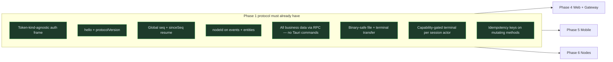

# Requirements Review (Phase 0, §66 Step 1)

| | |
|---|---|
| Status | Accepted, baseline for Phase 1–3 |
| Inputs | `docs/spec/MASTER_SPEC.md` (§N), `docs/ENGINEERING_CONTRACT.md` (the "contract", binding) |
| Outputs | Resolutions below. They are binding unless an ADR supersedes them. Related: [`adr/`](adr/README.md), [`spikes/`](spikes/README.md), [`roadmap/mvp-milestones.md`](roadmap/mvp-milestones.md), [`roadmap/feature-traceability.md`](roadmap/feature-traceability.md), [`risks.md`](risks.md) |
| Conflict rule | §70 priority order: data safety > recoverability > correctness > project integrity > user control > AI quality > stability > performance > UX > visual premium > animation |

This review lists every contradiction, ambiguity and gap we found in the spec and the contract, and gives each one a resolution that can be built. IDs are stable. Code comments and ADRs cite them as `RR-C1`, `RR-A3`, `RR-G7` and so on.

- **C** = contradiction: two statements cannot both hold as written.
- **A** = ambiguity: the statement can be read in several ways, and we pick one.
- **G** = gap: a needed requirement is missing.
- **P** = protocol coupling: a later phase forces a decision now.

---

## 1. Contradictions

### RR-C1. Voice is "first-class" (§33) but is scheduled for Phase 3 (§61)
- **Conflict:** §33 says "Voice — first-class". §61 puts voice and wake word in Phase 3, after the core is built. If the core is built without voice in mind, adding voice later means rewriting the command paths.
- **Resolution:** In the *architecture*, voice is first-class from Phase 1. Its *delivery* is Phase 3.
  1. Every user intent that voice can trigger is already an RPC method, for example `emergency.stopProject` or `manager.send`. Voice in Phase 3 is just one more client of the protocol (§67). It turns speech into text, then into an intent, then into an RPC call. Voice has no private API.
  2. Phase 1 defines the `voice.*` method namespace and a `Microphone` trait in `orkestr-platform` (§46). Calls return the explicit unimplemented-feature error (`bad_request` + `data.unimplementedFeature` today; see RR-G14).
  3. `AgentTemplate` (§6) carries an optional `voice: VoiceProfile` field from Phase 1 (`{ttsProvider, voiceId, language, style}`), so templates written before Phase 3 do not need a migration.
  4. Text-to-speech for notifications (§33, Voice Notifications) is Phase 3. The `Notification` event kind (contract §4) already carries `priority`, and voice uses it for do-not-disturb (DND).
- **Trace:** ADR-0017, SP-15, R-08.

### RR-C2. Background/headless service (§12) does not appear in any phase of §61
- **Conflict:** §12 requires agents to keep running when the GUI is closed, and the core to start automatically with the OS. Phase 0 lists a "local service" spike, but no phase from 1 to 7 delivers the service. The contract §3 also embeds the core in-process by default, so closing the app kills the agents.
- **Resolution:** split the work across phases (ADR-0004):
  | Phase | Delivery |
  |---|---|
  | 1 | The `orkestrd` binary exists and can be started by hand. It serves the same RPC as the embedded core. Desktop finds it through `core.json`. Closing the desktop window while tasks are `Running` asks: *Stop agents* / *Keep running in tray* (default) / *Cancel*. In tray mode the process and the embedded core stay alive. |
  | 2 | *Hand off to daemon*: the desktop starts `orkestrd` and drains in-flight tasks into it (tasks become `Interrupted`, then `Recovering`, then `Running` in the daemon, using ADR-0022). After that, the desktop always connects to the daemon if one is running. |
  | 3 | Autostart at OS login through `PlatformAdapter::autostart()` (opt-in, set up in onboarding step 5 or in Settings). Tray HUD (§34). |
  | 4 | `orkestrd` runs as a headless AI Node behind the gateway (§35). |
- **Trace:** ADR-0004, SP-13, R-13.

### RR-C3. The Phase 1 list (§61) leaves out security items that §23/§52/§70 make non-negotiable
- **Conflict:** Phase 1 lists "approvals" and nothing else from security. It does not list the permission engine, Dangerous Action Guard (§23), secrets vault (§24), emergency stop (§52), audit, redaction (§50) or budget limits. §64 also forbids "uncontrolled autonomous loops". §70 ranks data safety first. Contract §6 makes these invariants.
- **Resolution:** Phase 1 **must** deliver these, as acceptance gates for milestone M1.4 (see `roadmap/mvp-milestones.md`):
  - `PermissionEngine::check` on every agent tool call, with Global, Project, Agent and Task scopes and the Ask, SemiAuto and FullAuto modes (ADR-0010).
  - `DangerousActionGuard` with at least 150 unit-test cases across bash, PowerShell and cmd.
  - Filesystem confinement that rejects `..`, symlink escapes, absolute paths, UNC and `\\?\`.
  - `SecretStore` with the OS keyring and the encrypted vault fallback (ADR-0011). Redaction in `tracing` and in events.
  - Emergency stop: `emergency.stopAll`, `emergency.stopProject` and `agents.stop`, using local cancellation tokens with no provider involved.
  - An `AuditEvent` table for approvals, secret access, dangerous-action decisions and emergency stops.
  - Hard limits per task: `maxTurns`, `maxWallTime` and `maxCostUsd`. Exceeding one triggers `BudgetThreshold` and moves the task to `Waiting` (the user decides).
  - The §52 emergency controls *Disable Full Auto* and *Lock Vault* in Phase 1. *Revoke Remote Sessions* comes in Phase 4. *Disable Network Tools* comes in Phase 1 as a global Deny rule on `Network`.

### RR-C4. Floating robots: "click-through when idle" and "drag/drop" (§30)
- **Conflict:** A window that ignores cursor events cannot be dragged.
- **Resolution:** Click-through applies to **transparent pixels only**. The robot body is always hit-testable. The window toggles `set_ignore_cursor_events` based on the cursor position, polled about every 33 ms in Rust and tested against the robot's hit shape. "Idle click-through" means *pass-through* mode: while the agent is `Idle`, the whole window passes clicks through unless the user holds a modifier (Alt by default) or hovers for 600 ms. See ADR-0016 and SP-04.

### RR-C5. "Snapshot ≠ Git commit" (§25), "no auto-commit spam" (§40, §64), and "agents create branches/worktrees and merge" (§1.7, §1.12, §16)
- **Conflict:** Agents have to commit to produce mergeable work, but the spec forbids auto-commits.
- **Resolution:**
  - Commits **are** allowed on agent-owned branches (`agent/*`) inside agent worktrees. They are task-scoped, and a commit happens only at a quality checkpoint, never on a timer.
  - The Merge Manager squash-merges by default (configurable), so the user's branch gets one commit per accepted task.
  - Orkestr never commits to a user-owned branch without an approved merge proposal.
  - Snapshots never create commits, refs or stashes. They are content manifests in the Orkestr object store (ADR-0021).
  - "Auto-commit spam" is defined as commits on user branches, timer-based commits, or commits outside a task. All three are forbidden.

### RR-C6. Branch naming `agent/backend` (§16) vs uniqueness
- **Conflict:** Two Backend agents, or two tasks for the same agent, would collide. Git also rejects `agent/backend` when a branch named `agent` exists (the D/F ref conflict).
- **Resolution:** The pattern is `<prefix><role-slug>-<agentShort>` with default prefix `agent/`, for example `agent/backend-3f9a1c2e`. The short id is the **last 8 hex digits** of the UUID v7 (the random part, because the leading digits are timestamp bits). On a collision, append `-2`, `-3` and so on. Full naming is in `architecture/git-worktree-strategy.md`. Before creating a branch, Orkestr checks for a D/F conflict with `git check-ref-format` and `git show-ref`. See ADR-0009.

### RR-C7. Contract crash recovery (§5) vs the transition table
- **Conflict:** The contract says that on restart every `Running/Waiting/Testing/Review` task becomes `Interrupted`. The transition table only allows `Running → Interrupted`.
- **Resolution:** `orkestr-task-engine` adds a privileged transition cause, `TransitionCause::CrashRecovery`. Only the recovery routine at core start can use it, and it allows `{Running, Waiting, Review, Testing} → Interrupted`. User and agent requests can never produce `→ Interrupted` from any state except `Running`. Emergency stop uses `→ Cancelled`, which the table allows from every non-terminal state. `agents.stop` (pause semantics) uses `Running → Interrupted`. A non-`Running` task whose agent is stopped stays where it is. See ADR-0022. **The contract table must be amended** (reported to the integrator).

### RR-C8. "Every agent tool call goes through PermissionEngine" (contract §6) vs CLI coding agents (Claude Code / Codex, §4)
- **Conflict:** `claude -p` and `codex exec` run tools inside their own process, so Orkestr does not see each call before it runs.
- **Resolution:** see ADR-0012. In short:
  1. **Claude Code:** gate every tool call through `--permission-prompt-tool` pointing at an Orkestr MCP bridge, `orkestr mcp-permission`. The bridge calls `PermissionEngine::check` and blocks until approval. `--allowedTools` and `--disallowedTools` come from the agent's capabilities. The process runs with `cwd = worktree`.
  2. **Codex:** `codex exec` has no interactive approvals. Run it with `--sandbox workspace-write` confined to the worktree, network off unless `Network` is granted, and **launch-time gating**: launching needs `Write`+`Terminal` on the worktree. In `Ask` mode, launching is itself an approval. Orkestr always takes a snapshot first (ADR-0021) and audits the JSONL tool events after the fact.
  3. A CLI agent is labelled "delegated sandbox" in the UI.
  4. Where per-call gating cannot be verified (SP-06/SP-07), the adapter must refuse FullAuto.
- §70 accepts this trade-off: the snapshot gives recoverability, and the user can see exactly what is and is not gated.

### RR-C9. Multi-platform Phase 1 (§2 "Windows-first, not Windows-only"; §64 forbids a Windows-only core)
- **Conflict:** Phase 1 is "Windows Desktop Core MVP", but §67 requires that a macOS build does not need UI or core rewrites.
- **Resolution:** In Phase 1, CI must `cargo check` and `cargo test` every crate on Windows, macOS and Linux, and `vite build` the desktop. Only Windows is QA-tested and packaged (MSI/NSIS). The macOS and Linux `PlatformAdapter` implementations may return `unimplemented` only for the Phase 3 features (overlay, hotkeys, microphone, computer control), never for paths, shells, the credential store or process management.

---

## 2. Ambiguities

| ID | Statement | Interpretation adopted |
|---|---|---|
| RR-A1 | "SemiAuto" approval mode (§23) is never defined | The default matrix is in ADR-0010 §"Mode matrix". In SemiAuto, `Read` and in-worktree `Write` are allowed, `Terminal` is allowed for commands classified `Safe`, and `Git` is allowed for local ops on agent branches. `Delete`, `Network`, `DbWrite`, `Docker`, `Ssh`, `Deploy`, `Browser` and `Secrets` ask. `ComputerControl` is denied unless an explicit rule grants it. |
| RR-A2 | Scope precedence: "Global ⊃ Project ⊃ Agent ⊃ Task" | The **narrowest scope with a matching rule decides**. Deny beats Allow at the same scope. A narrower Allow **cannot** override the guard's hard-deny or a Dangerous ⇒ Ask. A narrower scope can always add Deny. |
| RR-A3 | "Waiting" (task) vs "Waiting" (agent) | Task `Waiting` covers approval, user input, a provider (rate limit or quota) or a budget threshold. `Task.waitReason: "approval" \| "user" \| "provider" \| "budget"`. The agent state `Waiting` mirrors it. `Blocked` is only for an unmet dependency or a policy Deny that needs a configuration change. |
| RR-A4 | "Rollback Everything" (§68.34) | This covers task rollback, workspace rollback, UI-config rollback (versioned, ADR-0015), permission-rule rollback (versioned) and memory-item rollback (soft delete plus versions). It does **not** roll back remote side effects (deployments, pushes, DB writes). Those are guarded by Ask and recorded in the audit log. |
| RR-A5 | "Store all useful history but not hidden chain-of-thought" (§1.14, §21) | Provider reasoning/thinking blocks are dropped at the adapter boundary (`ChatEvent` has no reasoning variant). Provider-supplied *reasoning summaries*, if they exist, are stored as `Decision.reasoningSummary`. `AgentMessage` deltas are ephemeral, and only the final assistant message is stored in `executions`. |
| RR-A6 | LSP/IntelliSense (§15) | Phase 1 uses Monaco's built-in language services (TS/JS/JSON/CSS/HTML) plus syntax for the rest. Phase 2 adds an LSP bridge: `orkestr-core` spawns language servers through `PlatformAdapter::process`, with `lsp.*` methods tunnelled over RPC so Web gets them too. |
| RR-A7 | "Dynamic Agent Spawn" (§6) in Phase 1 as "basic" | Phase 1: the Manager may propose N agents from templates, the user approves the plan, and agents are spawned within `maxParallelAgents` (default 3). Phase 2 adds the resource-aware decision (CPU/RAM, provider concurrency, cost estimate) with no approval needed in SemiAuto/FullAuto. |
| RR-A8 | Storage mode in onboarding (§55 step 2) | Phase 1–3: only **Local Only** can be selected. Cloud and Self-Hosted are shown disabled with "Phase 4". The choice is stored as `settings.storageMode`. |
| RR-A9 | Provider "Official Sign-in where supported" (§55) | OpenAI: API key, or Codex CLI login (`codex login`, run by the user in an Orkestr terminal). Claude: Claude Code login (`claude` CLI, user-run) or an Anthropic API key. Orkestr never runs an OAuth flow on behalf of a third-party CLI. See ADR-0012. |
| RR-A10 | `core.json` field `token_file_hint` (contract §3) | The daemon writes the token to `<data_dir>/core.token`, readable only by the current user (POSIX file mode 0600; on Windows an owner-only ACL set through `platform`). `token_file_hint` is the file name relative to `<data_dir>`. `core.json` keeps snake_case because it is a file format, not the wire protocol. |
| RR-A11 | Event `seq` (contract §4): global or per connection? | **Global, monotonic, not dense**, assigned by `orkestr-events`. Durable kinds are persisted with their seq. Ephemeral kinds (`AgentMessage`, `TerminalOutput`, `Log` at debug level, `NodeStatus`) get a seq but are not persisted, so replay can show gaps. See ADR-0018. |
| RR-A12 | Robot states §30 vs agent states (contract §5) | The robot state is a pure function of the agent state: `Stopped` maps to the robot hidden or greyed, and the rest map one-to-one. `Listening` is set only while voice capture targets that agent. |
| RR-A13 | "Priority: Critical..Background" (§11) vs the scheduler | The priority queue is strict between classes, FIFO plus aging inside a class (+1 effective level per 10 min waiting, capped below Critical). `Background` never preempts. In Phase 2, `Critical` may preempt `Background` by moving it `Running → Interrupted`, then `Recovering`. |
| RR-A14 | "Cross-project agents" (§68.27) | An agent template is global. An agent *instance* belongs to one project. "Cross-project" means a Manager-level task that spawns linked instances in several projects, with a `crossProjectGroupId`. Each instance keeps its own project scope (§67: no secret access across projects). Phase 2 partial. |
| RR-A15 | "90–95% shared code" (§47) | This is measured on the TS client layer (`@orkestr/protocol`, `@orkestr/client`, `@orkestr/ui`) plus the core. Desktop-only code stays in `apps/desktop/src-tauri` and `apps/desktop/src/shell/*`. |

---

## 3. Gaps (missing requirements, added)

| ID | Gap | Resolution | Phase |
|---|---|---|---|
| RR-G1 | No protocol version negotiation | Server sends `{"type":"hello","protocolVersion":1,"serverVersion":"x.y.z","nodeId":"…","capabilities":[…]}` after a successful `auth`. If the client's major version does not match, it shows "update required". Auth failure closes the WebSocket with code 4401. This is an additive frame (ADR-0005). | 1 |
| RR-G2 | No `unsub`, keepalive or resume on reconnect | Additive frames: `{"type":"unsub","id","topics"}`, `{"type":"ping","id"}` → `{"type":"pong","id"}`. `sub` takes an optional `sinceSeq` and replays durable events after it. Overflow → `{"type":"lagged","topics":[…],"lastSeq":n}` and the client re-subscribes with `sinceSeq`. ADR-0005. | 1 |
| RR-G3 | Approval flow not specified end-to-end | `Decision::Ask` → `Approval` row (`pending`) → `ApprovalRequested` → task `Waiting(approval)` → `approvals.resolve {approvalId, decision:"approve"\|"deny", remember:"once"\|"task"\|"agent"\|"project", note?}` → `ApprovalResolved` → `Waiting → Running`. `remember` is forced to `once` for dangerous actions. Default expiry 24 h, then Deny. ADR-0010. | 1 |
| RR-G4 | Budget behaviour on exhaustion | 80% triggers `BudgetThreshold{level:"warn"}`. 100% triggers `BudgetThreshold{level:"exceeded"}` and the RPC error `budget_exceeded` for new provider calls on that scope. Running tasks move to `Waiting(budget)`. "Unrestricted" budgets (§22) still record usage. | 1 |
| RR-G5 | Privacy classification (§56) not in any phase | Phase 1: `Project.privacy: {policy:"cloudAllowed"\|"selectedProviders"\|"localOnly"\|"noRemoteSync"\|"selfHostedOnly", allowedProviders?:[…], classification:"public"\|"internal"\|"confidential"\|"secret"}`. The router enforces `localOnly` (only `descriptor().local == true`) and `selectedProviders` from Phase 1. The sync side comes in Phase 4. | 1 (routing), 4 (sync) |
| RR-G6 | Command palette (§54) and global search not in any phase | Phase 1 palette (create/switch project, ask Manager, spawn agent, open terminal, snapshot, rollback, stop all). Phase 2 global search (`search.query`, FTS5 across tasks/memory/decisions/logs/files). | 1 / 2 |
| RR-G7 | Onboarding (§55) not in any phase | Phase 1 delivers steps 1–8 (5 = permission mode). Steps 9–12 are shown as "later" until Phase 3/4/5. | 1 |
| RR-G8 | Observability (§50) not in any phase | Phase 1: `tracing` JSON logs to `<data_dir>/logs/` (rotation 10×10 MB), with `correlationId`, `projectId`, `taskId`, `agentId` and `nodeId` as span fields, and a redaction layer. The Logs panel tails them through the `Log` events. Metrics/traces export (OTLP) is Phase 4. | 1 |
| RR-G9 | Session resume (§57) | Phase 1: on start, `system.resumeSummary` aggregates the last session (completed/interrupted tasks, pending approvals, last snapshot) and shows it in the Manager panel. Phase 2: handoff-based resume of `Interrupted` tasks. | 1 / 2 |
| RR-G10 | MCP Hub (§19) not in Phases 1–3 | Phase 2 partial: stdio MCP client in `orkestr-agent-runtime` (tools exposed to agents, gated by the capability declared per server, default `Network`). Phase 3: McpHub panel. Phase 7: marketplace. Capability mapping: see contract ambiguity CA-4. | 2 |
| RR-G11 | Environment/Deployment (§26), Monitor/Bug Detective (§27) not in Phases 1–3 | Phase 1: `Environment` entity (Local only) for secret scoping. Phase 2: environment manager (Dev/Test/Staging/Prod definitions, prod flag feeds the Dangerous guard). Deployment and Bug Detective: Phase 4+ (outline in milestones). | 1 / 2 / 4+ |
| RR-G12 | Browser agent (§18) not in Phases 1–3 | Phase 2 partial (stretch): Playwright-driven tool (`browser_open/click/type/screenshot/console`, naming per `agents/agent-runtime-spec.md` §5.1) run as a child process in the worktree, behind capability `Browser`. Phase 3: Browser panel with a live screenshot stream. | 2 / 3 |
| RR-G13 | Data retention / disk growth (event log, object store, worktrees) | Defaults: durable events kept 180 days (configurable; decisions, approvals and audit kept forever). Objects kept by mark-and-sweep from snapshots and artifacts. Worktrees removed 7 days after merge or cancel. Shown in Settings → Storage. | 1 (settings), 2 (GC) |
| RR-G14 | No error code for "not implemented in this phase" (contract §6.6 asks for explicit stubs) | Add the error code `unimplemented` with `data: {feature:"voice.wake", phase:3}`. Until the integrator adopts it, stubs return the as-built `RpcError::unimplemented_feature(feature)` = `bad_request` with `data: {unimplementedFeature: "<feature>"}` (the foundation chose `bad_request`, not `internal`). See CA-1 and §5.1. | 1 |
| RR-G15 | Windows file-path limits & AV interference with worktrees | Worktrees live under `<data_dir>/worktrees/<projectShort>/<agentShort>` (short paths), `core.longpaths=true` on each worktree, and an onboarding hint to exclude `<data_dir>/worktrees` from Defender real-time scanning (user action, never automatic). See R-15 and SP-10. | 1 |
| RR-G16 | Concurrency limits for providers | `ProviderDescriptor.maxConcurrency` (default 2 for CLI agents, 8 for HTTP). A semaphore per provider in the router. A `rate_limited` error → `ProviderRateLimited` event plus backoff. | 1 |
| RR-G17 | Single-instance desktop and daemon races | `<data_dir>/core.lock` is an exclusive OS file lock held by whichever process owns the core. A second desktop instance focuses the first through the Tauri single-instance plugin. | 1 |
| RR-G18 | Licensing of bundled models/libs (wake word, Rive runtime, Monaco) | A license check is part of each spike's success criteria. GPL/AGPL is not bundled in the desktop binary. | 0 |

---

## 4. Protocol coupling with Phases 4–6 (decisions forced now)

Web (Phase 4), Mobile (Phase 5) and Multi-node (Phase 6) reuse the Phase 1 protocol (§67). If any of the items below is missing in Phase 1, those phases need a breaking protocol change.

| ID | Requirement in Phase 1 | Why later phases need it |
|---|---|---|
| RR-P1 | `auth.token` is opaque. The server resolves it to a `Session{actor, deviceId, scopes}`. The local bearer token resolves to `Actor::User{deviceId: localDevice}` with full scope. | Phase 4 gateway sessions, device tokens and passkey-backed sessions plug in without changing the frame (§36). |
| RR-P2 | `hello` frame with `protocolVersion`. Methods and event kinds are append-only, as the contract already says for kinds. | Mobile apps in stores lag behind desktop versions. |
| RR-P3 | Global `seq` plus `sub.sinceSeq` resume. | Mobile reconnects constantly. Web runs over a relay. Push (§37) needs exactly-once UI reconciliation. |
| RR-P4 | `nodeId` set on every event and on `Task.assignedNodeId`, `AgentInstance.nodeId` and `TerminalSession.nodeId` (the local node id is generated at first start and stored in `settings`). | Phase 6 routes tasks to nodes, and the UI must already render a node badge without a schema migration. |
| RR-P5 | No business data through Tauri `invoke`. Tauri commands are limited to `core_connection`, window management, overlay windows, tray, global hotkeys and the file-dialog bridge. | Web and Mobile have no Tauri (contract §2). |
| RR-P6 | `files.read` / `files.write` take `encoding:"utf8"\|"base64"` and chunking (`offset`, `length`, max 4 MiB per frame). `TerminalOutput.data` is UTF-8 with boundary-safe splitting. Both have size caps. | Remote clients go through the gateway, where frame limits apply. |
| RR-P7 | Terminal methods check `Terminal` capability for the **session actor** (for a local user this is always allowed). | Phase 4 remote terminal must be gated per device (§36, risk §62.2) with no redesign. |
| RR-P8 | Mutating methods accept an optional `idempotencyKey` (deduplicated for 10 min). | Mobile retries over flaky networks must not double-spawn agents or double-approve. |
| RR-P9 | `emergency.*` methods never depend on providers, sync or the network. | §52: local emergency stop works even when the Control Plane is broken. |
| RR-P10 | Entities carry `rev: u64` (optimistic concurrency, `conflict` error on a stale write) and `updatedAt`. | The Phase 4 sync journal and multi-client editing need versioned writes. ADR-0019. |

---

## 5. Contract ambiguities to escalate (for the integrator)

These items need a contract edit. Until that happens, docs and code follow the resolution given here.

| ID | Contract text | Issue | Proposed resolution |
|---|---|---|---|
| CA-1 | §4 error codes | No `unimplemented` code, and no code for invalid task transitions | Add `unimplemented` and `invalid_transition` (append-only). Until then use `bad_request` + `data.unimplementedFeature` (as built) and `conflict` with `data.reason`. |
| CA-2 | §5 transitions vs crash recovery | See RR-C7 | Add the `CrashRecovery` privileged edges. |
| CA-3 | §2 dependency direction `domain ← protocol ← events ← everything else` | `events` needs a persisted log, but `storage` is "everything else", which makes a cycle | `orkestr-events` defines the `EventLogStore` trait (persistence port). `orkestr-storage` implements it as `SqliteEventLog`. `core` wires them. `storage` depends on `events` for the trait, never the other way (ADR-0018). |
| CA-4 | §6 capability list | No capability for MCP tools, plugin/widget execution or microphone | MCP tools are checked against the capability each server declares (default `Network`, plus `Read`/`Write` if it is a filesystem server). Microphone is a user-level OS permission, not an agent capability. A future `Plugin` capability needs an ADR. The list stays append-only. |
| CA-5 | §4 frames | No `unsub`, `ping`/`pong`, `hello` or `lagged`, and no reply to `auth`/`sub` defined | See RR-G1 and RR-G2. `sub` is acknowledged with `res{id, ok:true, result:{topics, lastSeq}}`. |
| CA-6 | §4 event kinds | Missing kinds needed by Phases 1–3: `ApprovalExpired`, `WorktreeCreated`, `WorktreeRemoved`, `MergeProposed`, `MergeCompleted`, `TaskDependencyChanged`, `UiConfigChanged`, `SecretAccessed`, `PermissionRuleChanged`, `ConsensusFinished`, `VoiceCommand` | Append them when each feature lands. Never rename existing kinds. |
| CA-7 | §2 domain "NO I/O" + §4 ts-rs | Protocol results embed domain entities, so domain types need `#[derive(TS)]` | `orkestr-domain` gets an optional `ts` feature (`ts-rs` derive only, no I/O). `orkestr-protocol` enables it. ADR-0006. |
| CA-8 | ts-rs maps `u64`/`i64` to TS `bigint` | JSON numbers parse to `number`, so the generated types would be wrong | Annotate `#[ts(type = "number")]` on every u64/i64 that crosses the wire (seq, rev, tokens, bytes). All of them stay below 2^53. ADR-0006. |
| CA-9 | §3 "Each engine owns its tables" and `core` composes migrations "in a fixed order" | Cross-crate foreign keys (`tasks.project_id`) need a defined order | The order is fixed in `core` as `storage(meta) → events → security → providers → task-engine → agent-runtime → vcs → terminal → snapshots → cost → memory → orchestrator → sync → node`. Foreign keys only point at crates earlier in that order. |
| CA-10 | §6 "Emergency stop … `agents.stop`" | Effect on the task state is unspecified | `agents.stop` moves the agent to `Stopped` and its task `Running → Interrupted` (resumable). `emergency.stop*` moves tasks to `Cancelled` and also creates a snapshot first if any agent had uncommitted changes. ADR-0022. |
| CA-11 | §7 `ChatEvent` | No reasoning/thinking variant (intentional per RR-A5), and no `ToolResult` echo | Confirmed intentional. Tool results are produced by the runtime, not the provider. |
| CA-12 | §4 heading "(§19 deliverable: …shared protocol)" | §19 is MCP Hub. The shared protocol is §65 deliverable #19 | Editorial fix: change the heading to "§65 #19". |
| CA-13 | §5 transitions | `Review` and `Testing` cannot go to `Waiting`, but tool calls during review or test runs (e.g. running the test command) can produce `Ask` | The task keeps its `Review`/`Testing` state, the **agent** goes to `Waiting`, and the pending approval is linked to the task (`Task.pendingApprovalIds`). An alternative contract fix would add `Review→Waiting` and `Testing→Waiting` together with a `resumeTo` field. Not adopted, to keep the state machine small. |
| CA-14 | §3 "IDs: UUID v7 strings … newtype wrappers" | Provider instances are configured, not created per device, and must be stable across devices and in routing rules ("Architecture→Claude") | `ProviderId` is a slug (`anthropic`, `claude_code`, `custom:<slug>`). `ObjectId` is a blake3 content hash. Every other id is UUID v7. ADR-0020. |

### 5.1 Status after the Phase 0 foundation (2026-10-02)

None of the CA items has been folded into `ENGINEERING_CONTRACT.md` yet. What
the foundation code did with each:

| ID | Status in code | Consequence |
|---|---|---|
| CA-1 | Not adopted. Stubs use `RpcError::unimplemented_feature` = **`bad_request`** with `data.unimplementedFeature` (not `internal`); no `invalid_transition` code (no `tasks.*` RPC yet) | Docs describe the `bad_request` form (`api/protocol.md` §4.3); adopting CA-1 later is an append-only change |
| CA-2 | Not implemented: the state machine has exactly the contract table; no recovery hook exists yet | The Phase 1 crash-recovery hook must use a privileged path (`task-state-machine.md` §0, §8.2) |
| CA-3 | Resolved **differently**: `orkestr-events` depends on `orkestr-storage` and contains `SqliteEventLog`; `storage` knows no events. No cycle, persistence still behind a trait (`EventLog`) | ADR-0001 needs an erratum; `components.md` §1, `monorepo.md` §3.1, `storage-abstraction.md` S1 describe the as-built direction |
| CA-4 | Not reached (no MCP/plugins) | — |
| CA-5 | Partly: `unsub` implemented; `auth` and `sub` are acknowledged with `res` (`AuthResult`, `SubResult {topics}`); `hello`, `ping`/`pong`, `lagged`, `lastSeq` in the sub ack are **not** implemented (lag ⇒ `seq:0` `Log` notice) | `api/protocol.md` §0 |
| CA-6 | Not yet needed; the 39 contract kinds exist, none of the extra kinds | Append when features land |
| CA-7 | Resolved without a feature flag: domain types derive `TS` unconditionally | — |
| CA-8 | Resolved globally: `TS_RS_LARGE_INT = "number"` in `.cargo/config.toml` instead of per-field annotations | — |
| CA-9 | Implemented for the three existing tables: order core → storage → events (`orkestr_core::migrations::all()`) | `data-model.md` §1.6 keeps the target order with this prefix |
| CA-10 | Not implemented (no agents/emergency yet) | `agents.stop` → `Interrupted`, `emergency.stop*` → `Cancelled` remains the target |
| CA-11 | Skeleton `ChatEvent` has no reasoning variant, as proposed | — |
| CA-12 | Contract heading unchanged | Editorial |
| CA-13 | Not reached | — |
| CA-14 | **Not implemented**: `ProviderId` is a UUID v7 newtype; `ObjectId` is bare 64-hex blake3 without `b3:` | Decide before providers land (ADR-0020 notes) |
