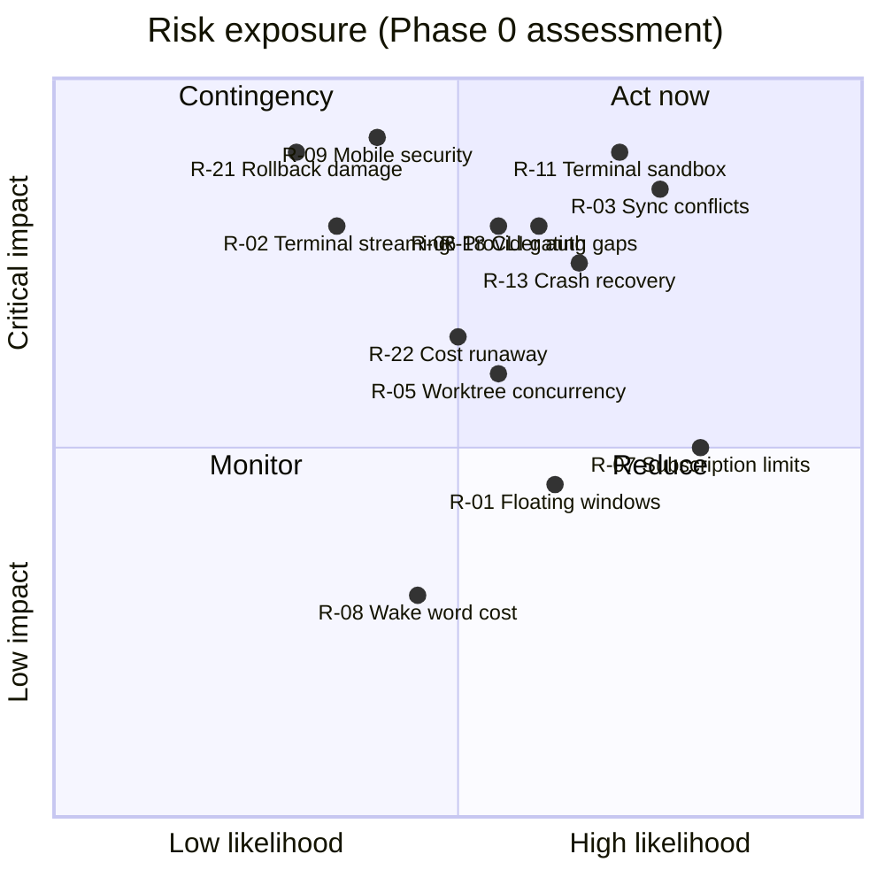

# Risk Register (§62 + risks found in the Phase 0 review)

| | |
|---|---|
| Owner | Architecture (reviewed at every milestone exit, `roadmap/mvp-milestones.md`) |
| Scale | **Likelihood** L/M/H (≤ 20% / 20–60% / > 60%) · **Impact** L/M/H/C (C = critical: data loss, security breach, or the product cannot ship) · **Score** = L×I with L=1, M=2, H=3, C=4 |
| Rule | §62: every high-risk item has an ADR or a spike. Risks scoring ≥ 6 are reviewed weekly while their phase is active. A risk closes only when its spike passes **and** the mitigation is implemented |
| Conflict rule | §70: data safety > recoverability > correctness > … > animations |

## Heat map

## §62 risks (1–14)

| ID | Risk (§62.n) | L | I | Score | Phase | Mitigation | Spike / ADR | Early-warning trigger | Status |
|---|---|---|---|---|---|---|---|---|---|
| R-01 | Tauri floating/transparent windows on 3 OSes (§62.1) | H | M | 6 | 0 → 3 | Separate small windows with per-pixel click-through via cursor hit-testing; budget of 6 visible robots; fallback B (per-monitor overlay) and D (docked robots); Wayland degraded mode documented | SP-04, SP-01 · ADR-0016, ADR-0003 | SP-04 memory > 40 MB per window or click-through flip > 50 ms | Open |
| R-02 | Secure terminal streaming (§62.2) | M | C | 8 | 1 (local), 4 (remote) | Terminal only through authenticated RPC (no raw port, §64); loopback bind; constant-time token; agent PTYs line-gated; per-session actor capability check (RR-P7); redaction; remote terminal behind gateway with per-device scope + recent MFA | SP-03, SP-14, SP-19 · ADR-0014, ADR-0005 | Any code path writing to a PTY without `TerminalManager` checks (code review grep); a 0.0.0.0 bind | Open |
| R-03 | Live sync conflict resolution (§62.3) | H | C | 12 | 4 | Deferred behind `SyncBackend`; rows carry `rev`/`origin_device_id` from P1; single-authority rule for task state; content-addressed snapshots for files; conflicts surfaced, never silently resolved | SP-20 · ADR-0019, ADR-0031 (planned) | Phase 4 design review finds an entity without `rev` | Open (deferred) |
| R-04 | Git + live sync interaction (§62.4) | M | H | 6 | 4 | Git ≠ sync (§41): sync carries snapshots, never `.git` internals or auto-commits; refs move only by explicit push; worktrees excluded from sync | SP-20 · ADR-0019, ADR-0021 | Any proposal to sync `.git` directories | Open (deferred) |
| R-05 | Worktree concurrency (§62.5) | M | H | 6 | 1–2 | Per-repo mutation lock; `GIT_OPTIONAL_LOCKS=0` for reads; `merge-tree` conflict prediction; file-overlap-aware scheduling; startup reconciliation and stale-lock recovery | SP-10 · ADR-0008, ADR-0009 | `index.lock` errors in logs; SP-10 failures | Open |
| R-06 | Provider auth restrictions (§62.6) | M | C | 8 | 0–1 | Official mechanisms only; never read CLI token files; ToS matrix with dates (SP-08); adapters pinned to tested CLI versions; a ToS change disables the adapter, not the product (other providers stay) | SP-06, SP-07, SP-08 · ADR-0012 | Provider ToS/doc change; CLI version outside the tested range | Open |
| R-07 | Subscription-login limitations (§62.7) | H | M | 6 | 1 | Usage limits treated as `QuotaExceeded` → fallback chain (§63B); subscription providers marked `costModel: Subscription`; concurrency of 2 per CLI provider; user-visible limit state | SP-06, SP-07, SP-08 · ADR-0012 | Frequent `QuotaExceeded` in telemetry (local) | Open |
| R-08 | Wake-word battery/CPU (§62.8) | M | M | 4 | 3 | Off by default; push-to-talk default; VAD gate; paused on battery and Battery Saver; local only | SP-15 · ADR-0017 | SP-15 CPU > 2% of one core | Open |
| R-09 | Mobile remote security (§62.9) | M | C | 8 | 4–5 | No direct exposure of core; gateway with TLS, MFA/passkeys, device authorization, revoke, rate limits, audit; approvals from mobile need device binding + biometric; emergency kill switch local-first | SP-19 · ADR-0030 (planned) | Threat model finds an unauthenticated path | Open (deferred) |
| R-10 | Node task migration (§62.10) | M | M | 4 | 6 | Logical migration only (checkpoint + handoff + snapshot), never process migration (§39); idempotent resume; single owner per task | SP-21 · ADR-0033 (planned), ADR-0022 | Duplicate execution in SP-21 | Open (deferred) |
| R-11 | Sandboxing terminal commands (§62.11) | H | C | 12 | 1–2 | PermissionEngine + Dangerous Action Guard (Forbidden/Dangerous/Unknown classes) with ≥ 150 cases; worktree confinement; snapshots before autonomous runs; Unknown asks in SemiAuto; OS-level sandbox evaluated (Job Objects/restricted tokens, sandbox-exec, bubblewrap/landlock) for P2 | SP-17 · ADR-0010, ADR-0014 | Guard corpus regression; a reported bypass | Open |
| R-12 | Cross-platform Computer Control (§62.12) | H | M | 6 | 7 | Capability Deny-by-default; isolated in `PlatformAdapter`; not in Phases 1–3 | SP-22 · ADR-0035 (planned) | — | Open (deferred) |
| R-13 | Crash recovery (§62.13) | H | H | 9 | 1 | Atomic state + event writes; session clean-shutdown flag; `Interrupted` via privileged edges (CA-2); Job Objects/PDEATHSIG so no orphans; snapshots of dirty worktrees at recovery; resume summary | SP-13, SP-11 · ADR-0022, ADR-0018, ADR-0004 | Orphan processes after kill; integrity_check failures; tasks stuck in `Running` after restart | Open |
| R-14 | Sync of uncommitted state (§62.14) | M | H | 6 | 1 (local), 4 | Snapshots capture uncommitted + untracked state locally (P1); P4 syncs snapshot manifests + encrypted chunks, not working trees | SP-16, SP-20 · ADR-0021, ADR-0019 | SP-16 misses a file class (CRLF, renames, modes) | Open |

## Additional risks (identified in Phase 0 review)

| ID | Risk | L | I | Score | Phase | Mitigation | Spike / ADR | Early-warning trigger | Status |
|---|---|---|---|---|---|---|---|---|---|
| R-15 | Windows path length and Defender scanning slow or break worktrees | M | M | 4 | 1 | Short worktree paths under `<data_dir>/worktrees`; `core.longpaths`; measured with Defender on; optional exclusion documented (never automatic) | SP-10 · ADR-0009 | Worktree add > 5 s; `Filename too long` errors | Open |
| R-16 | SQLite single-writer contention or event-log growth | L | H | 3 | 1 | Ephemeral classes for high-rate streams; batching; retention and compaction; benchmarks in CI nightly | SP-12 · ADR-0007, ADR-0018 | p99 write > 20 ms; DB > 1 GB in 30 days of normal use | Open |
| R-17 | Protocol drift between Rust and TS (ts-rs limits: bigint, flatten) | M | M | 4 | 1 | Generated files committed + drift check; `bigint` ban test; method map test; no untagged enums | SP-14 · ADR-0006 | CI drift failure; runtime parse errors in client | Open |
| R-18 | CLI coding agents bypass per-call permission gating | H | H | 9 | 1 | Claude Code `--permission-prompt-tool` bridge; Codex launch-time gating + CLI sandbox + snapshot + post-hoc audit; gating badge in UI; FullAuto refused without opt-in; downgrade if SP-06/07 fail | SP-06, SP-07 · ADR-0012, ADR-0010 (RR-C8) | A denied action still takes effect in SP-06/07 deny tests | Open |
| R-19 | OS keyring unavailable or limited (headless Linux, blob size, macOS prompts) | M | M | 4 | 1 | Encrypted vault fallback (keyring-wrapped or Argon2id passphrase); size routing; memory backend for tests only | SP-18 · ADR-0011 | Keyring errors at onboarding | Open |
| R-20 | AI-editable UI produces unusable or unsafe UI | M | M | 4 | 3 | Typed schema, path allowlist, contrast and invariant validation, preview with auto-revert, versions, safe mode | ADR-0015 | Rejected patches > 30% in evaluation | Open |
| R-21 | Rollback destroys unrelated changes (§25, §63J) | L | C | 4 | 1 | Hash-based 3-way check per file; conflicts never overwritten; pre-rollback snapshot; workspace rollback always asks | SP-16 · ADR-0021 | Any SP-16 case modifying an unrelated file | Open |
| R-22 | Runaway autonomous loops or cost (§64 "uncontrolled autonomous loops") | M | H | 6 | 1–2 | Hard maxTurns, time and cost per task; budgets per project; `budget_exceeded` blocks new calls; self-heal max attempts; emergency stop independent of providers | ADR-0010, ADR-0012 · milestones M1.4, M2.3 | BudgetThreshold exceeded events per day; loops hitting max attempts | Open |
| R-23 | Webview engine divergence (WebView2 / WKWebView / WebKitGTK) breaks visuals or Monaco | M | M | 4 | 1–3 | Effects degrade via Performance Mode; SP-01/SP-02 on all three; CI vite build + Playwright smoke against WebKit (Phase 3) | SP-01, SP-02 · ADR-0003 | Visual regressions on macOS/Linux | Open |
| R-24 | Scope overload: Phases 1–3 carry many features plus the RR additions | H | H | 9 | 1–3 | Milestone gates; "Arch" level allowed for non-core items; security baseline is the only non-negotiable add; traceability reviewed at each milestone | `roadmap/mvp-milestones.md`, `roadmap/feature-traceability.md` | Milestone slip > 30% | Open |
| R-25 | Third-party CLI or provider API changes break adapters silently | H | M | 6 | 1+ | Version pinning, `--version` checks, recorded JSONL fixtures in contract tests, loud `provider_error` on unknown stream events | SP-06, SP-07 · ADR-0012 | Unknown event types in stream parse | Open |
| R-26 | Single-maintainer libraries (dockview, portable-pty) stall | L | M | 2 | 1–3 | Wrap behind thin shell modules (ADR-0013); portable-pty is pure Rust and small enough to vendor if needed | ADR-0013, ADR-0014 | No release in 12 months plus open blocking bugs | Open |

## Review log

| Date | Milestone | Changes |
|---|---|---|
| 2026-10-02 | M0.1 | Initial register: R-01…R-14 from §62, R-15…R-26 from the requirements review |
| 2026-10-02 | M0.3 (foundation built) | Doc–code review. **R-16:** every `Log` event at `INFO`+ is persisted and no retention job exists yet, so event-log growth is now a real early-warning item (watch DB size; ADR-0018 retention is a Phase 1 must). **R-17:** ts-rs flatten of `EventKind` and number-typed 64-bit ints verified (`TS_RS_LARGE_INT`); no CI drift check yet. **R-13:** crash detection works (`session.lock`), but no recovery hooks are registered and the pid liveness check has no start-time guard (pid reuse can block startup with `AlreadyRunning`). **R-02** (and threat-model R-12): loopback + `Host` check + constant-time token implemented; `Origin` allowlist (SR-03) still missing. Statuses unchanged (all Open). |
