# MVP Milestones (§65 deliverable #22)

| | |
|---|---|
| Source | §61 (roadmap), §63 (acceptance scenarios), §66 (order of work), §58 (quality gates), `../requirements-review.md` (re-phasing decisions) |
| Scope | Phase 0–3 broken down into milestones with exit criteria; Phase 4, 5, 6 and 7 status in the table below |
| Rule | A milestone is **done** only when every exit criterion is demonstrated: automated test, recorded demo, or measured number in a report. Stubs for later phases must return the explicit unimplemented-feature error (RR-G14; as built `bad_request` with `data.unimplementedFeature`) and be marked in `feature-traceability.md`. |

**Definition of Done for every milestone** (§58, §60):
- `cargo clippy --workspace -- -D warnings` and `cargo test --workspace` are green on Windows. `cargo check` is green on macOS and Linux (RR-C9).
- `npm run typecheck`, `npm run lint` and `npm test --workspaces` are green.
- Generated protocol types are up to date (ADR-0006 drift check).
- New migrations have up/down round-trip tests.
- Critical security, orchestration and state logic has unit tests (§60.9).
- Docs are updated: the ADR if a decision changed, the traceability row, and the API method list.
- No secrets in logs. This is checked by the redaction test fixture.

## Final state of Phases 0–3 (2026-10-07, after the audit)

**Phase 7 (Ecosystem)**: signed plugins in a wasmtime sandbox with grants,
a kill switch and safe mode; signed marketplace registries (official,
directory, self-hosted gateway) with publisher key pinning and revocation;
the Widget SDK and Dashboard Builder; environments and deployments (local
targets live, cloud adapters request-shape verified, guarded production
deploys, rollback); the infrastructure monitor; and the Bug Detective with
two human gates (ADR-0034, ADR-0040, ADR-0041, ADR-0042). Acceptance:
<!-- P7-ACCEPTANCE -->91/91<!-- /P7-ACCEPTANCE --> (`scripts/smoke/phase7-acceptance.mjs`; packaged-app dashboard walkthrough 21/21;
details and the deferred list in `feature-traceability.md` → "Phase 7
acceptance check").

**Phase 6 (Multi-node)**: a coordinator core places jobs on enrolled
worker cores through the gateway (E2E, pull heartbeat, leases with fencing),
migrates them with checkpoints, distributes local models, and shows it all
in the desktop Nodes panel (ADR-0033, ADR-0039). Acceptance:
<!-- P6-ACCEPTANCE -->47/47 checks on 2026-10-22<!-- /P6-ACCEPTANCE --> (`scripts/smoke/phase6-acceptance.mjs`;
details and the deferred list in `feature-traceability.md` → "Phase 6
acceptance check").

**Phase 5 (Mobile) closed on 2026-10-22** for Android:
`apps/mobile` (Expo SDK 58 / React Native 0.88) runs on the Android emulator
and covers scenario E (mobile approval with biometric step-up and native
push). Acceptance: <!-- P5-ACCEPTANCE --> Node lane 44/44 / Android lane 11/11 (emulator orkestr_pixel, incl. fingerprint step-up)
<!-- /P5-ACCEPTANCE --> (`scripts/smoke/phase5-acceptance.mjs`,
`scripts/smoke/phase5-android.mjs`; details and the deferred list in
`feature-traceability.md` → "Phase 5 acceptance check").

**Phase 4 (Remote & Sync) closed on 2026-10-22** for the self-hosted MVP:
`scripts/smoke/phase4-acceptance.mjs` passes 40/40 (scenario D — secure remote
access through the gateway and the web client; scenario C — encrypted sync and
Seamless Continue between two cores). Verification on `main` after the Phase 4
merge: fmt and clippy clean, `cargo test --workspace` 2309 passed, 8 ignored, `npm test`
1190 tests, `npm run typecheck` and `npm run build` pass, and the Phase 1–3
acceptance scripts still pass (Phase 1 45/45, Phase 2 46/46 with `--no-shots`, Phase 3 64/64 with `--no-shots`).

Phases 0–3 are closed on Windows. Two audit rounds confirmed 157 findings and
all of them were fixed (3 critical, 30 high, 79 medium, 45 low;
[`../audit/phase0-3-audit.md`](../audit/phase0-3-audit.md)). Final
verification on `main`:
- `cargo fmt --check` and clippy `--workspace --all-targets -D warnings` are clean.
- `cargo test --workspace`: 1907 passed, 2 ignored.
- `npm run gen:protocol` (no diff), `npm run typecheck`, `npm test` (947 tests) and `npm run build` pass.
- Smoke and acceptance scripts: Phase 1 smoke 38/38, Phase 1 acceptance 45/45, Phase 2 acceptance 47/47, Phase 3 acceptance 64/64.
- All eight screenshot scripts pass, and the screenshots in `docs/screenshots/` were captured on this build.

| Phase | State | Fully delivered | Partial / not measured | Not built (architecture-only or deferred) |
|---|---|---|---|---|
| 0 Architecture & spikes | **Partly met** | All §65 deliverables, the ADRs, the traceability map and the foundation skeleton (the M0.3 gaps were closed in Phase 1: Mock provider, `tasks.*` RPC with `invalid_transition`) | CA-1…CA-14 not formally accepted or rejected | Most spike reports (SP-02…SP-11, SP-15…SP-18) were never written; the M0.4 gate was formally not met, and the later phases answered the functional questions in code and tests |
| 1 Desktop core MVP | **Complete** (45/45) | Shell, projects, Manager, provider hub, manual and dynamic agents, files, Git and worktrees, tasks, memory, approvals, guard, snapshots, emergency stop, crash recovery, onboarding, palette, tray | Terminal (no take-control or scrollback snapshots), Monaco (no LSP), snapshot GC and benchmarks, budgets for CLI agents checked after the run | Signed installer, auto-update, CI matrix |
| 2 Multi-agent quality | **Acceptance passed with Mock providers** (47/47) | Teams and hierarchy, scheduler, quality pipeline + Self-Healing, reviews, consensus, adversarial review, Merge Manager, AI PM, architecture map, Decision Log, Replay, benchmarks, global search, project privacy | Merge Manager (no revert proposals), Knowledge Base (no PDF or URL ingestion); the M2.1, M2.5 and M2.6 numeric evals were not run; real providers not exercised | **M2.7**: MCP Hub, Environment Manager, LSP bridge, `orkestrd` hand-off; Browser agent (deferred to Phase 4) |
| 3 Visual OS | **Delivered for Windows** (64/64; G and H pass) | Themes + editor, layouts + editor, Robot Designer, HUD, voice notifications, voice per agent, performance modes, sound engine | Mission Control and task graph (performance not measured), robots (CPU/RAM budget, Wayland), voice (no local Whisper, no real microphone), wake word (SP-15 budgets), AI-UI (no contrast rejection or `--safe-ui`), docking / multi-monitor (restore on a second monitor not verified), autostart after a reboot | macOS and Linux packages |
| 4 Remote & Sync | **Complete for the self-hosted MVP** (40/40, 2026-10-22: scenarios D and C) | Self-hosted gateway (passkeys + TOTP, CIK-signed tunnel, pairing with codeMac + SAS, `e2e-v1`, roles + MethodPolicy, step-up, revoke, kill switch, rate limits, audit); web client (sign-in, pairing, projects, tasks, approvals with step-up, remote terminal, editor, en/ru); encrypted working-tree sync with Seamless Continue, conflict copies and an offline outbox; Web Push (RFC 8291 + VAPID); desktop Remote & Sync settings | Web editor is a textarea; sync covers the working tree + `records:` only (no events / snapshots / artifacts streams, no 3-way merge); Web Push verified with a local mock endpoint only | Deferred with reasons in ADR-0030/0031/0036: mTLS/CA (replaced by the CIK-signed tunnel), TLS/ACME (run behind a TLS proxy), device-code flow, admin-device approval, DPoP; PostgreSQL/S3 and multi-instance; HPKE conformance, recovery key, key rotation; PWA signature/SRI; container image. Phase 4b (not started): M4.5/M4.6, OTLP, Visual Browser Agent (#17) |
| 5 Mobile | **Complete for Android** (scenario E; acceptance: see `feature-traceability.md`) | `apps/mobile` Expo/RN dev build: TOTP login, cores list, QR / deep-link pairing with SAS, monitoring, Emergency Stop + remote kill switch, approvals with biometric step-up (`orkestr-native-v1`, ADR-0038), Manager chat, voice through core `voice.transcribe` + shared intent parser, quick review (tasks, diff, logs), devices + revoke, settings, en/ru; `nobleCrypto` provider behind the `RemoteCrypto` seam; native push FCM HTTP v1 + APNs with AES-256-GCM payloads (ADR-0037); local notifications while connected | Editor is a textarea; keys are SecureStore-wrapped software keys (not hardware non-exportable); FCM/APNs verified with mock servers only; lock-screen alert always generic | Deferred with reasons in ADR-0032/0037/0038: iOS build (needs macOS + Xcode), real FCM/APNs delivery, passkey login on mobile, on-device STT and wake word, background decryption (detailed lock screen, approve from notification), hardware non-exportable keys, DPoP, admin-device approval; multi-node is Phase 6 |
| 6 Multi-node | **Complete for the simulated cluster** (scenario F; acceptance: see `feature-traceability.md`) | Node enrollment via `kind: "node"` pairing with SAS + trust levels (restricted / standard / trusted), revoke, drain, policy; registry with health Online / Suspect / Offline / Draining / Revoked; gateway-relayed core-to-core E2E with the P-256 CIK; pull heartbeat + leases with epochs and fencing; deterministic scheduler with stored explanations; `command` and `agentTask` jobs (Mock / Ollama); checkpoints (git bundle, dirty tree, handoff, agent state, side-effect log) as content-addressed blobs; planned + unplanned migration; side effects → `needs_user_decision`; coordinator-signed policy snapshots; local model store + `models.distribute` + Ollama adapter; emergency stop on all nodes; desktop Nodes panel (en/ru) | macOS node is profile-simulated (`ORKESTR_NODE_PROFILE` + fake `xcodebuild`); GPU node simulated in acceptance (real `nvidia-smi` detection informational) | Deferred with reasons in ADR-0033/0039: HPKE per-job secrets, preemption, `service` jobs, LAN mTLS, coordinator failover, portable Claude Code / Codex sessions, mobile / web node UI, sync chunk store for checkpoints |
| 7 Ecosystem | **Complete for local targets and self-hosted registries** (acceptance: see `feature-traceability.md`) | Plugin SDK: signed `.orkp`, trust store, wasmtime 50 ABI v1 sandbox (fuel, epoch deadline, memory cap, quarantine after 3 traps), host API with grants as permission rules + audit, kill switch, safe mode, agent tools `plugin_*`, Rust guest SDK, event subscriptions (`subscribes`) and DeploymentProvider plugins, plugin management in the Marketplace panel (grants, logs, kill all, safe mode, install from file, Publish tab); Marketplace: official / directory / gateway registries, registry key TOFU, publisher trust + per-package pin, revocation, publish / revoke, Marketplace panel; Widget SDK (iframe sandbox + CSP, `orkestr-widget` scheme) + Dashboard Builder; environments + deployments (StaticSite, LocalProcess, Docker when present; guard approvals, redacted logs, rollback), Deployments panel; infra monitor (metrics, checks with hysteresis, log sources, alerts; alert rules and file log sources editable over RPC + UI); Bug Detective (evidence, hypothesis, reproduction, gated fix and merge, budget; settings over RPC + UI); dashboard walkthrough in the packaged app | Vercel / Netlify / Fly / Kubernetes verified against a fake API only; monitor logs memory-only, no GPU utilisation; no plugin packaging CLI | Deferred with reasons in ADR-0034/0040/0041/0042: JS plugins, Provider / Panel kinds, auto-update, widget network, AWS / GCP / Azure / Cloudflare, live cloud runs, container sandbox for deploys, GitHub PRs, hosted marketplace, APM ingestion, mobile / web dashboards, Computer Control (ADR-0035) |

The delivered level of every §68 item is in `feature-traceability.md`. As
of the final audit, 41 items are Full, 22 Partial, 16 architecture-only and
3 not addressed.

```mermaid
flowchart LR
  subgraph P0["Phase 0 — Architecture & Risk Spikes"]
    M01["M0.1 Requirements + ADRs"] --> M02[M0.2 Architecture deliverables]
    M01 --> M03[M0.3 Foundation skeleton]
    M03 --> M04[M0.4 Spikes]
  end
  subgraph P1["Phase 1 — Windows Desktop Core MVP"]
    M11["M1.1 Workspace & CI"] --> M12[M1.2 Core runtime]
    M12 --> M13[M1.3 Desktop shell]
    M12 --> M14[M1.4 Security baseline ★gate]
    M14 --> M15[M1.5 Provider hub]
    M14 --> M16[M1.6 Workspace tools]
    M15 --> M17["M1.7 Agents, tasks, Manager"]
    M16 --> M17
    M17 --> M18["M1.8 Memory, snapshots, cost, release"]
  end
  subgraph P2["Phase 2 — Multi-Agent Quality"]
    M21[M2.1 Parallel scheduler] --> M22["M2.2 Teams & hierarchy"]
    M21 --> M23["M2.3 Review/test/self-heal"]
    M23 --> M24[M2.4 Merge Manager]
    M23 --> M25["M2.5 Consensus & adversarial"]
    M21 --> M26["M2.6 Context, decisions, replay, analytics"]
    M26 --> M27["M2.7 Background, MCP, envs, LSP"]
  end
  subgraph P3["Phase 3 — Visual OS"]
    M31["M3.1 Mission Control & task graph"] --> M35["M3.5 HUD, multi-monitor, tray"]
    M32["M3.2 Theme/Layout editor, AI-editable UI"] --> M33["M3.3 Floating robots & designer"]
    M33 --> M34["M3.4 Voice & sound"]
    M34 --> M35
    M35 --> M36["M3.6 Performance modes & cross-OS hardening"]
  end
  M04 --> M11
  M18 --> M21
  M27 --> M31
  M27 --> M32
```

---

## Phase 0: Architecture and Risk Spikes

### M0.1 Requirements review + ADRs
- **Scope:** `docs/requirements-review.md`, `docs/adr/0001…0022`, `docs/spikes/README.md`, this file, `docs/roadmap/feature-traceability.md`, `docs/risks.md`.
- **Exit criteria:**
  - every §62 risk has a spike or ADR (see `risks.md`);
  - every §68 item is mapped (see traceability);
  - contract ambiguities CA-1…CA-14 are handed to the integrator, with each accepted or rejected in writing.
- **Status (2026-10-02):** documents exist; every §62 risk and §68 item is mapped. CA-1…CA-14 are **not** yet accepted/rejected in the contract; `../requirements-review.md` §5.1 records what the foundation code did with each.

### M0.2 Architecture deliverables (§65 #1–#19)
- **Scope:** system context, container and component diagrams; data model (§51); event model; provider adapter spec; agent runtime spec; task state machine; permission model; threat model (local scope in full, remote scope as an outline); sync protocol outline; git/worktree strategy; node protocol outline; remote-access architecture outline; storage, platform and plugin abstractions; shared protocol. Location: `docs/{architecture,security,sync,agents,providers,platform,api}` (§59).
- **Exit criteria:** each deliverable exists, cites the ADRs, and is consistent with the contract (crate names, frames, transitions, capabilities, event kinds). The threat model covers the local RPC token, agent tool abuse, CLI agents, secrets and the supply chain.
- **Status (2026-10-02):** all 22 §65 deliverables exist (index: `../README.md`). A doc–code consistency pass added an "as built" section to the protocol, event model, components, data model, storage, platform and task-state-machine documents and implementation notes to every ADR; remaining design-vs-code gaps are listed there rather than hidden.

### M0.3 Foundation skeleton (§66 step 4)
- **Scope:**
  - cargo + npm monorepo (ADR-0001/0002);
  - `orkestr-domain` entities and ids;
  - `orkestr-protocol` frames, `Event`, methods and ts-rs export;
  - `orkestr-events` bus;
  - `orkestr-storage` DB, migrations and object store;
  - `orkestr-task-engine` state machine;
  - the `ProviderAdapter` trait plus the mock provider;
  - `orkestr-core::start` with the WS RPC and `projects.*`;
  - Tauri shell connecting through `core_connection`;
  - `@orkestr/client`.
- **Exit criteria:**
  - from the desktop, create a project and see a `ProjectCreated` event live;
  - an invalid task transition returns `conflict`/`invalid_transition`;
  - the mock provider streams a reply into a panel;
  - the whole workspace builds from clean on Windows with one command (as built: `npm run build`, which builds the three packages and the desktop frontend; the Rust side is `cargo build --workspace`).
- **Status (2026-10-02): partly met.** Done and verified on Windows: monorepo, domain entities and ids, protocol frames/events/methods with ts-rs export (`npm run gen:protocol`), event bus with persisted log and replay, storage (SQLite, migrations, object store), the task state machine (unit-tested; not reachable over RPC because `tasks.*` is not implemented), `orkestr_core::start` with WS RPC (`system.*`, `projects.*`, `events.replay`), `orkestrd`, the Tauri shell connecting through `core_connection`, `@orkestr/client` — and "create a project from the desktop and see `ProjectCreated` live" (`../spikes/foundation-tauri-websocket.md`). **Not met:** the mock provider (the `ProviderAdapter` trait exists, no adapter), the invalid-transition RPC exit criterion, and a single command building Rust + TS together.

### M0.4 Spikes
- **Scope:** SP-01…SP-18 (`../spikes/README.md`). SP-15 is a desk study only.
- **Exit criteria:**
  - each spike report exists with a verdict;
  - every `Fail` has a superseding ADR or a re-phasing decision recorded here;
  - **Phase 1 cannot start until** SP-01, SP-03, SP-10, SP-12, SP-13, SP-14 and SP-17 are `Pass` or `Pass with caveats`.
- **Status (2026-10-02):** SP-01, SP-13 and SP-14 are `Foundation part done`, SP-12 `In progress`, all others `Not started` (`../spikes/README.md`). The gate is **not** met.
- **Final (2026-10-07):** unchanged as a formal gate. The spike reports were not written, and Phase 1 started on the strength of the foundation evidence. The functional questions of SP-03, SP-04, SP-05…SP-11, SP-16, SP-17 and SP-18 were answered by the shipped implementation and its tests and acceptance scripts. Their **measured** criteria (throughput, latency, CPU/RAM budgets, cross-OS) remain open.

---

## Phase 1: Windows Desktop Core MVP

Phase 1 delivers, per §61:
- custom desktop shell, projects, Manager, provider hub;
- manual agents and basic dynamic spawn;
- terminal, files, Monaco, Git and worktrees;
- tasks, basic memory, approvals, logs, snapshots.

The requirements review adds the security baseline (RR-C3), onboarding (RR-G7), the command palette (RR-G6), observability (RR-G8), the resume summary (RR-G9), tray mode (RR-C2) and the protocol prerequisites for later phases (RR-P1…P10).

### Status: Phase 1 complete (acceptance 2026-10-02)

Phase 1 was built in two waves: wave A (security, providers, tasks,
vcs/snapshots, terminal, files/editor, memory/context/cost, platform/shell),
then wave B (agent runtime + templates + Agents panel, AI Manager +
Manager panel). The acceptance pass ran the end-to-end script
`scripts/smoke/phase1-acceptance.mjs` against the real desktop app (debug
build, isolated `ORKESTR_HOME`, temp git repo, Mock provider) — **45/45
checks pass** — and reviewed every main view in the running app
(`scripts/smoke/phase1-screenshots.mjs`, screenshots in
`docs/screenshots/phase1/`). `cargo test --workspace`, clippy `-D warnings`,
`cargo fmt --check`, `npm run typecheck`, `npm test` and `npm run build` are
green.

**Acceptance scenario (what the script proves):**
onboarding-equivalent setup (Mock as Manager + agent routing) →
`manager.chat` "Create a hello module with a unit test" → plan card (4 tasks,
dependencies) → `manager.approvePlan` → supervised run: every task
`Ready → Running → (Review|Testing) → Completed`, the two middle tasks in
parallel (`peakParallel 2`, overlapping windows), one git worktree per agent
on `agent/<role>-<id>` (checked with `git worktree list`), files written and
committed on the agent branches, the main checkout untouched, QA runs
`node --test`, final report with merge proposals → a dangerous command
(`git clean -fd`) parks the agent and its task in `Waiting` with
`ApprovalRequested`; `approvals.resolve` lets it run and finish → each task
has before/after checkpoints; `snapshots.rollbackTask` (confirm-gated)
restores the pre-task state and leaves an unrelated file the user edited
afterwards untouched (§63 J) → `emergency.stopAll` stops a live run (run and
all its tasks `Cancelled`, no live agent) → the process is killed mid-run;
after a restart the in-flight task and the run are `Interrupted`, no agent is
left active and `manager.resumeSummary` reports the session.

**§61 Phase 1 list — delivery state**

| §61 item | State | Notes / remaining gaps |
|---|---|---|
| Custom desktop shell | Done | Frameless window, title bar with Approvals + Stop, dockview workspace (Coding preset, maximize panel), palette, tray/close-to-tray, single instance, notifications. Keep-running close dialog, native OS notifications and i18n are open. |
| Projects | Done | Create/import/switch/delete, per-project approval mode. Switch-time benchmark (< 300 ms) not automated. |
| AI Manager | Done (basic) | Chat with tools, schema-checked plans, plan card (approve/edit/reject), supervised runs with limits, pause/resume/cancel, report, resume summary. No in-flight reply cancel; epic/feature/task only; no automatic review/test loops (Phase 2). |
| Provider hub | Done | All Phase 1 adapters, registry, router, fallback + handoff, health loop, pricing, Settings → AI Providers. Live checks against real APIs/CLIs not part of CI. Per-model concurrency open. |
| Manual agents | Done | 11 official templates + custom/import/export, spawn/stop/pause/resume, live transcript, inline approvals. |
| Basic dynamic spawn | Done | The Manager spawns one agent per ready task within `maxParallelAgents`. |
| Terminal | Done | PTY sessions, gated `terminal.run`, read-only agent command tab. Take-control handover and scrollback snapshots open. |
| Files | Done | Tree, watch, CRUD via RPC, confinement, agent permission checks. |
| Monaco | Done | Tabs, quick open, search, agent change markers. |
| Git / worktrees | Done | Status, diff, log, branches, commit, worktrees list/add/remove; one worktree per agent. Push/fetch and startup worktree reconciliation open; merging is Phase 2. |
| Tasks | Done | State machine, DAG, scheduler, list/board/graph views, crash recovery to `Interrupted`. |
| Basic memory | Done | Project/global memory, FTS search, rules priority, Memory panel; used in agent context. |
| Approvals | Done | Single-use approvals, dangerous-action guard (always Ask), agent waits in `Waiting`. "Remember this decision" open. |
| Logs | Done | Live event stream panel with filters; tracing logs. Log rotation open. |
| Snapshots | Done | Manual, before-change and after-task checkpoints; task and workspace rollback with conflict detection. HEAD/index restore and snapshot GC open. |
| Background service | Partial | `orkestrd` headless/`--background`, discovery, desktop attach, tray. No Windows Job Object supervisor (child processes of a killed core are not reaped by the OS), no `core.lock`. |
| Security engines | Done (baseline) | Permission engine, guard corpus, path confinement, secret vault, audit chain, emergency controls, WS hardening. Passphrase vault mode, `confine()` fuzz test and privacy routing open. |
| Installer / signing (M1.8) | Not done | No signed NSIS/MSI, no auto-update channel. |
| CI (M1.1) | Not done | No CI matrix or dependency-boundary script yet; verification is local. |

| Milestone | State | Still open |
|---|---|---|
| M1.1 Workspace & CI | Not done | CI matrix, dependency-boundary script, lint configs |
| M1.2 Core runtime | Partial | Job Objects (`ProcessSupervisor`), `hello`/`sinceSeq`/idempotency keys, `core.lock`, log rotation |
| M1.3 Desktop shell | Done | keep-running close dialog, native OS notifications, i18n |
| M1.4 Security baseline | Done (baseline) | "remember this decision", passphrase vault, `confine()` fuzz test, privacy routing |
| M1.5 Provider hub | Done | per-model concurrency, CLI per-call permission bridge, live provider checks |
| M1.6 Workspace tools | Done | Take-control handover, scrollback snapshots, worktree reconciliation, push/fetch |
| M1.7 Agents, tasks, Manager | Done | Claude Code/Codex agents: no per-command approval, no pause, cost checked after the run; context compaction, stuck-loop detection |
| M1.8 Memory, snapshots, cost | Partial | HEAD/index restore on rollback, snapshot GC, installer/signing, clean-VM install |

**Fixed during acceptance** (each with a test or an acceptance check):
successful agent tasks had no after-checkpoint, so `snapshots.rollbackTask`
failed for them; an emergency stop left the run's tasks `Running`/`Planned`
on the final run card; a "run completed" notice that raced a new request was
sent to the model after the request (the Mock then planned the notice instead
of the user's goal); the Manager conversation could be squeezed to zero
height and lost its scroll position when the dock re-parented the panel; the
command palette ran a different item than the highlighted one when results
were grouped; finished agents still showed a Stop button; the resume card
floated above Settings and the onboarding dialog; the Tasks/Agents panels
overflowed in a narrow dock column; the task-graph MiniMap was empty; Settings
showed a phantom horizontal scrollbar.

### M1.1 Workspace and CI hardening
- **Scope:**
  - CI matrix: Windows (build and test), macOS and Linux (check and test);
  - `scripts/check-deps` boundary rules (ADR-0001);
  - protocol drift check;
  - `npm ls react` single-version check;
  - Rust and TS lint configs;
  - release signing placeholders (documented, not faked).
- **Exit criteria:**
  - CI fails on a deliberate dependency-direction violation, a stale generated TS file, or a clippy warning;
  - total CI time < 20 min.

### M1.2 Core runtime
- **Scope:**
  - `Db` writer/readers, migrations composed in the CA-9 order, `ObjectStore` (ADR-0007);
  - transactional outbox, persisted seq ceiling and durable/ephemeral/retention classes on top of the Phase 0 `EventBus` + `EventLog` (`SqliteEventLog`) (ADR-0018);
  - WS RPC additions `hello`, `sub`+`sinceSeq`, `ping`, `lagged` and idempotency keys (ADR-0005; `auth`, `req`, `sub`, `unsub` exist since Phase 0);
  - `orkestrd` bin and `core.json`/`core.token` exist since Phase 0; add the `core.lock` OS lock and the embedded-mode token rule (ADR-0004);
  - the recovery routine and `ProcessSupervisor` with a Windows Job Object (ADR-0022);
  - tracing JSON logs with rotation and redaction (RR-G8);
  - `system.*` methods.
- **Exit criteria:**
  - SP-12 and SP-14 numbers are reproduced by automated benchmarks in CI (nightly);
  - a hard kill of the desktop leaves no child processes, and the restart marks tasks `Interrupted` (integration test with a fake long task);
  - `orkestrd` plus the desktop attach works;
  - a log grep for the test secrets finds nothing.

### M1.3 Desktop shell and project workspace
- **Scope:**
  - frameless window, custom title bar with the always-visible **Emergency Stop** and **Approvals** indicator (ADR-0015 invariant);
  - dockview with presets Coding and Focus (ADR-0013);
  - `@orkestr/ui` tokens and theme engine (dark and light built-ins, Performance and Balanced modes);
  - panel registry with "Available in Phase N" placeholders;
  - Projects (create, import a git repo, switch instantly, delete with confirmation; §13);
  - onboarding steps 1–8 (RR-G7, RR-A8);
  - command palette (RR-G6);
  - tray with "keep running" (RR-C2);
  - single instance (RR-G17).
- **Exit criteria:**
  - switching between 5 open projects < 300 ms to interactive;
  - closing with running tasks shows the keep-running dialog;
  - the UI never calls Tauri for business data (a lint rule forbids `invoke(` outside `src/shell/`);
  - keyboard-only navigation of the palette and onboarding.

### M1.4 Security baseline (**release gate**, RR-C3)
- **Scope:**
  - `PermissionEngine` (scopes, mode matrix, rules JSON, versioned rules);
  - `DangerousActionGuard` (≥ 150 cases) and path confinement (ADR-0010);
  - approvals flow and the Approvals panel (resolve with remember-scope);
  - `SecretStore` with keyring + vault, Lock Vault and redactor (ADR-0011);
  - emergency `stopAll`/`stopProject`/`agents.stop`, *Disable Full Auto* and *Disable Network Tools* (§52);
  - `audit_events`;
  - budget limits per task and project, with the `budget_exceeded` behaviour (RR-G4);
  - privacy policy routing for `localOnly`/`selectedProviders` (RR-G5).
- **Exit criteria:**
  - the guard corpus test passes, including obfuscation cases;
  - a fuzz test on `confine()` (10k random paths with `..`, UNC, `\\?\`, ADS, symlinks) finds no escape;
  - in FullAuto, `git push --force` from an agent still produces an approval;
  - emergency stop terminates 5 running fake agents and their children in < 2 s with the network disabled;
  - the data dir contains no plaintext secret (scripted grep);
  - an agent in project A cannot resolve a project-B secret (test, §67).

### M1.5 Provider hub
- **Scope:**
  - adapters: mock, OpenAI API, Anthropic API, Gemini, DeepSeek, OpenAI-compatible/custom, Ollama, Claude Code CLI, Codex CLI (ADR-0012);
  - Providers panel: configure, test, model list, health, auth state, "Sign in via CLI" terminal;
  - router with a manual fallback chain plus `ProviderFallback` and handoff;
  - per-provider concurrency (RR-G16);
  - usage records (tokens and cost) in `orkestr-cost`.
- **Exit criteria:**
  - the same agent conversation test passes against mock, OpenAI-compatible (fake server) and Ollama with no change to agent-runtime (§67);
  - scenario **B** (§63B): a provider returning 429 falls back to the next provider with an event visible to the user and the task completed;
  - CLI adapters show their gating level badge (perCall/launchTime);
  - Codex is refused in FullAuto without the per-project opt-in;
  - no credential file is read (SP-06/07 method repeated as a test where feasible).

### M1.6 Workspace tools
- **Scope:**
  - Files panel: tree, watch, create/rename/delete through RPC with permission for agents; user ops are local-trusted, with Delete confirmation;
  - Code panel: Monaco with tabs, diff, Git decorations, agent change markers, "open in external IDE";
  - Terminal panel: multiple sessions, user- and agent-owned, shell detection, scrollback snapshot, `execLine` gating (ADR-0014);
  - Git panel: status, diff, branches, log, worktrees list (ADR-0008);
  - worktree lifecycle and reconciliation (ADR-0009).
- **Exit criteria:**
  - edit → save → git status → diff round-trip in < 500 ms on a 50k-file repo;
  - an agent's raw `terminal.write` is rejected;
  - shells detected on RM: pwsh, powershell, cmd, Git Bash, WSL (when installed);
  - an agent worktree is created, listed, and removed only after a snapshot when dirty.

### M1.7 Agents, tasks and Manager
- **Scope:**
  - agent templates: built-in roles (§6, the Architect…Custom list, with prompts, tools and default permissions) plus custom, import/export JSON;
  - manual spawn, stop and send;
  - agent runtime tool loop with tools `read_file`, `write_file`, `list_dir`, `search` (ripgrep through `grep` crate), `run_command`, `git_status`, `git_diff` and `git_commit` (agent branch only), all through the PermissionEngine;
  - budgets and `maxTurns`;
  - task engine with DAG dependencies, priority queue (single-node, `maxParallelAgents`) and crash-recovery edges;
  - **Manager:** choose provider/model (§5) → chat → `manager.plan` produces tasks with dependencies → user approves the plan → basic dynamic spawn (RR-A7);
  - Tasks panel (list plus a simple DAG view using @xyflow/react, read-only), Agents panel, Logs panel (filters by project/task/agent/level).
- **Exit criteria:**
  - a scenario **A-lite**: "add a REST endpoint with tests" produces 2 tasks (backend + tests), 2 agents in separate worktrees, sequential execution, and a result diff visible, using the mock provider deterministically and a real provider manually;
  - every transition in the run matches the contract table (event log audit);
  - an interrupted task resumes manually from its handoff after a restart.

### M1.8 Memory, snapshots, cost and Phase 1 release
- **Scope:**
  - project and global memory (CRUD, FTS search, project rules take priority; §20 basic);
  - Memory panel;
  - snapshots (manual, before task, before dangerous action), task rollback and workspace rollback (ADR-0021);
  - Snapshots panel;
  - cost summary per provider/model/agent/project/task with daily/monthly budgets (§22 basic; Costs panel);
  - resume summary (RR-G9);
  - signed Windows installer (NSIS/MSI) with WebView2 bootstrapper and auto-update channel.
- **Exit criteria:**
  - scenario **J** (§63J) passes as an automated integration test;
  - snapshot capture of 500 changed files < 3 s;
  - the cost panel totals match the usage records exactly;
  - a clean-VM install of Windows 10 22H2 and Windows 11 reaches onboarding without manual steps;
  - **the Phase 1 demo** (record it): onboarding → import repo → Manager plan → 2 agents → approval → snapshot → rollback task → emergency stop.

---

## Phase 2: Multi-Agent Quality

### Status: Phase 2 acceptance passed on Windows with mock providers (2026-10-06). M2.7 and several measured exit criteria are still open

**How it was checked**
- `scripts/smoke/phase2-acceptance.mjs` drives the real desktop app:
  - debug build with the bundled frontend (`--features custom-protocol`);
  - isolated `ORKESTR_HOME`;
  - the Mock (offline demo) provider;
  - a temp git repo with a tiny real npm project (`node --test`).
- Result: **47/47 checks pass**. It passed on two consecutive runs: the second was on the final build, after the visual fixes below.
- Screenshots are in `docs/screenshots/phase2/` (English and Russian, app window only, through WebView2 DevTools), with audit data in `shots.json`.
- These are green: `cargo fmt --check`, clippy `--workspace --all-targets -D warnings`, `cargo test --workspace` (1814 tests), `npm run typecheck`, `npm test` (746 desktop tests) and `npm run build`.

**Scenario results**
- **A-lite (§63A).** Request: "Create a payroll module: architecture review, backend, tests, security review".
  - The plan had Architect, Backend, Product Manager (docs), QA and Security tasks, with dependencies.
  - Agents ran in parallel (at most 2 at once), each in its own `agent/<role>-<id>` worktree.
  - Every task that changed files passed Author → Review → Build → Test → Security.
  - The quality runner really ran `npm run build` and `npm run test` on Windows, through the `cmd.exe` shim path from `8cb59f6`.
  - The injected failing test was parsed from the output (name, `tests/payroll.test.mjs:7`, assertion) and fixed by Self-Healing in 1 attempt.
  - Standard and adversarial reviews finished.
  - One run-wide merge proposal (5 branches, DAG order) asked for approval. After approval it merged into `main`; the repo was checked on disk, and `npm test` passes on the merged `main`.
  - The per-task proposals became `Superseded`, and the pipelines' Merge stage became `Passed`.
- **B (§63B).** A local fake OpenAI-compatible server answers `429 insufficient_quota`.
  - A `ProviderFallback` event fired (fake primary → Mock) and a structured handoff was saved.
  - The fallback model finished the task.
  - The toast "Switched to the fallback model" was shown.
- **J (§63J).** A refactor with `[mock:heal-never]` failed: Self-Healing stopped on "no progress" and the user declined more attempts.
  - `snapshots.rollbackTask` needs confirmation. Its dry run lists only the task's files.
  - The rollback deleted the refactor's files and emitted `RollbackPerformed`.
  - An unrelated user edit in the same worktree survived, and so did one in the main checkout.
- **More checks:**
  - a consensus run (3 participants) created a Decision Log entry with 3 alternatives;
  - the architecture map is non-empty;
  - the replay timeline has Plan, Agents, Tools, Files, Tests, Reviews, Approvals and Merge steps;
  - model and agent benchmarks are populated from the runs;
  - a team was created;
  - an AI PM draft was approved, which created 4 tasks and a Manager plan.

**Fixed during acceptance**
- **Mock provider:** it keeps an existing `package.json` with a `test` script.
- **Quality runner:** a `node --test` parser (spec and TAP).
- **Run supervisor:** no premature "no task can proceed" while a failed agent awaits its retry decision.
- **Agent runtime:** a task stays on the fallback model after a fallback.
- **Adversarial review:** the author's model is the last-resort adversary, and the review is flagged.
- **Merge Manager:** a `MergeCompletedHook`, the `Superseded` status, and a merged pipeline's Merge stage and run report are updated.
- **Rollback Task:** it spans the worktrees of Self-Healing attempts and treats CRLF/LF differences as equal.
- **UI:**
  - the Manager run report;
  - pipeline text in the UI language;
  - the ProviderFallback notification;
  - the Architecture map refits when its canvas is resized;
  - team monograms for acronym roles ("UI");
  - maximize → restore now restores every dock group's size (dockview left the side column at about 90 px);
  - tab labels no longer wrap in narrow panels;
  - benchmark table headers wrap instead of scrolling sideways;
  - task statuses in the Replay state no longer wrap.

**Not met / not verified (honest gaps)**
- §63A was run with the Mock provider, not with real providers. Video recording was not done.
- M2.1 numbers were not measured: 6 parallel agents, the overlap hold-back and CPU throttling.
- M2.5: the adversarial eval set (≥ 4 of 5 seeded bugs) was not run.
- M2.6: the context-pack eval (≥ 90 %) was not run.
- **M2.7 is not built:** no hand off to `orkestrd`, no MCP stdio client, no LSP bridge, and no Dev/Test/Staging/Prod environment manager.
- The Visual Browser agent tool (stretch) is not built.
- Consensus used one model with three perspectives (only Mock was available).
- Dock groups have no minimum width, so a manual resize can still squeeze a panel.

### M2.1 Parallel execution and resource-aware scheduling
- **Scope:**
  - concurrent tasks across worktrees;
  - scheduler inputs: CPU/RAM (sysinfo through `orkestr-node`), provider concurrency, budget, predicted file overlap (ADR-0009);
  - priority aging and preemption of Background tasks (RR-A13);
  - dynamic spawn without plan approval in SemiAuto/FullAuto (RR-A7);
  - cross-project groups (RR-A14).
- **Exit criteria:**
  - 6 parallel mock agents on RM with no git lock errors and no starvation;
  - the scheduler holds back a task whose predicted files overlap a running task;
  - CPU > 90% for 30 s throttles new spawns (test with a synthetic load).

### M2.2 Teams and hierarchy
- **Scope:** `AgentTeam` (ERP, Web, Mobile, Security, Rapid Prototype, custom), Manager → Team Lead → Executors → Reviewers delegation, structured handoff objects (§57), team templates import/export.
- **Exit criteria:** a team template spawns a lead plus executors, the lead delegates subtasks, and the handoffs are stored and viewable.

### M2.3 Review, testing and self-healing pipeline
- **Scope:**
  - Author → Reviewer → Build → Tests → Security/QA pipeline (§17);
  - test command auto-detection (cargo, npm/pnpm/yarn scripts, pytest, go test, dotnet test, lint, typecheck);
  - quality gates (§58) stored per task;
  - self-healing loop with max attempts, time and budget;
  - `Build*`, `TestRunFinished` and `ReviewFinished` events;
  - Browser agent tool (stretch, RR-G12).
- **Exit criteria:**
  - an injected failing test is fixed by the loop within limits on the demo repo;
  - the loop stops at max attempts with `Failed` and a summary;
  - gates are visible on the task.

### M2.4 AI Merge Manager
- **Scope:** merge proposals (ADR-0009 outline), semantic diff summary, conflict prediction, acceptance-criteria check, policy-based auto-merge, revert-commit proposal for merged-task rollback.
- **Exit criteria:**
  - two agents with non-conflicting changes merge automatically under the policy;
  - a conflicting pair produces a proposal with the conflicts listed and nothing merged;
  - a merge into a dirty user branch is refused safely.

### M2.5 Consensus and adversarial review
- **Scope:** consensus mode (N providers propose, the Manager synthesizes, alternatives are stored as a Decision; §8), an adversarial reviewer role that must list concrete findings and never auto-agrees, and a security reviewer (Claude+GPT consensus routing example from §7).
- **Exit criteria:** a consensus run stores alternatives, a summary and the accepted decision; an adversarial review on a seeded-bug diff finds the seeded issues (≥ 4 of 5 in an eval set).

### M2.6 Context optimizer, decision log, replay and analytics
- **Scope:**
  - context optimizer: tree-sitter symbol extraction, relevance ranking, token budgeting (ADR-0024);
  - Decision Log panel;
  - Execution Replay panel (ADR-0018 query by correlation);
  - model benchmarking and agent performance analytics (§22);
  - global search (RR-G6);
  - session resume with automatic recovery (ADR-0022 Phase 2).
- **Exit criteria:**
  - on the demo repo, context packs fit within the budget while keeping the files needed to pass the task in ≥ 90% of the eval tasks;
  - replay of scenario A shows every step of §21's chain;
  - benchmark tables are populated from real runs.

### M2.7 Background service, MCP, environments, LSP
- **Scope:**
  - hand off to `orkestrd` (ADR-0004 Phase 2);
  - "allow other local clients";
  - MCP stdio client plus capability mapping (RR-G10, CA-4);
  - Environment manager with Dev/Test/Staging/Prod and the prod flag feeding the guard (RR-G11);
  - LSP bridge over RPC (RR-A6);
  - retention and GC jobs (RR-G13).
- **Exit criteria:**
  - closing the desktop with "hand off" keeps 2 agents working, and reopening the desktop shows live progress;
  - an MCP filesystem server's tools are gated by the PermissionEngine;
  - rust-analyzer diagnostics appear in Monaco through the bridge.
- **Phase 2 acceptance:** scenario **A** (§63A, multi-agent payroll) in full, with real providers, recorded.

---

## Phase 3: Visual OS

### Status: Phase 3 delivered for Windows (acceptance 2026-10-05). G and H pass; several exit criteria are still open

**How it was built**
- Six areas were built in parallel worktrees:
  - theme engine;
  - layouts / multi-monitor;
  - HUD, performance and AI-UI;
  - Mission Control;
  - robots;
  - voice and sound.
- They were integrated in `138ca8a`.
- An acceptance and visual-QA pass then followed.

**How it was checked**
- `scripts/smoke/phase3-acceptance.mjs` drives the real desktop app:
  - debug build with the bundled frontend;
  - isolated `ORKESTR_HOME`;
  - mock providers;
  - a temp git project named «Schoolify».
- Result: **64/64 checks pass** on the final build. The two runs before it, on the build just before the last CSS and preset fixes, each passed 63/63.
- Screenshots and `acceptance.json` are in `docs/screenshots/phase3/`.
- These are green: `cargo build`, `cargo test --workspace` (1796 tests), clippy `-D warnings`, `cargo fmt --check`, `npm run typecheck`, `npm test` (740 desktop tests) and `npm run build`.
- The architecture is described in `docs/architecture/visual-os.md`.

**Scenario results**
- **H** (§63H): passes.
  1. A Manager run spawns a floating robot window for every agent, and the robots change state during the run (Coding → Reviewing → Completed).
  2. A QA agent completes, and its robot shows the Completed pose with a «Done! ✓» bubble.
  3. A click on the robot opens the agent's result in the Agents panel.
  4. The robot windows are verified to be layered, topmost and click-through (`WS_EX_TRANSPARENT`) while not hovered.
  5. They have fully transparent corners: no box around the robot.
- **G** (§63G): passes **without microphone hardware**.
  1. The transcript «Jarvis, что происходит со Schoolify?» is fed through the post-STT path via a debug-flagged seam.
  2. It resolves to `projectStatus`.
  3. The reply is «Schoolify: … tasks in progress … agent is working … approvals … failing test».
  4. TTS (`speechSynthesis`, stubbed silent) is called with the reply.
  5. `VoiceCommand` records only the transcript.
- **Real speech recognition was not exercised.** The default STT engine is «Disabled», which means typed commands. The other engines are WebSpeech and OpenAI Whisper (cloud, consent).

| Milestone | Delivered | Open (exit criteria not met or not measured) |
|---|---|---|
| M3.1 Mission Control | Live widgets from events: projects, agents, task graph, node CPU/RAM/GPU, provider health, limits, spend, approvals (approve/reject inline), quality-runner builds/tests, reviews & merges, alerts. Customizable arrangement saved per device. | 200-node graph ≥ 50 fps not measured. Charts refresh on an interval policy, not purely event-driven. |
| M3.2 Theme / layout / AI-UI | Six built-in themes; Theme Editor with live preview and WCAG report. Layout presets Coding / Mission Control / Monitoring / Focus / Review / Custom (Ctrl+1…5). Layout Editor. Manager patch → preview → Keep / Revert → Undo with version history. | A patch that lowers contrast is **not rejected** (contrast is only reported). No `--safe-ui` recovery. AI patches change only the global config, not a device override. |
| M3.3 Robots + Robot Designer | Scenario H. States, bubbles, context menu, drag/snap, drop-on-project assignment, overflow cluster. Designer: 2D/3D, skin, material, accent, size, accessories, voice, sounds, behaviour. | Per-robot CPU/RAM vs the SP-04 budget not measured. Linux Wayland fallback not built. Robot windows do not follow the battery / frame-rate auto-downgrade. Robot scale is not taken from the theme. |
| M3.4 Voice + Sound | Push-to-talk, typed HUD, local intent parser (ru/en, fuzzy names), confirmations for destructive intents, local wake word (DTW, opt-in), consent-gated cloud STT/TTS, voice per agent, voice notifications with DND, sound engine cues. | **No local Whisper STT.** Zero-network-before-wake not verified by packet capture. SP-15 budgets not measured. G passed via the transcript seam only. |
| M3.5 HUD, multi-monitor | HUD window (status, agents, build/test chip, approvals, voice indicator, mini Manager). Detach a panel to its own window and re-dock (verified). Layouts and popouts persisted per device with monitor ids. | Restore after an app restart on two monitors not verified (single-monitor host). HUD voice indicator relies on `BroadcastChannel` between windows; the click path is not verified in the running app. Autostart (from Phase 1) not re-verified after a reboot. |
| M3.6 Performance modes, cross-OS | One policy table drives blur, glow, motion, backgrounds, robots, charts and HUD. Battery Saver holds robots still. The policy is verified on `<html>` for all four modes. | UI CPU < 3 % with 5 agents not measured. **No macOS / Linux packaging.** |

**Defects found and fixed in the acceptance pass**
- **Every window mounted two React roots.** The `main.tsx` merge rendered `<App/>` twice. This stacked two shells (the page scrolled, every store and subscription ran twice) and drew the full shell behind the HUD and detached windows. A guard test was added.
- **Command enablement in the palette went stale.** The palette memoized `enabled()` at mount, so a command disabled at startup stayed disabled and Enter silently did nothing. This was flaky: «Open voice commands» was hit by it. A regression test was added.
- **Ctrl+K also reached Monaco**, where it starts a chord.
- **The Coding preset tabbed Code and the Manager into one group**, so only one was ever visible. They are now side by side.
- **The shell could be scrolled away.** `AgentDetail` used `scrollIntoView`, which also scrolled `overflow:hidden` ancestors. The fix scrolls only the transcript, and `.app` now uses `overflow: clip`.
- **Robot speech bubbles shrank to one letter wide** when an old bubble was leaving as a new one arrived.
- **The robot context menu showed the bubble through it.**
- **Translucent overlays let panel text ghost through.** Affected: Settings nav, Theme Editor, Layout Editor, onboarding, AI-UI card and toasts.
- **Each approval produced two toasts that overlapped.** The passive notification toast is now skipped, and security toasts sit at the top-right.
- **The HUD squeezed the project name to «Sc…».** The build/test chip moved to the agents row.
- **«Monitoring» was split mid-word in the Layout Editor.**
- **The Manager run card wrapped its stats into a narrow column.**
- **Mission Control's spend tile was orphaned on a second row.**
- **Approval buttons had no gap between icon and label, and «just now» was truncated.**
- **The AI-UI change list showed raw token ids** («color-bg»).
- **A flaky Git merge-tab test** had too short a `findBy` timeout under load.

**Resolved after acceptance: `npm.ps1` and the execution policy**
- On this Windows host, agent and quality commands that called `npm` failed inside PowerShell, because the default execution policy blocks `npm.ps1`.
- Fixed in `8cb59f6` **without relaxing the execution policy**:
  - the quality runner launches through `cmd.exe`, so `npm` resolves to `npm.cmd`;
  - agent PowerShell commands alias `npm`/`npx` to their `.cmd` shims.
- No `-ExecutionPolicy` argument is passed, and a test checks that.
- The Phase 2 acceptance really runs `npm run build` and `npm run test`.

**Not re-run on the Phase 3 build:** scenarios A, B and J.

### M3.1 Mission Control and visual task graph
- **Scope:** Mission Control preset/panel (§32): projects, active agents, task graph, node resources, provider health, limits, spend, approvals, builds, alerts. An interactive task graph (create, link, reprioritize, open; @xyflow/react), with all actions through RPC.
- **Exit criteria:** a 200-node graph renders at ≥ 50 fps pan/zoom; every tile updates live from events with no polling.

### M3.2 Theme engine, layout editor, AI-editable UI
- **Scope:** Theme Editor and Layout Editor panels (§29), all presets (Coding, Mission Control, Monitoring, Focus, Custom), AI patches with preview, Keep/Revert and history (ADR-0015), safe mode.
- **Exit criteria:**
  - "make the accent purple and move the terminal to the bottom" from the Manager yields a valid patch, a preview, Keep, and a persisted version;
  - a patch that violates contrast is rejected with a reason;
  - `--safe-ui` recovers from a broken config.

### M3.3 Floating robots and Robot Designer
- **Scope:** robots per ADR-0016 (re-run SP-04 on the final build), states from the agent state, speech bubble, context menu (open details, stop agent), drop onto a project to assign, Robot Designer (skin, scale, animations, voice, sounds, behavior) stored in `UiConfig.robots`.
- **Exit criteria:**
  - scenario **H** (§63H): the QA robot completes, plays its animation, shows a bubble, and a click opens the result;
  - per-robot CPU and memory within the SP-04 budget;
  - pass-through behaviour verified;
  - the Linux Wayland fallback works.

### M3.4 Voice Command Center and Sound Engine
- **Scope:** push-to-talk (global hotkey), local STT (whisper), intents to RPC, a wake word (ADR-0017, SP-15 Phase 3 run), TTS voice per agent (§33), voice notifications with DND, Sound Engine events (wake, start, completion, error, approval, deploy, alert), consent records for cloud STT and TTS.
- **Exit criteria:**
  - scenario **G** (§63G) "Jarvis, what is happening with Schoolify?" gives a spoken summary;
  - "stop Thompson Finance" triggers `emergency.stopProject` after confirmation;
  - zero network traffic before the wake (packet capture);
  - SP-15 budgets are met.

### M3.5 HUD/Ambient, multi-monitor, autostart
- **Scope:** HUD mini-Manager, status, voice indicator and approvals (§34); detachable panels to OS windows with per-monitor restore (ADR-0013); per-device layouts; autostart opt-in (ADR-0004 Phase 3); tray HUD.
- **Exit criteria:**
  - code on monitor 1 and Mission Control on monitor 2 survive a restart with the same placement;
  - autostart toggles correctly on Windows and is verified after a reboot.

### M3.6 Performance modes and cross-OS hardening
- **Scope:** Ultra Visual, Balanced, Performance and Battery Saver (§31) wired to effects, robots, wake word and frame rates; GPU/CPU budget tests; macOS (dmg, notarization) and Linux (AppImage, deb, rpm) packaging; `PlatformAdapter` parity for Phase 1–3 features.
- **Exit criteria:**
  - in Performance mode, UI CPU while 5 agents run is < 3%;
  - Battery Saver disables the wake word and animations;
  - macOS and Linux builds pass the Phase 1 demo script.
- **Phase 3 acceptance:** scenarios **G** and **H**, plus a re-run of **A**, **B** and **J** on the Phase 3 build.

---

## Phases 4–7: outline

| Phase | Theme | Key milestones (outline) | Acceptance (§63) | Main ADRs/spikes |
|---|---|---|---|---|
| **4 Remote & Sync** | Web client, secure gateway/relay, MFA/passkeys, device auth and revoke, remote terminal, push channel, cloud/self-hosted storage (Postgres + S3/MinIO), continuous encrypted sync, cross-device continuation, deployments and environments in full, OTLP observability | M4.1 Gateway + device auth · M4.2 Web client (reuses `@orkestr/client`/`ui`) · M4.3 SyncBackend cloud and self-hosted · M4.4 Snapshot/file sync · M4.5 Deployment agents + Infrastructure monitor · M4.6 Bug Detective | C, D, I (offline queue) | ADR-0030, ADR-0031, SP-19, SP-20 |
| **5 Mobile** — delivered for Android 2026-10-22 (see the status table above) | React Native Command Center: Manager chat, voice, approvals, push (§37), quick diff, logs, node status, emergency stop, light editing | M5.1 RN shell + client reuse · M5.2 Approvals + push · M5.3 Voice + quick review | E | ADR-0032, ADR-0037, ADR-0038 |
| **6 Multi-node** | Node registry, resource-aware cross-node scheduling, OS-requirement routing (macOS builds → Mac node), task checkpoint and migration | M6.1 Node protocol · M6.2 Cross-node scheduler · M6.3 Migration | F | ADR-0033, SP-21 |
| **7 Ecosystem** — delivered (see the status table above) | Agent Marketplace, Plugin SDK, Widget SDK, Dashboard Builder, deployment providers, infra monitor, Bug Detective (M4.5/M4.6 moved here); Computer Control deferred | M7.1 Plugin sandbox + SDK · M7.2 Marketplace · M7.3 Widgets/Dashboard · M7.4 Deployments · M7.5 Monitor · M7.6 Bug Detective · (Computer Control deferred) | `phase7-acceptance.mjs` E1–E9 | ADR-0034, ADR-0040, ADR-0041, ADR-0042; ADR-0035 deferred |
