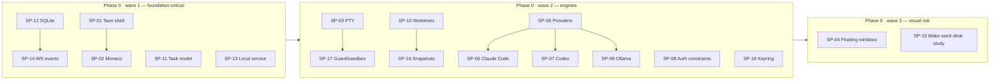

# Technical Spike List (§65 deliverable #21)

A spike is a time-boxed experiment that answers one risky question with **measured evidence**. It covers every Phase 0 spike named in §61 and every high-risk item in §62 ("for each high-risk item an ADR or a spike").

**Rules**
- Each spike writes a report to `docs/spikes/<name>.md` with these sections: *Question, Setup (OS, versions, hardware), Method, Results (numbers, logs), Verdict (Pass / Pass-with-caveats / Fail), Decision impact (ADR confirmed / superseded), Follow-ups*.
- Spike code goes in `spikes/<name>/` (throwaway, not a workspace member) or behind a `#[cfg(feature = "spike")]` flag in the owning crate. It is never merged into product code without review.
- **Reference machine (RM):** Windows 11 23H2+, 8-core x64, 16 GB RAM, NVMe, Defender on. Secondary: macOS 14+ (Apple Silicon) and Ubuntu 24.04 (X11 and Wayland) VMs/hosts.
- **Status values:** `Not started` · `In progress` · `Foundation part done` · `Pass` · `Pass with caveats` · `Fail` · `Deferred (Phase N)`. `Foundation part done` means the Phase 0 foundation work verified the functional core of the spike with recorded evidence (report + automated tests), but the spike's measured success criteria (throughput, latency, cross-OS) are still open; it is **not** a `Pass` and does not satisfy the M0.4 gate on its own.
- A spike is **Pass** only when every success criterion is met with recorded evidence. `Fail` reopens the linked ADR through a superseding ADR (see `../adr/README.md`).

> **Honest status as of 2026-10-02:** one report exists: [`foundation-tauri-websocket.md`](foundation-tauri-websocket.md) (Tauri shell + embedded core + WebSocket event streaming, Windows 11 only). It covers the functional part of SP-01, SP-13 and SP-14 and touches SP-12; their rows below say exactly which criteria it met. The per-spike report files linked in the table do not exist yet. Every other spike is `Not started`.

### What the foundation verified (evidence: the report above, `crates/core/tests/rpc_integration.rs`, unit tests)

| Spike | Verified by the foundation | Still open (keeps the spike from `Pass`) |
|---|---|---|
| SP-01 Tauri shell | Frameless transparent window with custom title bar and drag region; minimal capability set; embedded core reachable from the webview via `core_connection`; dockview with 15 registered panels and a persisted layout | Snap Layouts flyout, vibrancy, Monaco/xterm surviving dock moves, popouts, cold start < 1.5 s (measured: process launch → `core.json` ≈ 2.5 s debug), idle CPU/RAM, macOS/Linux |
| SP-12 SQLite | WAL database, ordered checksummed reversible migrations (`up`/`down` round-trip test), persisted event log with topic-filtered range reads | Every throughput/latency number, kill-cycle integrity checks |
| SP-13 Local service | `orkestrd` discovered through `core.json` and reused by the desktop; stale `core.json` of a dead pid ignored; unclean shutdown detected via `session.lock` and recorded; second core on the same data dir refused (integration test); clean shutdown removes the run files | Child-process containment and kill on crash, task interruption/resume (no hooks yet), 20-run determinism, attach < 500 ms measurement, Linux/macOS, embedded → daemon hand-off |
| SP-14 WebSocket events | Header and first-frame auth (wrong token ⇒ 401 / 4401), req/res, `sub`/`unsub`, live `ProjectCreated` + `Log` streaming to the UI, seq continuity across a restart, ts-rs `Event` flatten narrows on `kind` and contains no `bigint`, client reconnect + resubscribe + `events.replay` without duplicates (vitest) | `hello`, `sinceSeq`, `lagged`, `ping` (not built), the 100-reconnect zero-loss run, p95 latency under load, slow-client behaviour, memory growth |

## Overview

| ID | Name / report | Source | Phase | Timebox | Owner crate(s) | ADR | Risk | Status |
|---|---|---|---|---|---|---|---|---|
| SP-01 | [tauri-shell](tauri-shell.md) | §61 Tauri spike | 0 | 3 d | apps/desktop | 0003, 0013 | R-01 | Foundation part done ([report](foundation-tauri-websocket.md)) |
| SP-02 | [monaco-in-tauri](monaco-in-tauri.md) | §61 Monaco spike | 0 | 2 d | apps/desktop | 0003 | — | Not started |
| SP-03 | [terminal-pty-streaming](terminal-pty-streaming.md) | §61 terminal spike, §62.2 | 0 | 3 d | terminal, core | 0014 | R-02 | Not started |
| SP-04 | [floating-transparent-windows](floating-transparent-windows.md) | §61, §62.1 | 0 (re-run 3) | 4 d | apps/desktop, platform | 0016 | R-01 | Not started |
| SP-05 | [provider-abstraction](provider-abstraction.md) | §61 provider abstraction | 0 | 3 d | providers | 0012 | R-06 | Not started |
| SP-06 | [claude-code-integration](claude-code-integration.md) | §61, §62.6–7 | 0 | 3 d | providers | 0012, 0022 | R-06, R-07, R-18 | Not started |
| SP-07 | [codex-integration](codex-integration.md) | §61, §62.6–7 | 0 | 3 d | providers | 0012 | R-06, R-07, R-18 | Not started |
| SP-08 | [provider-auth-constraints](provider-auth-constraints.md) | §62.6, §62.7 | 0 | 2 d | providers, docs | 0012 | R-06, R-07 | Not started |
| SP-09 | [ollama-integration](ollama-integration.md) | §61 | 0 | 1 d | providers | 0012 | — | Not started |
| SP-10 | [git-worktree-concurrency](git-worktree-concurrency.md) | §61 Git worktree, §62.5 | 0 | 3 d | vcs | 0008, 0009 | R-05, R-15 | Not started |
| SP-11 | [agent-task-model](agent-task-model.md) | §61 agent/task model | 0 | 2 d | task-engine, agent-runtime | 0022 | R-13 | Not started |
| SP-12 | [sqlite-throughput](sqlite-throughput.md) | (storage foundation) | 0 | 1 d | storage | 0007, 0018 | R-16 | In progress (functional only; no measurements) |
| SP-13 | [local-service-and-recovery](local-service-and-recovery.md) | §61 local service, §62.13 | 0 | 3 d | core, platform | 0004, 0022 | R-13 | Foundation part done ([report](foundation-tauri-websocket.md)) |
| SP-14 | [websocket-event-streaming](websocket-event-streaming.md) | §61 WebSocket/event streaming | 0 | 3 d | protocol, events, core, packages/client | 0005, 0006, 0018 | R-02, R-17 | Foundation part done ([report](foundation-tauri-websocket.md)) |
| SP-15 | [wake-word-local](wake-word-local.md) | §62.8 | 0 (desk study) + 3 | 1 d + 4 d | platform, core::voice | 0017 | R-08 | Not started |
| SP-16 | [snapshot-rollback](snapshot-rollback.md) | §62.14 (local part), §63J | 0 | 2 d | snapshots | 0021 | R-14, R-21 | Not started |
| SP-17 | [command-guard-sandbox](command-guard-sandbox.md) | §62.11 | 0 | 3 d | security, terminal, platform | 0010, 0014 | R-11 | Not started |
| SP-18 | [secrets-keyring](secrets-keyring.md) | §24 | 0 | 1 d | security, platform | 0011 | R-19 | Not started |
| SP-19 | [remote-access-threat-model](remote-access-threat-model.md) | §62.9, §62.2 (remote) | 4 prep | 3 d | docs/security | (0030) | R-09, R-02 | Deferred (Phase 4) |
| SP-20 | [sync-conflicts-and-git](sync-conflicts-and-git.md) | §62.3, §62.4, §62.14 | 4 prep | 5 d | sync, snapshots | 0019, (0031) | R-03, R-04, R-14 | Deferred (Phase 4) |
| SP-21 | [node-task-migration](node-task-migration.md) | §62.10 | 6 prep | 4 d | node, orchestrator | (0033) | R-10 | Deferred (Phase 6) |
| SP-22 | [computer-control-cross-platform](computer-control-cross-platform.md) | §62.12 | 7 prep | 4 d | platform | (0035) | R-12 | Deferred (Phase 7) |

---

## Phase 0 spikes: detail

### SP-01 Tauri 2 shell: `tauri-shell`
- **Goal:** prove the Tauri 2 main window meets §28 and hosts the embedded core.
- **Method:**
  1. Frameless window with `data-tauri-drag-region` title bar, custom min/max/close, Win11 Snap Layouts on hover of the custom maximize button.
  2. Acrylic/mica via `window-vibrancy` on Windows; vibrancy on macOS.
  3. Embedded core: `orkestr_core::start` → `core_connection` → webview connects WS.
  4. dockview with 6 panels including a Monaco and an xterm instance; drag them between groups and check that state is kept; dockview popout through a Tauri window.
  5. Measure cold start, idle CPU and RAM.
- **Success criteria:**
  - cold start to interactive < 1.5 s on RM;
  - idle CPU < 1%;
  - main-process private memory < 250 MB with 6 panels;
  - window drag/resize at 60 fps without white flashes;
  - Monaco and xterm survive a dock move with no remount (state preserved);
  - popout opens as a frameless Tauri window connected to the same core;
  - Snap Layouts flyout works (or the caveat is documented).
- **Report:** [tauri-shell.md](tauri-shell.md)

### SP-02 Monaco in Tauri: `monaco-in-tauri`
- **Goal:** Monaco works offline in WebView2/WKWebView/WebKitGTK with workers, large files and diff.
- **Method:**
  1. Bundle `monaco-editor` with Vite worker plugins (no CDN).
  2. Open 5 MB and 50k-line files.
  3. Diff editor with 2k changed lines.
  4. TS language service on a 300-file project via `addExtraLib`.
  5. Agent change markers through decorations.
  6. CSP compatibility (ADR-0003 CSP).
- **Success criteria:**
  - no network requests;
  - opening a 5 MB file < 1 s;
  - typing latency p95 < 16 ms;
  - diff render < 1.5 s;
  - workers load under the CSP (`worker-src blob:`);
  - works on all three webviews (WebKitGTK caveats recorded).
- **Report:** [monaco-in-tauri.md](monaco-in-tauri.md)

### SP-03 Terminal PTY streaming: `terminal-pty-streaming`
- **Goal:** validate portable-pty, the RPC stream and xterm.js for throughput, correctness and resize (ADR-0014).
- **Method:**
  1. Run PowerShell 7, Windows PowerShell 5.1, cmd, Git Bash, WSL bash, zsh (mac), bash (linux).
  2. Stream `yes | head -n 2000000`, `Get-ChildItem -Recurse C:\Windows` (read-only), `vim`, `htop`, and an `npm install` progress bar.
  3. Resize storm.
  4. UTF-8 multibyte split across chunks (emoji, CJK).
  5. Late subscriber `terminal.snapshot`.
  6. Kill the session and verify that the process tree is gone (Job Object).
- **Success criteria:**
  - ≥ 5 MB/s sustained to xterm without UI freeze (main thread long tasks < 50 ms);
  - zero mojibake in the multibyte test;
  - TUIs render correctly after resize;
  - snapshot restores the screen within 200 ms;
  - no orphan processes after kill (verified with a process list);
  - input-to-echo latency p95 < 30 ms locally.
- **Report:** [terminal-pty-streaming.md](terminal-pty-streaming.md)

### SP-04 Floating transparent windows: `floating-transparent-windows`
- **Goal:** de-risk §30 and §62.1 on Windows, macOS, Linux X11 and Wayland (ADR-0016).
- **Method:**
  1. Spawn 1, 3 and 6 robot windows (transparent, undecorated, always-on-top, skip-taskbar) with a Rive animation at 30 fps.
  2. Per-pixel click-through via 30 Hz cursor polling and `set_ignore_cursor_events` toggling.
  3. Drag and snap across 2 monitors with different DPI (100% and 150%).
  4. Drop onto the main window's project tab.
  5. Fullscreen-app behaviour.
  6. Option B comparison: one fullscreen overlay per monitor.
- **Success criteria (Windows, required):**
  - transparent areas pass clicks to apps underneath with < 50 ms flip latency;
  - the robot body is clickable and draggable;
  - per-window extra private working set ≤ 40 MB;
  - CPU ≤ 1% idle and ≤ 3% animating per robot;
  - correct DPI positioning across monitors;
  - no focus stealing.
- **macOS:** the same, with `macOSPrivateApi`.
- **Linux:** X11 with a compositor works; Wayland behaviour is documented, and the fallback "docked robots" is confirmed.
- **Fail ⇒** supersede ADR-0016 with option B or D.
- **Report:** [floating-transparent-windows.md](floating-transparent-windows.md)

### SP-05 Provider abstraction: `provider-abstraction`
- **Goal:** one `ProviderAdapter` trait serves HTTP APIs (OpenAI, Anthropic, Gemini, DeepSeek, OpenAI-compatible), local (Ollama), CLI agents and Mock with no leaks into the runtime (§60.5, §67).
- **Method:**
  1. Implement `chat` streaming for the mock and for OpenAI-compatible SSE.
  2. Tool-call round trip.
  3. Error classification table (429 with `retry-after`, 401, 5xx, network drop mid-stream).
  4. Cancellation within 200 ms.
  5. Fallback chain mock-A (rate limited) → mock-B with a structured handoff (§63B).
- **Success criteria:**
  - the agent-runtime test suite runs unchanged against mock, OpenAI-compatible (against a local fake server) and Ollama;
  - every error class maps correctly;
  - cancel stops the stream and the HTTP connection < 200 ms;
  - the fallback emits `ProviderFallback` and the task continues.
- **Report:** [provider-abstraction.md](provider-abstraction.md)

### SP-06 Claude Code integration: `claude-code-integration`
- **Goal:** drive the official `claude` CLI headlessly with per-call permission gating (ADR-0012, RR-C8).
- **Method:**
  1. `claude -p … --output-format stream-json --verbose` in a temp worktree.
  2. Wire `--permission-prompt-tool` to a stub MCP server that logs and decides.
  3. Test allow and deny of Bash, Edit and Write.
  4. Detect the auth state with documented commands only.
  5. Resume with `--resume`.
  6. Rate-limit and usage-limit message capture.
  7. Behaviour on stdin close or parent death (Windows job, ADR-0022).
  8. Version pinning and the `--version` parse.
- **Success criteria:**
  - every file-modifying and command tool call reaches the permission tool before it executes (verified by deny tests: the denied action leaves no side effect);
  - the stream parses into `CodingAgentEvent` with no unknown event types dropped silently;
  - no credential file is read by Orkestr (verified with a file-access monitor such as Procmon or fs_usage);
  - limit errors map to `RateLimited`/`QuotaExceeded`;
  - the child dies with the parent.
- **Fail (per-call gating incomplete) ⇒** the adapter downgrades to `launchTime` gating for the affected tool classes.
- **Report:** [claude-code-integration.md](claude-code-integration.md)

### SP-07 Codex integration: `codex-integration`
- **Goal:** drive `codex exec --json` safely (ADR-0012).
- **Method:**
  1. `--sandbox workspace-write` confined to the worktree.
  2. Attempt writes outside the worktree and network access with the sandbox flags.
  3. Parse the JSONL events.
  4. `codex login status` detection.
  5. Rate-limit handling.
  6. Parent-death behaviour.
- **Success criteria:**
  - writes outside the worktree are blocked by the Codex sandbox on Windows, macOS and Linux (document per-OS sandbox support; where a platform has no sandbox, the adapter is **disabled on that OS** for non-Ask modes);
  - events map to `CodingAgentEvent`;
  - post-hoc audit records every reported command;
  - no credential files are read by Orkestr.
- **Report:** [codex-integration.md](codex-integration.md)

### SP-08 Provider auth and subscription constraints: `provider-auth-constraints`
- **Goal:** a written, source-cited matrix of what each provider officially allows (§4, §62.6, §62.7).
- **Method:** desk research of current ToS and docs for OpenAI (API, Codex CLI sign-in), Anthropic (API, Claude Code subscription use in third-party tools), Google Gemini, DeepSeek and Ollama. Record each allowed auth mode, the automation and headless restrictions, the rate and usage-limit signals, and the redistribution constraints.
- **Success criteria:**
  - a matrix with doc links and retrieval dates;
  - every Phase 1 auth mode in ADR-0012 is confirmed as permitted, or removed;
  - legal and ToS caveats are surfaced in the onboarding UI copy.
- **Report:** [provider-auth-constraints.md](provider-auth-constraints.md)

### SP-09 Ollama integration: `ollama-integration`
- **Goal:** local models as a first-class provider (§55, §56 Local Models Only, §44 offline).
- **Method:**
  1. Discovery at `http://localhost:11434` (configurable).
  2. `/api/tags` model list.
  3. `/api/chat` streaming with tools.
  4. Model pull progress.
  5. Behaviour when Ollama is not running.
  6. Concurrency with 2 parallel requests.
- **Success criteria:**
  - detected within 300 ms or reported "not running" with no error spam;
  - streaming works with tools for models that support them, and capability flags are correct for models that do not;
  - `localOnly` projects route only to Ollama.
- **Report:** [ollama-integration.md](ollama-integration.md)

### SP-10 Git worktree concurrency: `git-worktree-concurrency`
- **Goal:** validate ADR-0008 and ADR-0009 under concurrency on Windows.
- **Method:**
  1. Use a 50k-file repo.
  2. Create 8 worktrees in parallel with and without `RepoLock`.
  3. 8 agents commit concurrently.
  4. `merge-tree --write-tree` conflict prediction between siblings.
  5. Long paths (> 260 chars) with `core.longpaths`.
  6. Defender on and off timing.
  7. Recover from a killed `git worktree add` (stale `index.lock`, half-created dir).
  8. Submodule repo.
- **Success criteria:**
  - zero `index.lock`/ref-lock failures with `RepoLock`;
  - worktree add < 5 s for 50k files on RM (with Defender on, recorded);
  - conflict prediction matches an actual merge in 100% of 20 scripted cases;
  - recovery procedure documented and automated;
  - long paths work.
- **Report:** [git-worktree-concurrency.md](git-worktree-concurrency.md)

### SP-11 Agent/task model: `agent-task-model`
- **Goal:** validate the task state machine (contract §5, CA-2, CA-13), the DAG and the agent lifecycle before engines build on them.
- **Method:**
  1. Property tests (proptest) generating random transition sequences: the invariants hold (terminal states are absorbing; `Ready` only if all dependencies are `Completed`; no cycles in the DAG).
  2. Model the crash-recovery edges and the approval-during-Testing case.
  3. Write the scheduler as a simulation: 50 tasks, priorities, aging, `maxParallelAgents`.
- **Success criteria:**
  - property tests pass with 10k cases;
  - the DAG rejects cycles with a clear error;
  - no starvation in the simulation (Background tasks eventually run when Critical is idle);
  - the contract amendments (CA-2, CA-13) are confirmed or alternatives are proposed.
- **Report:** [agent-task-model.md](agent-task-model.md)

### SP-12 SQLite throughput: `sqlite-throughput`
- **Goal:** confirm the single-writer design (ADR-0007) handles the event load (ADR-0018).
- **Method:**
  1. Writer thread plus 4 readers, WAL.
  2. Insert 1M durable events in batches and singly.
  3. Concurrent readers running `read_since`.
  4. Defender on.
  5. Crash mid-transaction (kill -9): integrity check on reopen.
- **Success criteria:**
  - ≥ 2000 single-event transactions/s with p99 < 20 ms;
  - batches ≥ 50k events/s;
  - readers are never blocked > 50 ms;
  - `PRAGMA integrity_check` is ok after 20 kill cycles;
  - `read_since` on 1M rows with an index < 10 ms for a page of 500.
- **Report:** [sqlite-throughput.md](sqlite-throughput.md)

### SP-13 Local service and crash recovery: `local-service-and-recovery`
- **Goal:** validate ADR-0004 (embedded and daemon discovery, single lock) and ADR-0022 (containment and recovery).
- **Method:**
  1. Embedded core with 3 child processes (a PTY, a long `npm test`, a fake CLI agent).
  2. Kill the desktop process hard and verify that the children die (Windows Job, Linux PDEATHSIG, macOS next-start cleanup).
  3. Restart: tasks become `Interrupted`, worktrees are snapshotted, the resume summary is correct.
  4. Start `orkestrd` and launch the desktop: it attaches through `core.json`.
  5. Race two desktops: the single lock holds.
  6. Phase 2 preview: hand off embedded → daemon.
- **Success criteria:**
  - no surviving child process after a hard kill on Windows and Linux;
  - macOS orphans cleaned up at the next start;
  - recovery is deterministic in 20 runs;
  - attach < 500 ms;
  - never two cores on one data dir.
- **Report:** [local-service-and-recovery.md](local-service-and-recovery.md)

### SP-14 WebSocket and event streaming: `websocket-event-streaming`
- **Goal:** validate ADR-0005, ADR-0006 and ADR-0018 end to end.
- **Method:**
  1. Run the axum WS server with auth (header and first frame), `hello`, req/res, sub with `sinceSeq`, `lagged`, ping.
  2. Generate TS with ts-rs (check flatten of an adjacently tagged `EventKind`, and no `bigint` in the output).
  3. Run the `@orkestr/client` reconnect loop under network toggling.
  4. Load test: 10 agents × 50 deltas/s, plus 2 terminals at 1 MB/s, to 3 clients.
- **Success criteria:**
  - zero lost durable events across 100 forced reconnects (seq continuity verified);
  - p95 event latency (publish → client) < 50 ms under load;
  - a slow client gets `lagged` and recovers, with no memory growth on the server;
  - the generated TS compiles with `strict`;
  - the `Event` union narrows on `kind`.
- **Report:** [websocket-event-streaming.md](websocket-event-streaming.md)

### SP-15 Local wake word: `wake-word-local`
- **Goal:** choose the wake-word runtime and model (ADR-0017) within the CPU, battery and license budgets.
- **Method:**
  - **Phase 0:** desk study of licenses and model availability ("hey jarvis"), and `ort` vs `tract` support.
  - **Phase 3:**
    1. Rust prototype: cpal capture → VAD → classifier.
    2. 10 h of background audio (office, music, TV) for false accepts.
    3. 200 utterances by 5 speakers at 1 m and 3 m.
    4. CPU and battery measurement on a laptop.
- **Success criteria:**
  - average CPU ≤ 2% of one core while listening;
  - ≤ 1 false accept per 10 h;
  - false reject ≤ 10% at 1 m;
  - wake-to-listening latency < 300 ms;
  - license allows bundling;
  - zero network traffic before the wake (packet capture).
- **Report:** [wake-word-local.md](wake-word-local.md)

### SP-16 Snapshots and rollback: `snapshot-rollback`
- **Goal:** prove ADR-0021: capture includes uncommitted state, and task rollback preserves unrelated changes (§63J).
- **Method:**
  1. Scripted scenario: the user edits A, task T edits B and C, the user then edits C, then Rollback T.
  2. Large untracked file over the limit.
  3. Concurrent agent writes during capture.
  4. Deleted and renamed files, mode changes, CRLF files on Windows.
- **Success criteria:**
  - after Rollback T: B is restored, C is reported as a conflict and untouched, A is untouched;
  - capture of 500 changed files < 3 s on RM;
  - zero refs, stashes or objects added to the user's `.git`;
  - rollback is itself undoable;
  - CRLF byte-exact.
- **Report:** [snapshot-rollback.md](snapshot-rollback.md)

### SP-17 Command guard and sandbox: `command-guard-sandbox`
- **Goal:** validate the Dangerous Action Guard (ADR-0010) and assess OS-level sandbox options (§62.11).
- **Method:**
  1. A corpus of more than 300 commands (bash, PowerShell, cmd), including obfuscation (quotes, escapes, aliases, `-EncodedCommand`, nested `-c`), with expected classifications.
  2. A false-positive corpus taken from real dev sessions (npm, cargo, git, docker, pytest).
  3. Evaluate the Windows restricted token + Job Object, macOS `sandbox-exec`, and Linux bubblewrap/landlock for "write only inside the worktree".
- **Success criteria:**
  - 100% of the Forbidden/Dangerous corpus classified at least as strictly as expected;
  - false-positive rate on the dev-session corpus ≤ 3%;
  - a sandbox recommendation per OS with an effort estimate (or "not practical", with reasons) feeding a Phase 2 ADR.
- **Report:** [command-guard-sandbox.md](command-guard-sandbox.md)

### SP-18 Secrets keyring: `secrets-keyring`
- **Goal:** validate ADR-0011 across OSes.
- **Method:**
  1. `keyring` v3 put/get/delete on Windows Credential Manager (size limit), macOS Keychain (prompt behaviour) and Linux Secret Service (GNOME, KDE, headless with no D-Bus).
  2. Fallback vault with the keyring-wrapped key and with a passphrase.
  3. Lock/unlock.
  4. Redaction of a secret inside a chunked terminal stream.
- **Success criteria:**
  - round-trip on all three OSes;
  - the > 2048-byte value routes to the vault;
  - headless Linux falls back cleanly to the passphrase;
  - no plaintext found in DB, logs or events (grep of the data dir after a test run);
  - redaction catches values split across 2 chunks.
- **Report:** [secrets-keyring.md](secrets-keyring.md)

---

## Deferred spikes (later phases; listed so the risks stay visible)

| ID | Goal | Method (outline) | Success criteria (outline) |
|---|---|---|---|
| SP-19 remote-access-threat-model | STRIDE threat model for gateway, relay, device auth, remote terminal and mobile approvals (§35–37, §62.2, §62.9) | Data-flow diagrams, abuse cases, a WebAuthn/passkey PoC, mutual-TLS tunnel PoC | No raw core port exposed; device revoke < 5 s; remote terminal needs per-device scope plus a recent MFA |
| SP-20 sync-conflicts-and-git | Conflict model for metadata, files and Git interplay, and syncing uncommitted state (§62.3, §62.4, §62.14) | Simulate 2 devices offline with divergent edits on snapshots plus branches; chunked encrypted upload | No silent data loss in 50 scripted divergence cases; Git never auto-committed; resume of a 1 GB upload |
| SP-21 node-task-migration | Logical task migration between nodes (§39) | Checkpoint → handoff → artifact transfer → resume on a second machine | A migrated task resumes with the same worktree state (snapshot) and its handoff; no duplicate execution |
| SP-22 computer-control-cross-platform | Feasibility of the ComputerControl capability on Win/macOS/Linux (§18, §62.12) | UI Automation (Win), the AX API (mac), AT-SPI/xdotool (X11), Wayland portals | Per-OS capability matrix; a permission UX that meets §18 (never granted by default) |
