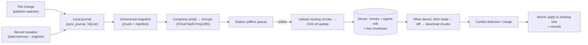
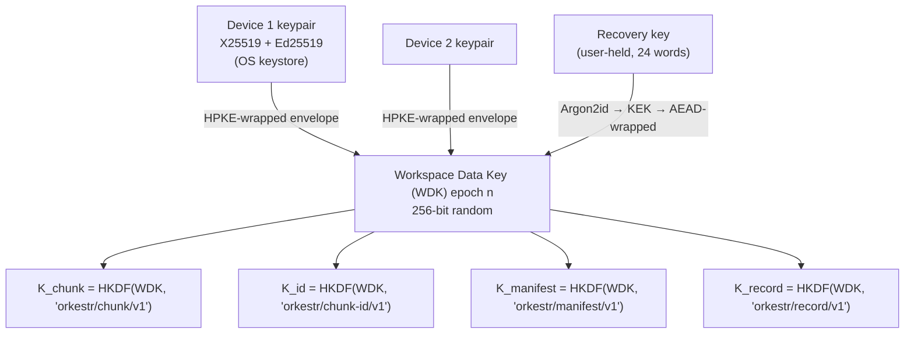
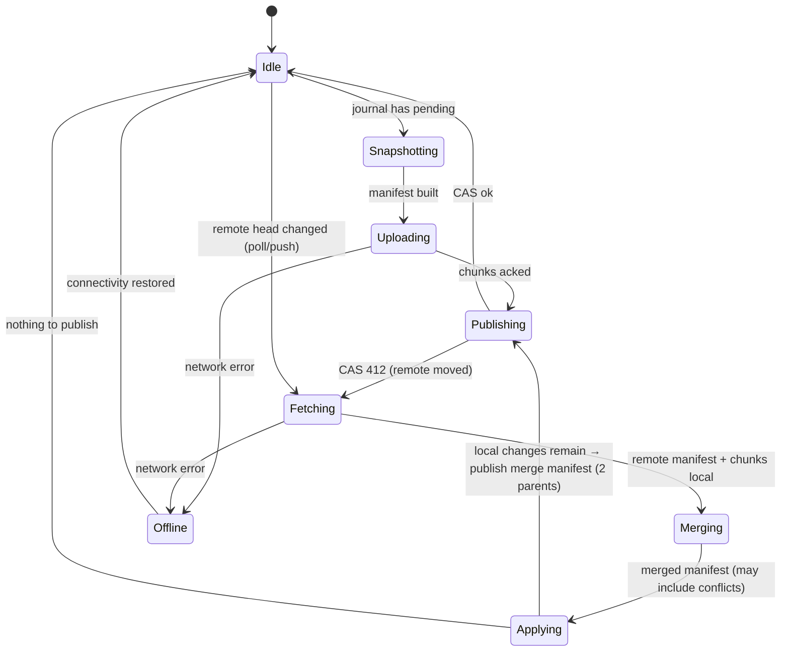
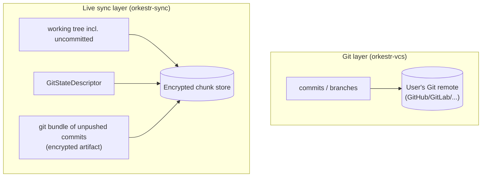
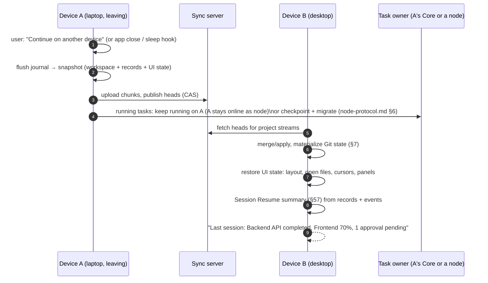

# Sync Protocol

Status: Phase 0 deliverable #12 (§65). Covers §40–45 (Cloud Workspace, Continuous Sync,
Offline-first, Seamless Continue, Storage Modes), §56 privacy policies, risks §62.3,
§62.4, §62.14, scenario §63 C (cross-device) and I (offline).

Crate: `orkestr-sync` (C§2: "SyncBackend trait + LocalOnly backend + journal (Phase 4
extends)"). Threat analysis: `docs/security/threat-model.md` TB10 (SR-70..76).

**Phase split**
- **P1**: journal, `SyncBackend` trait, `LocalOnlyBackend`, change capture, chunker +
  manifests used by `orkestr-snapshots` locally (same format → snapshots become syncable
  later without migration). No network.
- **P4**: encryption & key ring, `RemoteBackend` (managed cloud / self-hosted), version
  vectors across devices, conflict detection/resolution UI, offline queue, Seamless
  Continue.
- **P5**: mobile offline cache (metadata + on-demand file fetch, served by a Core over the
  remote E2E channel; mobile holds no workspace keys — see §4.1).
- **P6**: node job checkpoints reuse the chunk store (node-protocol.md).

## 1. Principles

1. **Git ≠ live sync.** Sync never commits, never pushes, never rewrites Git history
   (§40, §64 "auto-commit spam"). Git transport is the user's Git remote via `orkestr-vcs`.
2. **Local-first.** Every device holds a full working copy of what it uses; the server is a
   dumb, untrusted, encrypted blob + ref store.
3. **End-to-end encrypted.** Plaintext keys never leave devices; the server stores only
   ciphertext and wrapped keys.
4. **Content-addressed, incremental, resumable, compressed** (§41).
5. **No silent data loss.** Concurrent edits are detected; losing sides are always kept
   (conflict records), never overwritten silently (§60.8, §70 #1).
6. **Policy-respecting.** Per-project privacy policy (§56) can forbid remote sync or
   require self-hosted storage.

## 2. What syncs

| Stream kind | Contents | Model | Default |
|-------------|----------|-------|---------|
| `workspace:<projectId>` | Working tree of the main checkout incl. **uncommitted** files, Git state descriptor (§7) | file tree manifests + chunks | on |
| `worktree:<projectId>:<agentBranch>` | agent worktrees (§16) | same | off (on if Seamless Continue / node migration needs it) |
| `records:<projectId>` | tasks, task deps, agent instances (state summaries), memory items, decisions, environments (no secrets), UI state per project | record ops with version vectors | on |
| `records:global` | global memory, agent templates, themes/layouts (§29), provider *descriptors* (never keys) | record ops | on |
| `events:<projectId>` | event log / execution replay (§21) | append-only, union merge | on (bounded retention) |
| `snapshots:<projectId>` | `WorkspaceSnapshot` manifests (§25) | manifests referencing chunks | on |
| `artifacts:<projectId>` | build/test artifacts, screenshots, reports | chunks | opt-in per type |

Never synced: secrets (only `SecretReference`s; secret *values* are per device or via the
vault provider, §24), RPC tokens, device private keys, terminal history (opt-in), files
matching exclusion rules (§2.1).

### 2.1 Exclusion rules (evaluated in order)

1. Hard excludes: `.git/` internals (handled by §7), `<data_dir>`, OS junk (`Thumbs.db`,
   `.DS_Store`).
2. Secret patterns (default excluded, warn once): `.env`, `.env.*` (except `.env.example`),
   `*.pem`, `*.key`, `id_rsa*`, `*.p12`, `*.pfx`, `credentials*.json`, `.npmrc` with tokens.
3. `.orkestrignore` (gitignore syntax; may also re-include with `!`).
4. `.gitignore` (default on: build outputs like `node_modules/`, `target/` are not synced —
   they are rebuilt).
5. Size limit: files > 512 MiB excluded unless explicitly included.

## 3. Pipeline



### 3.1 Journal (P1)

All changes enter an append-only journal in `orkestr.db` (owned by `orkestr-sync`
migrations):

```sql
CREATE TABLE sync_journal (
  seq          INTEGER PRIMARY KEY AUTOINCREMENT,
  stream       TEXT NOT NULL,          -- e.g. 'workspace:<projectId>'
  entry_kind   TEXT NOT NULL,          -- 'file_upsert' | 'file_delete' | 'file_rename' | 'record_op' | 'event' | 'git_state'
  path_or_key  TEXT NOT NULL,          -- relative POSIX path or record key '<table>/<id>'
  content_hash BLOB,                   -- blake3 of plaintext (file) or op payload
  op           BLOB,                   -- CBOR-encoded record op (record_op only)
  hlc          TEXT NOT NULL,          -- hybrid logical clock (§5.2)
  device_id    TEXT NOT NULL,
  created_at   TEXT NOT NULL,
  state        TEXT NOT NULL DEFAULT 'pending'   -- pending | snapshotted | uploaded | acked
);
CREATE INDEX sync_journal_stream_state ON sync_journal(stream, state);

CREATE TABLE sync_outbox (            -- P4 offline queue (§8)
  id INTEGER PRIMARY KEY, stream TEXT NOT NULL, kind TEXT NOT NULL,   -- 'chunk' | 'manifest' | 'ref' | 'envelope'
  object_id BLOB NOT NULL, upload_session TEXT, attempts INTEGER NOT NULL DEFAULT 0,
  next_attempt_at TEXT, last_error TEXT
);
```

- File changes are debounced (500 ms quiet period per path, 5 s max) and verified by
  hashing (watchers lie; mtime-only changes are dropped).
- Journal is also the crash-recovery source for snapshots (§62.13): on start, `pending`
  entries are re-scanned.
- Compaction: entries `acked` (P4) or `snapshotted` (LocalOnly) older than the latest
  manifest are deleted.

### 3.2 Content-defined chunking

- Algorithm: **FastCDC** (gear hash, normalized chunking level 2), parameters
  min 16 KiB / avg 64 KiB / max 256 KiB. Files < 16 KiB are a single chunk.
- Plaintext hash: BLAKE3 (same as local object store, C§3) → used for local dedupe in
  `<data_dir>/objects/`.
- **Remote chunk id** (P4): `keyed_blake3(K_id, plaintext)` where `K_id` is derived from the
  workspace data key (§4) — prevents cross-tenant confirmation-of-file attacks (SR-73).
- Chunk payload on the wire/at rest: `zstd(level 3)` then AEAD; padded to a 4 KiB multiple
  before encryption (SR-70, R-06). Compression disabled for streams whose project
  classification is `Secret` (§56) to avoid compression length oracles.

### 3.3 Manifests

A manifest describes one stream state (a tree snapshot). Encoded as deterministic CBOR,
encrypted as a whole (paths are confidential).

```rust
// orkestr-sync::manifest
pub struct Manifest {
    pub format: u16,                         // 1
    pub stream: StreamId,
    pub parent: Vec<ManifestId>,             // 1 parent normally, 2 after a merge
    pub version: VersionVector,              // §5
    pub device_id: DeviceId,                 // author
    pub created_at: DateTime<Utc>,
    pub git: Option<GitStateDescriptor>,     // §7
    pub entries: Vec<TreeEntry>,             // sorted by path, POSIX separators, NFC normalized
}
pub struct TreeEntry {
    pub path: String,                        // relative, validated (no '..', no absolute)
    pub kind: EntryKind,                     // File | Symlink(target) | Dir (empty dirs only)
    pub mode: u32,                           // executable bit only is meaningful cross-platform
    pub size: u64,
    pub content: Blake3Hash,                 // plaintext hash of the whole file
    pub chunks: Vec<ChunkRef>,               // (chunk_id, plaintext_len)
}
pub struct SignedManifest { pub ciphertext: Vec<u8>, pub manifest_id: ManifestId, pub sig: Ed25519Signature }
// manifest_id = blake3(ciphertext); sig over (manifest_id ‖ stream ‖ version)
```

Large trees: manifests are split into a Merkle tree of pages (≤ 4096 entries per page) so
an incremental snapshot re-uploads only changed pages.

Cross-platform path rules (validated on ingest, reject + flag rather than mangle):
case-folding collisions (`A.txt` vs `a.txt` on Windows/macOS), Windows-reserved names
(`CON`, `aux.c`), trailing dots/spaces, `:` in names, path length > 260 without long-path
support. Such entries are kept in the manifest but materialized on incompatible OS as
"unmaterializable" with a UI warning.

## 4. Encryption and keys (P4)

### 4.1 Key hierarchy



- Sync participants are **Core instances** (desktops, headless `orkestrd`, nodes). Web and
  mobile clients do not hold WDKs: they read data through a Core over the E2E remote channel
  (remote-access.md). Mobile partial sync (P5) caches only what Core sends over that channel.
  Hence sync device keys (X25519/Ed25519, below) are separate from the P-256 remote-access
  device keys, although both are enrolled through the same device authorization flow.
- One **workspace** = one sync account scope (user's set of projects) by default; projects
  with classification `Secret` or policy `Self-Hosted Only` get their own WDK.
- **Key envelopes**: `HPKE(mode_base, DHKEM(X25519, HKDF-SHA256), HKDF-SHA256,
  ChaCha20Poly1305)` (RFC 9180) of `WDK‖epoch` to each authorized device's X25519 key.
  The server stores envelopes; only devices can open them. *Keys never leave devices in
  plaintext.*
- **Recovery key** (strongly prompted at sync setup): 256-bit, shown as BIP-39-style words,
  wraps WDK via Argon2id(m=256 MiB, t=3) → XChaCha20-Poly1305. Without any device and
  without recovery key, data is unrecoverable (threat model R-09).
- Device signing keys (Ed25519) are listed in a **signed key ring** (`KeyRing{epoch,
  devices:[{deviceId, x25519, ed25519, addedBy, sig}]}`); each addition is signed by an
  existing member (first device self-signs). Clients reject manifests/refs signed by keys
  not in the ring.

### 4.2 AEAD

- Chunks: XChaCha20-Poly1305, key `K_chunk`, random 192-bit nonce, AAD =
  `"orkestr-chunk-v1" ‖ workspaceId ‖ epoch ‖ chunk_id`.
- Manifests/records: same with `K_manifest`/`K_record` and the stream id in AAD.

### 4.3 Adding a device

Uses the device authorization flow of `docs/architecture/remote-access.md` §4.2 (SAS
confirmation). After approval, an existing device writes a new envelope for the new device
and appends it to the key ring.

### 4.4 Server view

Server sees: account id, stream ids (opaque random ids, not project names), ciphertext
sizes (padded), timestamps, device ids, ref versions. Server cannot read paths, contents,
record fields, or forge signed objects.

### 4.5 Revocation / rotation

`devices.revoke` → remaining device generates `WDK(epoch+1)`, writes envelopes for
remaining devices, updates key ring (signed, removing the revoked key). New chunks use the
new epoch; old chunks stay readable via old epoch keys (kept in envelopes to remaining
devices). Optional full re-encryption job (`sync.rotateKeys {reencrypt: true}`, local_only).

## 5. Versioning

### 5.1 Version vectors

```rust
pub struct VersionVector(pub BTreeMap<DeviceId, u64>);
pub enum Causality { Equal, Before, After, Concurrent }
impl VersionVector {
    pub fn bump(&mut self, me: &DeviceId);
    pub fn merge(&mut self, other: &VersionVector);          // pointwise max
    pub fn compare(&self, other: &VersionVector) -> Causality;
}
```

Each stream head has a version vector. A device bumps its own counter whenever it publishes
a new manifest/record batch for that stream. Counters are persisted locally *before*
upload (anti-rollback, SR-71): a device never accepts a remote head that is `Before` its
last-seen head for that stream.

### 5.2 Hybrid logical clocks

Record-level last-writer-wins ordering uses HLC `(wall_ms, logical, device_id)` — total
order, robust to small clock skew; skew > 5 min from server `Date` raises a warning.

### 5.3 Refs (server API)

```
GET  /v1/streams/{streamId}/head                → SignedRef
PUT  /v1/streams/{streamId}/head  If-Match: <etag> body SignedRef  → 200 | 412 (concurrent update)
```

```json
{"streamId":"s_7Qm…","manifestId":"b3:…","version":{"dev_A":12,"dev_B":7},
 "epoch":3,"device":"dev_A","ts":"2026-10-02T11:00:00Z","sig":"ed25519:…"}
```

Compare-and-swap on the head; 412 → fetch remote head, merge (§6), retry.

## 6. Conflict detection and resolution

### 6.1 File streams (three-way)

For each path, with `B` = common ancestor manifest (merge base found via manifest parents),
`L` = local, `R` = remote:

| Case | Resolution |
|------|-----------|
| `L == R` (content hash) | no conflict |
| only one side changed vs `B` | take the changed side (fast-forward) |
| both changed, text file, three-way merge (diff3) has no overlapping hunks | auto-merge if project setting `autoMergeText` (default **on**); a `ConflictRecord{auto:true}` is still written for audit/undo |
| both changed, overlapping hunks | **conflict**: working tree keeps `L`; `R` stored as conflict blob; file marked conflicted |
| binary both changed | conflict (keep both) |
| modify vs delete | modify wins; file resurrected; conflict record `deleteVsModify` |
| rename (detected by ≥ 50 % chunk overlap) vs modify | apply modify to renamed path |
| both create same path differently | conflict |
| case-only rename collision on case-insensitive FS | conflict `caseCollision` |

Conflicts never write `.orig`/`.conflict` files into the worktree by default (they would
pollute Git); they are stored in `sync_conflicts` and surfaced in the UI (three-way Monaco
diff). Resolution options: keep local, keep remote, manual merge, **AI-assisted merge**
(Merge Manager agent proposes a resolution, user approves — never auto-applied). A stream
with unresolved conflicts still syncs other paths.

```rust
pub struct ConflictRecord {
    pub id: ConflictId,
    pub stream: StreamId,
    pub path_or_key: String,
    pub kind: ConflictKind,     // ContentOverlap | Binary | DeleteVsModify | BothCreated | CaseCollision | RecordField | TaskOwnership
    pub base: Option<Blake3Hash>,
    pub local: Option<Blake3Hash>,
    pub remote: Option<Blake3Hash>,
    pub remote_device: DeviceId,
    pub auto_resolved: bool,
    pub resolution: Option<Resolution>,
    pub detected_at: DateTime<Utc>,
}
```

Event (append-only proposal): `SyncConflictDetected {conflictId, stream, path, kind}`;
`SyncCompleted {stream, manifestId, uploaded, downloaded, conflicts}` (existing kind).

### 6.2 Record streams

Records are synced as **ops**, not whole rows:

```rust
pub enum RecordOp {
    Upsert { table: String, id: String, fields: BTreeMap<String, FieldValue>, hlc: Hlc },  // per-field LWW
    Delete { table: String, id: String, hlc: Hlc },                                        // tombstone (kept 90 days)
    Append { table: String, id: String, item: serde_json::Value, hlc: Hlc },               // grow-only lists
    TaskTransition { task_id: TaskId, from: TaskStatus, to: TaskStatus, epoch: u64, hlc: Hlc },
}
```

Merge rules per table:

| Data | Rule |
|------|------|
| Task fields (title, description, priority, acceptance criteria) | per-field LWW by HLC; concurrent edits of the same text field → `RecordField` conflict kept for user |
| **Task status** | **not LWW.** Every task has an `owner` (DeviceId or NodeId) holding the execution lease (node-protocol.md). Only the owner applies transitions via `orkestr-task-engine` (C§5). Other devices send transition *requests* through RPC to the owner. A replicated `TaskTransition` whose `from` ≠ current status or whose `epoch` is stale is rejected and raises `TaskOwnership` conflict. |
| Memory items, decisions | LWW per field; deletes are tombstones; Decision log is append-only |
| Events / execution replay | grow-only set keyed by event UUIDv7; union |
| UI state (layouts/themes) | per-device by default (multi-monitor layouts §34 are device specific); "shared" layouts LWW |
| Usage records (cost) | grow-only union (dedupe by id) |

### 6.3 Merge state machine (per stream)



### 6.4 Applying to the working tree safely

- Writes go to a temp file in the same directory then atomic rename (`MoveFileEx` with
  replace on Windows via `orkestr-platform`).
- Before applying remote changes over files that changed locally since the last manifest
  (race with the editor/agent), re-hash; if changed, abort apply for that path and re-run
  merge (no lost update).
- Files open in Monaco with unsaved buffers: the editor is notified (`FileChanged` with
  `origin: "sync"`) and shows a reload/merge prompt; it never discards unsaved buffers.
- Agent worktrees currently used by a `Running` task on this device are never overwritten
  by sync; incoming changes are held as conflicts until the task stops.

## 7. Git vs live sync



Git internals (`.git/`) are never chunk-synced (concurrent `.git` mutation from two
devices corrupts repos). Instead each workspace manifest carries:

```rust
pub struct GitStateDescriptor {
    pub head: GitHead,                         // Branch{name, commit} | Detached{commit}
    pub upstream: Option<String>,              // e.g. "origin/main"
    pub unpushed_commits: Vec<GitOid>,         // commits not on any configured remote
    pub bundle: Option<ChunkRef>,              // `git bundle` containing unpushed commits (encrypted)
    pub index: IndexState,                     // Clean | Staged{ patch: ChunkRef }  (binary patch of staged changes vs HEAD)
    pub stash_count: u32,                      // informational; stashes are not synced
    pub worktrees: Vec<WorktreeDescriptor>,    // agent worktrees (branch, path relative to project)
}
```

Materializing on another device:
1. Ensure repo exists (clone from upstream if needed; user's own Git credentials).
2. `git fetch`; if `head.commit` missing and `bundle` present → `git fetch <bundle>`.
3. Checkout `head` **without** touching files that the manifest provides (working tree
   from manifest wins; `git` then reports the same uncommitted diff as on the source).
4. Apply staged patch to the index (`git apply --cached`).
5. Verify: `git status --porcelain` on target equals the descriptor's recorded status
   hash; mismatch → warning, nothing destructive.

Never: commits, pushes, force operations, branch deletion, `reset --hard` performed by sync.
If the target has local uncommitted changes in the same project, they are merged via §6
(not discarded).

## 8. Offline queue

- All outbound work lives in `sync_outbox` (persisted); survives restart and crash.
- Uploads are **resumable**: chunk uploads ≥ 8 MiB batches use upload sessions
  (`POST /v1/uploads` → `PUT /v1/uploads/{id}/parts/{n}` → `POST …/complete`); `HEAD
  /v1/chunks:batchHas` avoids re-uploading existing chunks.
- Retry: exponential backoff 2 s → 15 min, jitter; `rate_limited` honors `retryAfter`.
- Ordering: chunks before manifests before refs (refs only point to fully uploaded data).
- Offline-first features (§44) are unaffected by connectivity: editor, Git, terminal,
  Ollama, snapshots, journal all local.
- Storage pressure: outbox > 5 GiB or > 7 days old → `Notification` + Mission Control
  warning; never auto-drops data.

## 9. Seamless Continue (§43, scenario C)



- Running agents are **not** moved implicitly. If A goes offline with tasks running, they
  become `Interrupted` on A (C§5) and the user can resume them on B via node migration
  (P6) or by restarting from the last checkpoint/snapshot.
- UI-state record: `{projectId, openEditors:[{path, cursor, scroll}], activePanel,
  layoutPresetId, terminalSessions:[{title, cwd}] }` (terminal processes are not
  transferred; only their descriptors).

## 10. Storage modes (§45)

| Mode | `SyncBackend` impl | Server components | Notes |
|------|-------------------|-------------------|-------|
| Local Only | `LocalOnlyBackend` (exists since Phase 0) | none | journal + manifests + local object store only; `push/pull` return an empty `SyncReport` (target: `Ok(NoRemote)`); never touches network |
| Cloud | `RemoteBackend` (P4) | managed control plane (ref store + key envelopes in PostgreSQL) + object storage | E2E; same protocol as self-hosted |
| Self-Hosted | `RemoteBackend` (P4) | Control Plane + PostgreSQL + S3/MinIO + Gateway (§45) | object store via S3 API (any S3-compatible; "S3 заменяем", §67) |

Per-project privacy policy enforcement (SR-76): `No Remote Sync` ⇒ only LocalOnly;
`Self-Hosted Only` ⇒ only a backend whose `descriptor().mode == SelfHosted`. Checked at
enqueue and before each upload.

## 11. Rust interfaces

**As built (Phase 0, 2026-10-02):** `orkestr-sync` contains a minimal seam
that differs from the target below and from ADR-0019's sketch (see
`../architecture/storage-abstraction.md` S5):

```rust
pub trait SyncBackend: Send + Sync {
    fn name(&self) -> &'static str;                                   // "local-only" | "self-hosted" | "cloud"
    fn is_remote(&self) -> bool;
    async fn push(&self, entries: &[JournalEntry]) -> Result<SyncReport, SyncError>;
    async fn pull(&self, project: ProjectId) -> Result<SyncReport, SyncError>;
}
pub struct JournalEntry { pub seq: u64, pub project_id: ProjectId, pub path: String, pub object_id: Option<String>, pub ts: Timestamp }
pub struct SyncReport { pub pushed: u64, pub pulled: u64, pub bytes: u64, pub conflicts: u32 }
pub enum SyncError { NotAllowed, Backend(String) }
pub struct LocalOnlyBackend;   // name "local-only", never transfers, push/pull return an empty report
```

There is no journal table, chunker, manifest format or `SyncEngine` yet, and
`sync.status` is not routed. The `SyncCompleted` event exists with payload
`{backend, items, bytes, conflicts}`. The target interface (P1 definitions,
P4 remote implementation):

```rust
// orkestr-sync (P1 defines; P4 implements RemoteBackend)
#[async_trait::async_trait]
pub trait SyncBackend: Send + Sync {
    fn descriptor(&self) -> BackendDescriptor;               // { id, mode: LocalOnly|Cloud|SelfHosted, supports_e2e }
    async fn has_chunks(&self, ids: &[ChunkId]) -> Result<Vec<bool>, SyncError>;
    async fn put_chunk(&self, id: &ChunkId, sealed: Bytes) -> Result<(), SyncError>;
    async fn get_chunk(&self, id: &ChunkId) -> Result<Bytes, SyncError>;
    async fn put_manifest(&self, m: &SignedManifest) -> Result<(), SyncError>;
    async fn get_manifest(&self, id: &ManifestId) -> Result<SignedManifest, SyncError>;
    async fn get_head(&self, stream: &StreamId) -> Result<Option<(SignedRef, ETag)>, SyncError>;
    async fn cas_head(&self, stream: &StreamId, expected: Option<&ETag>, new: &SignedRef)
        -> Result<CasOutcome, SyncError>;                    // Updated(ETag) | Conflict(current SignedRef)
    async fn list_envelopes(&self, device: &DeviceId) -> Result<Vec<KeyEnvelope>, SyncError>;
    async fn put_envelope(&self, e: &KeyEnvelope) -> Result<(), SyncError>;
    async fn get_key_ring(&self) -> Result<Option<SignedKeyRing>, SyncError>;
    async fn cas_key_ring(&self, expected: Option<&ETag>, ring: &SignedKeyRing) -> Result<CasOutcome, SyncError>;
}

#[derive(Debug, thiserror::Error)]
pub enum SyncError {
    #[error("network: {0}")] Network(String),
    #[error("rate limited, retry after {retry_after_ms} ms")] RateLimited { retry_after_ms: u64 },
    #[error("not found")] NotFound,
    #[error("integrity check failed: {0}")] Integrity(String),     // bad AEAD tag / signature / rollback
    #[error("forbidden by privacy policy: {0}")] PolicyDenied(String),
    #[error("quota exceeded")] Quota,
    #[error("backend does not support this operation: {0}")] Unsupported(String),
    #[error("storage: {0}")] Storage(String),
}

/// High-level engine used by core/RPC (`sync.status`, `sync.now`, `sync.resolveConflict`, …)
#[async_trait::async_trait]
pub trait SyncEngine: Send + Sync {
    async fn record_file_change(&self, project: &ProjectId, path: &RelPath) -> Result<(), SyncError>;
    async fn record_op(&self, stream: &StreamId, op: RecordOp) -> Result<(), SyncError>;
    async fn snapshot(&self, stream: &StreamId) -> Result<ManifestId, SyncError>;   // also used by orkestr-snapshots
    async fn sync_now(&self, stream: &StreamId) -> Result<SyncReport, SyncError>;
    async fn status(&self, project: &ProjectId) -> Result<SyncStatus, SyncError>;
    async fn resolve_conflict(&self, id: &ConflictId, r: Resolution) -> Result<(), SyncError>;
}
```

RPC methods (area `sync`, P4 unless noted): `sync.status` (P1, returns LocalOnly),
`sync.now`, `sync.listConflicts`, `sync.resolveConflict`, `sync.configure` (local_only),
`sync.rotateKeys` (local_only), `sync.continueOn` (Seamless Continue trigger).

## 12. Testing requirements (§60.9)

- Property tests: version vector laws (merge commutative/associative/idempotent; compare
  consistent); FastCDC boundary stability under insertions (shift resistance).
- Three-way merge matrix: every row of §6.1 table; record merge rules of §6.2.
- Crash tests: kill during apply → working tree is either old or new per file, journal
  replays; kill during upload → resume without duplicate refs.
- Security tests: tampered chunk/manifest → `Integrity`; head rollback → rejected; manifest
  signed by key not in ring → rejected; policy `No Remote Sync` → `PolicyDenied`.
- Git interplay: uncommitted + staged + unpushed commits round-trip between two temp repos;
  sync never creates commits (assert `git rev-list --count` unchanged).

## 13. Open issues / contract notes

- C§2 places snapshots in `orkestr-snapshots`; this doc proposes it reuse the
  `orkestr-sync` chunker/manifest format. Dependency direction: `snapshots → sync` (both
  engines; no cycle) — integrator to confirm.
- Event kind `SyncConflictDetected` is a proposed append-only addition.
- `DeviceId` is needed in `orkestr-domain` from P1 (journal rows carry it) even though
  devices are a P4 concept; LocalOnly uses a stable per-install device id.
